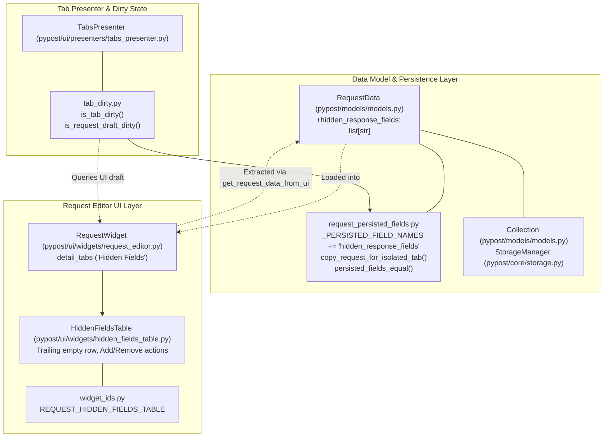
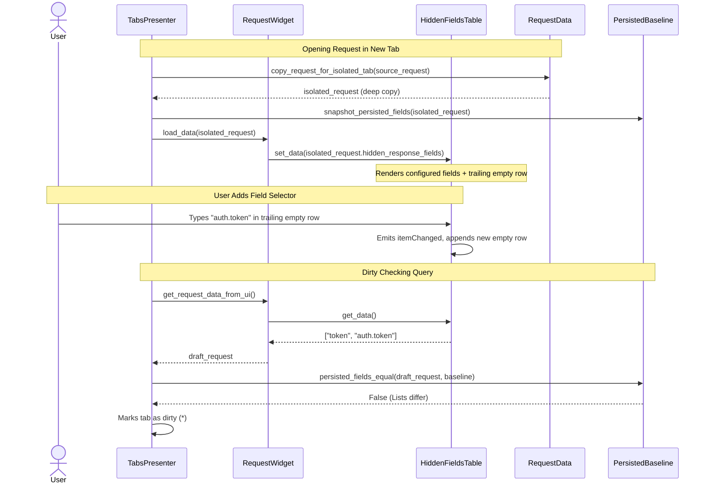
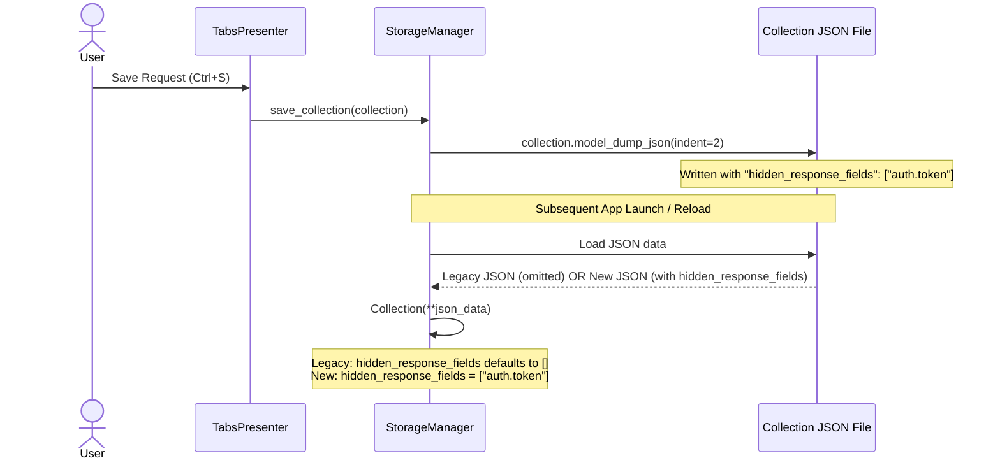

# PYPOST-1377: [PYPOST-1312] Request model, persistence, and RequestEditor UI for hidden response fields

Step 2 artifact for PYPOST-1377. Translates approved requirements from
[`10-requirements.md`](10-requirements.md) and decomposition guidelines from
[`../PYPOST-1312/decomposition-notes.md`](../PYPOST-1312/decomposition-notes.md)
and [`../PYPOST-1376/20-architecture.md`](../PYPOST-1376/20-architecture.md) into
a concrete architectural specification and implementation plan for the foundational
model, persistence, tab copy isolation, and RequestEditor configuration UI for hidden response fields.

---

## Research

### 1. `RequestData` Model Schema & Validation (`pypost/models/models.py`)

- **Current State**:
  - `RequestData` is a Pydantic `BaseModel` representing the in-memory request draft used across the editor, tab presenter, and collection storage.
  - Currently contains fields: `id`, `name`, `method`, `headers` (`Dict[str, str]`), `params` (`Dict[str, str]`), `body`, `body_type`, `yaml_as_json`, `post_script`, `expose_as_mcp`, `mcp_description`, `mcp_params` (`Dict[str, McpToolParam]`), and `retry_policy` (`Optional[RetryPolicy]`).
  - Architectural rule (`doc/dev/request_data_copy_policy.md`): `RequestData` must remain lean. It holds editor fields and metadata only; HTTP response bodies, history entries, and large runtime buffers live strictly in `ResponseView` and `HistoryManager`.
- **Field Definition for Hidden Response Fields**:
  - `hidden_response_fields: list[str] = Field(default_factory=list)`
  - Using `Field(default_factory=list)` guarantees that any deserialized payload or newly created instance omitting this field defaults safely to `[]`.
  - Pydantic validates that all items are strings; duplicate selectors can be preserved in user-configured order or normalized as unique entries.
  - Keeps memory footprint negligible (~80 bytes for typical lists of 1–10 selectors).

### 2. Tab Copy Isolation & Dirty Checking (`pypost/core/request_persisted_fields.py`)

- **Tab Isolation Policy**:
  - `copy_request_for_isolated_tab(data: RequestData) -> RequestData` performs `data.model_copy(deep=True)`.
  - Deep copy semantics ensure mutable nested structures (like `headers`, `params`, `mcp_params`, and now `hidden_response_fields`) are cloned into independent list instances. Mutations in an isolated tab draft (such as appending a field selector) do not bleed into the source request.
- **Persisted Field Registry**:
  - `_PERSISTED_FIELD_NAMES` is a tuple listing all canonical fields that participate in tab baseline snapshots, dirty comparison, and draft reset checks.
  - Currently includes: `"name"`, `"url"`, `"method"`, `"headers"`, `"params"`, `"body"`, `"body_type"`, `"yaml_as_json"`, `"post_script"`, `"expose_as_mcp"`, `"mcp_description"`, `"mcp_params"`, `"retry_policy"`.
  - By adding `"hidden_response_fields"` to `_PERSISTED_FIELD_NAMES`:
    1. `persisted_fields_equal(a, b)` automatically compares `a.hidden_response_fields == b.hidden_response_fields`.
    2. `request_draft_fields_equal(a, b)` automatically compares drafts against `factory_request_draft()`.
    3. `is_tab_dirty(tab)` in `pypost/ui/presenters/tab_dirty.py` immediately flags unsaved changes whenever a user modifies hidden field selectors relative to the tab's `persisted_baseline`.
    4. Sibling tab conflict detection (`_offer_stale_tab_resolution` in `tabs_presenter.py`) correctly identifies when another tab saved a modified hidden fields list.

### 3. Collection Persistence & Backward Compatibility (`pypost/core/storage.py`)

- **Saving**:
  - `StorageManager.save_collection(collection: Collection)` calls `collection.model_dump_json(indent=2)`.
  - Pydantic serializes `hidden_response_fields` for each request in `collection.requests` into JSON array format: `"hidden_response_fields": ["token", "client_secret"]`.
- **Loading & Backward Compatibility**:
  - `StorageManager.load_collections()` reads `.json` files and parses them via `Collection(**data)`.
  - Because `Collection` contains `requests: List[RequestData]`, Pydantic instantiates each request using `RequestData(**req_dict)`.
  - **Legacy Compatibility Guarantee**: In collections created prior to this feature, `"hidden_response_fields"` is absent. Because `hidden_response_fields` has `default_factory=list`, Pydantic populates it with an empty list `[]` without raising validation errors. No schema migration scripts, fallback translation, or disk overwrites are required.

### 4. RequestEditor UI Layout & Table Design (`pypost/ui/widgets/request_editor.py`)

- **Current Tab Structure**:
  - `RequestWidget` hosts `self.detail_tabs` (`QTabWidget` with id `REQUEST_DETAIL_TABS`).
  - Current tabs:
    1. `"Params"` (`self.params_table: KeyValueTable`)
    2. `"Headers"` (`self.headers_table: KeyValueTable`)
    3. `"Body"` (`self.body_tab: QWidget` containing format combo and `CodeEditor`)
    4. `"Script"` (`self.script_edit: QPlainTextEdit`)
    5. `"MCP"` (`mcp_tab: QWidget` containing description, `McpParamsTable`, and preview)
- **Table Interaction Patterns in PyPost**:
  - PyPost employs the "empty trailing row" pattern across tables (`EmptyRowKeyValueTable` for query/headers, `McpParamsTable` for MCP params, and `McpServerHeadersTable`).
  - When the user edits the last empty row, the table automatically appends a new empty row.
  - Rows can be edited inline by double-clicking or typing directly.
  - For list manipulation, providing clear actions (e.g. "Add" button, "Remove" button, or context menu "Delete Row") ensures intuitive deletion and keyboard accessibility.
- **Hidden Fields UI Section**:
  - A dedicated tab in `detail_tabs` titled `"Hidden Fields"` provides high visibility and ample horizontal/vertical space.
  - Contains:
    1. Informational header label explaining selector syntax: `"Response fields or dot-notation paths to hide (e.g. token, password, user.secret)"`.
    2. An interactive `HiddenFieldsTable` widget (subclassing `QTableWidget`) displaying configured selector paths in a structured list with an auto-expanding empty row.
    3. Toolbar buttons: "Add Selector" (focuses or appends empty row) and "Remove Selector" (deletes selected row).
    4. Data synchronization methods: `set_data(selectors: list[str])` and `get_data() -> list[str]`.
    5. `itemChanged` signal wired to trigger editor dirty notifications and update the in-memory request draft.

---

## Implementation Plan

### High-Level Approach

The implementation will follow a strict test-driven development (TDD) cycle in Python:
1. **Step 3 (Failing Repro)**: Implement comprehensive red tests in `tests/test_request_hidden_fields_model_and_ui.py` covering model schema, backward-compatible persistence, tab copy isolation, dirty checking, and RequestEditor UI data binding. Verify that all fail cleanly with expected missing attributes.
2. **Step 4 (Development)**:
   - Extend `RequestData` in `pypost/models/models.py`.
   - Update `_PERSISTED_FIELD_NAMES` in `pypost/core/request_persisted_fields.py`.
   - Implement `HiddenFieldsTable` in `pypost/ui/widgets/hidden_fields_table.py` (or within `request_editor.py`).
   - Register widget identity `REQUEST_HIDDEN_FIELDS_TABLE` in `pypost/ui/widget_ids.py`.
   - Embed `"Hidden Fields"` tab into `RequestWidget` in `pypost/ui/widgets/request_editor.py`, wiring `load_data()`, `update_request_data()`, and `get_request_data_from_ui()`.
   - Run tests until green and verify zero regressions.

---

### Mandatory — Failing Repro (next Step 3)

The failing repro test suite will be written in **Step 3** prior to production code changes.

- **Test File Path**: `tests/test_request_hidden_fields_model_and_ui.py`
- **Pytest Configuration**: Module-level `pytestmark = pytest.mark.timeout(60)` per `lsr-python` standard; uses `@pytest.mark.usefixtures("qapp")` for Qt UI assertions.
- **Test Scenarios Asserted**:
  1. **Schema Validation & Default Factory**:
     - `test_request_data_default_hidden_fields`: Instantiating `RequestData()` without parameters yields `hidden_response_fields == []`.
     - `test_request_data_explicit_hidden_fields`: Instantiating with `hidden_response_fields=["token", "secret"]` sets and preserves the list.
     - `test_request_data_rejects_non_string_elements`: Passing invalid types (e.g., integers or dicts) raises `ValidationError`.
  2. **Persistence Serialization & Backward Compatibility**:
     - `test_collection_serialization_round_trip`: Saving a `Collection` containing requests with `hidden_response_fields` to JSON and reloading via `Collection(**json.loads(...))` preserves the exact list of selectors.
     - `test_legacy_collection_backward_compatibility`: Loading a legacy collection JSON fixture where `"hidden_response_fields"` is absent succeeds without error and assigns `hidden_response_fields = []` to all loaded requests.
  3. **Tab Copy Isolation**:
     - `test_tab_copy_isolation_deep_copies_hidden_fields`: Calling `copy_request_for_isolated_tab(original)` returns a request whose `hidden_response_fields` is equal in value but a distinct list reference (`copy.hidden_response_fields is not original.hidden_response_fields`).
     - Mutating `copy.hidden_response_fields.append("new_field")` does not alter `original.hidden_response_fields`.
  4. **Persisted Dirty State Checking**:
     - `test_persisted_fields_equal_detects_hidden_fields_diff`: Two requests differing only in `hidden_response_fields` return `persisted_fields_equal(a, b) == False`.
     - When `hidden_response_fields` match, returns `True`.
     - `test_request_draft_dirty_checking`: Modifying `hidden_response_fields` on a factory draft causes `request_draft_fields_equal(modified, factory_request_draft())` to return `False`.
  5. **RequestEditor UI Table & Data Synchronization**:
     - `test_request_editor_has_hidden_fields_tab`: `RequestWidget` contains a tab titled `"Hidden Fields"` hosting `HiddenFieldsTable` with widget ID `REQUEST_HIDDEN_FIELDS_TABLE`.
     - `test_request_editor_loads_hidden_fields`: Calling `widget.load_data()` with a request containing `["token", "apiKey"]` populates the table rows accordingly.
     - `test_request_editor_get_request_data_extracts_table`: Editing items or adding rows in `HiddenFieldsTable` is reflected when calling `widget.get_request_data_from_ui()` and `widget.update_request_data()`.
     - `test_request_editor_clearing_or_empty_reset`: Resetting or initializing with empty data displays an empty table (with one trailing input row).
- **Failure Forcing & Clean Failure**:
  - In Step 3, running `make test` against these tests will fail immediately because `RequestData` does not have `hidden_response_fields`, `_PERSISTED_FIELD_NAMES` does not include it, and `RequestWidget` has no `hidden_fields_table`.
  - Zero live external dependencies or network calls required.

---

## Architecture

### 1. System Module Breakdown



### 2. Component Responsibilities

| Module | Responsibility | Changes in PYPOST-1377 |
| :--- | :--- | :--- |
| `pypost/models/models.py` | Core data models for requests, collections, and environments. | Add `hidden_response_fields: list[str] = Field(default_factory=list)` to `RequestData`. |
| `pypost/core/request_persisted_fields.py` | Tab isolation deep copying and persisted field equality comparison. | Add `"hidden_response_fields"` to `_PERSISTED_FIELD_NAMES`. Deep copy and equality logic automatically cover the new field. |
| `pypost/core/storage.py` | File system JSON serialization/deserialization for collections. | Validate that serialization includes `hidden_response_fields` and legacy deserialization defaults safely to `[]`. |
| `pypost/ui/widget_ids.py` | Automation and test widget identities. | Register `REQUEST_HIDDEN_FIELDS_TABLE = "pypost_request_hidden_fields_table"`. |
| `pypost/ui/widgets/hidden_fields_table.py` | UI table component for viewing and editing list of string selectors. | New table widget: auto-expanding empty trailing row, inline editing, remove button/action, `set_data()` / `get_data()` API. |
| `pypost/ui/widgets/request_editor.py` | Request editor widget containing method, URL, and detail tabs. | Add `"Hidden Fields"` tab to `self.detail_tabs`, wire `HiddenFieldsTable` to `load_data()`, `update_request_data()`, and `get_request_data_from_ui()`. |

---

### 3. Interaction Sequence Diagrams

#### Tab Isolation and UI Data Flow



#### Collection Save & Load Lifecycle



---

### 4. Data Contracts and Interfaces

#### `RequestData` Extension (`pypost/models/models.py`)

```python
class RequestData(BaseModel):
    id: str = Field(default_factory=lambda: str(uuid.uuid4()))
    name: str = "New Request"
    method: str = "GET"
    url: str = ""
    headers: Dict[str, str] = Field(default_factory=dict)
    params: Dict[str, str] = Field(default_factory=dict)
    body: str = ""
    body_type: str = "json"
    yaml_as_json: bool = False
    post_script: str = ""
    expose_as_mcp: bool = False
    mcp_description: str = ""
    mcp_params: Dict[str, McpToolParam] = Field(default_factory=dict)
    retry_policy: Optional[RetryPolicy] = None
    hidden_response_fields: list[str] = Field(default_factory=list)  # New field
```

#### `_PERSISTED_FIELD_NAMES` Extension (`pypost/core/request_persisted_fields.py`)

```python
_PERSISTED_FIELD_NAMES = (
    "name",
    "url",
    "method",
    "headers",
    "params",
    "body",
    "body_type",
    "yaml_as_json",
    "post_script",
    "expose_as_mcp",
    "mcp_description",
    "mcp_params",
    "retry_policy",
    "hidden_response_fields",  # Added to canonical persisted fields
)
```

#### `HiddenFieldsTable` Interface (`pypost/ui/widgets/hidden_fields_table.py`)

```python
class HiddenFieldsTable(QTableWidget):
    """Single-column table for managing hidden response field selectors.
    
    Features:
    - Auto-expanding trailing empty row for quick entry.
    - Context menu and toolbar actions for deleting rows.
    - Preserves selector ordering and filters out empty whitespace rows.
    """

    def __init__(self, parent: QWidget | None = None) -> None: ...
    def set_data(self, selectors: list[str]) -> None: ...
    def get_data(self) -> list[str]: ...
    def add_row(self, selector: str = "") -> None: ...
    def remove_selected_rows(self) -> None: ...
```

---

## Q&A

### Q1: Why use a dedicated tab in `detail_tabs` rather than placing hidden fields in Body or Headers?
- **A**: `RequestWidget.detail_tabs` organizes request properties by logical domain: `Params` (URL query), `Headers` (HTTP headers), `Body` (payload), `Script` (post-execution script), and `MCP` (agent tool contract). Hidden fields govern *response confidentiality* across body keys and headers. Placing it in its own `"Hidden Fields"` tab gives it prominent visibility, prevents cluttering the JSON body editor, and allows room for helpful syntax instructions, search filters, and selector validation.

### Q2: Why use `list[str]` instead of `set[str]` in `RequestData`?
- **A**: `list[str]` guarantees deterministic, user-controlled ordering when displayed in the GUI table and saved to JSON. JSON arrays map directly to Python lists, avoiding arbitrary re-ordering diffs in version control when collections are committed.

### Q3: How does the auto-expanding trailing row work for single-column string tables?
- **A**: The table initializes with `len(selectors) + 1` rows. Rows `0` to `N-1` display existing selectors; row `N` is an empty string `""`. When the user enters text into the last row, the `itemChanged` event appends a new empty row at `rowCount()`. When reading via `get_data()`, any row whose trimmed text is empty is skipped.

### Q4: How is deletion handled in `HiddenFieldsTable`?
- **A**: Multiple convenient mechanisms:
  1. The user can select a row and click the "Remove" button or press the Delete key.
  2. The user can right-click any populated row and choose "Remove Selector" from the context menu.
  3. Clearing the text of a cell causes `get_data()` to omit it, effectively deleting it upon save or draft extraction.

### Q5: How is 100% backward compatibility guaranteed for older collection files?
- **A**: Pydantic's `Field(default_factory=list)` automatically initializes `hidden_response_fields` to `[]` whenever the key is absent in the input dictionary during deserialization. Existing collection files load seamlessly with zero schema errors and zero migration overhead.

### Q6: Does modifying hidden fields trigger tab dirty state?
- **A**: Yes. By adding `"hidden_response_fields"` to `_PERSISTED_FIELD_NAMES`, `persisted_fields_equal(ui_data, baseline)` compares the draft list against the saved baseline. If an entry is added, modified, reordered, or removed, `is_tab_dirty(tab)` evaluates to `True`, triggering the tab's dirty indicator.
