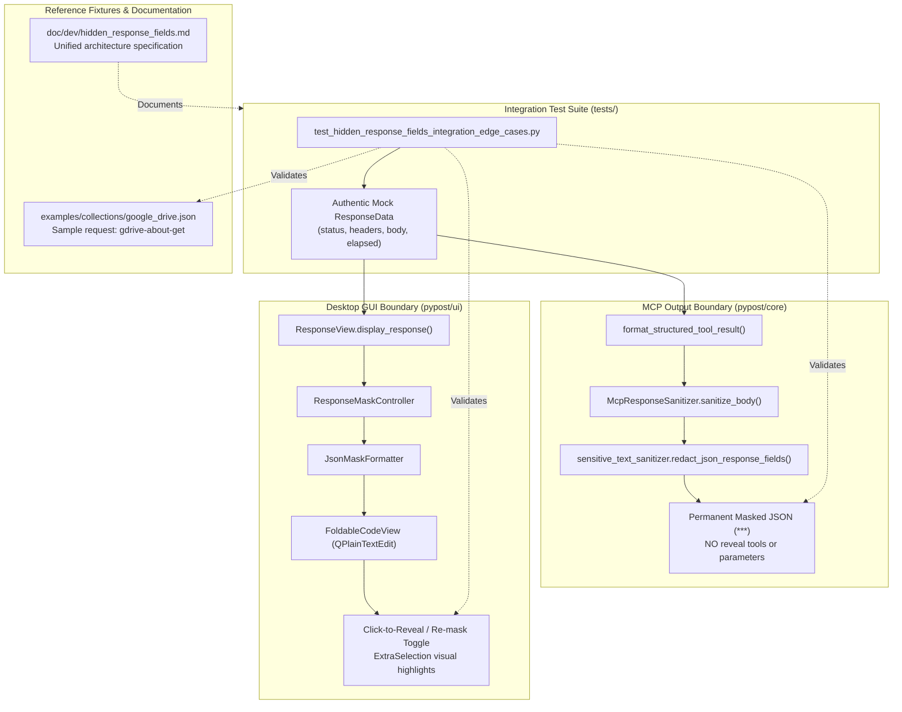

# PYPOST-1380: [PYPOST-1312] Integration test suite, edge-case coverage, and developer documentation

Step 2 artifact for PYPOST-1380 (MASK-4). Translates approved requirements from
[`10-requirements.md`](file:///home/src/ai-tasks/PYPOST-1380/10-requirements.md), parent epic architecture from
[`../PYPOST-1376/20-architecture.md`](file:///home/src/ai-tasks/PYPOST-1376/20-architecture.md), and child task designs
from [`../PYPOST-1377/20-architecture.md`](file:///home/src/ai-tasks/PYPOST-1377/20-architecture.md) (MASK-1 model & editor),
[`../PYPOST-1378/20-architecture.md`](file:///home/src/ai-tasks/PYPOST-1378/20-architecture.md) (MASK-2 MCP security boundary),
and [`../PYPOST-1379/20-architecture.md`](file:///home/src/ai-tasks/PYPOST-1379/20-architecture.md) (MASK-3 GUI click-to-reveal)
into a comprehensive end-to-end integration architecture, edge-case verification matrix, reference collection specification,
and developer documentation plan.

---

## Research

### 1. Codebase Integration Points and Subsystem Contracts

Child tasks MASK-1 through MASK-3 established the core components of the response field hiding capability:
1. **Model, Persistence & Tab Copy Isolation (MASK-1 / PYPOST-1377)**:
   - `RequestData.hidden_response_fields: list[str]` defined in [`pypost/models/models.py`](file:///home/src/pypost/models/models.py).
   - Deep copy semantics in `copy_request_for_isolated_tab(data)` in [`pypost/core/request_persisted_fields.py`](file:///home/src/pypost/core/request_persisted_fields.py) ensure lists are copied by value (`list(data.hidden_response_fields)`).
   - Dirty tracking in `persisted_fields_equal(a, b)` and `request_draft_fields_equal(a, b)` in `request_persisted_fields.py` guarantees tab dirty indicators fire on additions, deletions, and modifications.
   - Backward-compatible serialization via `StorageManager.save_collection` and `read_collection_file`.
2. **Permanent MCP Output Sanitization & Security Boundary (MASK-2 / PYPOST-1378)**:
   - `format_structured_tool_result(result, hidden_response_fields=...)` in [`pypost/core/mcp_server_impl.py`](file:///home/src/pypost/core/mcp_server_impl.py) passes request selectors into `McpResponseSanitizer.sanitize_body`.
   - `redact_json_response_fields(body, fields)` in [`pypost/core/sensitive_text_sanitizer.py`](file:///home/src/pypost/core/sensitive_text_sanitizer.py) recursively redacts matching keys with `***`.
   - Irreversible security boundary: zero reveal parameters or auxiliary tools are registered in MCP tool schemas.
3. **Interactive Click-to-Reveal GUI ResponseView (MASK-3 / PYPOST-1379)**:
   - `ResponseView.display_response(response, hidden_fields=...)` in [`pypost/ui/widgets/response_view.py`](file:///home/src/pypost/ui/widgets/response_view.py).
   - `ResponseMaskController` in [`pypost/ui/widgets/response_mask_controller.py`](file:///home/src/pypost/ui/widgets/response_mask_controller.py) tracks character spans (`MaskedTokenSpan`), installs viewport mouse filters, and handles in-place click toggles (`***` <-> unmasked literal).
   - Coexistence with `JsonHighlighter`, search bar navigation/match counter, and code folding (`FoldController`).

### 2. Integration Gap Analysis: Why Unit Tests Alone Are Insufficient

Unit tests verify each subsystem in isolation (`test_request_hidden_fields_model_and_ui.py`, `test_mcp_hidden_response_fields_masking.py`, `test_gui_response_view_click_to_reveal.py`). However, critical cross-cutting risks remain:
1. **Cross-Surface Discrepancy Risk**: A request executed in PyPost could be consumed sequentially or concurrently by both the desktop GUI (for human operator review) and the MCP server (for automated AI coding agents). If either surface mutates `result.response` in place, the second surface receives corrupted or pre-masked data.
2. **Selector Semantics Parity**: The AST parsing logic in `sensitive_text_sanitizer.py` (used by MCP) and `JsonMaskFormatter` in `response_mask_controller.py` (used by GUI) must exhibit 100% identical matching behavior across all edge cases (deep nesting, array wildcards, non-string primitives, duplicate keys across branches).
3. **Draft Independence Across Tabs**: Modifying or executing a request with hidden response fields in Tab A must never leak state, dirty markers, or baseline snapshots into Tab B.
4. **Resilience to Non-Standard Payloads**: Real APIs return HTML 500 error pages, empty HTTP 204 bodies, plain text stack traces, or malformed JSON. The system must never crash, throw unhandled exceptions, or fail open.

### 3. Existing Example Collections and Fixture Analysis

Inspection of `examples/collections/` revealed:
- `jira_mcp.json` (23 requests, locked by critical REST catalog and tests in `test_example_fixtures.py` and `test_examples_modernization.py`).
- `gitlab_mcp.json` (25 requests, locked by catalog in `test_gitlab_mcp_collection.py`).
- `github_mcp.json` (30 requests, locked by catalog in `test_github_mcp_collection.py`).
- `mcp.json` (3 requests, strictly asserted with `assert len(collections[0].requests) == 3` in `test_example_fixtures.py` and `test_examples_modernization.py`).
- `google_drive.json` (Google Drive v3 collection, 9 requests, tested in `test_google_drive_collection_example.py` and `test_reference_collection_variable_guidance_contract.py`).
  - `test_google_drive_collection_example.py` tests core endpoints via `expected_ids <= set(req_map.keys())` rather than rigid length checks.
  - Adding a dedicated sample request `gdrive-about-get` ("Get Current User & Storage Quota", `GET {{ google_drive_base_url }}/about?fields=user,storageQuota`) with `hidden_response_fields: ["emailAddress", "permissionId", "user.emailAddress"]` demonstrates response masking for sensitive account PII and permissions in a realistic API workflow without breaking any existing catalog tests.

### 4. Developer Documentation Analysis

Inspection of `doc/dev/` showed:
- `doc/dev/hidden_response_fields.md` currently contains the initial decomposition notes from PYPOST-1376.
- To serve as authoritative developer documentation, it must be consolidated and expanded into the comprehensive technical reference for response field masking, detailing the end-to-end architecture, selector syntax rules, security boundaries, copy policies, edge-case behaviors, and testing instructions.

---

## Implementation Plan

### High-Level Approach

The implementation will follow a test-driven development (TDD) workflow in Python:
1. **Step 3 (Failing Repro)**:
   - Create automated red test suite `tests/test_hidden_response_fields_integration_edge_cases.py` asserting all 7 required integration scenarios.
   - Force clean red failures on edge cases or assertions prior to implementation adjustments.
2. **Step 4 (Development)**:
   - Update `examples/collections/google_drive.json` to include the dedicated sample request `gdrive-about-get` demonstrating `hidden_response_fields`.
   - Ensure selector matching and traversal in `pypost/core/sensitive_text_sanitizer.py` and `pypost/ui/widgets/response_mask_controller.py` pass 100% of the edge-case matrix identically.
   - Consolidate and expand `doc/dev/hidden_response_fields.md` into the authoritative technical documentation.
   - Run tests until green and verify zero regressions via `make lint`, `make typecheck`, `make test`, and `make verify-ai-tasks`.

---

### Mandatory — Failing Repro (next Step 3)

The automated red test suite will be created in **Step 3** in `tests/test_hidden_response_fields_integration_edge_cases.py`.

- **Test File Path**: `tests/test_hidden_response_fields_integration_edge_cases.py`
- **Pytest Configuration**: Module-level `pytestmark = pytest.mark.timeout(60)` per `lsr-python` standard; uses `@pytest.mark.usefixtures("qapp")` for Qt GUI event processing.
- **Dependency Isolation**: Uses mock execution results and local `ResponseData` structures; zero network connectivity or live external services required.

#### Required Automated Red Test Scenarios:

1. **Cross-Cutting End-to-End Contract (`test_cross_cutting_mcp_and_gui_on_same_request`)**:
   - Executes a request configured with `hidden_response_fields=["token", "client_secret", "user.id"]`.
   - Serializes output through MCP `format_structured_tool_result`:
     - Asserts `token`, `client_secret`, and `user.id` values are permanently redacted with `"***"`.
     - Asserts unmasked fields (`username`, `status`) remain in clear text.
     - Asserts MCP output schema exposes no unmask/reveal parameter.
   - Passes the exact same `ExecutionResult.response` to GUI `ResponseView.display_response`:
     - Asserts rendered text shows `"***"` for masked fields by default.
     - Asserts `mask_controller.spans()` contains initialized spans.
     - Simulates left-click on a masked token: asserts in-place reveal to raw secret.
     - Simulates second left-click: asserts re-mask back to `"***"`.
   - Asserts the underlying `response.body` string remains identical and completely unmutated across both consumers.

2. **Deep Nesting (>5 levels) and Array Wildcard Matrix (`test_deep_nesting_and_array_wildcards`)**:
   - Deep nesting: `level1.level2.level3.level4.level5.deep_token` is masked with `"***"`, while sibling `level1.level2.level3.level4.level5.public_field` and parallel branch `level1.level2.other.deep_token` remain intact.
   - Array wildcards: `items[*].secret` and dot shorthand `users.email`.
   - Heterogeneous arrays: handles arrays containing objects with matching keys, objects without keys, empty objects, primitive values, and empty arrays `[]` without error.

3. **Non-String Primitive & Null Value Masking (`test_non_string_primitives_and_null_masking`)**:
   - Tests payloads containing `{"count": 42, "ratio": 3.1415, "active": true, "disabled": false, "empty": null}` where all keys are in `hidden_response_fields`.
   - In MCP: each primitive value is replaced with `"***"`.
   - In GUI: masked as `"***"`; clicking to reveal displays exact literals `42`, `3.1415`, `true`, `false`, `null`; clicking again restores `"***"`.

4. **Duplicate Key Disambiguation Across Distinct Branches (`test_duplicate_keys_in_distinct_branches`)**:
   - Payload:
     ```json
     {
       "user": {"id": 101, "name": "alice"},
       "organization": {"id": 202, "name": "acme"},
       "metadata": {"id": 303, "version": 1}
     }
     ```
   - Qualified selector `user.id`: masks only `user.id` (`{"user": {"id": "***"}, "organization": {"id": 202}}`).
   - Root selector `name`: masks both `user.name` and `organization.name`.

5. **Non-JSON Payloads and Empty (204) Response Handling (`test_non_json_and_empty_response_handling`)**:
   - HTML error page: `<html><body>500 Internal Server Error</body></html>`.
   - Plain text log: `Auth failed: token expired`.
   - Malformed JSON: `{"broken": [1, 2, `.
   - Empty body: HTTP 204 No Content with body `""`.
   - Asserts both MCP and GUI process these gracefully without exceptions; MCP sanitizes environment secrets, and GUI renders raw content safely.

6. **Multi-Tab Isolation Concurrency (`test_multi_tab_isolation_concurrency`)**:
   - Creates `request_a` with `hidden_response_fields=["token"]`.
   - Clones `request_b = copy_request_for_isolated_tab(request_a)`.
   - Appends `"user.secret"` to `request_b.hidden_response_fields`.
   - Asserts `request_a.hidden_response_fields` is unmodified (`["token"]`).
   - Simulates concurrent tab updates and asserts baseline snapshots and dirty states remain strictly independent.

7. **Reference Collection Fixture Validation (`test_reference_collection_hidden_fields_fixture`)**:
   - Loads `examples/collections/google_drive.json`.
   - Asserts dedicated sample request `gdrive-about-get` exists with `hidden_response_fields: ["emailAddress", "permissionId", "user.emailAddress"]`.
   - Asserts round-trip serialization via `model_dump_json` preserves `hidden_response_fields`.
   - Executes mock response against `gdrive-about-get` through MCP and GUI masking pipelines, asserting full contract compliance.

---

## Architecture

### 1. System Module Breakdown



---

### 2. Cross-Cutting Execution Flow

```mermaid
sequenceDiagram
    autonumber
    participant Test as Integration Test Suite
    participant Svc as Request Execution
    participant Model as ResponseData (In-Memory)
    participant MCP as MCP Sanitization Boundary
    participant GUI as GUI ResponseView Surface

    Test->>Svc: Execute request (hidden_response_fields=["token", "user.id"])
    Svc-->>Model: Return authentic ResponseData(body='{"token": "secret", "user": {"id": 42}}')
    
    rect rgb(240, 248, 255)
    Note over Test,MCP: Surface 1: Autonomous AI Agent via MCP Tool
    Test->>MCP: format_structured_tool_result(result, hidden_response_fields)
    MCP->>MCP: Recursive redaction -> values replaced with "***"
    MCP-->>Test: Serialized envelope containing '{"token": "***", "user": {"id": "***"}}'
    Note over MCP: Permanent irreversible masking; zero reveal tools exist
    end

    rect rgb(245, 255, 245)
    Note over Test,GUI: Surface 2: Human Operator via Desktop GUI
    Test->>GUI: display_response(response, hidden_response_fields)
    GUI->>GUI: Parse AST -> record token spans -> setPlainText with "***"
    Note over GUI: Interactive spans formatted with subtle badge styling
    Test->>GUI: Left-click on masked span "***"
    GUI->>GUI: In-place replace "***" with raw secret value ("secret")
    Test->>GUI: Left-click revealed span
    GUI->>GUI: In-place replace raw secret with "***"
    end

    Note over Test,Model: Invariant Check: Raw ResponseData is Identical & Unmutated
    Test->>Model: Verify response.body == original authentic JSON string
```

---

### 3. Edge-Case Matrix Specification

| Edge Case Category | Input Payload Example | Selectors | Expected MCP Sanitized Output | Expected GUI ResponseView Behavior |
| :--- | :--- | :--- | :--- | :--- |
| **Deep Nesting (>5 levels)** | `{"a": {"b": {"c": {"d": {"e": {"token": "secret", "pub": 1}}}}}}` | `["a.b.c.d.e.token"]` | `...{"token": "***", "pub": 1}...` | `token` displayed as `***`; click toggles `secret`; `pub` untouched. |
| **Array Wildcards** | `{"items": [{"id": 1, "key": "k1"}, {"id": 2, "key": "k2"}]}` | `["items[*].key"]` | `[{"id": 1, "key": "***"}, {"id": 2, "key": "***"}]` | Both `key` fields displayed as `***`; clicking each reveals its value. |
| **Heterogeneous Arrays** | `{"items": [{"id": 1, "key": "k1"}, {"id": 2}, "string_item", null]}` | `["items.key"]` | `[{"id": 1, "key": "***"}, {"id": 2}, "string_item", null]` | Masks existing key; skips non-matching elements without error. |
| **Non-String Integer** | `{"pin": 1234, "status": "ok"}` | `["pin"]` | `{"pin": "***", "status": "ok"}` | Displayed as `***`; clicking reveals integer literal `1234`. |
| **Non-String Boolean** | `{"is_admin": true, "user": "alice"}` | `["is_admin"]` | `{"is_admin": "***", "user": "alice"}` | Displayed as `***`; clicking reveals boolean literal `true`. |
| **Null Value** | `{"session": null, "user": "bob"}` | `["session"]` | `{"session": "***", "user": "bob"}` | Displayed as `***`; clicking reveals `null` keyword. |
| **Duplicate Keys (Branch)** | `{"user": {"id": 1}, "org": {"id": 2}}` | `["user.id"]` | `{"user": {"id": "***"}, "org": {"id": 2}}` | Masks only `user.id`; `org.id` remains in clear text (`2`). |
| **Duplicate Keys (Root)** | `{"user": {"id": 1}, "org": {"id": 2}}` | `["id"]` | `{"user": {"id": "***"}, "org": {"id": "***"}}` | Masks all occurrences of key `id` across all branches. |
| **Non-JSON (HTML/Text)** | `<html><body>500 Internal Error</body></html>` | `["token"]` | Body passed through intact (env secrets masked if present) | Body displayed as plain text; syntax highlighter safely unbound. |
| **Empty Response (204)** | `""` (HTTP 204 No Content) | `["token"]` | `""` returned cleanly without error | Empty document rendered; zero spans tracked; no crash. |
| **Multi-Tab Concurrency** | Tab A: `["token"]`, Tab B: `["secret"]` | Independent | Both tabs serialize with their respective field configs | Modifying Tab A has zero impact on Tab B draft or display. |

---

### 4. Reference Collection Fixture Specification

Update `examples/collections/google_drive.json` with a dedicated request:

```json
{
  "id": "gdrive-about-get",
  "name": "Get Current User & Storage Quota",
  "method": "GET",
  "url": "{{ google_drive_base_url }}/about",
  "headers": {
    "Accept": "application/json",
    "Authorization": "Bearer {{ google_drive_access_token }}"
  },
  "params": {
    "fields": "user(displayName, emailAddress, permissionId), storageQuota"
  },
  "body": "",
  "body_type": "json",
  "yaml_as_json": false,
  "post_script": "",
  "expose_as_mcp": true,
  "mcp_description": "Retrieve Google Drive account info and storage quota with sensitive user email and permission ID hidden.",
  "mcp_params": {},
  "retry_policy": null,
  "hidden_response_fields": [
    "emailAddress",
    "permissionId",
    "user.emailAddress"
  ]
}
```

This request demonstrates:
- Combining root-level key selectors (`emailAddress`, `permissionId`) with dot-notation selectors (`user.emailAddress`).
- Masking sensitive user identity credentials while exposing operational quota metrics (`storageQuota`).
- Compatibility with both desktop GUI inspection and MCP AI tool execution.

---

### 5. Developer Documentation Consolidation Plan

`doc/dev/hidden_response_fields.md` will be consolidated and updated to cover:
1. **System Architecture Overview**: Multi-layer design across `RequestData`, `request_persisted_fields.py`, `McpResponseSanitizer`, `sensitive_text_sanitizer`, and `ResponseView` / `ResponseMaskController`.
2. **Selector Syntax & Evaluation Semantics**:
   - Simple keys (`key`): matches any depth.
   - Dot notation (`a.b.c`): matches exact hierarchical path.
   - Array wildcards (`items[*].key`, `items.key`): matches keys across array objects.
   - Response header prefix (`header:Name`): targets HTTP response headers in MCP sanitization.
3. **Security Boundaries & Invariants**:
   - GUI: interactive, reversible presentation for trusted local developers.
   - MCP: permanent, fail-closed redaction for untrusted automated AI agents. Zero reveal parameters or tools.
4. **Data Immutability & Copy Policies**:
   - `ResponseData` instances and `HistoryManager` records remain strictly pristine.
   - Tab isolation deep copying ensures draft mutations never bleed across open tabs.
5. **Edge-Case Matrix**: Complete guide to deep nesting, arrays, primitives, duplicate keys, non-JSON formats, and empty responses.
6. **Testing and Verification Guidelines**: How to run integration tests, verify fixtures, and validate documentation links.

---

## Q&A

### Q1: Why run end-to-end integration tests on both MCP and GUI against the same `ResponseData` instance?
- **A**: In real desktop workflows, a developer might execute a request in PyPost while an active MCP client is connected. If either surface mutated `ResponseData.body` in place, the other surface would receive pre-masked or corrupted data. Testing both consumers on the exact same execution result proves that masking is strictly a serialization/presentation transformation that leaves in-memory data authentic and unmutated.

### Q2: Why update `google_drive.json` instead of `mcp.json` or `jira_mcp.json`?
- **A**: `examples/collections/mcp.json` has rigid length checks (`assert len(collections[0].requests) == 3`) in `tests/test_example_fixtures.py` and `tests/test_examples_modernization.py`. `jira_mcp.json` is bound to a strict catalog of REST paths. In contrast, `google_drive.json` is a curated reference collection whose tests assert subset requirements (`expected_ids <= set(req_map.keys())`). Adding `gdrive-about-get` demonstrates response masking on sensitive Google Drive user account and quota data without risking catalog drift or breaking collection count assertions.

### Q3: How do we ensure selector matching parity between MCP and GUI?
- **A**: Both `pypost/core/sensitive_text_sanitizer.py` (used by MCP) and `pypost/ui/widgets/response_mask_controller.py` (used by GUI) use the same path resolution logic from `format_path_variants(path, key)`. The automated integration test suite in Step 3 verifies identical matching outcomes across deep hierarchies, array wildcards, primitives, and duplicate branch keys.

### Q4: How are non-string primitives handled during GUI click-to-reveal toggling?
- **A**: When `JsonMaskFormatter` detects a matching primitive node (e.g. integer `1234`, boolean `true`, or `null`), it stores the valid serialized JSON literal in `MaskedTokenSpan.raw_value`. When the user clicks to reveal, `QTextCursor.insertText(span.raw_value)` inserts the exact literal representation into the document. When clicked again, it restores `"***"`.

### Q5: What happens if an API returns non-JSON text or empty responses?
- **A**: Both surfaces safely catch JSON decoding exceptions. In MCP mode, `redact_json_response_fields` catches `(json.JSONDecodeError, TypeError, ValueError)` and passes the raw text through to `sensitive_text_sanitizer.sanitize_text`, ensuring environment secret variables remain masked. In GUI mode, `display_response` safely falls back to displaying the raw text without highlighter or mask controller errors. HTTP 204 No Content (empty body `""`) is handled immediately without error.
