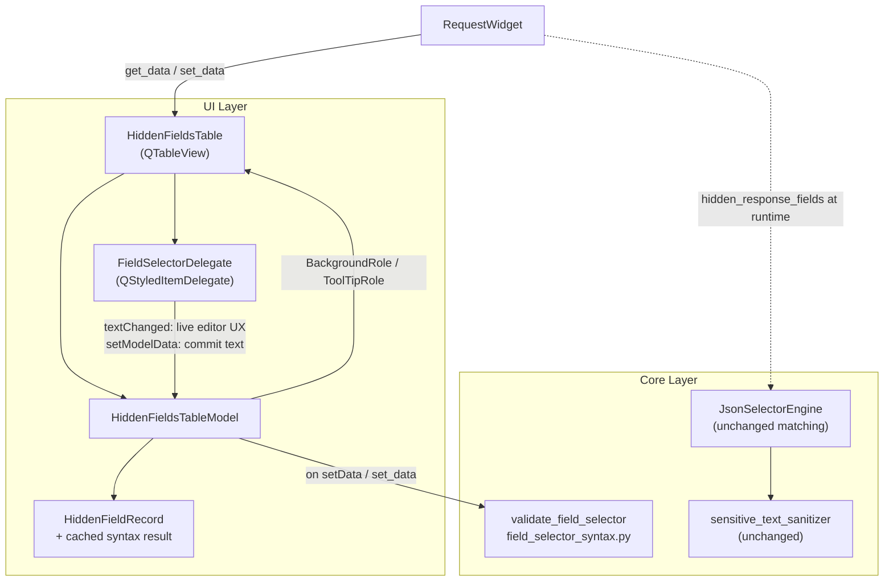

# PYPOST-1387: Inline Syntax Validation for Hidden Field Selectors

Step 2 artifact for PYPOST-1387. Translates approved requirements from
[`10-requirements.md`](10-requirements.md) into a concrete architectural
specification for live inline syntax validation, error highlighting, and
tooltip suggestions inside the virtualized `HiddenFieldsTable`
(`QTableView` + `HiddenFieldsTableModel` from PYPOST-1386).

---

## Research

### 1. Current Hidden Fields UI stack (post-PYPOST-1386)

| Layer | Location | Behavior today |
| --- | --- | --- |
| View | `pypost/ui/widgets/hidden_fields_table.py` | `HiddenFieldsTable(QTableView)` — selection, menus, Delete/Backspace, facades (`rowCount` / `item`), public `get_data` / `set_data` / `add_row` / `remove_selected_rows`. Uses the **default** `QStyledItemDelegate` (no custom editor). |
| Model | `pypost/ui/models/hidden_fields_table_model.py` | `HiddenFieldsTableModel(QAbstractTableModel)` — trailing blank row, strip-on-edit, dirty signals. |
| Record | `HiddenFieldRecord` | `selector: str`, `enabled: bool` only — **no validation state**. |
| Tooltips | `ToolTipRole` | Always returns the static string `"Response field selector or dot-notation path"` for every non-empty index. |
| Highlighting | — | No `BackgroundRole` / `ForegroundRole` / decoration for syntax problems. |

Editing commits through the stock line-edit editor when the user leaves the cell
or presses Enter. There is **no as-you-type feedback** and **no shared syntax
check** wired into the model.

### 2. Runtime selector parsing / masking (source of truth for “valid”)

Masking does **not** raise on bad selectors; it quietly skips or compiles
strings that never match.

- **`JsonSelectorEngine`** (`pypost/core/json_selector_engine.py`):
  - Skips empty / non-string values.
  - Skips anything starting with `header:` (case-insensitive) from JSON path
    compilation.
  - Bare keys (no `.` and no `[`) go into `_bare_keys`.
  - Everything else becomes a `CompiledPathSelector` after normalizing only
    the literal token `[*]` → `.*` and splitting on `.`.
  - Numeric indexes (`[0]`), `$`-prefixed JSONPath, and filter predicates are
    **not rejected** — they become inert path tokens that typically never match
    real JSON traversal paths (silent no-op at mask time).
- **Headers**: `sensitive_text_sanitizer.sanitize_headers` treats
  `header:<Name>` by taking `field[7:].strip().lower()` as an extra header name
  to redact. Empty `header:` yields an empty name and is effectively useless.
- **Documented vocabulary** (`doc/dev/hidden_response_fields.md`):
  simple key, dot-notation path, array wildcard (`[*]` / `*` segment forms),
  and `header:<Name>`. Root wildcards such as `[*].emailAddress` appear in
  reference collections and must remain valid.

**Gap**: the engine’s `_compile` is permissive; the UI must validate against the
**documented supported vocabulary**, not against “anything `_compile` accepts.”
NFR3 requires UI “valid” ≡ forms masking/MCP redaction actually honor in
practice.

### 3. Existing Qt delegate / validation patterns in PyPost

| Pattern | File | Relevance |
| --- | --- | --- |
| Commit-time **rejecting** rename | `pypost/ui/delegates/environment_name_delegate.py` + `validate_environment_rename` in `pypost/core/environment_ops.py` | Pure core validator + delegate `setModelData`; on failure keeps old value and sets editor tooltip. **Opposite** of FR6 for this ticket (advisory, non-destructive). |
| Role-driven display | `CollectionVariablesTableModel` ToolTipRole; Qt docs for `BackgroundRole` | Default `QStyledItemDelegate` paints `BackgroundRole` / shows `ToolTipRole` without a custom paint path. |
| Custom paint / editor | `StreamItemDelegate`, `ConflictStrategyDelegate`, variable autocomplete delegates | Heavier custom painting; unnecessary if model roles suffice for committed-cell highlights. |
| Package home | `pypost/ui/delegates/` | Natural place for a new advisory field-selector editor delegate. |

### 4. Qt / industry guidance (external)

- **PySide6 Model/View**: Prefer exposing validation via `data()` roles
  (`BackgroundRole`, `ToolTipRole`). The default styled delegate renders them
  ([Qt for Python `QStyledItemDelegate`](https://doc.qt.io/qtforpython-6/PySide6/QtWidgets/QStyledItemDelegate.html)).
- **Live-while-editing**: Model roles alone update after `setData` (edit
  commit). As-you-type feedback needs the editor widget (e.g. `QLineEdit` in
  a custom `QStyledItemDelegate.createEditor`) listening to `textChanged`,
  styling the **editor** without blocking keystrokes. Hard `QValidator`
  rejection of keystrokes conflicts with FR6 (non-destructive drafting).
- **Peer UX**: Postman response JSONPath filters use red underline + hover
  tooltip for invalid syntax and yellow for valid-but-no-match; this ticket is
  **syntax-only** (no payload match), so red/error highlight + constructive
  tooltip is the right analogue — not yellow “no match in last response.”

### 5. Architectural conclusion from research

Split responsibilities cleanly:

1. **Pure syntax module in `pypost.core`** — single vocabulary definition,
   unit-testable without Qt, shared by UI (and future tooling).
2. **Model role surfacing** — committed-cell highlight + tooltip for scanability
   of large catalogs (virtualization-friendly: only visible rows query roles).
3. **Thin advisory delegate** — live editor feedback while typing; always
   commits user text (including invalid) into the model.

Do **not** change `JsonSelectorEngine` matching/redaction algorithms in this
ticket (requirements out of scope). Optionally share token-normalization
helpers later; validation lives beside the engine, not inside `redact_tree`.

---

## Implementation Plan

### High-level approach

1. **Step 3 — Failing repro (red tests)** before production changes (see
   mandatory section below).
2. **Step 4 — Development**
   - Add `pypost/core/field_selector_syntax.py` with `FieldSelectorSyntaxResult`
     and `validate_field_selector(text: str) -> FieldSelectorSyntaxResult`.
   - Extend `HiddenFieldRecord` / `HiddenFieldsTableModel` to evaluate on
     `setData` / `set_data` / `add_row`, expose `BackgroundRole` + conditional
     `ToolTipRole`, include those roles in `dataChanged` payloads.
   - Add `FieldSelectorDelegate(QStyledItemDelegate)` under
     `pypost/ui/delegates/`; install from `HiddenFieldsTable.__init__`.
   - Keep public table API and trailing-row / dirty / get-set contracts intact.
3. **Steps 5–8** — cleanup, light observability (DEBUG counts only, never
   selector secret values beyond the expression string already user-authored),
   tech-debt, and `doc/dev` updates for syntax feedback.

### Module touch list

```
pypost/core/field_selector_syntax.py          # NEW — vocabulary + validate_field_selector
pypost/ui/models/hidden_fields_table_model.py # EXTEND — roles + cache validation on records
pypost/ui/delegates/field_selector_delegate.py # NEW — live editor feedback
pypost/ui/delegates/__init__.py               # EXPORT
pypost/ui/widgets/hidden_fields_table.py      # WIRE setItemDelegate(...)
tests/test_field_selector_syntax.py           # NEW — pure unit tests (also Step 3 seed)
tests/test_hidden_fields_syntax_validation_repro.py  # NEW — model/view red→green
```

### Selected patterns (justification)

| Pattern | Why |
| --- | --- |
| **Pure function validator in core** | Same style as `validate_environment_rename`; keeps grammar out of Qt widgets; enables headless tests and NFR3 alignment reviews. |
| **Model/View item roles for committed state** | Virtualization-safe; default delegate paints highlights; large catalogs only evaluate visible cells for paint. |
| **Advisory custom delegate (not rejecting)** | Satisfies FR1 “as you type” without FR6 violations; contrasts intentionally with `EnvironmentNameDelegate`. |
| **Cached result on `HiddenFieldRecord`** | Avoids re-running regex/grammar on every `data()` role query during scroll/repaint (NFR1). |
| **No save-hard-block** | Matches FR6 / Q4 in requirements — visual guidance only. |

### Supported vocabulary (validator contract)

`validate_field_selector` after `strip()`:

| Outcome | Rule |
| --- | --- |
| **Empty** | `""` → `ok=True`, `is_empty=True` (no highlight, no error tooltip). |
| **Header** | `(?i)^header:(.+)$` with non-empty name after strip → valid. Empty name → invalid + suggestion `header:Authorization`. |
| **Simple key** | Single segment, no `.` / `[` / `]` / `$` / spaces → valid (e.g. `token`, `api_key`). |
| **Path** | One or more segments joined by `.`, where each segment is either an identifier (`[A-Za-z_][A-Za-z0-9_-]*`) or `*`, and the surface form may use `[*]` which normalizes to a `*` segment (including leading `[*].field`). Shorthand `users.email` remains valid (identifier segments only). |
| **Invalid / unsupported** | `$…` JSONPath roots, `[?(…)]` filters, numeric/`[` indexes other than `[*]`, empty segments, trailing/leading dots, whitespace inside tokens, other punctuation → `ok=False` with plain-language reason + short examples of the four supported families. |

Whitespace-only input is treated as empty after the model’s existing strip
behavior (no false error on the trailing row).

### Live vs committed feedback

```
User types in editor
  → FieldSelectorDelegate.textChanged
      → style editor + set editor tooltip (invalid only)
  → (does not rewrite text; does not block keys)

User commits edit (Enter / focus leave)
  → delegate.setModelData → model.setData (always accepts stripped text)
      → validate_field_selector → cache on HiddenFieldRecord
      → dataChanged(..., Display|Edit|Background|ToolTip)
      → view paints soft error background; hover shows ToolTipRole
```

Valid rows: no error background; tooltip may keep a short neutral help string
(or none) — **must not** show an error tooltip (FR3).

### Main interfaces

```python
@dataclass(frozen=True)
class FieldSelectorSyntaxResult:
    ok: bool
    is_empty: bool
    message: str          # empty when ok or empty input
    suggestions: str      # short examples / guidance when not ok

def validate_field_selector(text: str) -> FieldSelectorSyntaxResult:
    """Return syntax evaluation for one selector string (strip-aware)."""
```

Model `data()` additions:

- `BackgroundRole` → soft warning `QBrush` when `not result.ok and not result.is_empty`; else `None`.
- `ToolTipRole` → `message + suggestions` when invalid; else neutral help or `None`.

Delegate public surface: standard `QStyledItemDelegate` overrides only
(`createEditor`, `setEditorData`, `setModelData`); no change to
`HiddenFieldsTable` public get/set API.

---

### Mandatory — Failing Repro (next Step 3)

Automated red tests **before** production fixes. No live network or MCP deps.

| Item | Plan |
| --- | --- |
| **Pure syntax file** | `tests/test_field_selector_syntax.py` |
| **UI/model file** | `tests/test_hidden_fields_syntax_validation_repro.py` |
| **Timeouts** | Module `pytestmark = pytest.mark.timeout(...)`; UI file uses `qapp` fixture. |
| **Asserts (desired behavior)** | (1) `validate_field_selector` accepts `token`, `auth.token`, `users[*].email`, `[*].id`, `users.email`, `header:Authorization`. (2) Rejects `$.users[0].name`, `users[0].name`, filter-like `[?(@.x)]`, empty `header:`, with non-empty guidance text containing at least one supported example. (3) Empty / whitespace → empty/ok, no error. (4) After `model.setData` / `table.set_data` with an invalid selector, `model.data(index, BackgroundRole)` is not `None` and `ToolTipRole` contains guidance; valid selector clears background and has no error tooltip. (5) Trailing blank row has no error background. (6) `get_data()` still returns invalid strings unchanged (advisory). |
| **How red is forced** | Import of `pypost.core.field_selector_syntax` fails or assertions fail because model still returns static tooltip / no `BackgroundRole`. |
| **Sequencing** | Research (this doc) → write red tests → implement validator → model roles → delegate → green → `make check`. |

---

## Architecture

### System module diagram



### Module responsibilities

| Module | Responsibility |
| --- | --- |
| `field_selector_syntax` | Closed vocabulary, classification, human-readable messages + examples. No Qt. |
| `HiddenFieldRecord` | Holds `selector` and cached `FieldSelectorSyntaxResult` (or equivalent fields). |
| `HiddenFieldsTableModel` | Revalidates on mutations; serves Display/Edit/Background/ToolTip roles; preserves trailing-row and dirty semantics. |
| `FieldSelectorDelegate` | Live editor highlight/tooltip; always commits text; does not silently rewrite selectors. |
| `HiddenFieldsTable` | Installs delegate; unchanged public API for Request Editor. |
| `JsonSelectorEngine` / sanitizer | **Unchanged** runtime masking; vocabulary of the validator must stay aligned by review/tests, not by changing redact algorithms in this ticket. |

### Interaction scheme

1. Request editor loads selectors → `set_data` → each non-empty row validated once → invalid rows paint with error background when scrolled into view.
2. User edits a cell → delegate shows live invalid state in the editor → commit stores text → model refreshes roles → view updates.
3. Hover on committed invalid cell → Qt tooltip from `ToolTipRole`.
4. User clears cell / trailing empty → empty result → no error chrome.
5. Persistence path unchanged: `get_data()` returns ordered non-empty strings including still-invalid drafts (advisory only).

### Dependency rules

- UI may depend on `field_selector_syntax`.
- `field_selector_syntax` must **not** depend on Qt or UI packages.
- `JsonSelectorEngine` does not depend on the validator in this task (avoids behavior change); shared constants (e.g. `header:` prefix) may be imported one-way from a tiny shared constant or duplicated as a single documented string with a test that both stay in sync.

### Risks / issues found during research

1. **Permissive engine vs strict UI**: `_compile` accepts many inert strings. Architecture chooses **documented vocabulary** as UI truth; tests must list both accepted and rejected examples explicitly so NFR3 does not drift.
2. **Shorthand vs wildcard**: `users.email` and `users[*].email` / `users.*.email` are all engine-meaningful; validator must accept identifier and `*` segments, not only the `[*]` surface spelling.
3. **Live typing vs trailing-row expand**: Do not call `setData` on every keystroke into the trailing row (would expand mid-word). Live feedback stays on the **editor**; model commit remains on edit finish (current behavior).
4. **Static tooltip regression**: Replacing always-on help tooltip must preserve FR3 (no error tooltip on valid rows) while still allowing optional neutral help text.
5. **Related out-of-scope tickets**: Autocomplete / collection lint (PYPOST-1483), dedupe (PYPOST-1533), enable checkboxes (PYPOST-1530) remain separate — do not expand this design into those.

---

## Q&A

### Q1: Should validation reject `setData` for invalid selectors?
**A**: No. FR6 requires non-destructive drafting. Invalid text is stored and highlighted; `get_data()` still returns it. This differs from `EnvironmentNameDelegate`, which rejects renames.

### Q2: Should `JsonSelectorEngine` start raising or filtering invalid selectors?
**A**: No for this ticket. Requirements keep masking algorithms unchanged. The UI validator aligns with documented forms; silent runtime ignore remains the fail-closed mask behavior.

### Q3: Model roles only, or a custom delegate too?
**A**: Both. Roles cover committed/scan-at-a-glance state (FR2/FR3, large catalogs). Delegate covers as-you-type feedback (FR1) without mid-edit `setData` side effects on the trailing row.

### Q4: Is payload-aware “path exists in last response” in scope?
**A**: No (requirements Q5 / out of scope). Syntax/form only — analogous to Postman’s red invalid-syntax state, not yellow no-match.

### Q5: Where should the grammar live?
**A**: `pypost/core/field_selector_syntax.py`, mirroring `validate_environment_rename` in core ops — not inside the Qt model file.

### Q6: External references used
- [QStyledItemDelegate (Qt for Python)](https://doc.qt.io/qtforpython-6/PySide6/QtWidgets/QStyledItemDelegate.html) — role rendering.
- [QAbstractItemModel roles](https://doc.qt.io/qtforpython-6.11/PySide6/QtCore/QAbstractItemModel.html) — ToolTipRole guidance.
- [QValidator](https://doc.qt.io/qt-6/qvalidator.html) — Intermediate/Invalid semantics; rejected for hard keystroke blocking given FR6.
- [Postman response filter UX](https://learning.postman.com/docs/use/send-requests/response-data/responses) — red underline + hover for invalid expressions.
