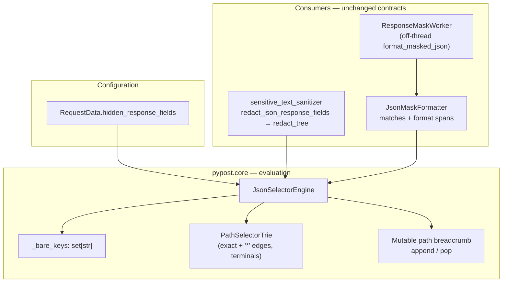
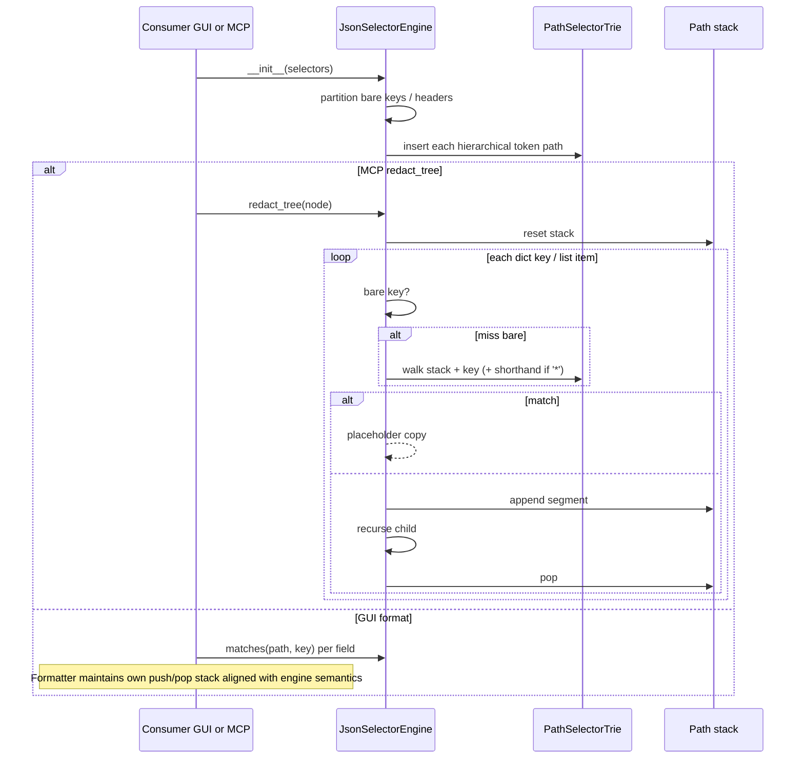

# PYPOST-1388: Efficient selector evaluation for high-frequency response masking

## Research

### Origin and intent

[PYPOST-1388](https://pypost.atlassian.net/browse/PYPOST-1388) is deferred performance debt from MCP hidden-fields delivery ([PYPOST-1378](https://pypost.atlassian.net/browse/PYPOST-1378)). The Jira summary proposes a **prefix trie** for compiled hierarchical selectors and **stack-based path breadcrumbs** during traversal. Requirements (`10-requirements.md`) freeze the **business outcome** (cheaper hierarchical matching and lower path-allocation cost with zero semantic change); concrete structures are chosen here.

Related follow-ups from the unified engine ([PYPOST-1394](https://pypost.atlassian.net/browse/PYPOST-1394) tech debt) named [PYPOST-1398](https://pypost.atlassian.net/browse/PYPOST-1398) for trie indexing alone. This ticket owns **both** hierarchical lookup indexing **and** mutable path tracking; work stays inside `JsonSelectorEngine` so GUI and MCP continue to share one evaluation path.

### Current codebase (inspected)

#### `JsonSelectorEngine` (`pypost/core/json_selector_engine.py`)

| Piece | Behavior today | Cost under load |
| --- | --- | --- |
| `_compile` | Partitions bare keys vs hierarchical `CompiledPathSelector` list; drops blanks / `header:` | One-time per engine construction — keep |
| `_bare_keys` | `set` membership | $O(1)$ — already adequate (FR-6 / hot path) |
| `_path_selectors` | Linear scan of every rule on every non-bare key | $O(R)$ per visited key when $R$ hierarchical rules exist (FR-2 gap) |
| `matches(path, key)` | Builds `list(path) + [key]`; optional second scan after stripping `*` for shorthand fallback | Fresh list (+ listcomp) every call when path rules exist |
| `_redact_node` | Recurses with `path + [key_str]` / `path + ["*"]` | New list per descent (FR-3 gap) |
| Public surface | `is_empty`, `matches`, `redact_tree`, `canonical_path`, `format_path_variants` | Must remain behaviorally stable (FR-4 / FR-5) |

`CompiledPathSelector` normalizes `[*]` → `*` tokens and matches only equal-length token sequences (exact or `*` wildcard per segment). Shorthand fallback: when the **candidate** path contains `*`, strip those tokens and re-test rules (e.g. document path `items.*.secret` can match rule `items.secret`).

#### Consumers (must keep identical outcomes)

1. **MCP** — `sensitive_text_sanitizer.redact_json_response_fields` constructs `JsonSelectorEngine(hidden_fields)` and calls `redact_tree` (immutable copy + placeholder).
2. **GUI** — `JsonMaskFormatter` (`response_mask_controller.py`) constructs one engine and calls `matches(path, key)` while pretty-printing; also uses `path + [key]` / `path + ["*"]` during format descent. Invoked synchronously and via `ResponseMaskWorker` for medium docs ([PYPOST-1396](https://pypost.atlassian.net/browse/PYPOST-1396)).

Both already depend only on core APIs (no UI in the engine). Optimization must remain in `pypost/core` (NFR-3).

### External patterns (web research)

1. **Segment trie / prefix tree** — Libraries such as [pygtrie](https://github.com/mina86/pygtrie) show the standard approach: keys as sequences of segments; lookup cost proportional to path depth, not rule-catalog size. For this product we **do not** add a third-party trie dependency; a small in-module token trie with an explicit `*` child edge is enough for the frozen selector vocabulary (bare keys stay in a set; no JSONPath filters / `..` / slices — out of scope).
2. **Full JSONPath engines** ([python-jsonpath](https://jg-rp.github.io/python-jsonpath/api/), jsonpathfx) use selector ASTs and iterative resolve — heavier than needed and would risk semantic drift.
3. **Stack / breadcrumb path builders** — Production JSON walkers (e.g. fionn-gron’s `PathBuilder`, zipper-style breadcrumbs) push/pop one shared buffer instead of cloning path vectors on every descent. The Python equivalent here is a **single mutable `list[str]`** with `append` / `pop` shared across recursion (or an explicit iterative stack), not per-level `path + [seg]`.

### Bottleneck summary

```
Hot path (GUI format OR MCP redact):
  for each dict key in tree:
      bare? → O(1) set                    # OK
      else → scan all R path rules        # FR-2: poorly scaling
      build candidate token list          # allocation
  for each descent:
      path + [segment]                    # FR-3: disposable lists
```

Enterprise Hidden Fields catalogs (hundreds–thousands of entries, many hierarchical) × medium nested JSON × high call frequency (viewer + worker + MCP) amplify both costs. Semantics must not change.

### Architectural decision

| Concern | Decision | Justification |
| --- | --- | --- |
| Hierarchical lookup | **In-process segment trie** built once in `_compile`, with exact-token children + `*` wildcard child; terminals mark “mask this field” | Meets FR-1/FR-2 without new deps; match walks $O(depth)$ with branching only on wildcards; preserves equal-length + wildcard semantics |
| Shorthand fallback | Second walk (or parallel cursor set) on candidate with `*` segments removed, only when candidate contains `*` | Preserves today’s fallback without scanning the full rule list |
| Path tracking | **Mutable breadcrumb stack** inside engine redaction; same pattern in `JsonMaskFormatter` | Meets FR-3; shared list identity across descent/ascent |
| Public API | Keep `matches(path, key)` accepting any `Sequence[str]` (callers may still pass a snapshot list); prefer stack reuse inside engine-owned walks | FR-5 consumer continuity; GUI can adopt stack without API break |
| Bare keys / headers / empty | Unchanged partitioning and short-circuit | FR-4 / FR-6 |
| Dependencies | Stdlib only | Core-layer suitability, lockfile stability |

## Implementation Plan

1. **Extend compilation** in `JsonSelectorEngine._compile`: after partitioning bare keys, insert each hierarchical token sequence into a `PathSelectorTrie` (or nested dict nodes) with terminal flags; retain `CompiledPathSelector` only if still useful for tests/debug, or build trie exclusively from the same tokenizer.
2. **Rewrite `matches`** to: bare-key check → trie walk on `path + key` (without allocating a full candidate list when a stack/view is available) → if path contains `*`, trie walk on shorthand tokens → else miss. No linear scan of `_path_selectors` in the steady state.
3. **Rewrite `_redact_node`** to push/pop a shared `path: list[str]` instead of `path + [...]`.
4. **Align GUI formatter** (`JsonMaskFormatter._format_dict` / `_format_list`) to the same push/pop breadcrumb so presentation masking gains FR-3 as well.
5. **Leave** `redact_json_response_fields` / `format_masked_json` call shapes unchanged; they automatically pick up engine improvements.
6. **Tests**: parity golden suite + efficiency repro (below); run `make check`.
7. **Docs** (Step 8): update `doc/dev/json_selector_engine.md` performance section for trie + stack breadcrumbs.

**Mandatory — Failing Repro (next Step 3):**

- **File**: `tests/test_pypost_1388_failing_repro.py` (module `pytestmark = pytest.mark.timeout(...)` per do-testing).
- **Semantic lock (must stay green after Step 4; write first as baseline assertions)**: identical `matches` / `redact_tree` / `format_masked_json` outcomes vs current behavior for bare keys, dotted paths, `[*]` / `.*`, nested wildcards, shorthand fallback (`items.secret` vs path through array), `header:` ignored, empty selectors, non-mutation of input.
- **Efficiency red assertions (fail on current code, pass after fix)**:
  1. **Path reconstruction**: instrument or wrap descent so a representative `redact_tree` (and optionally `JsonMaskFormatter.format`) on a nested fixture asserts that steady-state descent does **not** allocate a new path list per level (e.g. count of `list.__add__` / copy events on the breadcrumb, or assert a single list object identity across depths via a test hook / spy). Current `path + [seg]` fails this.
  2. **Hierarchical lookup scaling**: with a large catalog of distinct dotted path rules ($R \ge$ several hundred) and a medium JSON body whose keys mostly miss, assert match/redact cost or per-key rule examinations stay bounded by path depth / trie branching—not by scanning all $R$ rules (e.g. monkeypatch/counter on linear rule iteration, or compare against a baseline budget). Current linear `_path_selectors` loop fails this.
- **Sequencing**: research (done) → red efficiency tests (+ parity fixtures) → implement trie + stack until green → keep existing PYPOST-1394 / dual-surface masking suites green.
- **No live external deps**: pure in-memory fixtures.

## Architecture

### Module diagram



### Module responsibilities

| Module | Responsibility |
| --- | --- |
| **`PathSelectorTrie` (new, same file or private helper in `json_selector_engine.py`)** | One-time insert of hierarchical token sequences; match walk with exact/`*` edges; terminal = mask. |
| **`JsonSelectorEngine`** | Compile selectors; bare-key set; expose `matches` / `redact_tree` / helpers; own mutable path during redaction. |
| **`CompiledPathSelector`** | Keep tokenizer (`_parse_tokens`) as the single normalization path feeding the trie; optional thin wrapper for unit tests. |
| **`sensitive_text_sanitizer`** | MCP egress; no algorithm change beyond benefiting from `redact_tree`. |
| **`JsonMaskFormatter` / `format_masked_json`** | GUI spans; adopt stack breadcrumbs; still call `engine.matches`. |
| **`ResponseMaskWorker` / `ResponseView`** | Out of scope for logic changes; automatically faster when formatter/engine improve. |

### Interaction scheme



### Patterns

- **Compile-once, evaluate-many** — FR-1; engine construction remains the preparation boundary.
- **Partitioned hot path** — bare keys stay $O(1)$ set (unchanged).
- **Prefix trie with wildcard edge** — hierarchical FR-2 without third-party deps.
- **Stack breadcrumbs** — FR-3; zipper-like location without cloning.
- **Semantic freeze / dual-consumer single engine** — NFR-2, FR-5; no divergent GUI vs MCP rules.
- **Immutable output trees** — redaction still returns new dict/list structure; raw input untouched.

### Main interfaces

```python
# Unchanged public contracts
class JsonSelectorEngine:
    def __init__(self, selectors: Iterable[str] | None = None) -> None: ...
    @property
    def is_empty(self) -> bool: ...
    def matches(self, path: Sequence[str], key: str) -> bool: ...
    def redact_tree(self, node: Any, placeholder: str = "***") -> tuple[Any, int]: ...
    @staticmethod
    def canonical_path(path: Sequence[str], key: str) -> str: ...
    @staticmethod
    def format_path_variants(path: Sequence[str], key: str) -> set[str]: ...

# Internal (illustrative)
class _TrieNode:
    children: dict[str, _TrieNode]  # includes optional "*" key
    is_terminal: bool
```

Optional small internal hook for Step 3 efficiency tests (e.g. match-probe counter) may be added behind a private attribute or test-only seam; must not appear in MCP/GUI contracts.

### Out of scope (architecture boundary)

- New selector syntax, Hidden Fields UI, click-to-reveal UX, streaming SAX sanitizers, header policy changes, placeholder text changes — per requirements.

## Q&A

**Q1: Why an in-module trie instead of pygtrie or a JSONPath library?**  
**A:** Vocabulary is fixed (exact segments + `*`). A tiny trie avoids dependency/lock churn and prevents accidental semantic expansion. External JSONPath engines solve a larger problem and risk match drift ([python-jsonpath](https://jg-rp.github.io/python-jsonpath/api/), [pygtrie](https://github.com/mina86/pygtrie) used as design references only).

**Q2: Does `matches(path, key)` still allocate when the GUI passes a list?**  
**A:** Callers may pass any sequence; the engine can walk without copying when given a list used as a stack, or iterate the sequence + key without building `[...path, key]` when implementing the trie walk. GUI formatter will prefer push/pop so the hot path avoids `path + [seg]`.

**Q3: How is shorthand fallback preserved on a trie?**  
**A:** Same as today: if the candidate contains `*`, perform an additional trie walk on tokens with `*` removed. Rules without wildcards then match array-traversed locations; no full-list scan.

**Q4: Relationship to PYPOST-1398?**  
**A:** PYPOST-1398 restated trie indexing after PYPOST-1394. PYPOST-1388 is the originating debt item and includes stack breadcrumbs as well; implement here so both consumers benefit once.

**Q5: Could we only optimize `redact_tree` and leave the GUI formatter on `path + [...]`?**  
**A:** No — FR-3/FR-5 require both high-frequency consumers to avoid disposable path reconstruction. Formatter changes stay local to `response_mask_controller.py` breadcrumb handling.
