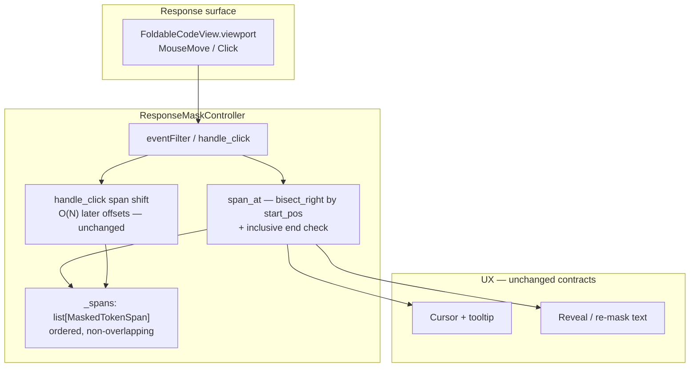

# PYPOST-1390: Bisect hit-testing for ResponseMaskController.span_at

## Research

### Origin and intent

[PYPOST-1390](https://pypost.atlassian.net/browse/PYPOST-1390) is deferred non-blocker performance debt from interactive GUI masking ([PYPOST-1379](https://pypost.atlassian.net/browse/PYPOST-1379) / MASK-3). Jira summary: *Replace linear list scan in `ResponseMaskController.span_at` with bisect binary search over sorted span intervals*. Requirements (`10-requirements.md`) freeze the **outcome** (responsive, semantically identical position→token resolution under high span counts); this document selects the concrete search approach.

Related debt intentionally left alone:

- Linear later-span offset shifting on toggle (separate PYPOST-1379 follow-up).
- Mouse-move throttling / debouncing (optional future debt).
- Selector evaluation ([PYPOST-1388](https://pypost.atlassian.net/browse/PYPOST-1388)), medium-doc worker formatting ([PYPOST-1396](https://pypost.atlassian.net/browse/PYPOST-1396)).

### Current codebase (inspected)

#### `ResponseMaskController.span_at` (`pypost/ui/widgets/response_mask_controller.py`)

```180:185:pypost/ui/widgets/response_mask_controller.py
    def span_at(self, char_pos: int) -> MaskedTokenSpan | None:
        """Finds the token span containing the specified character position."""
        for span in self._spans:
            if span.start_pos <= char_pos <= span.end_pos:
                return span
        return None
```

| Piece | Behavior today | Cost under load |
| --- | --- | --- |
| `_spans` | `list[MaskedTokenSpan]` stored by `set_masked_spans` / mutated in place by `handle_click` | Owned by controller only |
| `span_at` | Full linear scan; first inclusive hit wins | $O(N)$ comparisons per query |
| Callers | `eventFilter` `MouseMove` (hover cursor + tooltip); `handle_click` (reveal / re-mask) | Hover fires per pixel move with `setMouseTracking(True)` |
| Coverage rule | Inclusive both ends: `start_pos <= char_pos <= end_pos` | Must freeze (FR-2) |
| Empty / miss | Empty list or no containing interval → `None` | Must freeze (FR-6) |

`end_pos` is recorded as the formatter’s exclusive write cursor after emitting the token text, yet hit-testing treats that boundary as inclusive — so a caret sitting exactly at `end_pos` still resolves to the token. Bisect must preserve that exact predicate.

#### Ordering contract (already true)

1. **`JsonMaskFormatter`** appends spans in document emission order → ascending `start_pos`, non-overlapping intervals (requirements assumption).
2. **`handle_click`** updates the toggled span’s `end_pos`, then adds `delta` to every later span’s `start_pos` / `end_pos` where `other.start_pos > span.start_pos`. Relative order of the list is unchanged; the sorted-by-start invariant holds after every toggle without resorting.
3. **`clear` / `set_masked_spans`** replace or empty the list; no partial unsorted inserts.

Therefore a binary search keyed on `start_pos` is valid for the entire interactive lifetime of a span set. No auxiliary tree is required for this ticket.

#### Consumers that must stay behaviorally identical

| Surface | How it uses hit resolution |
| --- | --- |
| Hover (`eventFilter` / `MouseMove`) | `char_pos = cursorForPosition(...).position()` → `span_at` → hand cursor + tooltip or I-beam |
| Click (`handle_click`) | Same `span_at` before text rewrite and later-span shift |
| Existing GUI suites | `tests/test_gui_response_view_click_to_reveal.py`, integration / worker tests calling `handle_click` | Must stay green |

Visual styling (`ExtraSelection`), formatter, MCP redaction, and large-doc bypass remain out of scope.

### External patterns (web research)

1. **Sorted non-overlapping interval point query** — Standard approach: binary-search starts, take the rightmost interval with `start <= p`, then verify `p <= end` ([Azadira interval lookup](https://azadira.com/problems/p3-bs-interval-lookup/), common interview write-ups such as [DEV: interval membership](https://dev.to/emilywoodsnyc/google-interview-question-can-you-make-this-lookup-o1-3b3d)). Matches our inclusive closed intervals and non-overlap guarantee.
2. **Python [`bisect`](https://docs.python.org/3/library/bisect.html)** — `bisect_right(a, x, *, key=...)` (key since 3.10) implements “rightmost start ≤ query” when `key` extracts `start_pos` and `x` is the raw `char_pos` (key is **not** applied to `x`). Docs’ `find_le` pattern is exactly `i = bisect_right(...); candidate = a[i - 1]`.
3. **Performance notes from stdlib** — Repeated `key` calls during one search are fine for a cheap attribute read; for expensive keys, precompute a parallel key array. Here `start_pos` is an `int` attribute — prefer `operator.attrgetter("start_pos")` (or equivalent) on the live `_spans` list rather than a second starts cache that must be rewritten on every toggle shift.
4. **Rejected heavier structures** — Interval trees, Fenwick/segment trees, Sorted Collections, or O(1) dense coordinate maps add dependencies or memory without benefit for non-overlapping, already-sorted GUI spans at hundreds of tokens. Toggle offset trees remain explicit out-of-scope debt.

### Bottleneck summary

```
Hot path (viewport MouseMove, high frequency):
  char_pos → for each of N spans: range compare   # O(N) — poorly scales with span count
  → cursor / tooltip

Same function on click (lower frequency, same semantics)
```

At N ≈ hundreds, repeated O(N) scans on every move compete with smooth GUI feedback even though each compare is cheap. Semantics must not change.

### Architectural decision

| Concern | Decision | Justification |
| --- | --- | --- |
| Hit resolution algorithm | **`bisect_right` on `_spans` by `start_pos`**, then inclusive end check on the single candidate | Meets FR-1–FR-6 and NFR-1 with stdlib only; O(log N) steady-state queries |
| Inclusive endpoints | Candidate hit iff `start_pos <= char_pos <= end_pos` (unchanged predicate) | NFR-2 / AC-2; preserves today’s end-boundary quirk |
| Empty / before-first / gap / after-last | `None` when list empty, `bisect` index 0, or candidate fails end check | FR-6 |
| Parallel starts array | **Do not** maintain a separate `starts: list[int]` | Avoid sync bugs on toggle; attrgetter key is O(1) per probe |
| Toggle / span shift | **Unchanged** linear later-span adjustment in `handle_click` | Out of scope; order invariant already sufficient for bisect |
| Public API | Keep `span_at(char_pos) -> MaskedTokenSpan | None`; hover and click continue to share it | AC-4 |
| Dependencies | Stdlib `bisect` (+ `operator.attrgetter` optional) | GUI-thread suitable (NFR-3); no new packages |
| Throttling | Not introduced | Explicit out of scope |

## Implementation Plan

1. **Rewrite `ResponseMaskController.span_at`** only:
   - Short-circuit if `not self._spans`.
   - `idx = bisect_right(self._spans, char_pos, key=attrgetter("start_pos"))`.
   - If `idx == 0`: return `None`.
   - `candidate = self._spans[idx - 1]`; return it iff `char_pos <= candidate.end_pos` (start already ≤ by construction); else `None`.
2. **Leave untouched**: `handle_click` shift loop, `update_visual_formats`, `eventFilter` wiring, `JsonMaskFormatter`, MCP / selector paths.
3. **Optional micro-clarity**: local helper or one-line comment documenting the inclusive-end contract and why `bisect_right` (not `bisect_left`) is required when `char_pos == start_pos`.
4. **Tests**: Step 3 failing repro + keep existing click-to-reveal / integration suites green; run `make check`.
5. **Docs** (Step 8): note O(log N) hit-testing in `doc/dev/hidden_response_fields.md` (controller lifecycle / hit-test section).

**Mandatory — Failing Repro (next Step 3):**

- **File**: `tests/test_pypost_1390_failing_repro.py` (module `pytestmark = pytest.mark.timeout(...)` per do-testing / lsr-python).
- **Semantic lock (must stay green after Step 4; write first as baseline assertions)**:
  - Construct a `ResponseMaskController` (or exercise `span_at` via a thin fixture that sets `_spans` / `set_masked_spans`) with fixed non-overlapping ordered spans.
  - Assert hits, misses, and **inclusive** endpoints (`start_pos`, `end_pos`) match a pure linear oracle with the same predicate.
  - Assert empty list → `None`; positions in gaps and outside all spans → `None`.
  - After `handle_click` on one span (Qt fixture as in existing GUI tests, or controller with mocked document if already patterned), assert subsequent `span_at` results for later positions still match the oracle on the updated span list.
- **Efficiency red assertions (fail on current linear scan, pass after bisect)**:
  - High span-count fixture ($N$ on the order of hundreds, e.g. 256–512 non-overlapping intervals).
  - Instrument comparisons or loop visits (e.g. wrap spans in a counting proxy, or monkeypatch iteration) so that a batch of hover-style queries (many distinct `char_pos` values, including hits and misses) asserts steady-state work is **logarithmic in N**, not a full scan of every span per query (AC-1 / AC-5). Current `for span in self._spans` fails this.
  - Prefer deterministic counters over wall-clock flakiness; optional soft timing budget only as secondary signal.
- **Sequencing**: research (done) → red efficiency + parity tests → implement bisect in `span_at` until green → keep `tests/test_gui_response_view_click_to_reveal.py` and related masking suites green.
- **No live external deps**: in-memory span fixtures; GUI pieces only where toggle requires a real `QTextDocument`.

## Architecture

### Module diagram



### Module responsibilities

| Module / piece | Responsibility |
| --- | --- |
| **`span_at`** | O(log N) position→token (or none); sole semantic owner of inclusive coverage. |
| **`_spans`** | Ordered interval list; mutated in place on toggle; input assumption for bisect. |
| **`eventFilter` / `handle_click`** | Map pointer → `char_pos`; call shared `span_at`; hover affordances / toggle (toggle shift unchanged). |
| **`JsonMaskFormatter`** | Produces initial ordered spans (unchanged this ticket). |
| **Tests (`test_pypost_1390_failing_repro.py`)** | Parity vs linear oracle + high-N logarithmic intent. |

### Interaction scheme

```mermaid
sequenceDiagram
  participant VP as Viewport
  participant Ctrl as ResponseMaskController
  participant Spans as _spans ordered list

  VP->>Ctrl: MouseMove → char_pos
  Ctrl->>Ctrl: span_at(char_pos)
  Ctrl->>Spans: bisect_right by start_pos
  Spans-->>Ctrl: candidate index or none
  alt candidate contains char_pos inclusive
    Ctrl-->>VP: PointingHand + tooltip
  else miss
    Ctrl-->>VP: IBeam + hide tooltip
  end

  VP->>Ctrl: Click → handle_click(char_pos)
  Ctrl->>Ctrl: span_at(char_pos) same rules
  Ctrl->>Spans: rewrite text; shift later starts/ends
  Note over Spans: Order by start_pos preserved
```

### Selected patterns

| Pattern | Use |
| --- | --- |
| **Binary search over sorted keys (`bisect`)** | Hot-path point-in-interval for non-overlapping spans. |
| **Single shared lookup API** | Hover and click both call `span_at` — no divergent targeting. |
| **Semantic freeze / oracle testing** | Linear scan retained in tests as correctness reference; production uses bisect. |
| **Minimal change surface** | One method rewrite; no new types, no offset-tree redesign. |

### Main interfaces

```python
class ResponseMaskController(QObject):
    def span_at(self, char_pos: int) -> MaskedTokenSpan | None:
        """Return the span containing char_pos (inclusive ends), or None.

        Implementation: bisect_right on start_pos, then end_pos check.
        """
        ...

    def handle_click(self, char_pos: int) -> bool:
        """Resolve via span_at; toggle text; shift later spans (unchanged)."""
        ...
```

Call contract unchanged for `set_masked_spans`, `spans`, `clear`, and viewport event filter.

## Q&A

**Q1: Why `bisect_right` and not `bisect_left`?**  
**A**: For a query equal to some `start_pos`, `bisect_right` places the insertion point after that span so `idx - 1` selects it. `bisect_left` would point at the span itself for exact starts but the documented `find_le` / “rightmost start ≤ p” pattern is `bisect_right` then decrement — clearer for gaps and equal starts. See [bisect docs — Searching Sorted Lists](https://docs.python.org/3/library/bisect.html#searching-sorted-lists).

**Q2: Does toggle invalidate the bisect assumption?**  
**A**: No. `handle_click` only adjusts numeric positions of later spans; list order by ascending `start_pos` is preserved. No re-sort or secondary index update is required.

**Q3: Why not keep a parallel `starts` array?**  
**A**: Toggle would need to rewrite every later entry in that array as well as the spans. Searching with `key=attrgetter("start_pos")` on the live list avoids duplication; attribute reads are cheap at target N.

**Q4: Is changing `handle_click`’s O(N) shift in scope?**  
**A**: No. Requirements and Jira debt text isolate hit-testing. Offset trees remain separate debt.

**Q5: How do we prove responsiveness without flaky benchmarks?**  
**A**: Step 3 red test instruments per-query span examinations / comparisons under high N and asserts logarithmic bounds versus a full scan baseline; wall-clock is optional secondary only.
