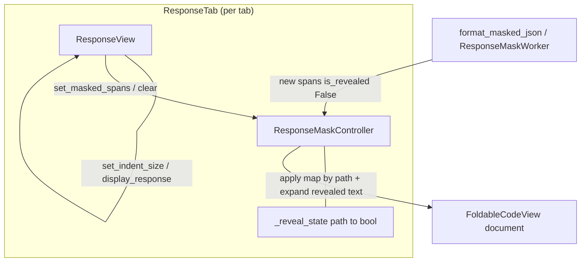

# PYPOST-1392: State preservation across reformatting and tab switching

## Research

### Current behavior (codebase)

- `MaskedTokenSpan` already carries stable field identity via `path` (canonical selector
  path from `JsonSelectorEngine.canonical_path`) and mutable `is_revealed`.
- `JsonMaskFormatter` always constructs new spans with `is_revealed=False`.
- `ResponseView.display_response` calls `mask_controller.clear()` then formats and
  `set_masked_spans(spans)` — wiping prior span objects and reveal flags.
- `ResponseView.set_indent_size` re-enters `display_response` with `_last_response` /
  `_last_hidden_fields`, which is the primary indent-reformat path.
- `ResponseView.clear_body` clears the controller and last-response caches.
- Each `ResponseTab` owns a distinct `ResponseView` (`tabs_presenter.py`), so tab isolation
  is already instance-scoped; the defect is **intra-view** wipe on reformat, including when
  settings apply `set_indent_size` across tabs.

### Debt origin

PYPOST-1379 `60-tech-debt.md` proposed a lightweight `dict[str, bool]` keyed by selector
path to retain reveal choices across re-renderings. That matches FR-2 / FR-3 without
persisting across process restarts.

### Industry pattern

UI frameworks preserve interaction state across remounts by lifting it into a store keyed by
**stable logical identity**, not by layout position (React keys / Streamlit widget keys /
accordion stores keyed by toolCallId). Character offsets change with indent; selector
`path` does not. Architecture therefore keys reveal memory by `span.path`.

### Constraints from sibling tickets

- Do not redesign hit-testing (PYPOST-1390), formatter counters (PYPOST-1391), or the
  medium-doc worker (PYPOST-1396) beyond applying the same restore hook when async spans
  arrive (`_on_mask_formatting_completed`).

## Implementation Plan

1. **Reveal-state memory on `ResponseMaskController`**
   - Add a private map `_reveal_state: dict[str, bool]` (path → revealed).
   - On successful `handle_click`, write `span.path → span.is_revealed` after the toggle.
   - On `set_masked_spans`, for each incoming span with a non-empty `path`, if the map has
     an entry, set `span.is_revealed` accordingly; then if revealed, expand document text
     from `masked_value` to `raw_value` and shift later span offsets (same delta logic as
     `handle_click`), **or** equivalently apply revealed text before attaching spans so
     coordinates match. Prefer a single helper `_apply_persisted_reveals(spans)` that
     mutates spans + document after `setText` / when spans are set, mirroring toggle
     geometry rules.
   - On `clear()`, empty `_reveal_state` as well as `_spans` (supports FR-5 / clear reset).

2. **ResponseView lifecycle wiring**
   - Keep calling `mask_controller.clear()` only when intentionally discarding the current
     response (`clear_body`, or start of `display_response` for a **new** response).
   - For same-response reformat (`set_indent_size` → `display_response` of `_last_response`):
     **do not** clear reveal memory. Options (choose one in Step 4; prefer smallest diff):
     - **A (preferred)**: Split clear into `clear_spans()` (visual/spans only) vs
       `clear()` (spans + reveal map). `display_response` uses span-only clear when
       re-displaying; full clear when body cleared or when response identity changes.
     - **B**: Snapshot reveal map before `clear()`, restore after `set_masked_spans`.
   - Detect “new response” vs “same response reformat”: compare object identity or a
     stable fingerprint of (`response.body`, hidden_fields). Simplest reliable approach:
     `set_indent_size` path already holds `_last_response`; introduce
     `display_response(..., *, preserve_reveal_state: bool = False)` set `True` from
     `set_indent_size`, and default `False` for presenter/worker new arrivals. Also set
     `True` for any other same-response re-entry if added later.
   - Async worker completion: after `set_masked_spans`, persistence helper must run so
     medium-doc path honors the same map when indent/settings reformat uses the worker.

3. **Tab isolation**
   - No shared global map. Each `ResponseView` → `ResponseMaskController` instance keeps
     its own `_reveal_state` (NFR-4).

4. **Tests**
   - Step 3 red repro (below).
   - Step 4: keep existing click-to-reveal suite green; add reset-on-new-response assertion
     alongside the indent persistence test if not already covered by the repro file.

5. **Quality gate**
   - `make test` with targeted `PYTEST_ARGS` during iteration; `make check` before close
     (later steps).

### Mandatory — Failing Repro (next Step 3)

- **What it asserts (desired behavior)**:
  1. Display a small JSON response with ≥2 hidden fields via `ResponseView.display_response`.
  2. Reveal exactly one field via `mask_controller.handle_click`.
  3. Call `view.set_indent_size(4)` (or another size ≠ current) to force reformat.
  4. Assert the previously revealed field’s span is still `is_revealed is True` and its
     raw secret appears in `body_view.toPlainText()`.
  5. Assert the never-revealed sibling field remains masked (`"***"`, `is_revealed is False`).
- **Where**: `tests/test_pypost_1392_failing_repro.py` (module `pytestmark` timeout 60,
  GUI/`qapp` pattern matching `tests/test_gui_response_view_click_to_reveal.py`).
- **How to force failure without live deps**: pure in-process Qt widgets +
  `ResponseData` / `RequestData` fixtures; no network.
- **Sequencing**: research (done) → red test (Step 3, no production fix) → implement
  plan above until green (Step 4).
- **Expected failure today**: after `set_indent_size`, all spans reset to
  `is_revealed=False` and secrets disappear from the document text.

## Architecture



### Modules and responsibilities

| Module | Responsibility |
| --- | --- |
| `ResponseMaskController` | Own `_reveal_state`; update on toggle; apply on `set_masked_spans`; wipe on full `clear` |
| `ResponseView` | Decide preserve vs reset when displaying; pass preserve flag from indent reformat; full clear on `clear_body` / new response |
| `JsonMaskFormatter` | Unchanged: still emits default-masked spans with `path` |
| `ResponseMaskWorker` | Unchanged emission; restore happens in view/controller when spans land |
| Tabs presenter | Unchanged: still per-tab `ResponseView`; settings still call `set_indent_size` |

### Patterns

- **State lifting / identity-keyed store**: reveal boolean keyed by canonical path.
- **Explicit preserve flag** on re-display: avoids accidental carry-over onto new payloads.
- **Single apply helper**: one place expands revealed text and adjusts offsets after
  reformat, reusing toggle geometry rules.

### Interfaces

```text
ResponseMaskController.clear() -> None
  # clears spans, visuals, AND _reveal_state

ResponseMaskController.clear_spans() -> None   # optional split
  # clears spans/visuals only; keeps _reveal_state

ResponseMaskController.set_masked_spans(spans) -> None
  # stores spans, applies _reveal_state by path, updates visuals

ResponseView.display_response(response, hidden_fields=None, *, preserve_reveal_state=False)
ResponseView.set_indent_size(size)
  # calls display_response(..., preserve_reveal_state=True) when re-showing _last_response
ResponseView.clear_body()
  # mask_controller.clear() — full reset
```

## Q&A

**Q**: Why not key by character offsets?

**A**: Indent changes shift all offsets; path identity is stable for the same JSON shape
and selectors (NFR-2).

**Q**: What if two spans share a path?

**A**: Formatter emits one span per matched leaf; canonical paths for distinct leaves
differ. If duplicates ever appear, last-write-wins in the map is acceptable; out of scope
to invent multi-occurrence indexing unless a repro appears.

**Q**: Does preserve apply when hidden_fields list changes?

**A**: New display with different selectors is a new presentation config; default
`preserve_reveal_state=False` from the presenter. Paths absent from the new span set are
simply unused; stale map entries are cleared on full `clear()` for new responses.
