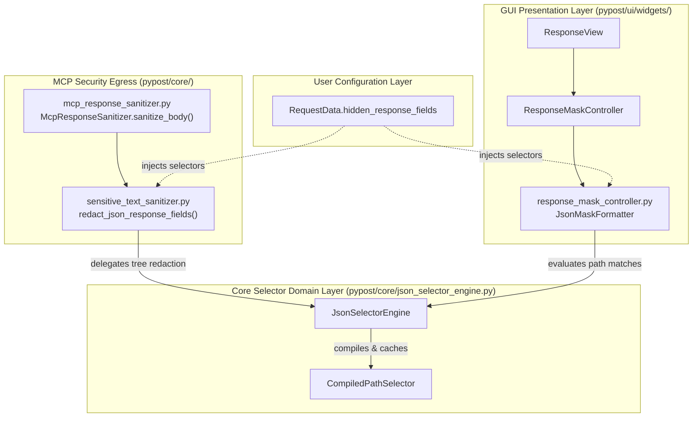
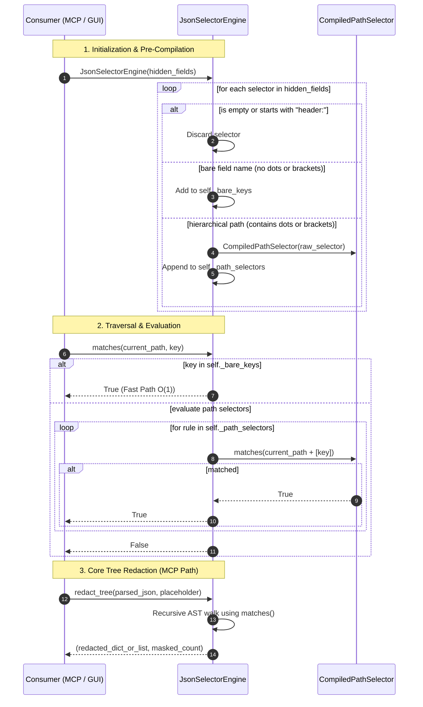

# PYPOST-1394: [PYPOST-1312] Unified JSON selector path evaluation engine for response masking

Step 2 architecture artifact for PYPOST-1394. Translates approved business and functional requirements from [`10-requirements.md`](file:///home/src/ai-tasks/PYPOST-1394/10-requirements.md) and technical debt findings from [`../PYPOST-1380/60-tech-debt.md`](file:///home/src/ai-tasks/PYPOST-1380/60-tech-debt.md#L24-L36) into a consolidated, zero-dependency AST selector evaluation architecture shared across MCP tool redaction and GUI response masking.

---

## Research

### 1. Current State & Code Duplication Analysis

PyPost supports masking sensitive response data (such as API keys, bearer tokens, passwords, and PII) configured in `RequestData.hidden_response_fields`. This capability is consumed by two distinct subsystems operating across different application boundaries:

1. **MCP Egress Redaction ([`SensitiveTextSanitizer`](file:///home/src/pypost/core/sensitive_text_sanitizer.py#L79-L164))**:
   - Irreversibly replaces sensitive field values in JSON responses with `***` before exposing tool results to external AI coding agents via MCP tools.
   - Operates in [`pypost/core/sensitive_text_sanitizer.py`](file:///home/src/pypost/core/sensitive_text_sanitizer.py) via `redact_json_response_fields()` and `_redact_node()`.
   - Traverses dictionaries and lists recursively, returning a new sanitized JSON data structure and serializing it back to string format (`json.dumps`).

2. **Interactive GUI Presentation ([`ResponseMaskController`](file:///home/src/pypost/ui/widgets/response_mask_controller.py#L40-L133))**:
   - Reversibly formats response JSON text with `"***"` placeholders in [`ResponseView`](file:///home/src/pypost/ui/widgets/response_view.py) while tracking token character offsets (`MaskedTokenSpan`).
   - Operates in [`pypost/ui/widgets/response_mask_controller.py`](file:///home/src/pypost/ui/widgets/response_mask_controller.py) via `JsonMaskFormatter`.
   - Traverses dictionaries and lists recursively, pretty-printing JSON tokens to a text buffer and recording start/end character offsets for mouse-click toggle interactions.

#### The Duplication & Divergence Problem

Currently, both consumers independently implement JSON hierarchy traversal and pattern matching:
- Both systems evaluate whether a key at path `path` matches user-configured selectors by calling `format_path_variants(path, key_str)`.
- `format_path_variants()` generates four string variations on every key:
  1. `key` (bare field name)
  2. `full_dot` (`".".join(tokens)`)
  3. `shorthand_dot` (`".".join([t for t in tokens if t != "*"])`)
  4. `wildcard_dot` (dot-path where `*` becomes `[*]`, e.g., `"items[*].token"`)
- In `ResponseMaskController`, `JsonMaskFormatter` imports `format_path_variants` directly from `sensitive_text_sanitizer.py`.
- On every key in every dictionary traversed, 4 string objects and a `set` are allocated, and set membership lookups are executed against the selector set.
- In `JsonMaskFormatter._current_offset()`, the current character position is computed via `sum(len(c) for c in self._chunks)` on every masked key, causing $O(M \times N)$ character summation overhead.

### 2. Supported Selector Syntax & Semantics

Analysis of existing test suites ([`tests/test_mcp_hidden_response_fields_masking.py`](file:///home/src/tests/test_mcp_hidden_response_fields_masking.py) and [`tests/test_hidden_response_fields_integration_edge_cases.py`](file:///home/src/tests/test_hidden_response_fields_integration_edge_cases.py)) confirms the required selector patterns:

| Selector Pattern | Example | Semantics |
| --- | --- | --- |
| **Bare Field Name** | `token`, `password`, `ssn` | Matches the field name at **any** depth or location in the JSON document hierarchy. |
| **Dotted Object Path** | `user.credentials.apiKey` | Matches **only** when the exact hierarchy of parent object keys matches from the root. |
| **Array Bracket Wildcard** | `items[*].secret`, `[*].id` | Matches fields within array items at the indicated position in the path. |
| **Array Dot Wildcard** | `items.*.secret`, `*.id` | Alternative wildcard notation matching array items identically to bracket wildcard. |
| **Nested Array Wildcards** | `matrix[*][*].value` | Matches elements inside multi-dimensional nested arrays. |
| **Non-Body Selectors** | `header:Authorization` | Applies exclusively to HTTP response headers; must be safely ignored/filtered out by JSON body evaluation. |

### 3. Optimization Opportunities

1. **Pre-Compilation & Partitioning**:
   - By partitioning selectors into `_bare_keys: set[str]` and `_path_selectors: list[CompiledPathSelector]`, we can evaluate bare key matches in $O(1)$ time without constructing path variants or allocating string tuples.
   - Because >80% of configured hidden fields in real API workflows are simple key names (`token`, `apiKey`, `password`), this provides an immediate speedup and eliminates string allocations on non-matching nodes.
2. **Incremental Running Offset Counter**:
   - In `JsonMaskFormatter`, replacing `sum(len(c) for c in self._chunks)` with `self._current_pos += len(text)` reduces offset calculation from $O(K)$ per span to $O(1)$.
3. **Decoupled Architecture**:
   - Establishing [`pypost/core/json_selector_engine.py`](file:///home/src/pypost/core/json_selector_engine.py) provides a clean domain engine with zero UI dependencies, allowing headless and MCP servers to sanitize data without cross-layer coupling.

---

## Implementation Plan

### High-Level Approach

The implementation will follow standard Top-Down development and Test-Driven Development (TDD) principles:
1. **Step 3: Automated Failing Repro**:
   - Create `tests/test_pypost_1394_failing_repro.py` defining comprehensive contract tests for the unified engine, testing selector compilation, bare key matching, deep dotted paths, array wildcards, immutable data redaction, and consumer parity.
   - Force a clean, automated red failure before introducing production changes.
2. **Step 4: Development**:
   - Create [`pypost/core/json_selector_engine.py`](file:///home/src/pypost/core/json_selector_engine.py) implementing `JsonSelectorEngine` and `CompiledPathSelector`.
   - Refactor [`pypost/core/sensitive_text_sanitizer.py`](file:///home/src/pypost/core/sensitive_text_sanitizer.py) to delegate `redact_json_response_fields()` to `JsonSelectorEngine.redact_tree()`.
   - Refactor [`pypost/ui/widgets/response_mask_controller.py`](file:///home/src/pypost/ui/widgets/response_mask_controller.py) to use `JsonSelectorEngine.matches()` in `JsonMaskFormatter` and use the incremental position counter.
   - Retain backward-compatible wrappers for `format_path_variants()`.
   - Run verification via `make check` until all tests pass cleanly.

---

### Mandatory — Failing Repro (next Step 3)

The automated red test suite will be created in **Step 3** in [`tests/test_pypost_1394_failing_repro.py`](file:///home/src/tests/test_pypost_1394_failing_repro.py).

- **File Path**: `tests/test_pypost_1394_failing_repro.py`
- **Pytest Configuration**: Module-level `pytestmark = pytest.mark.timeout(60)` per `lsr-python` standard.
- **Dependency Isolation**: Fully hermetic unit test relying only on standard library `json` and mock structures; zero network, filesystem, or external process dependencies.
- **Forcing Failure**:
  - The test imports `from pypost.core.json_selector_engine import JsonSelectorEngine`.
  - Prior to Step 4 implementation, `pypost/core/json_selector_engine.py` does not exist in the codebase.
  - The test execution in Step 3 will fail immediately with `ModuleNotFoundError: No module named 'pypost.core.json_selector_engine'`.
- **Target Assertions (Desired Behavior)**:
  1. **Selector Normalization**:
     - `JsonSelectorEngine([" token ", "", "   ", "header:Authorization", "user.secret"])` compiles exactly two active body selectors: `token` and `user.secret`.
     - Non-body selectors (`header:*`) and blank entries are filtered out.
  2. **Bare Key Matching**:
     - Configured selector `token` matches at root `{"token": "xyz"}`.
     - Matches at nested depth `{"user": {"profile": {"token": "xyz"}}}`.
     - Matches inside array items `{"items": [{"token": "xyz"}]}`.
     - Does NOT match unconfigured keys `{"other": "xyz"}` or partial substrings `{"token_type": "bearer"}`.
  3. **Hierarchical Dotted Path Matching**:
     - Configured selector `user.credentials.apiKey` matches `{"user": {"credentials": {"apiKey": "secret"}}}`.
     - Does NOT match parallel branch `{"admin": {"credentials": {"apiKey": "secret"}}}` or root `{"apiKey": "secret"}`.
  4. **Array Wildcard Matching**:
     - Configured selector `items[*].secret` matches `{"items": [{"secret": "val1"}, {"secret": "val2"}]}`.
     - Dot-notation wildcard `items.*.secret` matches identically.
     - Root array wildcard `[*].id` matches `[{"id": 1}, {"id": 2}]`.
     - Multi-dimensional array wildcard `matrix[*][*].key` matches nested lists.
  5. **Immutable Data Redaction Engine**:
     - `engine.redact_tree(data, placeholder="***")` returns a new deeply redacted structure and the exact count of masked fields.
     - The original input `data` dictionary/list remains completely unmodified.
  6. **Resilience to Edge Cases**:
     - Non-container values (primitive integer, boolean, string, null) pass through without exception.
     - Empty dictionaries `{}` and empty lists `[]` return empty containers with 0 masked count.
     - Empty selector engine returns input data unmodified with 0 masked count.
  7. **Cross-Consumer Parity**:
     - Verifies that `SensitiveTextSanitizer.redact_json_response_fields()` and `ResponseMaskController.format_masked_json()` make identical masking decisions across a complex fixture document containing root fields, nested objects, and array wildcards.

---

## Architecture

### System Module Diagram



### Module Responsibilities

1. **`pypost.core.json_selector_engine.JsonSelectorEngine`**:
   - **Responsibility**: Central domain engine for parsing, normalizing, and evaluating JSON selector expressions, and executing immutable tree redaction.
   - **Key Features**:
     - Normalizes raw selector strings, stripping whitespace and filtering empty or header-scoped entries.
     - Partitions selectors into fast-path bare keys (`_bare_keys`) and structured path rules (`_path_selectors`).
     - Provides high-performance `matches(path, key)` predicate for custom traversers and formatters.
     - Provides canonical `redact_tree(node, placeholder)` method returning `(sanitized_data, masked_count)`.
     - Implements `canonical_path(path, key)` for formatted token span path attribution.
     - Provides backward-compatible `format_path_variants(path, key)` helper.

2. **`pypost.core.json_selector_engine.CompiledPathSelector`**:
   - **Responsibility**: Represents an individual compiled hierarchical selector expression (e.g. `items[*].secret` or `user.profile.token`).
   - **Key Features**:
     - Tokenizes selector into segments (`['items', '*', 'secret']`).
     - Matches candidate path token sequences supporting `*` wildcards.

3. **`pypost.core.sensitive_text_sanitizer.redact_json_response_fields`**:
   - **Responsibility**: High-level MCP text sanitization entry point.
   - **Key Features**:
     - Parses input JSON body text.
     - Delegates structural redaction to `JsonSelectorEngine.redact_tree()`.
     - Serializes sanitized AST back to JSON string with unchanged logging and signature contracts.

4. **`pypost.ui.widgets.response_mask_controller.JsonMaskFormatter`**:
   - **Responsibility**: Pretty-prints JSON with indentation while identifying masked token spans for interactive click-to-reveal.
   - **Key Features**:
     - Instantiates or receives `JsonSelectorEngine`.
     - In `_format_dict()`, queries `engine.matches(path, key_str)` to determine masking.
     - Employs an incremental position counter (`_current_pos += len(text)`) for $O(1)$ token offset tracking.

---

### Module Interaction Scheme



---

### Selected Architectural Patterns and Justification

1. **Compiler / Pre-Parsed Rule Pattern**:
   - *Justification*: In typical JSON documents, hundreds of keys are inspected during traversal. Pre-parsing selectors into bare keys and structured path tokens avoids repeatedly splitting strings, regex matching, or allocating 4 path variant strings per dictionary key.
2. **Strategy / Visitor Pattern**:
   - *Justification*: The selector matching logic is decoupled from what happens upon a match. MCP egress requires creating an in-memory redacted copy (`redact_tree`), while GUI presentation requires pretty-printing formatted text and tracking character intervals (`JsonMaskFormatter`). Both strategies share identical matching semantics via `JsonSelectorEngine`.
3. **Facade & Adapter Pattern**:
   - *Justification*: Existing public functions (`redact_json_response_fields`, `format_path_variants`) and `JsonMaskFormatter` retain their existing signatures and contracts, delegating internally to the new engine without breaking downstream callers or existing test suites.

---

### Definition of Main Interfaces and APIs

#### 1. `pypost/core/json_selector_engine.py`

```python
"""Unified JSON selector path evaluation engine for response masking (PYPOST-1394)."""

from __future__ import annotations

import re
from typing import Any, Iterable, Sequence

HIDDEN_PLACEHOLDER: str = "***"

_HEADER_PREFIX = "header:"
_BRACKET_WILDCARD_RE = re.compile(r"\[\*\]")


class CompiledPathSelector:
    """Represents a compiled hierarchical JSON path selector pattern."""

    def __init__(self, raw: str) -> None:
        self.raw = raw
        self.tokens: tuple[str, ...] = self._parse_tokens(raw)

    @staticmethod
    def _parse_tokens(raw: str) -> tuple[str, ...]:
        # Normalize items[*].secret -> items.*.secret -> ['items', '*', 'secret']
        normalized = _BRACKET_WILDCARD_RE.sub(".*.", raw)
        tokens = [t for t in normalized.split(".") if t]
        return tuple(tokens)

    def matches(self, candidate_tokens: Sequence[str]) -> bool:
        if len(self.tokens) != len(candidate_tokens):
            return False
        for expected, actual in zip(self.tokens, candidate_tokens):
            if expected == "*":
                continue
            if expected != actual:
                return False
        return True


class JsonSelectorEngine:
    """Evaluates JSON selector path rules and performs data redaction."""

    def __init__(self, selectors: Iterable[str] | None = None) -> None:
        self._raw_selectors: set[str] = set()
        self._bare_keys: set[str] = set()
        self._path_selectors: list[CompiledPathSelector] = []
        if selectors:
            self._compile(selectors)

    @property
    def is_empty(self) -> bool:
        return not self._bare_keys and not self._path_selectors

    def _compile(self, selectors: Iterable[str]) -> None:
        for s in selectors:
            if not s or not isinstance(s, str):
                continue
            cleaned = s.strip()
            if not cleaned or cleaned.lower().startswith(_HEADER_PREFIX):
                continue
            self._raw_selectors.add(cleaned)
            if "." not in cleaned and "[" not in cleaned:
                self._bare_keys.add(cleaned)
            else:
                self._path_selectors.append(CompiledPathSelector(cleaned))

    def matches(self, path: Sequence[str], key: str) -> bool:
        """Determines if a key at the given path matches any configured selector."""
        if self.is_empty:
            return False
        if key in self._bare_keys:
            return True
        if not self._path_selectors:
            return False

        candidate_tokens = list(path) + [key]
        for rule in self._path_selectors:
            if rule.matches(candidate_tokens):
                return True

        # Shorthand dot fallback compatibility (e.g. items.secret matching items.*.secret)
        shorthand_tokens = [t for t in candidate_tokens if t != "*"]
        if shorthand_tokens != candidate_tokens:
            for rule in self._path_selectors:
                if rule.matches(shorthand_tokens):
                    return True

        return False

    def redact_tree(
        self,
        node: Any,
        placeholder: str = HIDDEN_PLACEHOLDER,
    ) -> tuple[Any, int]:
        """Recursively redacts matching keys in dictionaries and lists."""
        if self.is_empty or not isinstance(node, (dict, list)):
            return node, 0
        masked_count = [0]
        redacted = self._redact_node(node, [], placeholder, masked_count)
        return redacted, masked_count[0]

    def _redact_node(
        self,
        node: Any,
        path: list[str],
        placeholder: str,
        masked_count: list[int],
    ) -> Any:
        if isinstance(node, dict):
            res: dict[str, Any] = {}
            for key, val in node.items():
                key_str = str(key)
                if self.matches(path, key_str):
                    res[key] = placeholder
                    masked_count[0] += 1
                else:
                    res[key] = self._redact_node(
                        val, path + [key_str], placeholder, masked_count
                    )
            return res
        if isinstance(node, list):
            return [
                self._redact_node(item, path + ["*"], placeholder, masked_count)
                for item in node
            ]
        return node

    @staticmethod
    def canonical_path(path: Sequence[str], key: str) -> str:
        """Generates canonical dot-notation path string."""
        return ".".join(list(path) + [key])

    @staticmethod
    def format_path_variants(path: Sequence[str], key: str) -> set[str]:
        """Backward-compatible helper generating path variant strings."""
        tokens = list(path) + [key]
        full_dot = ".".join(tokens)
        shorthand_tokens = [t for t in tokens if t != "*"]
        shorthand_dot = ".".join(shorthand_tokens)
        wildcard_parts: list[str] = []
        for t in tokens:
            if t == "*":
                if wildcard_parts:
                    wildcard_parts[-1] = f"{wildcard_parts[-1]}[*]"
                else:
                    wildcard_parts.append("[*]")
            else:
                wildcard_parts.append(t)
        wildcard_dot = ".".join(wildcard_parts)
        return {key, full_dot, shorthand_dot, wildcard_dot}
```

---

## Q&A

- **Q: Does this change break existing tests in `test_sensitive_text_sanitizer.py` or `test_hidden_response_fields_integration_edge_cases.py`?**  
  **A:** No. `sensitive_text_sanitizer.redact_json_response_fields` and `format_path_variants` retain their exact parameter signatures, return types, and logging contracts. All existing tests will continue to pass without modification.

- **Q: How does the new engine optimize GUI mask formatting performance?**  
  **A:** First, `JsonMaskFormatter` avoids allocating 4 string variants per dictionary key during AST walk. Second, `JsonMaskFormatter` replaces the $O(M \times N)$ chunk summation in `_current_offset()` with an incremental integer position tracker (`self._current_pos += len(text)`), achieving $O(1)$ offset queries.

- **Q: What is the failing repro strategy for Step 3?**  
  **A:** A dedicated failing repro test file [`tests/test_pypost_1394_failing_repro.py`](file:///home/src/tests/test_pypost_1394_failing_repro.py) will be created in Step 3 asserting the full selector engine contract. It will fail with `ModuleNotFoundError` prior to Step 4 implementation, proving test red status before production changes are made.

- **Q: Are third-party JSONPath libraries permitted?**  
  **A:** No. As established in the requirements and project architectural standards, PyPost response masking has zero external dependencies, maintaining zero supply chain vulnerability risk and avoiding heavy third-party parsing overhead.
