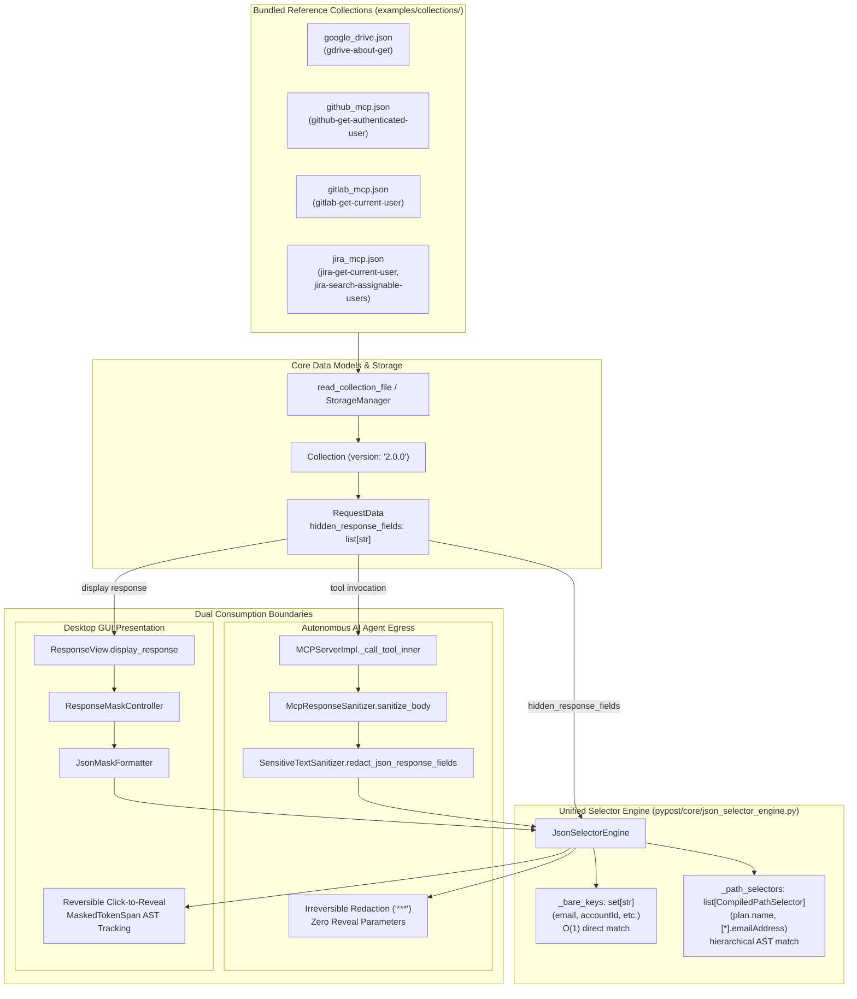

# PYPOST-1395: [PYPOST-1312] Add sample hidden_response_fields to remaining example collections

## Research

### Background & Existing Masking Infrastructure

In Epic [PYPOST-1312](https://pypost.atlassian.net/browse/PYPOST-1312), PyPost established a unified dual-surface response field masking architecture:
1. **Desktop GUI Presentation (`ResponseView`)**: Interactive presentation layer using `ResponseMaskController` and `FoldableCodeView`. Response fields matching configured selectors are rendered with `"***"` placeholders with visual underline affordances and support in-place click-to-reveal toggling for screen sharing and presentations.
2. **Autonomous AI Agent Safety (`MCPServerImpl`)**: Egress boundary using `McpResponseSanitizer` and `SensitiveTextSanitizer`. Response fields matching configured selectors are permanently redacted as `***`, preventing sensitive PII or credentials from entering LLM context tokens or remote agent logs.
3. **Pristine In-Memory State**: Masking is purely a presentation and serialization transformation; internal `ResponseData.body` objects remain pristine for scripting, history tracking, and auditing.
4. **Unified Selector Engine (`JsonSelectorEngine`)**: Consolidates selector compilation, bare key partitioning ($O(1)$ lookup), dotted path matching, and array wildcard handling across both GUI and MCP subsystems.

### Audit of Bundled Reference Collections

During the initial feature rollout in [PYPOST-1380](https://pypost.atlassian.net/browse/PYPOST-1380), only the Google Drive collection (`examples/collections/google_drive.json`) was updated to showcase `hidden_response_fields` on request `gdrive-about-get` (`GET {{ google_drive_base_url }}/about`):
```json
"hidden_response_fields": [
  "emailAddress",
  "permissionId",
  "user.emailAddress"
]
```

An audit of the remaining curated catalog collections in `examples/collections/` revealed:
- **`examples/collections/github_mcp.json`** (30 requests):
  - Request `github-get-authenticated-user` (`GET {{ github_api_url }}/user`) returns the authenticated user's profile.
  - Typical GitHub `/user` payload includes sensitive personal and account data: `email`, `two_factor_authentication`, `total_private_repos`, `owned_private_repos`, and nested billing metadata `plan: {"name": "pro", "space": 400, ...}`.
  - Currently, `hidden_response_fields` is omitted across all 30 GitHub requests.
- **`examples/collections/gitlab_mcp.json`** (24 requests):
  - Request `gitlab-get-current-user` (`GET {{ gitlab_base_url }}/api/v4/user`) returns the authenticated user's profile.
  - Typical GitLab `/api/v4/user` payload includes user PII: `email`, `commit_email`, and `public_email`.
  - Currently, `hidden_response_fields` is omitted across all 24 GitLab requests.
- **`examples/collections/jira_mcp.json`** (23 requests):
  - Request `jira-get-current-user` (`GET {{ jira_base_url }}/rest/api/3/myself`) returns current Atlassian user details, including `accountId` and `emailAddress`.
  - Request `jira-search-assignable-users` (`GET {{ jira_base_url }}/rest/api/3/user/assignable/search`) returns a root JSON array of user objects: `[{"accountId": "...", "emailAddress": "...", "displayName": "..."}]`.
  - Currently, `hidden_response_fields` is omitted across all 23 Jira requests.

### Clarification on Jira Epic Mentions ("Slack, Notion")

The Jira epic summary mentions "(e.g. GitHub, Slack, Notion, Jira)". An inspection of the repository reveals that PyPost currently bundles only GitHub, GitLab, Jira Cloud, Google Drive, and Gurushots collections. No Slack or Notion collections or environments exist in the repository. The scope of PYPOST-1395 is strictly to expand `hidden_response_fields` to the actual remaining bundled reference collections shipped with the repository (`github_mcp.json`, `gitlab_mcp.json`, and `jira_mcp.json`).

### Selector Syntax Capabilities in `JsonSelectorEngine`

The centralized engine in `pypost/core/json_selector_engine.py` supports four distinct selector patterns:
1. **Bare Keys (e.g. `email`, `emailAddress`, `two_factor_authentication`)**:
   Matches the field name at any level or depth within dictionaries or lists. Pre-compiled into an internal set `_bare_keys` for $O(1)$ lookup.
2. **Dotted Object Paths (e.g. `plan.name`, `user.emailAddress`)**:
   Matches specific hierarchical property paths starting from document root. Compiled into `CompiledPathSelector` tuples.
3. **Array Wildcard Paths (e.g. `[*].emailAddress`, `items[*].secret`, `users.*.email`)**:
   Matches elements within arrays at specific levels. Normalizes `[*]` and `.*.` tokens to match any array index.
4. **Header Selectors (e.g. `header:Authorization`)**:
   Filtered out from JSON body evaluation and routed to response header masking in `SensitiveTextSanitizer`.

---

## Implementation Plan

### High-Level Execution Sequence

```
1. Step 2 (Architecture Design) [CURRENT]
   → Document architecture, schema updates, selector patterns, and failing repro test design.
2. Step 3 (Failing Repro Test)
   → Write automated red contract test tests/test_reference_collection_masking_contract.py.
   → Assert red state: collections lack expected hidden_response_fields.
3. Step 4 (Development)
   → Update examples/collections/github_mcp.json (github-get-authenticated-user).
   → Update examples/collections/gitlab_mcp.json (gitlab-get-current-user).
   → Update examples/collections/jira_mcp.json (jira-get-current-user, jira-search-assignable-users).
   → Run tests to verify green state.
4. Step 5 (Code Cleanup)
   → Format JSON fixtures with 2-space indentation.
   → Run make lint, make typecheck, make check.
5. Step 6 (Observability)
   → Document and verify hidden_value_masks_applied_total metrics and structured logs.
6. Step 7 (Technical Debt Analysis)
   → Document tech debt analysis in ai-tasks/PYPOST-1395/60-tech-debt.md.
7. Step 8 (Dev Docs)
   → Update doc/dev/hidden_response_fields.md with the expanded reference collection inventory.
```

### Mandatory — Failing Repro (next Step 3)

- **Test File Location**: `tests/test_reference_collection_masking_contract.py`
- **What It Asserts**:
  1. **GitHub MCP Collection (`examples/collections/github_mcp.json`)**:
     - Request `github-get-authenticated-user` has `hidden_response_fields == ["email", "two_factor_authentication", "plan.name"]`.
     - Demonstrates bare key masking (`email`, `two_factor_authentication`) and dotted object path masking (`plan.name`).
     - Simulating execution with a mock GitHub `/user` payload verifies that `email`, `two_factor_authentication`, and `plan.name` are redacted to `***` in MCP output and rendered with interactive click-to-reveal spans in desktop `ResponseView`.
  2. **GitLab MCP Collection (`examples/collections/gitlab_mcp.json`)**:
     - Request `gitlab-get-current-user` has `hidden_response_fields == ["email", "commit_email", "public_email"]`.
     - Demonstrates multiple bare key selectors targeting distinct PII email attributes.
     - Simulating execution with a mock GitLab `/api/v4/user` payload verifies masking across both surfaces.
  3. **Jira Cloud MCP Collection (`examples/collections/jira_mcp.json`)**:
     - Request `jira-get-current-user` has `hidden_response_fields == ["emailAddress", "accountId"]`.
     - Request `jira-search-assignable-users` has `hidden_response_fields == ["[*].emailAddress", "[*].accountId"]`.
     - Demonstrates root array wildcard selectors (`[*].emailAddress`, `[*].accountId`) on endpoints returning collections of user objects.
     - Simulating execution with mock Jira user and search responses verifies that root array elements are cleanly redacted across both MCP and GUI layers.
  4. **Pydantic Model & Serialization Invariants**:
     - Each collection parses into `pypost.models.models.Collection` with `version == "2.0.0"`.
     - Round-trip serialization (`read_collection_file(path).model_dump_json()`) preserves `hidden_response_fields` with exact fidelity.
     - `ResponseData.body` remains unmutated throughout all masking transformations.
- **How to Force the Failure without Live External Dependencies**:
  - The test runs completely offline without network calls, loading files directly from `examples/collections/` via `read_collection_file`.
  - In Step 3, before modifying the JSON files, running `make test PYTEST_ARGS="tests/test_reference_collection_masking_contract.py"` will fail immediately with an `AssertionError` because `hidden_response_fields` on the targeted requests is currently `[]` (empty list).
- **Sequencing**:
  - Step 2: Establish architecture and test design.
  - Step 3: Write `tests/test_reference_collection_masking_contract.py` and confirm failure (red state).
  - Step 4: Apply JSON schema updates in `github_mcp.json`, `gitlab_mcp.json`, and `jira_mcp.json` until `make test PYTEST_ARGS="tests/test_reference_collection_masking_contract.py"` passes (green state), followed by `make check`.

---

## Architecture

### System Architecture & Data Flow



### Schema Updates for Bundled Example Collections

#### 1. `examples/collections/github_mcp.json`

Target request: `github-get-authenticated-user` (`GET {{ github_api_url }}/user`).
Demonstrates:
- **Bare Keys**: `"email"`, `"two_factor_authentication"`
- **Dotted Object Path**: `"plan.name"`

```json
{
  "id": "github-get-authenticated-user",
  "name": "GitHub Get Authenticated User",
  "method": "GET",
  "url": "{{ github_api_url }}/user",
  "headers": {
    "Accept": "application/vnd.github+json",
    "X-GitHub-Api-Version": "2022-11-28",
    "Authorization": "Bearer {{ github_token }}"
  },
  "params": {},
  "body": "",
  "body_type": "json",
  "yaml_as_json": false,
  "post_script": "",
  "expose_as_mcp": true,
  "mcp_description": "Return the GitHub user that owns the configured token with masked PII and account secrets.",
  "mcp_params": {},
  "retry_policy": null,
  "hidden_response_fields": [
    "email",
    "two_factor_authentication",
    "plan.name"
  ]
}
```

#### 2. `examples/collections/gitlab_mcp.json`

Target request: `gitlab-get-current-user` (`GET {{ gitlab_base_url }}/api/v4/user`).
Demonstrates:
- **Bare Keys**: Multiple distinct email scopes (`"email"`, `"commit_email"`, `"public_email"`)

```json
{
  "id": "gitlab-get-current-user",
  "name": "GitLab Get Current User",
  "method": "GET",
  "url": "{{ gitlab_base_url }}/api/v4/user",
  "headers": {
    "Accept": "application/json",
    "Authorization": "Bearer {{ gitlab_token }}"
  },
  "params": {},
  "body": "",
  "body_type": "json",
  "yaml_as_json": false,
  "post_script": "",
  "expose_as_mcp": true,
  "mcp_description": "Return the GitLab user that owns the configured access token with masked PII response fields.",
  "mcp_params": {},
  "retry_policy": null,
  "hidden_response_fields": [
    "email",
    "commit_email",
    "public_email"
  ]
}
```

#### 3. `examples/collections/jira_mcp.json`

Target request 1: `jira-get-current-user` (`GET {{ jira_base_url }}/rest/api/3/myself`).
Demonstrates:
- **Bare Keys**: Sensitive Atlassian PII and identifiers (`"emailAddress"`, `"accountId"`)

```json
{
  "id": "jira-get-current-user",
  "name": "Jira Get Current User",
  "method": "GET",
  "url": "{{ jira_base_url }}/rest/api/3/myself",
  "headers": {
    "Accept": "application/json",
    "Authorization": "Basic {{ base64(jira_credentials) }}"
  },
  "params": {},
  "body": "",
  "body_type": "json",
  "yaml_as_json": false,
  "post_script": "",
  "expose_as_mcp": true,
  "mcp_description": "Return the authenticated Jira user with masked PII response fields.",
  "mcp_params": {},
  "retry_policy": null,
  "hidden_response_fields": [
    "emailAddress",
    "accountId"
  ]
}
```

Target request 2: `jira-search-assignable-users` (`GET {{ jira_base_url }}/rest/api/3/user/assignable/search`).
Demonstrates:
- **Array Wildcard Paths**: Root array wildcard selectors (`"[*].emailAddress"`, `"[*].accountId"`)

```json
{
  "id": "jira-search-assignable-users",
  "name": "Jira Search Assignable Users",
  "method": "GET",
  "url": "{{ jira_base_url }}/rest/api/3/user/assignable/search",
  "headers": {
    "Accept": "application/json",
    "Authorization": "Basic {{ base64(jira_credentials) }}"
  },
  "params": {
    "project": "{{ jira_project_key }}",
    "query": "{{ mcp.request.query }}",
    "maxResults": "{{ to_int(mcp.request.maxResults) }}",
    "startAt": "{{ to_int(mcp.request.startAt) }}"
  },
  "body": "",
  "body_type": "json",
  "yaml_as_json": false,
  "post_script": "",
  "expose_as_mcp": true,
  "mcp_description": "Search Jira users assignable to issues with masked PII and account identifiers in user array results.",
  "mcp_params": {
    "query": {
      "type": "string",
      "description": "Optional search string to match against user name or email address.",
      "required": false,
      "default": ""
    },
    "maxResults": {
      "type": "integer_or_string",
      "description": "Optional maximum results to return (integer or decimal string; defaults to 50).",
      "required": false,
      "default": 50
    },
    "startAt": {
      "type": "integer_or_string",
      "description": "Optional zero-based starting index for pagination (integer or decimal string; defaults to 0).",
      "required": false,
      "default": 0
    }
  },
  "retry_policy": null,
  "hidden_response_fields": [
    "[*].emailAddress",
    "[*].accountId"
  ]
}
```

### Selector Pattern Taxonomy

The configurations across the reference collections demonstrate the complete spectrum of supported selector patterns:

| Pattern Category | Selector Example | Target Collection & Request | Semantics & Rationale |
| :--- | :--- | :--- | :--- |
| **Bare Key** | `email`, `two_factor_authentication` | GitHub: `github-get-authenticated-user` | Matches top-level or nested key by exact name anywhere in the payload; evaluated via $O(1)$ set lookup. |
| **Bare Key** | `email`, `commit_email`, `public_email` | GitLab: `gitlab-get-current-user` | Masks distinct email fields with different visibility scopes in GitLab's identity model. |
| **Bare Key** | `emailAddress`, `accountId` | Jira: `jira-get-current-user` | Protects Atlassian account identity and email in single-object responses. |
| **Dotted Object Path** | `plan.name` | GitHub: `github-get-authenticated-user` | Matches nested key strictly under the `plan` object; preserves sibling fields outside `plan`. |
| **Dotted Object Path** | `user.emailAddress` | Google Drive: `gdrive-about-get` | Matches nested property within the `user` object. |
| **Array Wildcard Path** | `[*].emailAddress`, `[*].accountId` | Jira: `jira-search-assignable-users` | Traverses root JSON array of user objects, masking target fields across every element. |

### Integration Points

1. **Model & Serialization Layer (`pypost/models/models.py`, `pypost/core/collection_serializer.py`)**:
   - `RequestData.hidden_response_fields: list[str] = Field(default_factory=list)`.
   - Serialized as standard JSON list in collection files.
   - Pydantic models automatically validate and preserve selector lists across deserialization and serialization.
2. **MCP Tool Egress Sanitization (`pypost/core/mcp_server_impl.py`, `pypost/core/sensitive_text_sanitizer.py`)**:
   - `MCPServerImpl._call_tool_inner` extracts `hidden_fields = item.hidden_response_fields`.
   - `McpResponseSanitizer.sanitize_body` coordinates redaction through `SensitiveTextSanitizer.redact_json_response_fields`.
   - Delegates directly to `JsonSelectorEngine.redact_tree(payload, placeholder="***")`.
   - Returns permanently masked payload without revealing parameters or auxiliary tools.
3. **Desktop GUI Presentation (`pypost/ui/widgets/response_view.py`, `pypost/ui/widgets/response_mask_controller.py`)**:
   - `ResponseView.display_response(response, hidden_fields)` passes selectors to `JsonMaskFormatter`.
   - Formatter uses `JsonSelectorEngine.matches(path, key)` to detect sensitive tokens during AST traversal.
   - Generates formatted JSON buffer with `"***"` and records `MaskedTokenSpan(start_pos, end_pos, raw_value, masked_value)`.
   - Viewport event filter detects left-clicks and executes in-place `QTextCursor` toggles between masked and raw text, adjusting downstream span offsets.
4. **Offline Contract Testing (`tests/test_reference_collection_masking_contract.py`)**:
   - Verifies all four reference collections (`google_drive.json`, `github_mcp.json`, `gitlab_mcp.json`, `jira_mcp.json`) conform to schema and masking contracts.

---

## Q&A

- **Q1: Why update `jira-search-assignable-users` in addition to `jira-get-current-user`?**
  **A**: The requirements call for demonstrating realistic selector patterns including bare keys, dotted object paths, and array wildcards. While user-profile endpoints (`github-get-authenticated-user`, `gitlab-get-current-user`, `jira-get-current-user`) return single JSON objects that showcase bare keys and dotted paths, `jira-search-assignable-users` returns a root JSON array of user objects. Configuring `[*].emailAddress` and `[*].accountId` on `jira-search-assignable-users` provides an authentic, out-of-the-box demonstration of array wildcard path evaluation (`[*]`).

- **Q2: Why are Slack and Notion collections not being created?**
  **A**: The Jira epic description uses Slack and Notion as generic examples of cloud services ("e.g. GitHub, Slack, Notion, Jira"). The PyPost repository does not author or bundle Slack or Notion collections. Authoring entirely new third-party API suites is out of scope for this technical debt task. The scope is strictly to configure `hidden_response_fields` in the remaining bundled collections (`github_mcp.json`, `gitlab_mcp.json`, `jira_mcp.json`).

- **Q3: How do array wildcards behave on root arrays versus nested arrays in `JsonSelectorEngine`?**
  **A**: `JsonSelectorEngine` normalizes `[*]` selectors. For a root array (e.g. `[{"accountId": "..."}]`), the path to `accountId` in element 0 is `["0"]`. The selector `[*].accountId` compiles to `('*', 'accountId')`. When evaluating node `0.accountId`, the `*` matches the numeric array index `"0"`, and `accountId` matches the property key. For nested arrays (e.g. `items[*].secret`), the tokens are `('items', '*', 'secret')`, which similarly matches any index within the `items` array.

- **Q4: Do these updates affect locked REST path catalogs (`github_mcp_rest_paths.json`, `gitlab_mcp_rest_paths.json`, `jira_mcp_critical_rest_paths.json`)?**
  **A**: No. The locked catalogs assert request IDs, HTTP methods, REST path fragments, and input `mcp_params`. They do not assert response masking fields. Updating `hidden_response_fields` in collection files is completely non-breaking and does not trigger path drift assertions.

- **Q5: How is offline testing guaranteed without live network credentials?**
  **A**: All automated tests operate entirely offline. The contract tests load the local JSON files directly from `examples/collections/` using `read_collection_file`, validate them against PyPost's Pydantic `Collection` schema, and pass authentic mock JSON payloads through `format_structured_tool_result` and `ResponseView.display_response`. No external HTTP calls are made.
