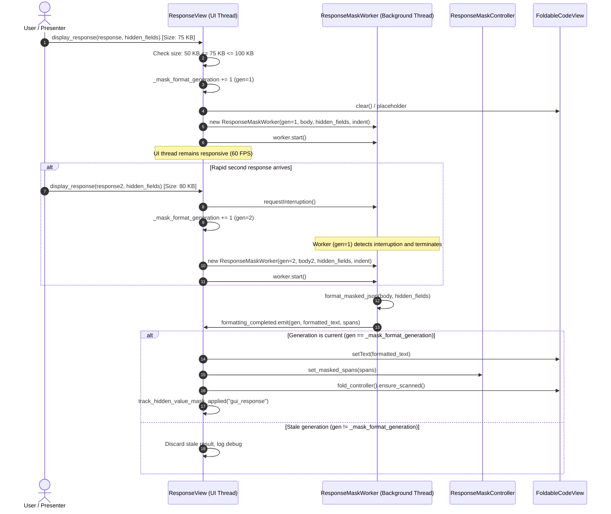

# PYPOST-1396: [PYPOST-1312] Background worker thread formatting for medium-size JSON response masking

## Research

### Background & Context

In Epic [PYPOST-1312](https://pypost.atlassian.net/browse/PYPOST-1312), PyPost introduced presentation-layer response masking (`hidden_response_fields`) across both the desktop graphical user interface (`ResponseView`) and the autonomous agent egress boundary (`MCPServerImpl`). In the desktop GUI, sensitive response values (passwords, auth tokens, client secrets, customer PII) matching configured selectors are visually masked with `"***"` placeholders while preserving in-place click-to-reveal toggling for secure screen sharing and live demonstrations.

Response payloads in the desktop viewer fall into three distinct operating bands:
1. **Small Payloads (< 50 KB)**: Parse and format almost instantaneously (< 5 ms) directly on the main user interface thread, well within the 16.6 ms frame budget for 60 FPS desktop responsiveness.
2. **Very Large Payloads (> 100 KB)**: Automatically bypass pretty-printing and interactive token tracking via `LARGE_DOC_CHAR_THRESHOLD` (100 * 1024 characters), rendering raw text to protect the editor from high rendering loads.
3. **Medium Payloads (50 KB – 100 KB)**: Contain hundreds of JSON lines, deep nesting, and dozens of keys. In the current implementation, `ResponseView.display_response()` synchronously invokes `format_masked_json(body_str, hidden_fields, indent=self.indent_size)` directly on the main UI thread. This performs JSON deserialization, recursive dictionary/list AST traversal, `JsonSelectorEngine` matching, masked token span indexing, and string formatting. On standard developer laptops and virtual machines, this blocks the main UI event loop for 15–60+ ms, producing perceptible UI stutter, input lag, and frame drops during response inspection or rapid tab switching.

### Codebase Analysis

#### 1. Current Masking Flow in `ResponseView` (`pypost/ui/widgets/response_view.py`)
In `ResponseView.display_response()`:
- `body_str` is extracted from `ResponseData.body`.
- If `len(body_str) > LARGE_DOC_CHAR_THRESHOLD` (100 * 1024), formatting and masking are bypassed:
  ```python
  self.body_view.setText(body_str)
  ```
- If `len(body_str) <= LARGE_DOC_CHAR_THRESHOLD` and format is JSON with `hidden_fields`:
  ```python
  pretty_json, spans = format_masked_json(
      body_str, hidden_fields, indent=self.indent_size
  )
  self.body_view.setText(pretty_json)
  self.mask_controller.set_masked_spans(spans)
  ```
  This is executed synchronously on the main UI thread regardless of whether the payload is 500 bytes or 95 KB.

#### 2. Response Mask Controller (`pypost/ui/widgets/response_mask_controller.py`)
- `MaskedTokenSpan`: Dataclass tracking `start_pos`, `end_pos`, `raw_value`, `masked_value`, `is_revealed`, and `path`.
- `JsonMaskFormatter`: Formats JSON while running `JsonSelectorEngine` matching and collecting `MaskedTokenSpan` objects.
- `format_masked_json(raw_json, hidden_fields, indent)`: Top-level helper function returning `tuple[str, list[MaskedTokenSpan]]`.
- `ResponseMaskController`: QObject managing `QTextEdit.ExtraSelection` highlights, viewport mouse event filtering (hover cursor, tooltips), and click-to-reveal toggling.
- Critical architectural requirement: `JsonMaskFormatter` and `format_masked_json` have no dependencies on Qt GUI widgets (`QWidget`, `QTextDocument`, `QTextCursor`). They operate strictly on raw Python primitives (`str`, `dict`, `list`, `int`), making them 100% thread-safe to execute on a background worker thread.

#### 3. Established Worker Patterns in PyPost Codebase
PyPost already employs dedicated background workers for CPU-intensive formatting and scanning tasks:
- **`FoldScanWorker` (`pypost/ui/widgets/fold/fold_worker.py`)**:
  - Subclasses `QThread`.
  - Maintains `_LIVE_WORKERS: ClassVar[set[FoldScanWorker]] = set()` to prevent C++ destruction crashes if Python drops a reference while the OS thread is active.
  - Implements cooperative interruption via `requestInterruption()` and `isInterruptionRequested()`.
  - Dispatches results via Qt Signals (`scan_completed = Signal(int, list)`).
  - Uses a monotonic generation counter (`_generation: int`) to invalidate stale scans when the user types or updates the document before previous background scanning completes.
- **`PasteJsonFormatWorker` (`pypost/ui/widgets/paste_json_worker.py`)**:
  - Subclasses `QThread`.
  - Formats pasted JSON off the UI thread and signals results via `finished_with_result = Signal(int, object)`.
  - Uses `generation_id` validation before applying formatted text to the editor.

### Key Architectural Insights

1. **Thread Affinity & GUI Safety**:
   - In PySide6 / Qt, GUI widgets (`FoldableCodeView`, `QTextDocument`, labels) must never be accessed or modified from a background thread.
   - The worker must receive immutable inputs (`text: str`, `hidden_fields: tuple[str, ...]`, `indent: int`), perform AST formatting and span calculation, and return the formatted string and span list through a Qt Signal across thread boundaries.
   - Qt QueuedConnection automatically schedules signal delivery onto the receiver's thread event loop (the main UI thread).

2. **Security & Visual State During In-Flight Worker**:
   - If `body_view` were populated with unmasked raw text while background formatting runs, sensitive secrets would flash on screen for 15–60 ms before masking takes effect. This would violate the primary purpose of presentation masking (safe screen sharing).
   - Therefore, while background formatting is in-flight, `body_view` must display a clean intermediate state (clearing previous content or setting a neutral loading placeholder such as `"Formatting masked response..."`) without revealing raw secrets.
   - The status labels (status code, elapsed time, payload size) update immediately so the user has immediate feedback that the request completed.

3. **Lifecycle Management & Preemption**:
   - When a user sends multiple requests in rapid succession or switches tabs, the response viewer may receive multiple `display_response()` calls in short intervals.
   - An active worker must be cooperatively interrupted (`requestInterruption()`), its reference detached, and its generation superseded.
   - If a superseded worker finishes, its signal handler detects `generation != self._mask_format_generation` and drops the stale result without updating the view.
   - Calling `clear_body()` must cooperatively interrupt any running worker and increment the generation counter so no pending results are rendered.

4. **Boundary Thresholds**:
   - `MEDIUM_DOC_CHAR_THRESHOLD = 50 * 1024` (50 KB = 51,200 chars).
   - `LARGE_DOC_CHAR_THRESHOLD = 100 * 1024` (100 KB = 102,400 chars).
   - Three paths:
     - `len(body_str) < MEDIUM_DOC_CHAR_THRESHOLD`: Synchronous fast path (sub-5 ms, no thread overhead).
     - `MEDIUM_DOC_CHAR_THRESHOLD <= len(body_str) <= LARGE_DOC_CHAR_THRESHOLD`: Background worker thread path with non-blocking UI.
     - `len(body_str) > LARGE_DOC_CHAR_THRESHOLD`: Large document bypass path (raw text, no AST/spans).

---

## Implementation Plan

### High-Level Execution Sequence

```
1. Step 2 (Architecture Design) [CURRENT]
   → Document architecture, worker lifecycle, signal contracts, threshold dispatch, and failing repro test design.
2. Step 3 (Failing Repro Test)
   → Write automated red test tests/test_response_mask_worker.py.
   → Assert red state: ResponseMaskWorker missing, ResponseView lacks background worker dispatch and generation tracking.
3. Step 4 (Development)
   → Implement ResponseMaskWorker in pypost/ui/widgets/response_mask_worker.py.
   → Integrate ResponseMaskWorker lifecycle into ResponseView (pypost/ui/widgets/response_view.py).
   → Add MEDIUM_DOC_CHAR_THRESHOLD constant and 3-way boundary routing.
   → Run tests to verify green state.
4. Step 5 (Code Cleanup)
   → Run make lint, make typecheck, make check.
   → Document cleanup in ai-tasks/PYPOST-1396/40-code-cleanup.md.
5. Step 6 (Observability)
   → Implement and verify structured debug logs (dispatch, completion, cancellation, stale discard, fallback).
   → Verify metrics tracking (track_hidden_value_mask_applied) and zero secret leakage.
   → Document in ai-tasks/PYPOST-1396/50-observability.md.
6. Step 7 (Technical Debt Analysis)
   → Analyze technical debt in ai-tasks/PYPOST-1396/60-tech-debt.md.
7. Step 8 (Dev Docs)
   → Update doc/dev/architecture.md and doc/dev/hidden_response_fields.md.
```

### Mandatory — Failing Repro (next Step 3)

- **Test File Location**: `tests/test_response_mask_worker.py`
- **What It Asserts**:
  1. **Threshold Boundary Dispatch**:
     - Payload < 50 KB (< `MEDIUM_DOC_CHAR_THRESHOLD`) with `hidden_response_fields` formats synchronously without launching `ResponseMaskWorker` (`_mask_worker is None`).
     - Payload 50 KB – 100 KB (`MEDIUM_DOC_CHAR_THRESHOLD` to `LARGE_DOC_CHAR_THRESHOLD`) with `hidden_response_fields` dispatches to `ResponseMaskWorker`, keeping UI responsive.
     - Payload > 100 KB (> `LARGE_DOC_CHAR_THRESHOLD`) bypasses formatting and renders raw text directly.
  2. **Thread Isolation**:
     - `ResponseMaskWorker` runs on a distinct thread (`worker.thread() != QApplication.instance().thread()`).
     - Formatting computation executes off the main UI thread.
  3. **Visual & Formatting Equivalence**:
     - Formatted output and detected `MaskedTokenSpan` coordinates from `ResponseMaskWorker` match `format_masked_json` synchronous output character-for-character.
     - Click-to-reveal toggling works identically on the background-formatted document.
  4. **Preemption & Cancellation on Rapid Succession**:
     - Dispatching a second response while a worker is running for generation $N$ cooperatively interrupts generation $N$, dispatches generation $N+1$, and discards stale results from generation $N$.
  5. **Clean Reset on `clear_body()`**:
     - Calling `clear_body()` while a worker is running interrupts the worker, detaches it, and prevents any delayed formatting from populating the cleared view.
  6. **Graceful Fallback on Malformed JSON**:
     - When payload contains invalid JSON syntax, worker catches `json.JSONDecodeError` / `ValueError` and signals failure, causing `ResponseView` to safely display raw body text without UI freeze or error dialogs.
  7. **Observability & Secret Protection**:
     - Structured logs contain generation, payload size, span count, and duration.
     - Zero raw secret strings appear in any log message.
- **How to Force the Failure without Live External Dependencies**:
  - The test generates synthetic in-memory JSON payloads using `json.dumps()`:
    - 25 KB payload for small threshold verification.
    - 75 KB payload for medium background worker verification.
    - 125 KB payload for large bypass verification.
  - In Step 3, before implementing `ResponseMaskWorker` and the `ResponseView` updates, the test suite will fail immediately with `ImportError: cannot import name 'ResponseMaskWorker'` or `AssertionError: active worker was not dispatched for 75 KB payload`.
- **Sequencing**:
  - Step 2: Finalize architecture design and repro test specification.
  - Step 3: Implement `tests/test_response_mask_worker.py` and confirm red failure.
  - Step 4: Implement `ResponseMaskWorker` and wire into `ResponseView` until all tests pass green, followed by full `make check`.

---

## Architecture

### System Architecture Diagram

```mermaid
flowchart TD
    subgraph UI_Thread["Main UI Thread (Qt Event Loop)"]
        RV["ResponseView\ndisplay_response(resp, hidden_fields)"]
        TH_CHECK{"Check Payload Size\nlen(body_str)"}
        SYNC_PATH["Fast Path (< 50 KB)\nformat_masked_json()"]
        LARGE_PATH["Bypass Path (> 100 KB)\nDirect raw setText()"]
        MEDIUM_PATH["Medium Path (50-100 KB)\nDispatch ResponseMaskWorker"]
        
        MC["ResponseMaskController\nset_masked_spans() / handle_click()"]
        BV["FoldableCodeView (body_view)\nsetText()"]
        GEN["_mask_format_generation: int\nPreemption & cancellation gate"]
    end

    subgraph Worker_Thread["Background Worker Thread (QThread)"]
        RMW["ResponseMaskWorker\nrun()"]
        JMF["format_masked_json()\n- json.loads()\n- JsonMaskFormatter AST traversal\n- JsonSelectorEngine matching\n- MaskedTokenSpan coordinate tracking"]
        INT_CHECK{"isInterruptionRequested()"}
    end

    RV --> TH_CHECK
    TH_CHECK -->|"< 50 KB"| SYNC_PATH
    TH_CHECK -->|"> 100 KB"| LARGE_PATH
    TH_CHECK -->|"50 KB - 100 KB"| MEDIUM_PATH

    SYNC_PATH --> BV
    SYNC_PATH --> MC
    LARGE_PATH --> BV

    MEDIUM_PATH -->|1. Increment generation| GEN
    MEDIUM_PATH -->|2. Cancel prior worker| RMW
    MEDIUM_PATH -->|3. Set placeholder / clear| BV
    MEDIUM_PATH -->|4. worker.start()| RMW

    RMW --> INT_CHECK
    INT_CHECK -->|"No"| JMF
    INT_CHECK -->|"Yes"| CANCELLED["Abort without signal"]
    
    JMF -->|Signal: formatting_completed| ON_COMPLETED["ResponseView._on_mask_formatting_completed\nCheck generation == current"]
    JMF -->|Signal: formatting_failed| ON_FAILED["ResponseView._on_mask_formatting_failed\nCheck generation == current"]

    ON_COMPLETED --> BV
    ON_COMPLETED --> MC
    ON_FAILED -->|"Fallback raw body"| BV
```

### Module Responsibilities

| Module / Component | Location | Responsibility |
| --- | --- | --- |
| `ResponseMaskWorker` | `pypost/ui/widgets/response_mask_worker.py` | Dedicated `QThread` subclass. Offloads AST parsing, indentation, selector matching, and `MaskedTokenSpan` coordinate indexing off the main thread. Supports cooperative interruption via `requestInterruption()`. Manages `_LIVE_WORKERS` to guarantee safe thread lifecycle. |
| `ResponseView` | `pypost/ui/widgets/response_view.py` | UI response widget. Evaluates operating band thresholds (`MEDIUM_DOC_CHAR_THRESHOLD`, `LARGE_DOC_CHAR_THRESHOLD`). Dispatches `ResponseMaskWorker` for 50–100 KB JSON payloads with `hidden_fields`. Manages `_mask_format_generation`, cancels in-flight workers on preemption or `clear_body()`, and applies completed results back on the UI thread. |
| `ResponseMaskController` | `pypost/ui/widgets/response_mask_controller.py` | Manages `QTextEdit.ExtraSelection` highlights, viewport cursor handling, tooltips, and click-to-reveal toggling. Receives `list[MaskedTokenSpan]` once formatting completes. |
| `JsonMaskFormatter` | `pypost/ui/widgets/response_mask_controller.py` | Pure AST formatting engine. Executes in the background worker thread without GUI widget dependencies. |
| `JsonSelectorEngine` | `pypost/core/json_selector_engine.py` | Unified selector matching engine. Performs $O(1)$ bare key matching and hierarchical AST path evaluations inside the worker. |

### Module Interaction & Lifecycle Sequence



### Architectural Patterns & Justification

1. **Active Object / Asynchronous Worker Thread Pattern (`QThread`)**:
   - *Justification*: AST parsing and token span extraction for 50–100 KB payloads are CPU-bound and take 15–60+ ms. Running this in a separate worker thread offloads CPU work from the main Qt event loop, allowing UI mouse movement, scrolling, typing, and window resizing to remain uninterrupted at 60 FPS.
   - *Why QThread over threading.Thread*: `QThread` natively integrates with the Qt event loop, signal/slot mechanism, and thread-affinity rules. Passing results via Qt signals guarantees safe thread boundary crossing without manual mutexes or thread-locking bugs.
   - *Why QThread over QRunnable/QThreadPool*: `QThread` allows direct cooperative interruption via `requestInterruption()`, generation ID passing, and clean signal lifecycle connections (`finished.connect(worker.deleteLater)`). This directly mirrors `FoldScanWorker` and `PasteJsonFormatWorker`.

2. **Generation Counter Pattern (`_mask_format_generation: int`)**:
   - *Justification*: In desktop applications, users can rapidly execute requests, switch between collection items, or clear views. If multiple background workers finish out of order, an older worker's result could overwrite a newer response. The monotonic generation counter guarantees that only the most recently dispatched formatting result can ever update the view.

3. **Cooperative Cancellation (`requestInterruption()`)**:
   - *Justification*: Forcibly terminating threads in Python/C++ causes memory corruption, locked mutexes, or segmentation faults. Cooperative interruption allows the worker to check `self.isInterruptionRequested()` between parsing steps and cleanly exit without emitting signals or leaking memory.

4. **ClassVar Live Worker Tracking (`_LIVE_WORKERS: ClassVar[set[...]]`)**:
   - *Justification*: In PySide6, if a Python `QThread` wrapper is garbage collected while the underlying C++ operating system thread is still running, Python crashes with `QThread: Destroyed while thread is still running`. Retaining the worker in a class-level set until its `finished` signal fires guarantees memory stability.

### Interface & API Definitions

#### 1. Constants (`pypost/ui/widgets/response_view.py`)
```python
MEDIUM_DOC_CHAR_THRESHOLD = 50 * 1024  # 50 KB (51,200 characters)
LARGE_DOC_CHAR_THRESHOLD = 100 * 1024  # 100 KB (102,400 characters)
```

#### 2. `ResponseMaskWorker` Interface (`pypost/ui/widgets/response_mask_worker.py`)
```python
class ResponseMaskWorker(QThread):
    """Background worker QThread for formatting medium-size JSON responses with masking."""

    formatting_completed = Signal(int, str, list)  # (generation, formatted_text, spans)
    formatting_failed = Signal(int, str)           # (generation, raw_body)

    _LIVE_WORKERS: ClassVar[set[ResponseMaskWorker]] = set()

    def __init__(
        self,
        generation: int,
        raw_body: str,
        hidden_fields: Sequence[str],
        indent: int = 2,
        parent: QObject | None = None,
    ) -> None: ...

    def requestInterruption(self) -> None: ...
    def isInterruptionRequested(self) -> bool: ...
    def run(self) -> None: ...
```

#### 3. `ResponseView` Additions (`pypost/ui/widgets/response_view.py`)
```python
class ResponseView(QWidget):
    # Existing attributes...
    _mask_worker: ResponseMaskWorker | None = None
    _mask_format_generation: int = 0

    def display_response(
        self,
        response: ResponseData,
        hidden_fields: Sequence[str] | None = None,
    ) -> None:
        # 1. Update status labels immediately
        # 2. Cancel active _mask_worker if running
        # 3. Check format and body size:
        #    - If > LARGE_DOC_CHAR_THRESHOLD: raw bypass
        #    - If JSON and hidden_fields:
        #        - If < MEDIUM_DOC_CHAR_THRESHOLD: synchronous format_masked_json()
        #        - If 50 KB - 100 KB: dispatch ResponseMaskWorker
        #    - Else (no hidden_fields): standard pretty-print or raw text

    def clear_body(self) -> None:
        # Cancel active _mask_worker, increment generation, clear view

    def _on_mask_formatting_completed(
        self, generation: int, formatted_text: str, spans: list[MaskedTokenSpan]
    ) -> None:
        # Verify generation == self._mask_format_generation
        # Apply formatted_text to body_view
        # Apply spans to mask_controller
        # Rescan fold controller
        # Track metrics if spans exist

    def _on_mask_formatting_failed(self, generation: int, raw_body: str) -> None:
        # Fallback to raw_body on body_view
```

---

## Q&A

- **Q: Why not use `QThreadPool` and `QRunnable` instead of `QThread`?**
  - **A**: `QRunnable` lacks native Qt signal support (requiring custom helper classes inheriting from `QObject` to emit signals) and does not have built-in cooperative interruption (`requestInterruption()`). `QThread` provides direct signal emission, interruption support, thread identification, and deterministic cleanup, matching existing repository patterns (`FoldScanWorker`, `PasteJsonFormatWorker`).

- **Q: What happens if the response payload has malformed JSON syntax?**
  - **A**: The background worker catches `json.JSONDecodeError`, `ValueError`, and general parsing exceptions inside its `run()` loop. Instead of crashing, it emits `formatting_failed(generation, raw_body)`. The main thread receives this signal and safely displays `raw_body` without masking, logging a debug warning.

- **Q: Could secrets be exposed if a user clicks or views the editor before the background worker finishes?**
  - **A**: No. While background formatting is in-flight, `body_view` is cleared or shows an uninformative placeholder (`"Formatting masked response..."`). Raw unmasked text containing sensitive tokens is never inserted into the `QTextDocument` prior to masking.

- **Q: How does this interact with code folding and syntax highlighting?**
  - **A**: Syntax highlighting (`JsonHighlighter`) operates on the document content automatically once `setText()` is called on the main thread. Code folding (`FoldController.ensure_scanned()`) is triggered immediately after `body_view.setText(formatted_text)` and `mask_controller.set_masked_spans(spans)`, ensuring fold regions and masked spans are completely synchronized.

- **Q: Why is the threshold based on character length (`len(body_str)`) rather than byte count?**
  - **A**: In Python and PySide6, strings and `QTextDocument` indices operate in UTF-16 code units / Unicode characters, and `LARGE_DOC_CHAR_THRESHOLD` is already defined in characters (`100 * 1024`). Using character length ensures consistency across all threshold checks without redundant UTF-8 re-encoding overhead.
