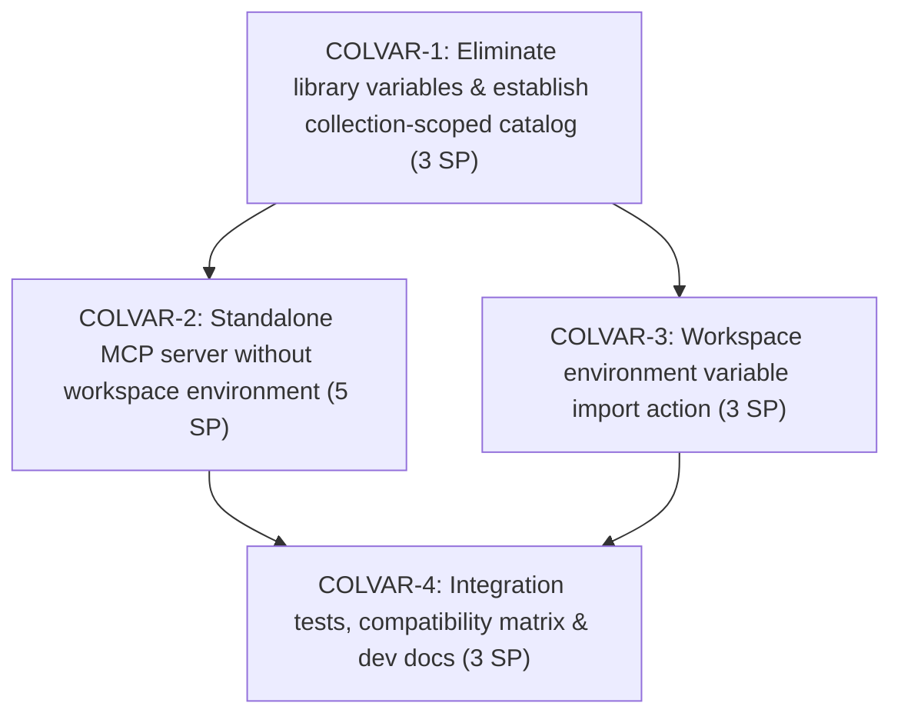

# PYPOST-1407 Decomposition Notes: Collection-Scoped Variables

## Epic Overview

**Epic Key**: [PYPOST-1407](https://pypost.atlassian.net/browse/PYPOST-1407)  
**Summary**: Collection-scoped variables for standalone MCP servers and workspace collection import  
**Sprint**: 2033 (Collection-Scoped Variables)  

### Problem Statement

In the existing PyPost architecture, collection libraries define variables and preset profiles at the overall library manifest level ("library variables"). This design presents significant operational and architectural drawbacks:
1. **Global Variable Pollution**: Variables across unrelated collections within the same library (e.g., Jira, GitLab, GitHub) are aggregated into a single global namespace. Users face cluttered variable lists and potential naming collisions.
2. **Forced Workspace Environment for MCP Servers**: When a user creates or launches an MCP server from a library collection, the system mandates selecting or configuring an Environment in their user workspace. This violates the self-contained nature of library collections, which should run out of the box with their own parameters.
3. **Missing Variable Bridge on Collection Copy**: When a user copies a library collection into their workspace, there is no integrated, intuitive mechanism in the environment variables view to import the variables declared by that collection into their workspace environment.
4. **Data Model Redundancy**: Both `LibraryManifest` and `Collection` models define `variables` and `presets`, creating confusion regarding variable provenance and authority.

### Scope and Constraints

- **Granularity & Sizing**: Sized strictly into small, deliverable child tasks (each ≤ 5 Story Points using the Fibonacci scale 1, 2, 3, 5).
- **Sprint Alignment**: All child tasks created from this decomposition belong to **Sprint 2033** ("Collection-Scoped Variables").
- **Workflow Compliance**: Each child story will execute a full Top-Down development lifecycle (Steps 1–8).
- **Quality Gates**: All code changes must pass repository quality gates (`make check`).

---

## Business Goals & Acceptance Criteria

### Core Business Concepts

1. **Catalog-Only Collection Library**: A Collection Library serves strictly as a catalog of collections and does not define global variables or library-level presets.
2. **Self-Contained Collections**: Each collection is self-contained: it specifies all variables, descriptions, types, secrets, and presets required for its operation.
3. **Standalone MCP Server Creation**: When a user creates an MCP server from a library collection, the server configures and runs directly using the collection's defined variables and presets. Users are not required to create or select an Environment in their user workspace.
4. **Workspace Collection Copy & Variable Import**: When a user copies a library collection into their workspace, the environment variables view provides an intuitive action to import variables defined by that collection.

### Business Acceptance Criteria

- The concept of "library variables" is eliminated; variables and presets belong strictly to collections.
- Library collections can run as MCP servers without requiring an Environment in the user workspace.
- Users can import declared collection variables into their workspace environment when copying or working with a collection.
- Setup dialogs present collection-specific variable configuration cleanly without confusing library-level variable lists.

---

## Scope Breakdown and Slicing Strategy

To deliver epic PYPOST-1407 iteratively with rigorous testing at each layer and zero monolithic risk, the epic is decomposed into four focused child stories:

| Child ID | Jira Key | Summary | SP | Dependencies | Focus Area | Sprint |
| --- | --- | --- | --- | --- | --- | --- |
| Child 1 | [PYPOST-1409](https://pypost.atlassian.net/browse/PYPOST-1409) (`COLVAR-1`) | Eliminate library-level variables and establish collection-scoped variables and catalog manifest | 3 SP | None | Catalog manifest schema, model cleanup, collection variable/preset authority, core resolution | Sprint 2033 |
| Child 2 | [PYPOST-1410](https://pypost.atlassian.net/browse/PYPOST-1410) (`COLVAR-2`) | Standalone MCP server configuration and execution without workspace environment | 5 SP | COLVAR-1 | Standalone MCP server model, dialog UI, runtime resolver, server lifecycle | Sprint 2033 |
| Child 3 | [PYPOST-1411](https://pypost.atlassian.net/browse/PYPOST-1411) (`COLVAR-3`) | Workspace environment variable import action from collections | 3 SP | COLVAR-1 | Environment variables view UI, import action, conflict handling, secret mapping | Sprint 2033 |
| Child 4 | [PYPOST-1412](https://pypost.atlassian.net/browse/PYPOST-1412) (`COLVAR-4`) | Integration test suite, compatibility matrix, and developer documentation | 3 SP | COLVAR-1, COLVAR-2, COLVAR-3 | E2E contracts, backward compatibility, fixtures, developer documentation | Sprint 2033 |

**Total Estimated Effort**: 14 SP across 4 child stories (all ≤ 5 SP, using standard Fibonacci estimates 3, 5, 3, 3).

---

## Detailed Child Task Descriptions

### [PYPOST-1409](https://pypost.atlassian.net/browse/PYPOST-1409) (COLVAR-1): Eliminate library-level variables and establish collection-scoped variables and catalog manifest

- **Parent Epic**: [PYPOST-1407](https://pypost.atlassian.net/browse/PYPOST-1407)
- **Sprint**: Sprint 2033 (Collection-Scoped Variables)
- **Estimated Effort**: 3 SP
- **Dependencies**: None
- **Summary**: Eliminate library-level variables and establish collection-scoped variables and catalog manifest
- **Scope**:
  - **Catalog-Only Manifest**: Refactor `LibraryManifest` to treat collection libraries solely as catalogs of collection references. Deprecate and remove library-level `variables` and `presets` declarations from manifest schemas.
  - **Collection Authority**: Establish `Collection.variables` and `Collection.presets` as the sole authoritative declarations for variables, types, defaults, descriptions, and presets.
  - **Core Resolution Update**: Refactor `LibraryRuntimeResolver` and `LibraryVariableResolver` to resolve variable values, secrets, and presets directly from the target `Collection` and local overlays, eliminating references to library-level variables.
  - **Graceful Backward Compatibility**: Provide backward-compatibility parsing for legacy library manifests that still contain top-level variables/presets, migrating or ignoring them cleanly without crashing or corrupting data.
- **Acceptance Criteria**:
  1. `LibraryManifest` no longer requires or validates top-level `variables` or `presets` fields.
  2. Core variable resolution reads variables, types, secrets, and presets strictly from the specified `Collection`.
  3. Legacy manifests with library variables are parsed gracefully with deprecation warnings.
  4. Unit tests verify manifest catalog validation and collection-scoped variable resolution.

---

### [PYPOST-1410](https://pypost.atlassian.net/browse/PYPOST-1410) (COLVAR-2): Standalone MCP server configuration and execution without workspace environment

- **Parent Epic**: [PYPOST-1407](https://pypost.atlassian.net/browse/PYPOST-1407)
- **Sprint**: Sprint 2033 (Collection-Scoped Variables)
- **Estimated Effort**: 5 SP
- **Dependencies**: COLVAR-1
- **Summary**: Standalone MCP server configuration and execution without workspace environment
- **Scope**:
  - **Configuration Schema Update**: Update `McpServerConfiguration` so that `environment_id` is optional for library collection servers (`environment_id: Optional[str] = None`).
  - **Dialog UI Clean-Up**: Refactor `mcp_servers_dialog.py` and variable setup dialogs:
    - When a library collection is selected, hide the mandatory Environment selection dropdown and eliminate confusing library-level variable lists.
    - Display collection-specific variables, descriptions, types, and preset profiles directly.
    - Allow users to select collection presets and enter secrets/overrides directly in the dialog without touching workspace environments.
  - **Runtime Execution**: Update server launch and supervision logic (`McpServerController` / daemon) to execute standalone library collection servers using their collection variables and chosen presets directly.
  - **Validation & Error Handling**: Ensure server validation checks that required collection variables are satisfied by collection presets or user overrides before startup.
- **Acceptance Criteria**:
  1. Users can create, save, and run a library collection MCP server without selecting or creating a workspace Environment.
  2. MCP server dialog displays only variables declared by the chosen collection, without global library variable clutter.
  3. Server process starts and executes tool requests successfully with resolved collection variables and preset values.
  4. Workspace collections continue to support workspace environment pairing without regression.

---

### [PYPOST-1411](https://pypost.atlassian.net/browse/PYPOST-1411) (COLVAR-3): Workspace environment variable import action from collections

- **Parent Epic**: [PYPOST-1407](https://pypost.atlassian.net/browse/PYPOST-1407)
- **Sprint**: Sprint 2033 (Collection-Scoped Variables)
- **Estimated Effort**: 3 SP
- **Dependencies**: COLVAR-1
- **Summary**: Workspace environment variable import action from collections
- **Scope**:
  - **UI Import Action**: Add an intuitive "Import from Collection" button/action in the environment variables view (`EnvironmentVariablesWidget` / `env_dialog.py`).
  - **Collection Picker & Variable Selection**: Provide a clean dialog allowing users to choose an existing workspace collection or connected library collection and preview its declared variables (`name`, `default_value`, `type`, `secret`).
  - **Merge & Conflict Resolution**: Support importing variables into the selected workspace environment:
    - Add new variables with their declared defaults and hidden/secret flags.
    - Provide clear options for existing variable collisions (skip existing, overwrite with default, or keep current).
  - **Copy Flow Integration**: Offer an optional variable import prompt or shortcut when copying a library collection into the workspace.
- **Acceptance Criteria**:
  1. An "Import from Collection" action is available in the environment variables editing view.
  2. Users can select any collection and import its declared variables into the current active or selected environment.
  3. Variable attributes (`name`, default value, secret/hidden status) are imported accurately.
  4. Conflict handling prevents unintentional overwriting of existing environment variables.

---

### [PYPOST-1412](https://pypost.atlassian.net/browse/PYPOST-1412) (COLVAR-4): Integration test suite, compatibility matrix, and developer documentation

- **Parent Epic**: [PYPOST-1407](https://pypost.atlassian.net/browse/PYPOST-1407)
- **Sprint**: Sprint 2033 (Collection-Scoped Variables)
- **Estimated Effort**: 3 SP
- **Dependencies**: COLVAR-1, COLVAR-2, COLVAR-3
- **Summary**: Integration test suite, compatibility matrix, and developer documentation
- **Scope**:
  - **End-to-End Test Suite**: Automated integration tests verifying:
    - Creation and execution of a standalone library collection MCP server with zero workspace environments.
    - Copying a library collection to the workspace and importing its variables into a workspace environment.
    - Clean failure and diagnostic reporting when required collection variables are missing.
  - **Compatibility Matrix**: Verify backward compatibility with existing saved collection files, workspace environments, and legacy library manifests.
  - **Fixture Updates**: Update committed collection fixtures and test library manifests to remove deprecated library variables and demonstrate self-contained collection presets.
  - **Developer & User Documentation**: Add architectural and developer documentation in `doc/dev/` covering collection-scoped variables, standalone MCP servers, and environment import flows. Update user-facing documentation where relevant.
- **Acceptance Criteria**:
  1. Full end-to-end integration test passes under `make test` with all timeout markers.
  2. Legacy library manifests and collection files load without regressions.
  3. Documentation is updated and passes `make lint-docs` and `make check-docs-links`.
  4. Full quality gate (`make check`) passes.

---

## Dependency Graph and Execution Sequence

### Execution Strategy

1. **Phase 1 (Foundation)**: Execute **COLVAR-1**. Establish the catalog manifest pattern, remove library-level variables from core resolvers, and anchor all variables and presets firmly within collections.
2. **Phase 2 (Parallel Feature Tracks)**:
   - Execute **COLVAR-2**: Implement standalone MCP server configuration and execution without workspace environment dependencies.
   - Execute **COLVAR-3**: Implement the "Import from Collection" action and dialog in the environment variables view.
3. **Phase 3 (Consolidation & Verification)**: Execute **COLVAR-4**. Verify end-to-end integration contracts, backward-compatibility matrix, fixture updates, and developer documentation.

---

## Sprint 2033 Allocation Summary

All child tasks are strictly assigned to **Sprint 2033** ("Collection-Scoped Variables") and linked to parent epic **PYPOST-1407**:

| Task Key | Story Points | Sprint | Hierarchy | Target Milestone |
| --- | --- | --- | --- | --- |
| COLVAR-1 | 3 SP | Sprint 2033 | Child of PYPOST-1407 | Phase 1 (Foundation) |
| COLVAR-2 | 5 SP | Sprint 2033 | Child of PYPOST-1407 | Phase 2 (Standalone MCP) |
| COLVAR-3 | 3 SP | Sprint 2033 | Child of PYPOST-1407 | Phase 2 (Variable Import) |
| COLVAR-4 | 3 SP | Sprint 2033 | Child of PYPOST-1407 | Phase 3 (E2E & Docs) |
| **Total** | **14 SP** | **Sprint 2033** | **4 child stories** | **Complete Epic Delivery** |

---

## Architectural & Design Refinements (from Step 2 Preview)

1. **Data Model Architecture**:
   - `LibraryManifest`: Strip `variables` and `presets` fields from active schemas. Manifest acts purely as an index (`id`, `name`, `version`, `description`, `collections`).
   - `Collection`: Maintain and enforce `variables: List[CollectionVariable]` and `presets: Dict[str, Dict[str, Any]]`. Every collection carries its own type declarations, defaults, help text, and environment profiles.
   - `McpServerConfiguration`: Change `environment_id: str` to `environment_id: Optional[str] = None`. When `server_type == "local"` and `library_id` is present, `environment_id` is optional.

2. **Standalone MCP Server Runtime Resolution**:
   - Replace the legacy pattern in `LibraryRuntimeResolver` where a fallback workspace `Environment` was looked up.
   - The resolver takes the collection's declared variables and active preset profile directly, merges any local user overrides/secrets stored in `LocalLibraryOverlay`, and produces the effective runtime environment for the MCP server process.

3. **Workspace Environment Variable Import Workflow**:
   - `EnvironmentVariablesWidget` gains a dedicated import trigger (`COLLECTION_VARIABLE_IMPORT_BUTTON`).
   - When triggered, an `ImportCollectionVariablesDialog` lets the user pick from open workspace collections or connected libraries, previews the candidate variables, flags conflicts with existing environment keys, and provides "Overwrite" / "Skip" conflict policies.
   - Preserves secret/hidden flags: variables declared with `secret: True` are automatically marked as `hidden` in the target workspace `Environment`.

4. **Testing & Quality Assurance**:
   - Unit tests for catalog manifest serialization and backward-compatible legacy ingestion.
   - Standalone MCP server integration tests exercising server startup without any workspace environment existing in the workspace repository.
   - GUI component tests for `mcp_servers_dialog.py` and `environment_variables_widget.py` using `pytest-qt`.
