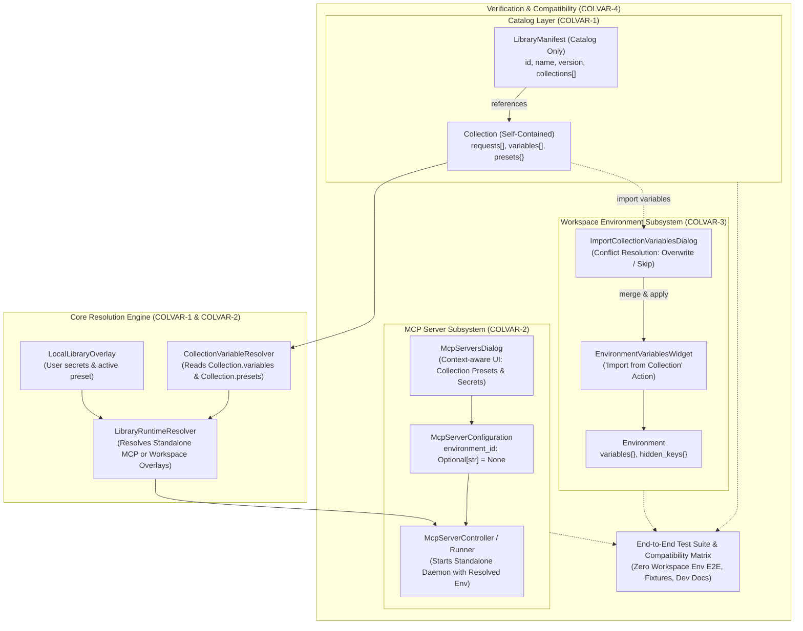
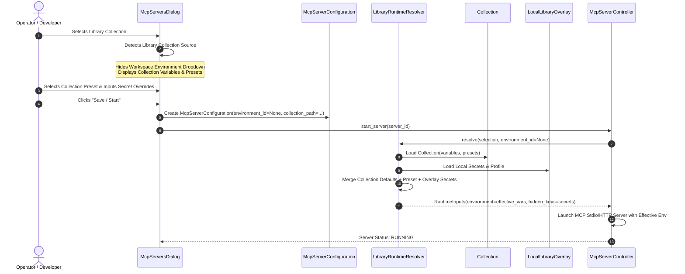
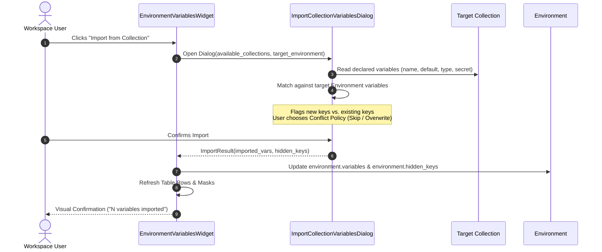

# PYPOST-1408: Decompose epic PYPOST-1407 into child tasks

## Research

### 1. Existing Collection, Library, MCP Server, and Environment Codebase

A comprehensive inspection of the PyPost codebase reveals the structural dependencies and operational flows across collection models, library manifests, MCP server execution, and workspace environments:

#### 1.1 Collection Data Model and Variable Metadata
- **`pypost/models/models.py` (`Collection`)**:
  - `Collection` already encapsulates:
    - `variables: List[CollectionVariable]` (defaulting to empty list).
    - `presets: Dict[str, Dict[str, Any]]` (defaulting to empty dict).
    - `requests: List[RequestData]`, `websockets: List[WebSocketConnection]`, and `mcp_clients: List[McpClientConnection]`.
    - `library_link: Optional[LibraryCollectionLink]`.
- **`pypost/models/collection_variable.py` (`CollectionVariable`)**:
  - Defines the formal schema for collection-scoped variables: `name`, `type` (`string`, `integer`, `number`, `boolean`, `array`, `object`), `default` / `default_value`, `description`, `help_text`, `required`, and `secret`.
  - Enforces type validation via `validate_variable_value(value, var_type)` and validates default values at instantiation.

#### 1.2 Library Manifest and Variable Precedence Engine
- **`pypost/models/library_manifest.py` (`LibraryManifest`)**:
  - Currently declares `collections: List[str]`, but also declares:
    - `variables: List[CollectionVariable] = Field(default_factory=list)`
    - `presets: Dict[str, Dict[str, Any]] = Field(default_factory=dict)`
  - This dual declaration creates significant architectural ambiguity: both the overall library manifest and the individual collection files define variables and presets.
  - Manifest validation currently permits or expects library-level variables and presets, pooling variables across unrelated collections in the library.
- **`pypost/core/variable_resolver.py` (`LibraryVariableResolver`)**:
  - Implements variable resolution across manifest, preset profiles, and local overlays (`LocalLibraryOverlay`).
  - In `_apply_dict` and schema collection, it prioritizes or merges manifest variables alongside collection variables.
  - Variable prefixes (`<collection_name>.<var_name>`) were used as an ad-hoc workaround to namespace variables across collections within a library, adding complexity and cognitive overhead.
- **`pypost/core/library_runtime_resolver.py` (`LibraryRuntimeResolver`)**:
  - Resolves runtime inputs for MCP servers backed by library collections.
  - Current implementation inspects `manifest.presets` first and merges `collection_profiles` (`collection.presets`).
  - In lines 110–136, if `active_profile` is not set in the local overlay, it falls back to inspecting `environment_id` against `environment_lookup(environment_id)` or `manifest.presets`.
  - When `environment_id` is missing or does not match a profile or workspace environment, it raises `ValueError("profile_missing: selected profile is unavailable")`.

#### 1.3 MCP Server Configuration and Lifecycle Supervision
- **`pypost/models/settings.py` (`McpServerConfiguration`)**:
  - Line 25 defines: `environment_id: str` as a strictly mandatory field.
  - `validate_server_type_requirements()` validates local vs. proxy servers:
    - For `server_type == "local"`, if `library_id` is present, it validates `manifest_id` and `library_collection_path`.
    - However, because `environment_id` is typed as `str` without a default, an MCP server cannot be saved or instantiated without an `environment_id`.
- **`pypost/ui/dialogs/mcp_servers_dialog.py` (`McpServersDialog` & `McpServerEditDialog`)**:
  - When creating or editing an MCP server, `self._environment` (`QComboBox`) is always displayed and populated with workspace environments from `environments()`.
  - When selecting a library collection, the UI forces the user to pick an environment from the workspace or create a new one, even though the library collection contains its own declared variables and presets.
  - In `_save_server()`, `environment_id` is extracted from the environment combobox and passed to `McpServerConfiguration`.
- **`pypost/ui/mcp_server_controller.py` (`McpServerSettingsController`)**:
  - Manages starting, stopping, and restarting MCP servers.
  - Delegates runtime resolution to `LibraryRuntimeResolver.resolve(selection, environment_id)`.
  - Passes the resolved environment dictionary and secret masks to the MCP server process runner (`mcp_server.py` / `mcp_server_impl.py`).

#### 1.4 Environment Variables View and Collection Copy Flows
- **`pypost/ui/widgets/environments/environment_variables_widget.py` (`EnvironmentVariablesWidget`)**:
  - Right-hand pane in the Manage Environments dialog (`env_dialog.py`).
  - Displays a 4-column table: Variable Name (`COL_VAR`), Value (`COL_VAL`), Hidden (`COL_HIDDEN`), and MCP Override (`COL_MCP_OVERRIDE`).
  - Currently lacks any action to import variables from collections.
- **`pypost/ui/dialogs/env_dialog.py` (`EnvironmentDialog`)**:
  - Manages list of workspace environments (`EnvironmentListWidget`) and variables (`EnvironmentVariablesWidget`).
  - Contains import/export actions for environments as a whole (JSON/CSV), but has no mechanism to inspect a collection and pull in its declared variables.
- **`pypost/core/library_collection_import.py` (`LibraryCollectionImport`)**:
  - Handles copying a collection from a connected library into the user's active workspace.
  - Instantiates a new workspace collection with a fresh ID, copying requests, websockets, and variables/presets.
  - However, it does not prompt the user or offer a direct path to copy or import the collection's declared variables into an active workspace environment.

---

### 2. Gap Analysis: Current State vs. Target State

| Dimension | Current State (Pre-PYPOST-1407) | Target State (Post-PYPOST-1407) |
| --- | --- | --- |
| **Library Manifest Role** | Hybrid catalog and variable container (`manifest.variables`, `manifest.presets`) | Pure catalog manifest (`id`, `name`, `version`, `collections`). No top-level variables or presets. |
| **Variable Authority** | Ambiguous split between library manifest and collection | Strictly self-contained: `Collection.variables` and `Collection.presets` are the sole authority. |
| **MCP Server Environment Requirement** | Mandatory workspace `environment_id: str` for all servers | Optional `environment_id: Optional[str] = None`. Standalone library servers run purely from collection variables/presets. |
| **MCP Setup Dialog** | Displays global library variables and forces workspace environment selection | Context-aware: hides workspace environment dropdown for library collections; displays collection-specific variables & presets. |
| **Workspace Variable Import** | Manual typing of keys and values; no collection import mechanism | Dedicated "Import from Collection" action in `EnvironmentVariablesWidget` with conflict resolution and secret masking. |
| **Backward Compatibility** | Rejects manifests lacking expected fields | Gracefully ingests legacy manifests containing library variables with non-fatal deprecation warnings. |

---

### 3. Jira MCP API and Sprint Governance Research

Inspection of the available Jira MCP tools (`jira-by-pypost`) confirms:
- **Authenticated User**: Confirmed active via `jira_get_current_user` (`koctep@gmail.com`).
- **Target Epic**: `PYPOST-1407` ("Collection-scoped variables for standalone MCP servers and workspace collection import").
- **Target Sprint**: `Sprint 2033` ("Collection-Scoped Variables", active on board 34).
- **Available MCP Operations**:
  - `jira_create_issue`: Creates issues with `summary`, `description`, `issue_type="Task"`, and project `PYPOST`.
  - `jira_link_issue_parent`: Links created child issues to parent epic `PYPOST-1407` using `parent_payload='{"fields":{"parent":{"key":"PYPOST-1407"}}}'`.
  - `jira_add_issues_to_sprint`: Adds created issues to Sprint 2033 using `sprint_id=2033` and `issues_payload='{"issues":[...]}'`.

---

## Implementation Plan

### High-Level Execution Phases for PYPOST-1408 (This Task)

1. **Step 2 (Architecture - Current Step)**:
   - Establish architectural designs, module boundaries, sequence diagrams, and contract specifications for all child stories.
   - Detail the Step 4 Jira decomposition execution plan.
   - Specify Step 3 design as `N/A — no behavioral change`.
   - Validate with `make lint` and `make verify-ai-tasks`.

2. **Step 3 (Failing Repro Test)**:
   - N/A — no behavioral change (planning and Jira decomposition task).

3. **Step 4 (Development - Jira Decomposition Execution)**:
   - Call `jira_create_issue` for each child story (`COLVAR-1` through `COLVAR-4`) with detailed acceptance criteria, technical scopes, and story points.
   - Call `jira_link_issue_parent` to associate each created issue as a child of epic `PYPOST-1407`.
   - Call `jira_add_issues_to_sprint` with `sprint_id=2033` to place all child tasks into active Sprint 2033.
   - Update `ai-tasks/PYPOST-1407/decomposition-notes.md` and `ai-tasks/PYPOST-1408/00-roadmap.md` with final Jira issue keys.

4. **Steps 5–8 (Code Cleanup, Observability, Tech Debt, Dev Docs)**:
   - Complete standard quality, observability, technical debt, and documentation steps.

---

### Mandatory — Failing Repro (Step 3 Design)

**Design Verdict: `N/A — no behavioral change`**

**Justification:**
This task (`PYPOST-1408`) is a planning, architectural design, and Jira epic decomposition task. It produces no production code modifications, alters no runtime behaviors, and introduces no runtime features directly. Automated failing repro tests (red tests) are the responsibility of the individual child implementation stories created by this task:
- `COLVAR-1`: Unit tests for catalog-only manifest validation and collection-scoped variable resolution (`tests/test_library_manifest_catalog.py`, `tests/test_collection_variable_authority.py`).
- `COLVAR-2`: Integration tests for standalone MCP server creation and execution without workspace environment (`tests/test_mcp_standalone_server.py`).
- `COLVAR-3`: GUI / component tests for workspace environment variable import action and conflict handling (`tests/test_environment_variable_import_widget.py`).
- `COLVAR-4`: End-to-end integration contracts and backward-compatibility suite (`tests/test_collection_scoped_variables_e2e.py`).

Therefore, Step 3 for PYPOST-1408 correctly records `N/A — no behavioral change` per workflow specifications.

---

### Sizing and Story Points Estimation

All child tasks are sized strictly $\le 5$ Story Points using the standard Fibonacci sequence ($1, 2, 3, 5$):

| Issue Code | Proposed Summary | SP | Rationale & Scope Complexity |
| --- | --- | --- | --- |
| **COLVAR-1** | Eliminate library-level variables and establish collection-scoped variables and catalog manifest | 3 | Refactoring `LibraryManifest` schema, updating `LibraryVariableResolver` and `LibraryRuntimeResolver`, implementing backward-compatible legacy ingestion, and unit tests. |
| **COLVAR-2** | Standalone MCP server configuration and execution without workspace environment | 5 | Cross-layer impact: `McpServerConfiguration` optional environment schema, `mcp_servers_dialog.py` UI redesign (hiding environment dropdown, showing collection presets/secrets), runtime resolver standalone execution branch, and process supervision. |
| **COLVAR-3** | Workspace environment variable import action from collections | 3 | Adding "Import from Collection" trigger to `EnvironmentVariablesWidget`, creating collection variable selector dialog, implementing merge/overwrite conflict policies, secret mapping, and Qt tests. |
| **COLVAR-4** | Integration test suite, compatibility matrix, and developer documentation | 3 | End-to-end regression testing, legacy manifest fixture migration, test suite coverage with timeouts, and developer documentation in `doc/dev/`. |

**Total Epic Effort:** 14 Story Points across 4 child stories.

---

## Architecture

### 1. Overall System Module Architecture

The following diagram depicts the target architecture following the execution of epic `PYPOST-1407`:



---

### 2. Standalone MCP Server Execution Sequence (COLVAR-2)

When launching an MCP server from a library collection, the system executes without requiring or referencing any workspace environment:



---

### 3. Workspace Environment Variable Import Sequence (COLVAR-3)

When working in the workspace, users can import collection variables directly into an existing environment:



---

### 4. Child Story Contract Specifications and Module Boundaries

#### 4.1 Story COLVAR-1: Catalog-Only Manifest & Collection Authority
- **Primary Goal**: Remove the concept of "library variables" and "library presets" from core models and resolvers.
- **Affected Modules**:
  - `pypost/models/library_manifest.py`:
    - Mark `variables` and `presets` on `LibraryManifest` as deprecated. Default both to empty structures.
    - Add backward-compatibility validator: if `variables` or `presets` are encountered in incoming dictionary/JSON/YAML, emit a deprecation warning instead of validation error.
  - `pypost/core/library_manifest.py`:
    - Update manifest parser and validator functions. Remove assertions requiring library-level variables.
  - `pypost/core/variable_resolver.py`:
    - Re-orient resolution around `Collection.variables` and `Collection.presets`.
    - Manifest variables layer becomes an optional legacy fallback rather than primary schema.
  - `pypost/core/library_runtime_resolver.py`:
    - Read presets and schemas strictly from `collection.presets` and `collection.variables`.
- **Interface Definition**:
  ```python
  class LibraryManifest(BaseModel):
      id: str = Field(default_factory=lambda: str(uuid.uuid4()))
      name: str
      version: str = "1.0.0"
      description: str = ""
      collections: List[str] = Field(default_factory=list)
      # Deprecated legacy fields retained for backward compatibility only
      variables: List[CollectionVariable] = Field(default_factory=list, deprecated=True)
      presets: Dict[str, Dict[str, Any]] = Field(default_factory=dict, deprecated=True)
  ```

#### 4.2 Story COLVAR-2: Standalone MCP Server Execution
- **Primary Goal**: Enable library collections to run as MCP servers without an associated workspace environment.
- **Affected Modules**:
  - `pypost/models/settings.py`:
    - Update `McpServerConfiguration`:
      ```python
      environment_id: Optional[str] = None
      ```
    - Update validator `validate_server_type_requirements`: when `server_type == "local"` and `library_id` is specified, `environment_id` is optional. For workspace collections (`collection_id` specified), `environment_id` remains optional or defaults to active environment.
  - `pypost/core/library_runtime_resolver.py`:
    - Support `environment_id=None`. When `environment_id` is `None`:
      - Resolve variables strictly using collection defaults, selected collection preset (`active_profile`), and `LocalLibraryOverlay` secrets/overrides.
      - Omit workspace environment lookups.
  - `pypost/ui/dialogs/mcp_servers_dialog.py`:
    - Refactor `McpServerEditDialog`:
      - Dynamic layout: When "Library Collection" or "Built-in Collection" is selected as the source, hide the `self._environment` combobox and environment label.
      - Add a collection preset selector combobox populated from `collection.presets.keys()`.
      - Render collection-specific variable override table for entering secrets/overrides directly into `LocalLibraryOverlay`.
  - `pypost/ui/mcp_server_controller.py`:
    - Handle `configuration.environment_id is None` gracefully during server lifecycle management.

#### 4.3 Story COLVAR-3: Workspace Variable Import Action
- **Primary Goal**: Provide a seamless UI action in the environment variables view to import declared collection variables into a workspace environment.
- **Affected Modules**:
  - `pypost/ui/widgets/environments/environment_variables_widget.py`:
    - Add `import_btn = QPushButton("Import from Collection...")` to the widget layout header or toolbar.
    - Connect button to trigger `self._on_import_from_collection()`.
  - `pypost/ui/dialogs/import_collection_variables_dialog.py` (New Dialog):
    - Present collection dropdown (listing all open workspace collections and connected library collections).
    - Table displaying candidate variables (`name`, `type`, `default_value`, `secret`).
    - Collision handling options:
      - Radio button: "Skip existing variables (keep environment values)"
      - Radio button: "Overwrite existing variables (replace with collection defaults)"
    - Checkboxes to selectively include/exclude specific variables.
  - `pypost/core/environment_ops.py`:
    - Add pure helper function `import_collection_variables_to_environment(env, collection, overwrite=False, selected_keys=None) -> ImportSummary`.
    - Automatically adds keys marked `secret=True` to `env.hidden_keys`.

#### 4.4 Story COLVAR-4: Integration Contracts, Compatibility & Documentation
- **Primary Goal**: End-to-end regression validation, backward compatibility matrix verification, and comprehensive developer documentation.
- **Affected Modules & Artifacts**:
  - `tests/test_mcp_standalone_e2e.py`: Full end-to-end test initializing and running an MCP server from a library collection without any workspace environment present.
  - `tests/test_environment_variable_import_e2e.py`: Test copying a collection, triggering the import action, and verifying variable resolution and secret masking in the workspace environment.
  - `tests/fixtures/`: Update test library manifests and collections to catalog-only format while verifying legacy fixtures parse with deprecation warnings.
  - `doc/dev/collection_scoped_variables.md`: Comprehensive developer guide explaining collection variable scoping, catalog manifests, standalone MCP execution, and environment import workflows.
  - `doc/user/`: Update user guide sections on MCP servers and environment variables.

---

### 5. Selected Architectural Patterns and Justification

The architecture for collection-scoped variables, standalone MCP servers, and workspace variable imports adopts five foundational architectural patterns:

| Architectural Pattern | Applied Component(s) | Architectural Role & Justification |
| --- | --- | --- |
| **Catalog / Manifest Pattern** | `LibraryManifest` ([`library_manifest.py`](file:///home/src/pypost/models/library_manifest.py), [`library_manifest.py`](file:///home/src/pypost/core/library_manifest.py)) | **Role**: Decouples library metadata (index, identity, versioning, authoring, and collection file paths) from runtime variable models.<br/>**Justification**: Previously, `LibraryManifest` served dual competing roles: a catalog index and an ambient variable/preset repository. This created variable namespace pollution across unrelated collections and blurred boundary definitions. Under the Catalog pattern, `LibraryManifest` is strictly a lightweight registry pointing to collections, ensuring separation of concerns, stateless indexing, and modular collection distribution. |
| **Self-Contained Aggregate / Entity Pattern** | `Collection` ([`models.py`](file:///home/src/pypost/models/models.py), [`collection_variable.py`](file:///home/src/pypost/models/collection_variable.py)) | **Role**: Establishes `Collection` as a self-contained Domain-Driven Design (DDD) aggregate root encapsulating requests, variables (`CollectionVariable`), and profile presets (`presets`).<br/>**Justification**: Variables and preset profiles belong to the operational context of the collection that consumes them. By making `Collection` the sole authoritative entity for its variables, collections can be imported, exported, shared, or executed independently without parental library dependencies or ambient workspace state. |
| **Decoupled / Standalone Execution Pattern** | `LibraryRuntimeResolver` ([`library_runtime_resolver.py`](file:///home/src/pypost/core/library_runtime_resolver.py)), `McpServerConfiguration` ([`settings.py`](file:///home/src/pypost/models/settings.py)) | **Role**: Eliminates the mandatory coupling between MCP server execution and workspace environments (`environment_id: Optional[str] = None`).<br/>**Justification**: Previously, launching an MCP server from a library required creating or selecting an arbitrary workspace `Environment`, cluttering workspaces with phantom environments. Standalone execution decouples server runtime lifecycle from workspace environments, evaluating inputs directly from the collection aggregate and local overrides. |
| **Local Overlay / Decorator Pattern** | `LocalLibraryOverlay` ([`variable_resolver.py`](file:///home/src/pypost/core/variable_resolver.py), [`library_runtime_resolver.py`](file:///home/src/pypost/core/library_runtime_resolver.py)) | **Role**: Dynamically decorates immutable/shared collection definitions with machine-local configurations, active presets, and sensitive secret overrides.<br/>**Justification**: Collections distributed in shared libraries or git repositories must remain free of machine-specific secrets and personal configurations. The Local Overlay pattern applies user-specific secret tokens and active preset selections at runtime without mutating the underlying collection file or leaking sensitive values into version control. |
| **Conflict Resolution Strategy Pattern** | `import_collection_variables_to_environment` ([`environment_ops.py`](file:///home/src/pypost/core/environment_ops.py), [`import_collection_variables_dialog.py`](file:///home/src/pypost/ui/dialogs/import_collection_variables_dialog.py)) | **Role**: Encapsulates collision handling algorithms when importing variables from a collection into a workspace environment.<br/>**Justification**: When importing collection variables into an existing workspace environment, key collisions may occur. Applying the Strategy pattern enables deterministic, user-controlled collision policies (e.g., `SkipStrategy` to preserve existing environment values vs. `OverwriteStrategy` to replace existing values with collection defaults), ensuring safe and non-destructive data synchronization. |

---

## Q&A

**Q: Why is eliminating library-level variables architecturally superior to keeping them as an optional fallback layer?**  
A: Library-level variables introduce an ambiguous multi-tier variable hierarchy where two separate files (`manifest.json` and `<collection>.json`) declare variables. This causes namespace pollution (variables from unrelated collections in the same library appearing together), forces complex naming conventions (e.g. prefixing variable names with collection IDs), and obscures variable provenance. Treating a library strictly as a catalog and collections as self-contained units establishes a clean, predictable mental model.

**Q: How will existing libraries with library-level variables be handled without breaking user installations?**  
A: In `COLVAR-1`, the manifest parser will inspect incoming JSON/YAML. If `variables` or `presets` are present at the manifest root, they will be parsed into deprecated model attributes with a logger warning (`logging.warning("Legacy library manifest contains top-level variables; please migrate variables into individual collection files.")`). In `LibraryVariableResolver`, legacy manifest variables will be used as fallback defaults only if the collection does not define them, ensuring zero downtime or crashes for existing users.

**Q: Why does `McpServerConfiguration.environment_id` become optional (`Optional[str] = None`)?**  
A: A library collection contains its own declared variables, default values, and preset profiles. Forcing the creation of an empty or arbitrary workspace Environment merely to satisfy a foreign-key-style field constraint creates friction and litters user workspaces with phantom environments. Making `environment_id` optional allows standalone execution while maintaining full backward compatibility for workspace collections that explicitly rely on workspace environments.

**Q: How does the "Import from Collection" action handle secrets and hidden keys?**  
A: `CollectionVariable` declares a boolean `secret: bool` field. When importing collection variables into a workspace `Environment`, any variable where `var.secret is True` will automatically have its key inserted into `Environment.hidden_keys`. This guarantees that passwords, API tokens, and credentials remain masked in the UI and encrypted at rest without requiring manual user intervention.

**Q: How are Jira child tickets linked to the parent epic in Step 4?**  
A: Jira Cloud uses the `parent` field rather than the deprecated `Epic Link` custom field. In Step 4, after creating each issue with `jira_create_issue`, the task executes `jira_link_issue_parent(issue_key=child_key, parent_payload='{"fields":{"parent":{"key":"PYPOST-1407"}}}')`. Finally, `jira_add_issues_to_sprint(sprint_id=2033, issues_payload='{"issues":[...]}')` places all four child issues into Sprint 2033.
