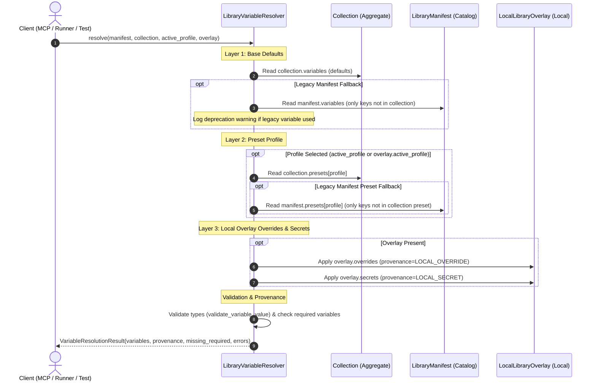

# PYPOST-1409: Eliminate library-level variables and establish collection-scoped variables and catalog manifest

## Research

### 1. Context and Problem Analysis

In the initial implementation of PyPost collection libraries (PYPOST-1221), variables and environment profile presets were modeled at both the library manifest level and the collection level:
- [`LibraryManifest`](file:///home/src/pypost/models/library_manifest.py) declared `variables: List[CollectionVariable]` and `presets: Dict[str, Dict[str, Any]]`.
- [`Collection`](file:///home/src/pypost/models/models.py) declared `variables: List[CollectionVariable]` and `presets: Dict[str, Dict[str, Any]]`.

This dual-tier declaration created critical architectural and operational problems:
1. **Namespace Pollution**: When a collection library bundles multiple disparate collections (for example, Jira, GitHub, and GitLab API collections), declaring variables at the library manifest root combines all configuration variables into a single global pool. A user or agent configuring a specific collection is presented with variables belonging to other unrelated collections.
2. **Loss of Portability and Modularity**: A collection that depends on variables defined externally at the library manifest level cannot function as an independent, self-contained unit. It cannot be exported, shared, or executed standalone (e.g., as an MCP tool suite) without carrying along or replicating the parent library manifest.
3. **Inverted Authority and Variable Provenance**: In the existing [`LibraryVariableResolver`](file:///home/src/pypost/core/variable_resolver.py), manifest-level variables and presets were given priority or merged in a manner that overshadowed collection-level declarations:
   - Manifest defaults in `manifest.variables` overrode collection defaults in `collection.variables` (lines 115–120 vs. 109–114).
   - Manifest presets in `manifest.presets` overrode collection presets in `collection.presets` (lines 131–147).
   - Ad-hoc dot-notation prefixes (e.g., `<collection_name>.<var_name>`) were introduced as a patch to separate namespaces within the global pool, adding cognitive overhead and brittle parsing logic.
4. **Runtime Resolver Coupling**: In [`LibraryRuntimeResolver`](file:///home/src/pypost/core/library_runtime_resolver.py), the resolver expected presets to exist on the manifest, explicitly modifying a copy of `manifest.presets` to inject collection profiles if not already present (lines 143–146).

### 2. Analysis of Existing Code Components

#### 2.1 `pypost/models/library_manifest.py`
- Current schema:
  ```python
  class LibraryManifest(BaseModel):
      id: str = Field(default_factory=lambda: str(uuid.uuid4()))
      name: str
      version: str = "1.0.0"
      description: str = ""
      collections: List[str] = Field(default_factory=list)
      variables: List[CollectionVariable] = Field(default_factory=list)
      presets: Dict[str, Dict[str, Any]] = Field(default_factory=dict)
  ```
- Findings:
  - Both `variables` and `presets` are active fields on the model.
  - When serializing a manifest to YAML or JSON via [`serialize_manifest_to_dict`](file:///home/src/pypost/core/library_manifest.py), `variables: []` and `presets: {}` are output even for pure catalog indexes unless excluded.
  - Manifest validation does not flag legacy root variables or presets with deprecation warnings.

#### 2.2 `pypost/models/models.py` & `pypost/models/collection_variable.py`
- Current schema:
  - [`Collection`](file:///home/src/pypost/models/models.py) already has:
    - `variables: List[CollectionVariable] = Field(default_factory=list)`
    - `presets: Dict[str, Dict[str, Any]] = Field(default_factory=dict)`
    - `requests: List[RequestData] = Field(default_factory=list)`
    - `websockets: List[WebSocketConnection] = Field(default_factory=list)`
    - `mcp_clients: List[McpClientConnection] = Field(default_factory=list)`
  - [`CollectionVariable`](file:///home/src/pypost/models/collection_variable.py) contains:
    - `name: str`, `type: str` (validated against `{"string", "integer", "number", "boolean", "array", "object"}`), `default: Optional[Any]` (aliased as `default_value`), `description: str`, `help_text: Optional[str]`, `required: bool = False`, and `secret: bool = False`.
- Findings:
  - The domain entity `Collection` already contains the necessary fields to act as the single source of truth for its variable declarations and environment presets. No schema addition to `Collection` is required, but its role must be elevated from secondary to sole primary authority.

#### 2.3 `pypost/core/variable_resolver.py`
- Current precedence logic in [`LibraryVariableResolver.resolve`](file:///home/src/pypost/core/variable_resolver.py):
  1. Schemas collected from collection, then overwritten by manifest.
  2. Base defaults applied from collection, then overwritten by manifest defaults.
  3. Profile variables applied from manifest presets, then non-conflicting keys added from collection presets.
  4. Local overlay overrides and secrets applied last.
- Findings:
  - The resolver operates backwards relative to the requirement: manifest defaults and presets currently take precedence over collection declarations.
  - Resolution must be inverted: Collection defaults form the base layer, collection presets form the profile layer, and local overlay overrides/secrets form the top layer. Legacy manifest declarations should act only as fallbacks if a variable is not declared in the collection, accompanied by deprecation logging.

#### 2.4 `pypost/core/library_manifest.py`
- Manifest deserializers:
  - `deserialize_manifest_from_dict`, `deserialize_manifest_from_yaml`, `deserialize_manifest_from_json`.
- Findings:
  - Need to detect when `variables` or `presets` are present in incoming raw data dictionaries and emit informative deprecation warnings (`logging.warning("Legacy library manifest contains top-level variables/presets...")`) without raising validation errors.

#### 2.5 `pypost/core/library_runtime_resolver.py`
- Runtime resolution for MCP servers:
  - Currently extracts `available_profiles = set(manifest.presets) | set(collection_profiles)` and mutates `manifest.presets` with collection profiles.
- Findings:
  - Needs to prioritize `collection.presets` as the primary preset dictionary and avoid requiring `manifest.presets`.

#### 2.6 `pypost/models/library_manifest.py` (`LocalLibraryOverlay`) & `pypost/core/local_overlay_manager.py`
- Machine-local overlay storage:
  - [`LocalLibraryOverlay`](file:///home/src/pypost/models/library_manifest.py) encapsulates `library_id`, `active_profile`, `secrets`, `overrides`, and `updated_at`.
  - Stored outside version control at `~/.pypost/libraries_data/<library_id>/overlay.json` with `0o600` permissions via [`LocalOverlayManager`](file:///home/src/pypost/core/local_overlay_manager.py).
- Findings:
  - `LocalLibraryOverlay` and `LocalOverlayManager` provide the foundation for machine-local secret isolation and active preset selection, allowing users to configure secrets and select active profiles without altering shared collection files.

---

## Implementation Plan

### High-Level Execution Phases

1. **Step 2 (Architecture - Current Step)**:
   - Define target component architecture, sequence flows, patterns, module contracts, and backward-compatibility rules.
   - Design automated failing repro test for Step 3.
   - Validate documentation artifacts with `make lint` and `make verify-ai-tasks`.

2. **Step 3 (Failing Repro Test)**:
   - Create automated red test in `tests/test_collection_scoped_variables_repro.py` asserting:
     - Catalog-only manifest validation (manifest instantiated without variables/presets behaves as a pure catalog index).
     - Legacy manifest deprecation warning emitted on ingestion.
     - Collection variable authority: collection defaults and collection presets take precedence over legacy manifest definitions.
     - 3-tier collection-first precedence: collection default $\to$ collection preset $\to$ local overlay secrets/overrides.
     - Absence of namespace pollution: variables from collection A do not appear when resolving collection B.
   - Run test suite via `make test` to confirm clean RED failure mode.

3. **Step 4 (Development)**:
   - **Iteration 1: Manifest Model & Deserializer Deprecation**:
     - Mark `variables` and `presets` as deprecated fields in [`LibraryManifest`](file:///home/src/pypost/models/library_manifest.py).
     - Update deserializer functions in [`pypost/core/library_manifest.py`](file:///home/src/pypost/core/library_manifest.py) to emit structured deprecation warnings when legacy `variables` or `presets` are encountered.
     - Update serialization logic to ensure catalog-only manifests do not serialize empty deprecated fields unless explicitly populated.
   - **Iteration 2: Collection-Scoped Variable Authority in Resolvers**:
     - Refactor [`LibraryVariableResolver`](file:///home/src/pypost/core/variable_resolver.py) so that `collection.variables` and `collection.presets` are authoritative.
     - Establish the 3-tier precedence:
       1. Base defaults: `Collection.variables` (fallback to `manifest.variables` only if key not in collection).
       2. Active preset: `Collection.presets[profile_name]` (fallback to `manifest.presets[profile_name]` only if key not in collection preset).
       3. Local overlay: `LocalLibraryOverlay.overrides` and `LocalLibraryOverlay.secrets`.
     - Remove ad-hoc dot-notation namespace splitting for collection variables.
   - **Iteration 3: Runtime Resolver Update**:
     - Update [`LibraryRuntimeResolver`](file:///home/src/pypost/core/library_runtime_resolver.py) to read profiles primarily from `collection.presets`.
     - Remove mutation of `manifest.presets`.
   - **Iteration 4: Green Verification**:
     - Run `make test` until red repro test and entire fast test suite pass.
     - Run `make lint` and `make typecheck`.

4. **Steps 5–8**:
   - Step 5: Code cleanup and static analysis audit.
   - Step 6: Observability logging enhancements.
   - Step 7: Technical debt analysis.
   - Step 8: Update developer documentation in `doc/dev/`.

---

### Mandatory — Failing Repro (Step 3 Design)

- **Test File Location**: [`tests/test_collection_scoped_variables_repro.py`](file:///home/src/tests/test_collection_scoped_variables_repro.py)
- **Framework & Decorators**: `pytest`, marked with `@pytest.mark.timeout(30)`.
- **Target Contract & Assertions to Verify**:
  1. **`test_catalog_manifest_instantiation_without_variables`**:
     - Asserts that `LibraryManifest(id="lib-catalog-1", name="Catalog Only", collections=["collections/col1.json"])` initializes cleanly without requiring `variables` or `presets`.
     - Asserts that serializing to dict (`manifest.model_dump(mode="json")`) functions cleanly and represents a catalog index.
  2. **`test_legacy_manifest_ingestion_emits_deprecation_warning`**:
     - Ingests a YAML string containing top-level `variables:` and `presets:` definitions.
     - Asserts that `deserialize_manifest_from_yaml(...)` succeeds without raising `ManifestValidationError` or `ManifestDiagnosticError`.
     - Asserts using `pytest.warns(DeprecationWarning)` or `caplog` that a deprecation notice is emitted indicating that library-level variables and presets are deprecated in favor of collection-scoped definitions.
  3. **`test_collection_variable_authority_over_legacy_manifest`**:
     - Constructs a `Collection` with `variables=[CollectionVariable(name="api_url", default="https://collection.default.com")]` and `presets={"prod": {"api_url": "https://collection.prod.com"}}`.
     - Constructs a legacy `LibraryManifest` with conflicting `variables=[CollectionVariable(name="api_url", default="https://legacy.manifest.com")]` and `presets={"prod": {"api_url": "https://legacy.prod.com"}}`.
     - Resolves variables with `LibraryVariableResolver.resolve(manifest=manifest, collection=collection, active_profile="prod")`.
     - Asserts that `result.variables["api_url"] == "https://collection.prod.com"` (collection authority) and NOT `"https://legacy.prod.com"`.
  4. **`test_three_tier_resolution_with_local_overlay`**:
     - Asserts the 3-tier precedence hierarchy:
       - Tier 1: Collection default (`base_val`).
       - Tier 2: Collection preset overrides default.
       - Tier 3: Local overlay override/secret overrides preset.
  5. **`test_elimination_of_cross_collection_namespace_pollution`**:
     - Resolves variables for Collection A in a library with multiple collections.
     - Asserts that variables belonging exclusively to Collection B do not leak into the resolved variable dictionary for Collection A.
- **Expected Failure Mode Before Fix**:
  - In the current codebase, `LibraryVariableResolver` applies `manifest.variables` over `collection.variables` (lines 115–120 overwrite lines 109–114) and applies `manifest.presets` over `collection.presets` (lines 131–147), so assertion 3 will fail (`AssertionError: expected 'https://collection.prod.com', got 'https://legacy.prod.com'`).
  - `deserialize_manifest_from_yaml` does not emit a deprecation warning, so assertion 2 will fail.
- **Sequencing**:
  - Step 2: Architecture design document (this file).
  - Step 3: Implement `tests/test_collection_scoped_variables_repro.py`, execute with `make test`, verify failures match expectations.
  - Step 4: Implement production code fixes in models, parser, and resolvers until all tests pass GREEN.

---

## Architecture

### 1. Overall System Architecture Diagram

```mermaid
flowchart TB
    subgraph CatalogBoundary["1. Catalog Manifest (pypost.models.library_manifest)"]
        LM["LibraryManifest<br/>id: str<br/>name: str<br/>version: str<br/>description: str<br/>collections: List[str]"]
        LegacyFields["[DEPRECATED]<br/>variables: List[CollectionVariable]<br/>presets: Dict[str, Dict[str, Any]]"]
        LM -.-> LegacyFields
    end

    subgraph CollectionBoundary["2. Self-Contained Aggregate (pypost.models.models)"]
        COL["Collection (Single Source of Truth)<br/>id: str<br/>name: str<br/>requests: List[RequestData]<br/>variables: List[CollectionVariable]<br/>presets: Dict[str, Dict[str, Any]]"]
        CV["CollectionVariable<br/>name: str, type: str<br/>default: Any, description: str<br/>required: bool, secret: bool"]
        COL -->|owns| CV
    end

    subgraph OverlayBoundary["3. Local Machine Overlay (pypost.models.library_manifest)"]
        LLO["LocalLibraryOverlay (~/.pypost/libraries_data/.../overlay.json)<br/>library_id: str<br/>active_profile: Optional[str]<br/>overrides: Dict[str, Any]<br/>secrets: Dict[str, Any]"]
        LOM["LocalOverlayManager (0o600 / 0o700 atomic storage)"]
        LOM -->|manages| LLO
    end

    subgraph ResolverBoundary["4. Core Resolution Engine (pypost.core.variable_resolver)"]
        LVR["LibraryVariableResolver"]
        COL -->|Tier 1 (Defaults) & Tier 2 (Presets)| LVR
        LLO -->|Tier 3 (Local Overrides & Secrets)| LVR
        LM -.->|Fallback Only (Deprecated)| LVR
        RES["VariableResolutionResult<br/>variables: Dict[str, Any]<br/>provenance: Dict[str, VariableProvenance]<br/>missing_required: List[str]"]
        LVR -->|produces| RES
    end

    LM -->|references| COL
```

---

### 2. Variable Resolution Precedence Flow

The variable resolution engine evaluates effective values across three distinct layers, with collection definitions acting as the definitive domain authority:



---

### 3. Architectural Patterns & Justification

| Architectural Pattern | Target Component(s) | Architectural Role & Technical Justification |
| --- | --- | --- |
| **Catalog / Manifest Pattern** | [`LibraryManifest`](file:///home/src/pypost/models/library_manifest.py), [`pypost/core/library_manifest.py`](file:///home/src/pypost/core/library_manifest.py) | **Role**: Separates repository discovery and collection indexing from variable declaration and state storage.<br/>**Justification**: Previously, `LibraryManifest` acted as both a collection registry and a global variable store, leading to namespace collisions. Under the Catalog pattern, `LibraryManifest` is purely an index pointing to collection files, guaranteeing modularity, stateless indexing, and zero namespace pollution. |
| **Self-Contained Aggregate (DDD)** | [`Collection`](file:///home/src/pypost/models/models.py), [`CollectionVariable`](file:///home/src/pypost/models/collection_variable.py) | **Role**: Treats `Collection` as an autonomous Domain-Driven Design aggregate root that encapsulates requests, schemas, default variables, and named presets.<br/>**Justification**: Variables and presets are intrinsically tied to the API requests and workflows defined in the collection. Making the collection the sole authoritative aggregate ensures that any collection can be exported, shared, imported, or executed independently without parent library dependencies. |
| **Local Overlay / Decorator Pattern** | [`LocalLibraryOverlay`](file:///home/src/pypost/models/library_manifest.py), [`LocalOverlayManager`](file:///home/src/pypost/core/local_overlay_manager.py) | **Role**: Dynamically decorates shared, version-controlled collection specifications with machine-local parameters, user-specific secrets, and active profile selection.<br/>**Justification**: Collections stored in git repositories must not contain private API keys, passwords, or machine-specific URLs. The Local Overlay pattern applies local secrets and environment choices at runtime outside git, preserving security and confidentiality. |
| **Graceful Deprecation Pattern** | [`deserialize_manifest_from_dict`](file:///home/src/pypost/core/library_manifest.py), [`LibraryVariableResolver`](file:///home/src/pypost/core/variable_resolver.py) | **Role**: Maintains backward compatibility with legacy library manifests containing root-level `variables` or `presets`.<br/>**Justification**: Users upgrading PyPost may possess existing libraries with manifest-level variables. Rather than failing validation, the parser ingests them, issues non-fatal deprecation warnings, and resolvers use them strictly as secondary fallbacks, guaranteeing zero breakage. |

---

### 4. Module Contracts, Interfaces, and API Specifications

#### 4.1 `LibraryManifest` Model Schema
File: [`pypost/models/library_manifest.py`](file:///home/src/pypost/models/library_manifest.py)
```python
class LibraryManifest(BaseModel):
    """Descriptor manifest for a version-controlled collection library (Catalog Only)."""

    model_config = ConfigDict(populate_by_name=True)

    id: str = Field(default_factory=lambda: str(uuid.uuid4()))
    name: str
    version: str = "1.0.0"
    description: str = ""
    collections: List[str] = Field(default_factory=list)

    # Deprecated legacy fields: retained for backward compatibility only.
    # Excluded from default serialization when empty.
    variables: List[CollectionVariable] = Field(
        default_factory=list,
        deprecated=True,
        description="Deprecated: Use Collection.variables instead.",
    )
    presets: Dict[str, Dict[str, Any]] = Field(
        default_factory=dict,
        deprecated=True,
        description="Deprecated: Use Collection.presets instead.",
    )
```

#### 4.2 Manifest Parser Deprecation Contract
File: [`pypost/core/library_manifest.py`](file:///home/src/pypost/core/library_manifest.py)
```python
def deserialize_manifest_from_dict(
    data: dict[str, Any], path: Optional[Path | str] = None
) -> LibraryManifest:
    """Deserialize and validate a dictionary into a LibraryManifest instance.

    Emits a DeprecationWarning and logger warning if legacy 'variables' or
    'presets' are present at the manifest root.
    """
    if "variables" in data and data["variables"]:
        logger.warning(
            "legacy_manifest_variables_detected path=%s: "
            "Library-level variables are deprecated; migrate variables to collection definitions.",
            path,
        )
        warnings.warn(
            "Library-level variables in LibraryManifest are deprecated and will be removed in a future release. "
            "Define variables within individual Collection files instead.",
            DeprecationWarning,
            stacklevel=2,
        )

    if "presets" in data and data["presets"]:
        logger.warning(
            "legacy_manifest_presets_detected path=%s: "
            "Library-level presets are deprecated; migrate presets to collection definitions.",
            path,
        )
        warnings.warn(
            "Library-level presets in LibraryManifest are deprecated and will be removed in a future release. "
            "Define presets within individual Collection files instead.",
            DeprecationWarning,
            stacklevel=2,
        )

    return LibraryManifest(**data)
```

#### 4.3 `LibraryVariableResolver` Resolution Contract
File: [`pypost/core/variable_resolver.py`](file:///home/src/pypost/core/variable_resolver.py)
```python
class LibraryVariableResolver:
    """Evaluates effective variables following collection-first precedence:
    Layer 1: Collection Defaults (fallback: Legacy Manifest Defaults)
    Layer 2: Collection Presets (fallback: Legacy Manifest Presets)
    Layer 3: Local Overlay Overrides & Secrets
    """

    def resolve(
        self,
        manifest: Optional[LibraryManifest] = None,
        overlay: Optional[LocalLibraryOverlay] = None,
        active_profile: Optional[str] = None,
        collection: Optional[Collection] = None,
        strict_required: bool = False,
    ) -> VariableResolutionResult:
        ...
```

**Precedence Hierarchy & Provenance Rules**:
1. **Layer 1: Base Defaults**
   - Read from `collection.variables` where `default is not None`: `variables[var.name] = var.default`, `provenance[var.name] = VariableProvenance.DEFAULT`.
   - Fallback: For keys in `manifest.variables` that are NOT declared in `collection.variables`, populate `variables[var.name] = var.default`.
2. **Layer 2: Preset Profile**
   - Resolve `profile_name = active_profile or (overlay.active_profile if overlay else None)`.
   - If `profile_name` is set:
     - Read from `collection.presets[profile_name]`: `variables[key] = val`, `provenance[key] = VariableProvenance.PROFILE`.
     - Fallback: For keys in `manifest.presets[profile_name]` NOT present in `collection.presets[profile_name]`, apply `variables[key] = val`.
3. **Layer 3: Local Overlay**
   - If `overlay.overrides`: apply `variables[key] = val`, `provenance[key] = VariableProvenance.LOCAL_OVERRIDE`.
   - If `overlay.secrets`: apply `variables[key] = val`, `provenance[key] = VariableProvenance.LOCAL_SECRET`.
4. **Validation & Diagnostics**:
   - Type checking with `validate_variable_value(val, schema.type)`.
   - Missing required variable check (`schema.required` and value is `None` or `""`).

#### 4.4 `LibraryRuntimeResolver` Contract Update
File: [`pypost/core/library_runtime_resolver.py`](file:///home/src/pypost/core/library_runtime_resolver.py)
- Resolves runtime inputs by passing `collection` directly to `LibraryVariableResolver`.
- Profiles are read directly from `collection.presets`, eliminating mutation of `manifest.presets`.

---

### 5. Backward Compatibility & Migration Rules

1. **Manifest Ingestion**:
   - Manifests without `variables` or `presets` load cleanly as catalog manifests.
   - Manifests with `variables` or `presets` load without error, emitting a non-fatal `DeprecationWarning` and logger warning.
2. **Variable Priority**:
   - If both `Collection` and `LibraryManifest` define a variable or preset with the same name, the `Collection` definition always wins.
   - Legacy manifest values serve strictly as fallback defaults when no corresponding variable is defined in the collection.
3. **Storage Isolation**:
   - Machine-local secrets and active profile selections are written to `overlay.json` under `~/.pypost/libraries_data/<library_id>/` and never committed or written back to the shared `pypost-library.yaml` or collection `.json`/`.yaml` files.

---

## Q&A

**Q: Why must `LibraryManifest` stop declaring variables and presets?**  
A: A library is a catalog container that indexes one or more API collections. Bundling variables into the catalog index forces unrelated collections to share a global namespace, causing naming collisions and preventing individual collections from being shared, exported, or executed standalone. Making the catalog strictly an index decouples collection metadata from variable storage.

**Q: Where should environment profile presets (e.g., Staging, Production) be stored?**  
A: Profile presets belong inside the [`Collection`](file:///home/src/pypost/models/models.py) model (`collection.presets: Dict[str, Dict[str, Any]]`). Each collection knows its own parameters and appropriate preset values (e.g., test vs. production endpoints). The user's active preset choice on a specific machine is stored in [`LocalLibraryOverlay.active_profile`](file:///home/src/pypost/models/library_manifest.py).

**Q: How does this change affect the downstream standalone MCP server task (PYPOST-1410)?**  
A: In PYPOST-1410, MCP servers will run from library collections without requiring an `environment_id`. Because this task establishes `Collection.variables` and `Collection.presets` as self-contained units, the MCP server can execute directly using only the collection definitions and the `LocalLibraryOverlay` secrets, completely eliminating the need for a workspace environment.

**Q: How are secrets kept secure and out of version control?**  
A: [`CollectionVariable`](file:///home/src/pypost/models/collection_variable.py) marks secret fields with `secret=True` and default `None`. The actual secret values are entered by the user and saved via [`LocalOverlayManager`](file:///home/src/pypost/core/local_overlay_manager.py) into `~/.pypost/libraries_data/<library_id>/overlay.json` with restricted `0o600` permissions. The version-controlled collection definition remains clean and secret-free.

**Q: Will existing legacy library manifests fail validation after this change?**  
A: No. Backward compatibility is strictly maintained: `LibraryManifest` retains `variables` and `presets` as deprecated fields with default factories. Incoming manifests containing them are parsed successfully with a deprecation warning, and their values are utilized as fallbacks if undefined in the collection.
