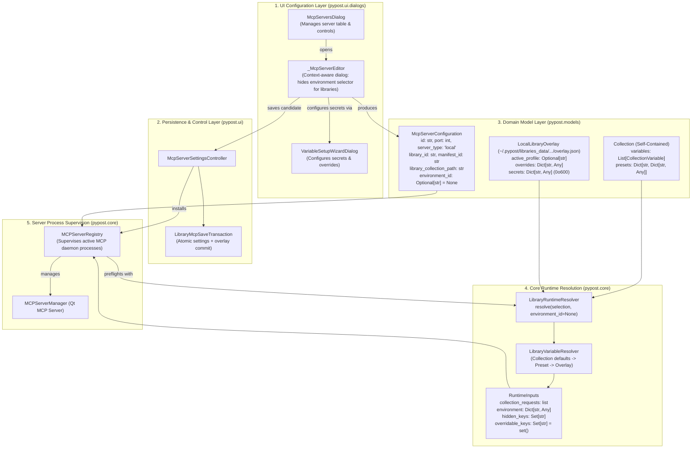
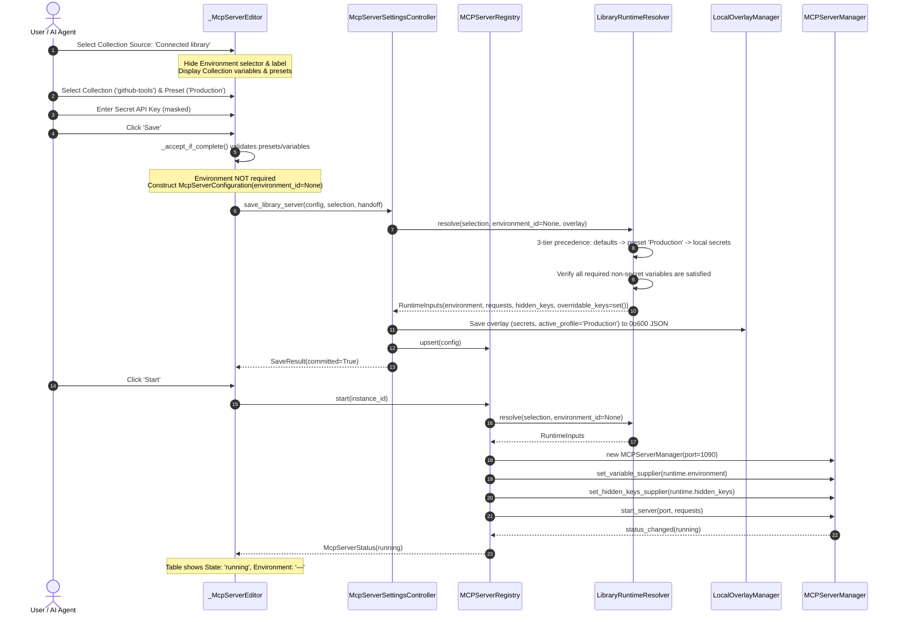

# PYPOST-1410: Standalone MCP server configuration and execution without workspace environment

## Research

### 1. Context and Problem Analysis

Model Context Protocol (MCP) servers in PyPost expose collections of API endpoints as standardized AI tools and resources. Under the original architecture (implemented in PYPOST-1044 / PYPOST-1071 / PYPOST-1280), every MCP server endpoint was strictly required to bind to an [`Environment`](file:///home/src/pypost/models/models.py) in the user's workspace:
- In [`McpServerConfiguration`](file:///home/src/pypost/models/settings.py), `environment_id: str` was a mandatory string field.
- In [`McpServersDialog`](file:///home/src/pypost/ui/dialogs/mcp_servers_dialog.py) and its internal `_McpServerEditor` dialog, the "Environment" combobox was always visible and mandatory. Attempting to save a library collection MCP server without selecting an environment triggered a validation error (`"Collection and environment are required."`).
- In [`MCPServerRegistry`](file:///home/src/pypost/core/mcp_server_registry.py), `reconcile_references()` assumed all local servers require a workspace environment and a workspace collection ID, causing servers without valid workspace environment IDs to fail with `"cannot run: missing environment"`.
- In [`LibraryRuntimeResolver`](file:///home/src/pypost/core/library_runtime_resolver.py), `resolve()` expected `environment_id: str` and raised `ValueError("profile_missing: selected profile is unavailable")` if no active profile or workspace environment was provided, preventing runtime execution when `environment_id` is None.

With the completion of [PYPOST-1409](file:///home/src/ai-tasks/PYPOST-1409/20-architecture.md) (COLVAR-1), collections are now self-contained aggregates that authoritatively declare their own variables ([`CollectionVariable`](file:///home/src/pypost/models/collection_variable.py)), types, default values, documentation, and named environment profile presets (`Collection.presets: Dict[str, Dict[str, Any]]`). Together with [`LocalLibraryOverlay`](file:///home/src/pypost/models/library_manifest.py) and [`LocalOverlayManager`](file:///home/src/pypost/core/local_overlay_manager.py), which securely store machine-local user secrets (`0o600` permissions) outside version control, library collections possess all required metadata and credentials to execute completely autonomously as standalone MCP servers without needing a workspace environment.

### 2. Analysis of Existing Code Components

#### 2.1 `pypost/models/settings.py` (`McpServerConfiguration`)
- **Current schema**:
  ```python
  class McpServerConfiguration(BaseModel):
      id: str
      name: Optional[str] = None
      host: str = "127.0.0.1"
      port: int = Field(ge=1024, le=65535)
      collection_id: Optional[str] = None
      library_id: Optional[str] = None
      manifest_id: Optional[str] = None
      library_collection_path: Optional[str] = None
      library_collection_index: Optional[int] = None
      environment_id: str  # <--- MANDATORY field!
      server_type: Literal["local", "proxy"] = "local"
      # ...
  ```
- **Findings**:
  - `environment_id: str` prevents instantiating or saving standalone MCP servers where `environment_id` is `None`.
  - The model validator `validate_server_type_requirements` enforces library identity when `server_type == "local"` and `library_id` is set, but does not currently account for `environment_id` being optional for library or standalone servers.
  - Making `environment_id: Optional[str] = None` allows standalone MCP servers to omit workspace environments while maintaining full backward compatibility for workspace collections where `collection_id` is set.

#### 2.2 `pypost/core/library_runtime_resolver.py` (`LibraryRuntimeResolver`)
- **Current method signature & behavior**:
  ```python
  def resolve(
      self,
      selection: dict[str, Any],
      environment_id: str,
      candidate_overlay=None,
  ) -> RuntimeInputs:
  ```
- **Findings**:
  - `RuntimeInputs` defines `environment_id: str`. For standalone execution, this must be `Optional[str] = None`.
  - Profile resolution logic (lines 111–131):
    ```python
    if active_profile:
        profile_id = active_profile
        profile = dict(manifest.presets.get(active_profile, {}))
        profile.update(collection_profiles.get(active_profile, {}))
    elif environment is not None:
        profile_id = environment_id
        profile = dict(environment.variables)
    elif environment_id in available_profiles:
        profile_id = environment_id
        profile = dict(manifest.presets.get(environment_id, {}))
        profile.update(collection_profiles.get(environment_id, {}))
    else:
        raise ValueError("profile_missing: selected profile is unavailable")
    ```
    If `environment_id` is `None` and `active_profile` is not set in the overlay, it raises `ValueError("profile_missing: selected profile is unavailable")`. Standalone execution must allow running with base collection defaults if no profile is explicitly selected, setting `profile_id = None` and `profile = {}`.
  - Missing variable check (lines 170–179):
    ```python
    missing_non_secret = [
        name for name in resolved.missing_required if name not in hidden_keys
    ]
    if missing_non_secret:
        raise ValueError("profile_invalid: required library variables are missing")
    ```
    This validation rule already correctly differentiates missing non-secret variables (which fail startup) from secrets. However, standalone resolution needs to ensure that when `environment_id` is `None`, `environment` is `None`, `overridable_keys` is an empty set, and `hidden_keys` is properly populated from collection/manifest declarations and overlay secrets.

#### 2.3 `pypost/core/mcp_server_registry.py` (`MCPServerRegistry`)
- **Current lifecycle methods**:
  - `_runtime_inputs(self, configuration: McpServerConfiguration)`:
    Calls `LibraryRuntimeResolver(...).resolve(selection, environment_id=configuration.environment_id, ...)`. When `configuration.environment_id` is `None`, this must pass `None` smoothly.
  - `reconcile_references(self, valid_collection_ids=None, valid_environment_ids=None)`:
    Lines 382–409 validate local servers. If `configuration.library_id` is present, it currently falls through to checking `configuration.collection_id` and `configuration.environment_id`. Since library servers have `collection_id = None` and standalone servers have `environment_id = None`, `reconcile_references` would incorrectly mark valid library servers as `"failed"`!
    A dedicated branch is required for `configuration.library_id` to verify connected library status and only validate `environment_id` if one is explicitly configured.
  - `refresh_environment(self, environment_id: str)`:
    Filters `instance_ids` where `configuration.environment_id == environment_id`. Standalone servers with `environment_id is None` are correctly ignored during workspace environment refreshes.

#### 2.4 `pypost/ui/mcp_server_controller.py` (`McpServerSettingsController`)
- **Current save and verification paths**:
  - `save_library_server(self, configuration, selection, handoff)`:
    Validates candidate overlay and resolves inputs via `LibraryRuntimeResolver`. Must accept `configuration.environment_id = None`.
  - `_save_mcp_server_configurations`:
    Saves configurations via `ConfigManagerSettingsStore` or `CheckedSettingsStore`. Must preserve `environment_id = None`.

#### 2.5 `pypost/ui/dialogs/mcp_servers_dialog.py` (`McpServersDialog` & `_McpServerEditor`)
- **Current editor behavior**:
  - In `_McpServerEditor.__init__`:
    `self._environment = QComboBox()` is initialized with workspace environments and added to the form layout (`self._layout.addRow("Environment", self._environment)`).
  - In `_on_collection_source_changed`:
    When `collection_source == "library"`, `_environment` and its row label remain visible. They must be hidden so the user is not confused by workspace environments.
  - In `_accept_if_complete`:
    ```python
    elif self._environment.currentData() is None or (
        self._collection_source.currentData() == "workspace"
        and self._collection.currentData() is None
    ) or (
        self._collection_source.currentData() == "library"
        and self._library_collection.currentData() is None
    ) or (
        self._collection_source.currentData() == "builtin"
        and self._builtin_collection.currentData() is None
    ):
        self._error.setText("Collection and environment are required.")
        return
    ```
    This check rejects library collections if `self._environment.currentData()` is `None`. For library collections, an environment must NOT be required.
  - In `configuration()`:
    When `self._collection_source.currentData() == "library"`, it currently sets:
    `environment_id=str(self._environment.currentData())`.
    It must set `environment_id=str(self._environment.currentData()) if (self._environment.isVisible() and self._environment.currentData()) else None`.
  - In `McpServersDialog.refresh()`:
    Line 194: `environment_names.get(configuration.environment_id, configuration.environment_id)`.
    If `configuration.environment_id` is `None`, this passes `None` to `QTableWidgetItem(value)`, raising a `TypeError`. It must render `"—"` or `"None"` safely.

---

## Implementation Plan

### High-Level Execution Phases

1. **Step 2 (Architecture - Current Step)**:
   - Complete technical design, module contracts, patterns, and repro test specification.
   - Validate documentation artifacts with `make lint` and `make verify-ai-tasks`.

2. **Step 3 (Failing Repro Test)**:
   - Implement comprehensive automated repro test suite in [`tests/test_mcp_standalone_execution_repro.py`](file:///home/src/tests/test_mcp_standalone_execution_repro.py).
   - Assert failure modes across:
     - `McpServerConfiguration` validation with `environment_id=None`.
     - `LibraryRuntimeResolver.resolve` with `environment_id=None`.
     - `MCPServerRegistry` startup and `reconcile_references` with `environment_id=None`.
     - `_McpServerEditor` UI visibility and save workflow without workspace environments.
   - Run `make test` and confirm clean RED failure status.

3. **Step 4 (Development - Iterative Execution)**:
   - **Iteration 1: Data Model Schema Decoupling**:
     - Update [`McpServerConfiguration`](file:///home/src/pypost/models/settings.py) to declare `environment_id: Optional[str] = None`.
     - Update model validator `validate_server_type_requirements` so that workspace servers (`collection_id` present) require an environment or collection, while library servers (`library_id` present) permit `environment_id = None`.
   - **Iteration 2: Core Runtime Resolver Decoupling**:
     - Update [`RuntimeInputs`](file:///home/src/pypost/core/library_runtime_resolver.py) to declare `environment_id: Optional[str] = None`.
     - Update [`LibraryRuntimeResolver.resolve`](file:///home/src/pypost/core/library_runtime_resolver.py):
       - Accept `environment_id: Optional[str] = None`.
       - When `environment_id` is `None` and no `active_profile` is selected, fall back cleanly to collection default variables (`profile_id = None`, `profile = {}`).
       - If `active_profile` is selected from `overlay.active_profile`, resolve variables from `collection.presets[active_profile]`.
       - Ensure `overridable_keys` is an empty set and `hidden_keys` are collected from collection/manifest secrets and overlay secrets.
   - **Iteration 3: Server Registry Lifecycle & Supervision**:
     - Update [`MCPServerRegistry.reconcile_references`](file:///home/src/pypost/core/mcp_server_registry.py):
       - Branch explicitly for `configuration.library_id`: if `configuration.environment_id` is None, skip environment validation; if present, validate against environment lookup.
       - Verify library connection via `library_service`.
     - Update [`MCPServerRegistry._runtime_inputs`](file:///home/src/pypost/core/mcp_server_registry.py) to pass `configuration.environment_id` directly without defaulting to a dummy string.
   - **Iteration 4: UI Configuration Dialog Clean-Up**:
     - Update [`_McpServerEditor`](file:///home/src/pypost/ui/dialogs/mcp_servers_dialog.py):
       - Hide `self._environment` combobox and its form layout label when `self._collection_source.currentData() == "library"`.
       - Update `_accept_if_complete()` so library collection MCP servers do not require an environment.
       - Update `configuration()` to emit `environment_id=None` when `collection_source == "library"`.
     - Update [`McpServersDialog.refresh`](file:///home/src/pypost/ui/dialogs/mcp_servers_dialog.py):
       - Safely handle `configuration.environment_id is None`, displaying `"—"` in the Environment table column.
   - **Iteration 5: Verification & Quality Gate**:
     - Verify green test suite via `make test`.
     - Verify static analysis and formatting via `make lint`.
     - Verify type signatures via `make typecheck`.

4. **Steps 5–8**:
   - Step 5: Static analysis cleanup and dead code removal.
   - Step 6: Structured observability logging for standalone MCP lifecycle events.
   - Step 7: Technical debt audit.
   - Step 8: Update developer documentation in `doc/dev/collection_scoped_variables.md`.

---

### Mandatory — Failing Repro (Step 3 Design)

- **Test File Location**: [`tests/test_mcp_standalone_execution_repro.py`](file:///home/src/tests/test_mcp_standalone_execution_repro.py)
- **Framework & Decorators**: `pytest`, marked with `@pytest.mark.timeout(30)`.
- **Target Contract & Assertions to Verify**:
  1. **`test_mcp_server_configuration_standalone_instantiation`**:
     - Asserts that `McpServerConfiguration` can be instantiated with `environment_id=None` for library servers:
       ```python
       config = McpServerConfiguration(
           id="standalone-mcp-1",
           port=1090,
           server_type="local",
           library_id="test-lib",
           manifest_id="test-manifest",
           library_collection_path="collections/test.json",
           environment_id=None,
       )
       assert config.environment_id is None
       ```
     - Asserts serialization and round-trip validation (`McpServerConfiguration.model_validate(config.model_dump())`).
  2. **`test_library_runtime_resolver_standalone_resolution`**:
     - Creates a self-contained `Collection` with `variables=[CollectionVariable(name="base_url", default="https://api.example.com", required=True)]` and `presets={"prod": {"base_url": "https://prod.example.com"}}`.
     - Calls `LibraryRuntimeResolver.resolve(selection, environment_id=None, candidate_overlay=LocalLibraryOverlay(library_id="test-lib", active_profile="prod"))`.
     - Asserts `result.environment["base_url"] == "https://prod.example.com"`.
     - Asserts `result.environment_id == "prod"` (or `None` when no preset selected).
     - Asserts `result.overridable_keys == set()` (no workspace environment overrides).
  3. **`test_mcp_server_registry_standalone_lifecycle`**:
     - Installs a standalone configuration (`environment_id=None`) into `MCPServerRegistry`.
     - Asserts `registry.validate_library_candidate(config)` succeeds without workspace environment lookup.
     - Calls `registry.start(config.id)` and asserts the manager starts and enters state `"running"`.
     - Asserts `registry.status(config.id).state == "running"`.
  4. **`test_mcp_server_registry_reconcile_references_standalone`**:
     - Runs `registry.reconcile_references(valid_collection_ids=set(), valid_environment_ids=set())`.
     - Asserts that standalone library servers with `environment_id=None` are NOT stopped or marked `"failed"`.
  5. **`test_mcp_server_editor_ui_standalone_workflow` (Qt)**:
     - Instantiates `_McpServerEditor` with `collections=[]` and `environments=[]`.
     - Switches collection source to `"library"`.
     - Asserts `editor._environment.isVisible() is False` and its layout label is hidden.
     - Selects a library collection and clicks Save (`_accept_if_complete()`).
     - Asserts `editor.result() == QDialog.DialogCode.Accepted`.
     - Asserts `editor.configuration().environment_id is None`.
  6. **`test_missing_required_variable_validation_error`**:
     - Constructs a collection declaring a required non-secret variable without default value.
     - Asserts `LibraryRuntimeResolver.resolve(selection, environment_id=None)` raises `ValueError("profile_invalid: required library variables are missing")`.
     - Asserts server startup is aborted and status is set to `"failed"`.
- **Expected Failure Modes Before Fix**:
  - `McpServerConfiguration(..., environment_id=None)` raises `pydantic.ValidationError: Input should be a valid string [type=string_type, input_value=None]`.
  - `LibraryRuntimeResolver.resolve(..., environment_id=None)` raises `ValueError("profile_missing: selected profile is unavailable")`.
  - `_McpServerEditor._accept_if_complete()` displays error `"Collection and environment are required."`.
  - `McpServersDialog.refresh()` raises `TypeError: QTableWidgetItem(): argument 1 has unexpected type 'NoneType'`.
- **Sequencing**:
  - Step 2: Architecture design (this artifact).
  - Step 3: Implement `tests/test_mcp_standalone_execution_repro.py`, run `make test`, confirm RED failures.
  - Step 4: Implement production fixes until test suite is 100% GREEN.

---

## Architecture

### 1. Overall System Architecture Diagram



---

### 2. Standalone MCP Server Configuration & Startup Sequence Flow

The sequence below illustrates the end-to-end lifecycle of configuring, saving, and starting a standalone MCP server without creating or referencing any workspace environment:



---

### 3. Architectural Patterns & Technical Justification

| Architectural Pattern | Target Component(s) | Architectural Role & Technical Justification |
| --- | --- | --- |
| **Optional Environment Strategy (Strategy / Null Object)** | [`McpServerConfiguration`](file:///home/src/pypost/models/settings.py), [`LibraryRuntimeResolver`](file:///home/src/pypost/core/library_runtime_resolver.py), [`MCPServerRegistry`](file:///home/src/pypost/core/mcp_server_registry.py) | **Role**: Enables polymorphic execution modes: Standalone mode (`environment_id: None`) and Workspace-Bound mode (`environment_id: str`).<br/>**Justification**: Decouples runtime execution from workspace persistence. When `environment_id` is None, the system executes purely from collection declarations and local overlays without checking workspace environment tables or requiring dummy environments. |
| **Decoupled Runtime Runner (Assembler Pattern)** | [`LibraryRuntimeResolver`](file:///home/src/pypost/core/library_runtime_resolver.py), [`RuntimeInputs`](file:///home/src/pypost/core/library_runtime_resolver.py) | **Role**: Assembles the runtime payload (`RuntimeInputs`) needed by the MCP server daemon from self-contained collections and machine overlays.<br/>**Justification**: Keeps `MCPServerManager` completely agnostic of whether variables originated from a workspace environment or a collection preset, avoiding code duplication across server types. |
| **Machine-Local Secrets Delegation (Decorator Pattern)** | [`LocalLibraryOverlay`](file:///home/src/pypost/models/library_manifest.py), [`LocalOverlayManager`](file:///home/src/pypost/core/local_overlay_manager.py) | **Role**: Dynamically decorates version-controlled collection schemas with user-specific secrets and profile selections stored at `~/.pypost/libraries_data/<library_id>/overlay.json`.<br/>**Justification**: Guarantees zero credential leakage in shared collection files or workspace exports while granting the standalone server access to necessary secrets. |
| **Context-Aware Dynamic Form (Presentation Model)** | [`_McpServerEditor`](file:///home/src/pypost/ui/dialogs/mcp_servers_dialog.py) | **Role**: Reconfigures form fields, visibility, and validation dynamically based on collection source (`workspace` vs. `library`).<br/>**Justification**: Eliminates visual clutter by hiding irrelevant controls (workspace environment dropdown) when configuring standalone library servers, preventing user error. |

---

### 4. Module Contracts, Interfaces, and API Specifications

#### 4.1 `McpServerConfiguration` Schema
File: [`pypost/models/settings.py`](file:///home/src/pypost/models/settings.py)
```python
class McpServerConfiguration(BaseModel):
    """One independently managed, persisted MCP endpoint."""

    id: str
    name: Optional[str] = None
    host: str = "127.0.0.1"
    port: int = Field(ge=1024, le=65535)
    collection_id: Optional[str] = None
    library_id: Optional[str] = None
    manifest_id: Optional[str] = None
    library_collection_path: Optional[str] = None
    library_collection_index: Optional[int] = None
    environment_id: Optional[str] = None  # Optional for standalone library servers
    server_type: Literal["local", "proxy"] = "local"
    upstream_url: Optional[str] = None
    upstream_transport: Literal["streamable_http", "sse"] = "streamable_http"
    headers: dict[str, str] = Field(default_factory=dict)
    timeout: float = 30.0
    enabled: bool = False
    bundled_library: bool = False

    @model_validator(mode="after")
    def validate_server_type_requirements(self) -> "McpServerConfiguration":
        if self.server_type == "proxy":
            if not self.upstream_url or not self.upstream_url.strip():
                raise ValueError("Proxy MCP server requires a non-empty upstream_url")
        elif self.server_type == "local":
            if self.library_id:
                required = (self.manifest_id, self.library_collection_path)
                if not all(value and str(value).strip() for value in required):
                    raise ValueError(
                        "Library MCP server requires manifest and collection identity"
                    )
                if self.bundled_library and self.library_id != "pypost-examples":
                    raise ValueError(
                        "bundled_library requires library_id 'pypost-examples'"
                    )
            elif self.bundled_library:
                raise ValueError("bundled_library requires library_id")
            elif not self.collection_id or not self.collection_id.strip():
                raise ValueError("Local MCP server requires a non-empty collection_id")
            elif not self.environment_id or not self.environment_id.strip():
                raise ValueError("Workspace local MCP server requires a non-empty environment_id")
        return self
```

#### 4.2 `LibraryRuntimeResolver` Resolution Contract
File: [`pypost/core/library_runtime_resolver.py`](file:///home/src/pypost/core/library_runtime_resolver.py)
```python
@dataclass(frozen=True)
class RuntimeInputs:
    selection: dict[str, Any]
    environment_id: Optional[str]
    environment: dict[str, Any]
    collection_requests: list[Any]
    hidden_keys: set[str]
    overridable_keys: set[str] = field(default_factory=set)


class LibraryRuntimeResolver:
    def resolve(
        self,
        selection: dict[str, Any],
        environment_id: Optional[str] = None,
        candidate_overlay: Optional[LocalLibraryOverlay] = None,
    ) -> RuntimeInputs:
        ...
```
**Resolution Precedence in Standalone Mode**:
1. When `environment_id is None`:
   - If `overlay.active_profile` is set, load preset variables from `collection.presets[active_profile]`.
   - If no profile is selected, use base defaults from `collection.variables`.
   - Apply user overrides and secrets from `overlay.overrides` and `overlay.secrets`.
2. Missing required variable validation:
   - Identify unfulfilled variables: `[name for name in resolved.missing_required if name not in hidden_keys]`.
   - If any unfulfilled required non-secret variable exists, raise `ValueError("profile_invalid: required library variables are missing")`.
3. Secret masking and permissions:
   - Mark all declared collection secrets and overlay secrets in `hidden_keys`.
   - `overridable_keys` is set to `set()` since standalone servers have no workspace environment overrides.

#### 4.3 `MCPServerRegistry` Lifecycle Contract
File: [`pypost/core/mcp_server_registry.py`](file:///home/src/pypost/core/mcp_server_registry.py)
```python
def reconcile_references(
    self,
    valid_collection_ids: set[str] | None = None,
    valid_environment_ids: set[str] | None = None,
) -> bool:
    """Reconcile active endpoints against available collections and environments.
    Standalone library servers (environment_id is None) are preserved and never
    stopped due to workspace environment changes.
    """
    ...
```

#### 4.4 `_McpServerEditor` UI Contract
File: [`pypost/ui/dialogs/mcp_servers_dialog.py`](file:///home/src/pypost/ui/dialogs/mcp_servers_dialog.py)
- **Visibility rule**:
  ```python
  is_library = is_local and source_data == "library"
  self._environment.setVisible(not is_library)
  env_label = self._layout.labelForField(self._environment)
  if env_label:
      env_label.setVisible(not is_library)
  ```
- **Validation rule**:
  When `is_library` is True, do not require `self._environment.currentData()`.
- **Output rule**:
  For library collections:
  `environment_id = str(self._environment.currentData()) if (self._environment.isVisible() and self._environment.currentData()) else None`.

---

### 5. Backward Compatibility & Migration Rules

1. **Workspace Collection MCP Servers**:
   - Workspace collections (`server_type == "local"`, `collection_id` present, `library_id` None) continue to require an associated workspace `environment_id`.
   - Workspace environment selectors and variable resolution remain completely unchanged for workspace collections.
2. **Proxy MCP Servers**:
   - Upstream proxy servers (`server_type == "proxy"`) continue to function without alteration; `environment_id` remains optional.
3. **Existing Stored Configurations**:
   - Configurations already stored in `settings.json` with an `environment_id` continue to load and deserialize seamlessly.
   - Newly created library MCP servers store `environment_id: null` in JSON, which deserializes as `None`.
4. **Graceful UI Rendering**:
   - The MCP Servers dialog table displays `"—"` in the Environment column for rows where `environment_id` is None, avoiding `NoneType` display exceptions.

---

## Q&A

**Q: Why should `environment_id` be `None` rather than an empty string `""`?**  
A: In Python domain modeling and Pydantic schemas, `None` explicitly signals the complete absence of a relationship (Null Object / Optional Foreign Key), whereas `""` represents an invalid or blank identifier. Using `Optional[str] = None` cleanly differentiates standalone servers from misconfigured workspace servers.

**Q: What happens if a standalone MCP server is started with missing required secrets?**  
A: In PyPost, secrets can be inspected and configured iteratively. During initial dialog inspection or browsing, missing secrets do not cause fatal startup crashes. However, non-secret required variables (e.g., base host URL) are strictly validated before process launch to prevent deploying non-functional servers.

**Q: How does `reconcile_references` differentiate between deleted environments and standalone servers?**  
A: For workspace servers, `reconcile_references` compares `configuration.environment_id` against the list of active workspace environment IDs. For standalone servers, `configuration.library_id` is present and `configuration.environment_id` is `None`. The reconciler checks library connection validity rather than looking for a workspace environment.

**Q: How does this task interact with the next child task (PYPOST-1411)?**  
A: This task (PYPOST-1410) focuses on *out-of-workspace standalone execution* of library collections. Child task PYPOST-1411 focuses on the reverse direction: *in-workspace environment import*, allowing users who copy a collection to import its declared variables into a workspace environment. The two capabilities complement each other cleanly.
