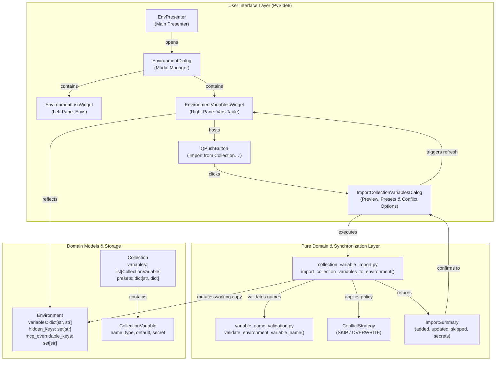
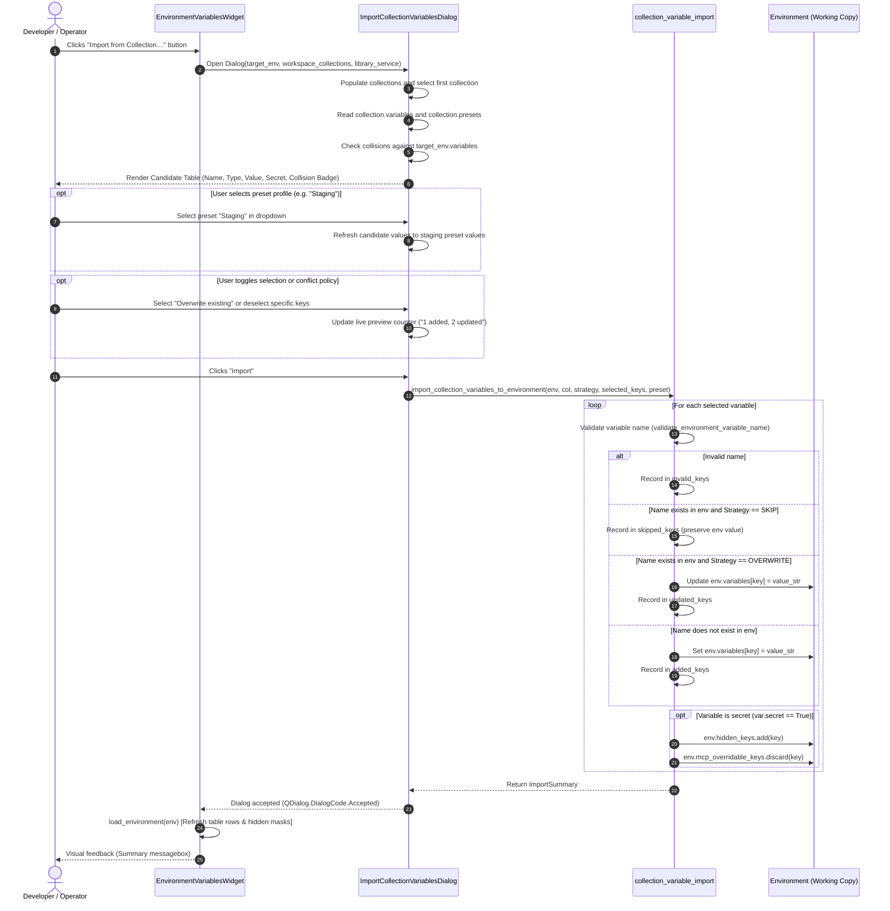

# PYPOST-1411: Workspace environment variable import action from collections

## Research

### 1. Context and Problem Analysis

In PyPost, workspace environments ([`Environment`](file:///home/src/pypost/models/models.py)) provide dynamic parameterization for requests and scripts (base URLs, auth tokens, API keys, headers). With the completion of [PYPOST-1409](file:///home/src/ai-tasks/PYPOST-1409/20-architecture.md) (catalog-only library manifest and self-contained collection-scoped variables) and [PYPOST-1410](file:///home/src/ai-tasks/PYPOST-1410/20-architecture.md) (standalone MCP server execution decoupled from workspace environments), collections ([`Collection`](file:///home/src/pypost/models/models.py)) now authoritatively own their declared variables ([`CollectionVariable`](file:///home/src/pypost/models/collection_variable.py)), data types, default values, documentation descriptions, secret flags, and preset configuration profiles (`presets: Dict[str, Dict[str, Any]]`).

However, there is currently no direct bridge between a collection's declared variables and workspace environments:
1. **Manual Transcription**: When a user creates a collection, copies a collection from a shared library into their workspace, or works with team members, they must manually transcribe each variable name, default value, and type into the Environment Variables view.
2. **Security Vulnerabilities**: When manually transcribing variables, users must remember to check the "Hidden" checkbox for secret credentials. Forgetting to do so results in API tokens being displayed in plaintext in the UI and stored unencrypted on disk.
3. **No Collision or Conflict Strategy**: If the destination environment already defines some of the same keys (e.g. `base_url` or `api_key`), users have no structured way to preview differences, choose whether to preserve existing values or replace them with collection defaults/presets, or selectively import specific keys.
4. **Friction with Presets**: Collections define preset profiles (e.g. `Staging`, `Production`, `Dev`), but users cannot import variable sets tailored to a specific preset directly into their environment.

The objective of **PYPOST-1411** (COLVAR-3) is to introduce an intuitive, robust, and secure "Import from Collection" capability within the Environment Variables management interface ([`EnvironmentVariablesWidget`](file:///home/src/pypost/ui/widgets/environments/environment_variables_widget.py)), supported by a pure domain synchronization engine ([`import_collection_variables_to_environment`](file:///home/src/pypost/core/environment_ops.py)), a rich preview dialog ([`ImportCollectionVariablesDialog`](file:///home/src/pypost/ui/dialogs/import_collection_variables_dialog.py)), deterministic conflict resolution policies, and automated secret masking.

---

### 2. Analysis of Existing Code Components

#### 2.1 `pypost/ui/widgets/environments/environment_variables_widget.py` (`EnvironmentVariablesWidget`)
- **Current Architecture**:
  - Right-pane table widget in `EnvironmentDialog` that edits the variables of the selected environment.
  - Contains `self.vars_table = QTableWidget(0, 4)` with columns `[COLUMN_VARIABLE, COLUMN_VALUE, COLUMN_HIDDEN, COLUMN_MCP_OVERRIDE]`.
  - Manages row editing, trailing empty row addition, context menu (move up, move down, delete), and `self.mcp_check = QCheckBox(MCP_ENABLE_LABEL)`.
  - Receives `get_selected_env: Callable[[], Environment | None]` to access the active working copy of the environment.
  - Implements mutual exclusion between `hidden_keys` and `mcp_overridable_keys` (`_apply_mutual_exclusion`): a variable can never be both hidden and MCP-overridable.
- **Findings & Extension Points**:
  - Currently lacks any import trigger for collection variables.
  - `load_environment(self, env: Environment | None)` enables/disables table and checkbox based on whether `env` is None.
  - We can embed an "Import from Collection…" button (`QPushButton`) in the bottom controls or header toolbar of `EnvironmentVariablesWidget`.
  - The import button should be enabled when an environment is loaded (`env is not None`) and disabled when `env is None`.
  - The widget needs access to available workspace collections (via `get_collections: Callable[[], list[Collection]]`) and connected libraries (via `library_service`). Passing optional `get_collections` and `library_service` parameters to `__init__` maintains 100% backward compatibility with all existing tests.

#### 2.2 `pypost/ui/dialogs/env_dialog.py` (`EnvironmentDialog`)
- **Current Architecture**:
  - Modal dialog managing the list of workspace environments (left pane: `EnvironmentListWidget`) and variables table (right pane: `EnvironmentVariablesWidget`).
  - Instantiates `self._vars_widget = EnvironmentVariablesWidget(log_hidden_key_names=..., get_selected_env=self._selected_environment)`.
- **Findings & Extension Points**:
  - `EnvironmentDialog` can accept optional `get_collections: Callable[[], Iterable[Collection]] | None = None` and `library_service: Any = None` in its constructor and forward them to `_vars_widget`.
  - Callers without these arguments (e.g. existing unit tests `tests/test_env_dialog.py`) will default cleanly to `None` without failure.

#### 2.3 `pypost/ui/presenters/env_presenter.py` (`EnvPresenter`)
- **Current Architecture**:
  - Presenter owning environment loading, variable resolution, and the modal `EnvironmentDialog`.
  - Receives `get_collections: Callable` in `__init__` (`self._get_collections = get_collections`).
  - Holds `self._mcp_registry = mcp_registry`, which provides `mcp_registry.library_service`.
  - In `_open_env_manager()`, instantiates `dialog = EnvironmentDialog(...)`.
- **Findings & Extension Points**:
  - In `_open_env_manager()`, pass `get_collections=self._get_collections` and `library_service=getattr(self._mcp_registry, "library_service", None)` to `EnvironmentDialog`.

#### 2.4 Domain Models (`Environment`, `Collection`, `CollectionVariable`)
- **[`Environment`](file:///home/src/pypost/models/models.py)**:
  - `variables: Dict[str, str]`: environment variables mapping keys to string values.
  - `hidden_keys: Set[str]`: set of variable keys that must be hidden/masked and encrypted at rest.
  - `mcp_overridable_keys: Set[str]`: set of variable keys allowed to be overridden by MCP tools.
  - Invariant: `hidden_keys` and `mcp_overridable_keys` are mutually exclusive.
- **[`Collection`](file:///home/src/pypost/models/models.py)**:
  - `variables: List[CollectionVariable]`: declared variables with types, defaults, descriptions, and secret flags.
  - `presets: Dict[str, Dict[str, Any]]`: dictionary mapping preset profile names (e.g. `"Staging"`, `"Production"`) to key-value maps.
- **[`CollectionVariable`](file:///home/src/pypost/models/collection_variable.py)**:
  - `name: str`
  - `type: str`: `"string"`, `"integer"`, `"number"`, `"boolean"`, `"array"`, `"object"`
  - `default: Optional[Any]`: default value compatible with `type`
  - `description: str`
  - `help_text: Optional[str]`
  - `required: bool`
  - `secret: bool`: True if the variable represents a sensitive token or credential.

#### 2.5 Validation & Operations (`pypost/core/environment_ops.py` & `pypost/core/variable_name_validation.py`)
- **[`validate_environment_variable_name`](file:///home/src/pypost/core/environment_ops.py)**:
  - Validates proposed names for Jinja2 template compatibility:
    - Non-empty
    - Cannot start with a digit
    - Only alphanumeric characters and underscore (`[a-zA-Z_][a-zA-Z0-9_]*`)
- **Findings**:
  - The import engine must validate each candidate variable name using `validate_environment_variable_name(var.name)` before injecting it into the environment, preventing illegal identifiers from corrupting environment state.

#### 2.6 Connected Library Service (`pypost/core/library_manager_service.py`)
- **[`LibraryManagerService`](file:///home/src/pypost/core/library_manager_service.py)**:
  - `list_connections() -> list[LibraryConnectionRecord]`: lists connected libraries.
  - `list_manifest_collections(stable_id: str) -> list[dict[str, Any]]`: lists collections declared in a connected library's manifest.
  - `read_collection(stable_id: str, relative_path: str) -> Collection`: loads the parsed `Collection` model directly from the library disk path.
- **Findings**:
  - We can allow importing from workspace collections (already available in memory) and from connected library collections using `library_service.list_connections()` and `library_service.read_collection()`.

---

### 3. Gap Analysis

| Requirement | Current State | Required Architecture |
| --- | --- | --- |
| **Import Action Trigger** | No import button in `EnvironmentVariablesWidget` | Add `COLLECTION_VARIABLE_IMPORT_BUTTON` (`"Import from Collection…"`) to `EnvironmentVariablesWidget` toolbar/footer. Enabled only when an environment is selected. |
| **Collection Source Selection** | No UI to browse collections for environment import | Create `ImportCollectionVariablesDialog` supporting selection of workspace collections and connected library collections. |
| **Preset Profile Selection** | Environments have no awareness of collection presets | Allow selecting between base defaults and specific preset profiles (`collection.presets.keys()`), dynamically updating the preview table values. |
| **Variable Preview & Selection** | No inspection table for candidate variables | Table displaying candidate variable name, expected type, resolved value, secret badge, collision status, and select/deselect checkboxes (with Select All / Deselect All). |
| **Conflict Resolution Policies** | Manual edits only; overwrites happen without confirmation | Provide explicit conflict resolution strategies: `Skip` (preserve current environment value, default) vs. `Overwrite` (replace existing value with collection value). |
| **Secret Masking** | Users must manually check "Hidden" in environment table | Automatic secret protection: if `CollectionVariable.secret is True`, automatically add key to `Environment.hidden_keys` and discard from `Environment.mcp_overridable_keys`. |
| **Name Validation** | Only validated on manual table cell edit | The import engine validates every imported key via `validate_environment_variable_name`. Invalid keys are skipped with clear diagnostic reporting. |
| **UI State Refresh** | N/A | Immediately refresh the environment variables table (`load_environment`) upon import completion, preserving trailing add-row and secret masks. |

---

## Implementation Plan

### Step-by-Step Sequence

#### Phase 1: Core Domain Synchronization Engine (`pypost/core/collection_variable_import.py`)
1. Create `pypost/core/collection_variable_import.py` as a pure, Qt-independent domain service:
   - Define `ConflictStrategy` enum: `SKIP = "skip"`, `OVERWRITE = "overwrite"`.
   - Define `ImportSummary` dataclass:
     - `added_keys: list[str]`
     - `updated_keys: list[str]`
     - `skipped_keys: list[str]`
     - `invalid_keys: list[tuple[str, str]]`
     - `newly_hidden_keys: set[str]`
     - Helper method `format_summary() -> str`
     - Property `total_imported -> int`
   - Implement `format_variable_value(value: Any) -> str`:
     - Normalizes Python types (`str`, `int`, `float`, `bool`, `list`, `dict`, `None`) into clean string representations for `Environment.variables` (e.g. `None -> ""`, `bool -> "true"/"false"`, `dict/list -> json.dumps(value)`).
   - Implement `import_collection_variables_to_environment(environment: Environment, collection: Collection, conflict_strategy: ConflictStrategy = ConflictStrategy.SKIP, selected_keys: set[str] | None = None, preset_name: str | None = None) -> ImportSummary`:
     - Filters by `selected_keys` if provided.
     - Validates variable names using `validate_environment_variable_name`.
     - Resolves values from preset profile or base default.
     - Applies conflict policy: adds new keys, updates existing keys if `OVERWRITE`, skips existing keys if `SKIP`.
     - Enforces secret protection: if `var.secret is True`, adds key to `environment.hidden_keys` and discards from `environment.mcp_overridable_keys`.
2. Re-export `import_collection_variables_to_environment`, `ConflictStrategy`, and `ImportSummary` in `pypost/core/environment_ops.py`.

#### Phase 2: UI Dialog Component (`pypost/ui/dialogs/import_collection_variables_dialog.py`)
1. Register stable widget identities in `pypost/ui/widget_ids.py`:
   - `COLLECTION_VARIABLE_IMPORT_BUTTON = "pypost_collection_variable_import_button"`
   - `IMPORT_COLLECTION_VARIABLES_DIALOG = "pypost_import_collection_variables_dialog"`
   - `IMPORT_COLLECTION_SOURCE_COMBO = "pypost_import_collection_source_combo"`
   - `IMPORT_COLLECTION_PRESET_COMBO = "pypost_import_collection_preset_combo"`
   - `IMPORT_COLLECTION_VARS_TABLE = "pypost_import_collection_vars_table"`
   - `IMPORT_COLLECTION_CONFLICT_SKIP_RADIO = "pypost_import_collection_conflict_skip_radio"`
   - `IMPORT_COLLECTION_CONFLICT_OVERWRITE_RADIO = "pypost_import_collection_conflict_overwrite_radio"`
   - `IMPORT_COLLECTION_SELECT_ALL_BUTTON = "pypost_import_collection_select_all_button"`
   - `IMPORT_COLLECTION_DESELECT_ALL_BUTTON = "pypost_import_collection_deselect_all_button"`
2. Create `ImportCollectionVariablesDialog(QDialog)` in `pypost/ui/dialogs/import_collection_variables_dialog.py`:
   - **Source selection**:
     - Workspace collections dropdown populated from `workspace_collections`.
     - Optional Connected Library section if `library_service` is configured and has connections.
   - **Preset selection**:
     - Dropdown listing `"(Base Defaults)"` and all presets declared in `selected_collection.presets`.
     - Switching presets immediately updates candidate values in the preview table.
   - **Candidate Variables Table**:
     - Columns: `[Select Checkbox]`, `Name`, `Value`, `Type`, `Secret`, `Status (New / Exists)`, `Description`.
     - Secret variables render masked values (`***` or `HIDDEN_MASK`) to prevent exposing credentials in the dialog.
     - Variables existing in `target_environment.variables` are clearly badged as `"Exists (Collision)"`.
   - **Select All / Deselect All Actions**:
     - Quick buttons to toggle candidate selection.
   - **Conflict Strategy Radio Group**:
     - `Skip existing`: "Skip existing variables (keep current environment values)" [Checked by default].
     - `Overwrite existing`: "Overwrite existing variables (replace with collection values)".
   - **Summary / Preview Count Label**:
     - Live indicator: e.g. `"2 new to add, 1 existing to skip (0 selected to overwrite)"`.
   - **Accept Contract**:
     - Executes `import_collection_variables_to_environment(...)` on the target environment.
     - Stores `self.summary: ImportSummary`.
     - Emits structured log event `env_collection_variables_imported`.

#### Phase 3: Integration into `EnvironmentVariablesWidget`, `EnvironmentDialog`, and `EnvPresenter`
1. Update `pypost/ui/widgets/environments/environment_variables_widget.py`:
   - Accept `get_collections: Callable[[], Iterable[Collection]] | None = None` and `library_service: Any = None` in `__init__`.
   - Add `self.import_collection_btn = QPushButton("Import from Collection…")` with widget ID `COLLECTION_VARIABLE_IMPORT_BUTTON`.
   - Connect button to `self._on_import_from_collection()`.
   - In `load_environment(self, env)`: enable `self.import_collection_btn` if `env is not None`, else disable.
   - In `_on_import_from_collection()`:
     - Open `ImportCollectionVariablesDialog`.
     - If accepted, reload the variables table (`self.load_environment(self._current_env)`).
     - Display an informative confirmation message (`QMessageBox.information`) with the summary.
2. Update `pypost/ui/dialogs/env_dialog.py`:
   - Accept optional `get_collections` and `library_service` and pass them to `self._vars_widget`.
3. Update `pypost/ui/presenters/env_presenter.py`:
   - In `_open_env_manager()`, pass `get_collections=self._get_collections` and `library_service=getattr(self._mcp_registry, "library_service", None)` to `EnvironmentDialog`.

#### Phase 4: Failing Repro & Step 3 Test Design
1. Construct `tests/test_workspace_environment_import_repro.py` covering:
   - Pure domain tests for `import_collection_variables_to_environment` (all strategies, presets, secret handling, validation).
   - Qt component tests for `EnvironmentVariablesWidget` (button presence, enable/disable state, dialog opening, table refresh).
   - Dialog interaction tests (preset toggling, select/deselect all, conflict radio selection, import execution).
   - Persistence verification asserting that imported variables and newly hidden keys are written to storage via `save_environments` / `EnvPresenter._save_environments()`.

#### Phase 5: Verification & Quality Gates
1. Run `make lint`.
2. Run `make check`.
3. Run `make verify-ai-tasks`.

---

### Mandatory — Failing Repro (next Step 3)

The failing repro test for Step 3 will be implemented in [`tests/test_workspace_environment_import_repro.py`](file:///home/src/tests/test_workspace_environment_import_repro.py).

#### 1. What it Asserts (Desired Behavior)
1. **Pure Domain Import Contract**:
   - `test_import_collection_variables_skip_strategy`: Importing a collection with keys `["base_url", "api_key", "timeout"]` into an environment already containing `base_url="https://existing.com"` preserves the existing `base_url`, adds `api_key` and `timeout`, and records `added_keys=["api_key", "timeout"]` and `skipped_keys=["base_url"]`.
   - `test_import_collection_variables_overwrite_strategy`: Importing with `conflict_strategy=ConflictStrategy.OVERWRITE` updates `base_url` to the collection's default value and records `updated_keys=["base_url"]`.
   - `test_import_collection_variables_automatic_secret_masking`: Any variable with `secret=True` on `CollectionVariable` is automatically inserted into `environment.hidden_keys` and removed from `environment.mcp_overridable_keys`.
   - `test_import_collection_variables_preset_values`: Selecting a named preset profile (e.g. `"Staging"`) imports the preset's specific values instead of base defaults.
   - `test_import_collection_variables_invalid_name_rejected`: Variables with invalid Jinja2 names (e.g. starting with digits or containing hyphens) are rejected and recorded in `summary.invalid_keys` without corrupting the environment.
   - `test_import_collection_variables_selected_keys_filter`: Only variables explicitly included in `selected_keys` are processed.
2. **UI Component & Dialog Workflow Contract**:
   - `test_environment_variables_widget_import_button_state`: `EnvironmentVariablesWidget` contains a button with ID `pypost_collection_variable_import_button`. The button is disabled when `load_environment(None)` is called and enabled when an active `Environment` is loaded.
   - `test_import_collection_variables_dialog_workflow`: Launching `ImportCollectionVariablesDialog` with candidate collections renders all candidate variables, collision badges, and preset options. Accepting the dialog updates the active environment, adds secret masks, and refreshes the parent widget table rows immediately.
3. **Storage Persistence Contract**:
   - `test_import_collection_variables_persistence`: Verifies that imported variables and newly hidden keys are persisted to storage upon dialog acceptance and save via `save_environments` / `EnvPresenter._save_environments()`. Specifically, when collection variables (including secret keys) are imported into the active environment within `EnvironmentDialog` and the dialog is accepted/closed, `EnvPresenter._save_environments()` is triggered, ensuring that `StorageInterface.save_environments(snapshot)` persists the updated environment state where:
     - All imported key-value pairs exist in the saved environment's `variables`.
     - Any secret variables imported have their keys present in `hidden_keys` and are encrypted at rest.
     - Reloading environments from storage reflects the imported variables and hidden key metadata without data loss or corruption.

#### 2. Where it Lives
- File path: `tests/test_workspace_environment_import_repro.py`

#### 3. How to Force the Failure Before Step 4 Implementation
- Prior to Step 4 implementation:
  - `from pypost.core.collection_variable_import import import_collection_variables_to_environment, ConflictStrategy, ImportSummary` raises `ModuleNotFoundError: No module named 'pypost.core.collection_variable_import'`.
  - `from pypost.ui.dialogs.import_collection_variables_dialog import ImportCollectionVariablesDialog` raises `ModuleNotFoundError: No module named 'pypost.ui.dialogs.import_collection_variables_dialog'`.
  - `EnvironmentVariablesWidget.findChild(QPushButton, "pypost_collection_variable_import_button")` returns `None`.

#### 4. Timeouts and Strict Decorator Rules
- Per repo guidelines and `lsr-python` skill, the test module will declare class/module-level timeouts:
  ```python
  import pytest

  pytestmark = [pytest.mark.timeout(30)]
  ```
- All individual test cases will run purely in-memory using `qapp` fixtures without live external dependencies or network calls.

#### 5. Sequencing
- Step 2: High-Level Architectural Design (this artifact).
- Step 3: Implement `tests/test_workspace_environment_import_repro.py`, run `make test` to verify RED failure.
- Step 4: Implement `pypost/core/collection_variable_import.py`, `pypost/ui/dialogs/import_collection_variables_dialog.py`, widget updates in `environment_variables_widget.py`, and presenter wiring until test is GREEN.

---

## Architecture

### 1. High-Level Architectural Flow and Mermaid Diagrams

#### Component Interaction Diagram



#### Detailed Sequence Diagram: Import Execution Flow



---

### 2. Architectural Patterns and Justification

| Architectural Pattern | Applied Component(s) | Architectural Role & Justification |
| --- | --- | --- |
| **Pure Domain Function Pattern** | `import_collection_variables_to_environment` ([`collection_variable_import.py`](file:///home/src/pypost/core/collection_variable_import.py)) | **Role**: Isolates variable mapping, type normalization, conflict handling, and secret masking into a pure, stateless function with zero GUI dependencies.<br/>**Justification**: Decoupling the business logic from PySide6 widgets enables exhaustive, ultra-fast unit testing in headless environments, prevents UI coupling bugs, and makes the import logic reusable from CLI commands, scripts, or automated tests. |
| **Strategy Pattern** | `ConflictStrategy` ([`collection_variable_import.py`](file:///home/src/pypost/core/collection_variable_import.py)) | **Role**: Encapsulates conflict resolution behaviors (`SKIP` vs. `OVERWRITE`) behind a clean, type-safe enum.<br/>**Justification**: When importing variables into an environment that already defines matching keys, user intent varies: some want to preserve their existing local configurations (`SKIP`), while others want to align their environment with collection defaults (`OVERWRITE`). The Strategy pattern provides safe, explicit, deterministic behavior with a non-destructive default. |
| **Observer / Signal Pattern** | `EnvironmentVariablesWidget` & `EnvironmentDialog` | **Role**: Synchronizes table state, row checkboxes, trailing add rows, and secret masking upon import completion.<br/>**Justification**: When variables are imported, the UI table must immediately reflect the new state—updating table item widgets, creating hidden checkboxes, and applying mutual exclusion rules without requiring the user to close and reopen the dialog. |
| **Command / Specification Pattern** | `ImportSummary` & Selection Specification | **Role**: Encapsulates import inputs (source collection, preset, selected keys, conflict strategy) and returns a structured audit trail (`added_keys`, `updated_keys`, `skipped_keys`, `invalid_keys`).<br/>**Justification**: Provides transparent auditing, structured diagnostic logging, and actionable feedback to the user regarding exactly which variables were modified. |

---

### 3. Module Contracts and Interfaces

#### 3.1 `pypost/core/collection_variable_import.py`

```python
from enum import Enum
from dataclasses import dataclass, field
from typing import Any, Iterable, Optional, Set, Tuple
from pypost.models.models import Environment, Collection


class ConflictStrategy(str, Enum):
    """Conflict resolution policy when variable name already exists in target environment."""
    SKIP = "skip"
    OVERWRITE = "overwrite"


@dataclass
class ImportSummary:
    """Detailed summary of the environment variable import operation."""
    added_keys: list[str] = field(default_factory=list)
    updated_keys: list[str] = field(default_factory=list)
    skipped_keys: list[str] = field(default_factory=list)
    invalid_keys: list[Tuple[str, str]] = field(default_factory=list)  # (key, error_message)
    newly_hidden_keys: set[str] = field(default_factory=set)

    @property
    def total_imported(self) -> int:
        return len(self.added_keys) + len(self.updated_keys)

    def format_summary(self) -> str:
        parts = []
        if self.added_keys:
            parts.append(f"{len(self.added_keys)} added")
        if self.updated_keys:
            parts.append(f"{len(self.updated_keys)} updated")
        if self.skipped_keys:
            parts.append(f"{len(self.skipped_keys)} skipped")
        if self.invalid_keys:
            parts.append(f"{len(self.invalid_keys)} invalid")
        summary_details = ", ".join(parts) if parts else "no variables imported"
        return f"Imported {self.total_imported} variable(s) ({summary_details})."


def format_variable_value(value: Any) -> str:
    """Normalize raw Python value to string for storage in Environment.variables."""
    ...


def import_collection_variables_to_environment(
    environment: Environment,
    collection: Collection,
    conflict_strategy: ConflictStrategy = ConflictStrategy.SKIP,
    selected_keys: Optional[Set[str]] = None,
    preset_name: Optional[str] = None,
) -> ImportSummary:
    """Import declared collection variables into the target environment.

    Args:
        environment: The destination working environment to mutate.
        collection: The source collection providing variable declarations and presets.
        conflict_strategy: Conflict policy for existing keys (SKIP or OVERWRITE).
        selected_keys: Optional set of variable names to selectively import. If None, all are considered.
        preset_name: Optional preset profile name to take values from instead of base defaults.

    Returns:
        ImportSummary detailing added, updated, skipped, and invalid variables.
    """
    ...
```

#### 3.2 `pypost/ui/dialogs/import_collection_variables_dialog.py`

```python
class ImportCollectionVariablesDialog(QDialog):
    """Dialog allowing users to inspect collection variables, choose presets and conflict policies, and import."""

    def __init__(
        self,
        target_environment: Environment,
        workspace_collections: list[Collection],
        library_service: Any | None = None,
        parent: QWidget | None = None,
    ) -> None:
        ...

    @property
    def summary(self) -> ImportSummary | None:
        """The result summary of the completed import, or None if cancelled."""
        ...
```

#### 3.3 `pypost/ui/widgets/environments/environment_variables_widget.py`

```python
class EnvironmentVariablesWidget(QWidget):
    def __init__(
        self,
        parent: QWidget | None = None,
        *,
        log_hidden_key_names: bool = False,
        get_selected_env: Callable[[], Environment | None] | None = None,
        get_collections: Callable[[], Iterable[Collection]] | None = None,
        library_service: Any | None = None,
    ) -> None:
        ...
        # New UI controls:
        self.import_btn = QPushButton("Import from Collection…")
        self.import_btn.clicked.connect(self._on_import_from_collection)
        ...

    def _on_import_from_collection(self) -> None:
        """Triggered by import_btn; launches ImportCollectionVariablesDialog and refreshes."""
        ...
```

---

### 4. Schema Changes and Backward-Compatibility Rules

1. **Model Schemas Remain 100% Intact**:
   - Neither [`Environment`](file:///home/src/pypost/models/models.py) nor [`Collection`](file:///home/src/pypost/models/models.py) nor [`CollectionVariable`](file:///home/src/pypost/models/collection_variable.py) requires schema modifications.
   - Values are stored in `Environment.variables: Dict[str, str]` and secret indicators in `Environment.hidden_keys: Set[str]`.
2. **Backward Compatibility of Constructors**:
   - `EnvironmentVariablesWidget` accepts `get_collections` and `library_service` as optional keyword arguments defaulting to `None`. Existing tests instantiating `EnvironmentVariablesWidget(get_selected_env=...)` continue to execute without changes.
   - `EnvironmentDialog` accepts optional `get_collections` and `library_service` defaulting to `None`. Existing tests instantiating `EnvironmentDialog(envs)` continue to execute without changes.
3. **Safe Default Conflict Policy**:
   - The default policy is strictly `ConflictStrategy.SKIP` ("Skip existing keys"). Existing environment configurations cannot be accidentally overwritten without explicit user opt-in (`OVERWRITE`).
4. **Secret Protection Invariants**:
   - Any collection variable with `secret=True` that is imported is added to `environment.hidden_keys` and discarded from `environment.mcp_overridable_keys`, maintaining the mutual exclusion invariant enforced by `EnvironmentVariablesWidget`.

---

## Q&A

**Q: Why is an import action in the Environment Variables view needed if collections already have collection-scoped variables?**  
A: Collection-scoped variables allow collections to declare their parameters and enable standalone MCP servers to run out of the box without workspace environments. However, ordinary workspace request execution (HTTP/REST/GraphQL/WebSocket) uses workspace environments. When users copy collections from libraries or work with shared collections, they need an effortless, reliable mechanism to pull those declared variables into their workspace environments without manual typing.

**Q: What is the default conflict resolution strategy, and why?**  
A: The default strategy is `ConflictStrategy.SKIP` ("Skip existing variables"). In PyPost, environments frequently contain custom values (such as local port numbers, staging tokens, or personalized credentials). Defaulting to `SKIP` prevents accidental destruction of working user configurations, guaranteeing data safety.

**Q: How does the import action protect sensitive credentials?**  
A: When `CollectionVariable.secret` is `True`, the import engine automatically injects the variable's key into `Environment.hidden_keys`. This guarantees that:
1. In the UI table, the value is masked with `HIDDEN_MASK` (`"••••••••"`).
2. When encryption at rest is enabled, the secret is encrypted via the storage gateway.
3. In logs and diagnostic exports, the secret is redacted.

**Q: What happens if a collection defines a variable with an invalid name?**  
A: Jinja2 variable names must conform to `[a-zA-Z_][a-zA-Z0-9_]*`. The import engine validates every variable name using `validate_environment_variable_name(name)`. If a collection declares an illegal identifier (e.g. `123_invalid` or `var-name`), it is rejected, flagged in `summary.invalid_keys`, and reported to the user in the completion summary, preserving environment integrity.

**Q: How does preset profile selection work during import?**  
A: In `ImportCollectionVariablesDialog`, users can choose between `"(Base Defaults)"` and any named presets defined in `collection.presets` (such as `"Staging"` or `"Production"`). When a preset is selected:
- The dialog updates the displayed values in the candidate table immediately.
- Variables declared in the preset take their preset values; variables not specified in the preset fall back to their base default values.
- The imported environment receives the chosen preset's configuration.

**Q: Can users import variables from connected libraries as well as workspace collections?**  
A: Yes. If a `library_service` is configured and has connected libraries, the dialog allows selecting from both workspace collections and library collections (loaded via `library_service.list_manifest_collections` and `library_service.read_collection`).

**Q: Does importing variables permanently link the environment to the collection?**  
A: No. Importing is an explicit, point-in-time synchronization operation that copies variables into the environment's `variables` and `hidden_keys`. It creates no runtime coupling, allowing environments to be freely edited, cloned, or pruned independently.
