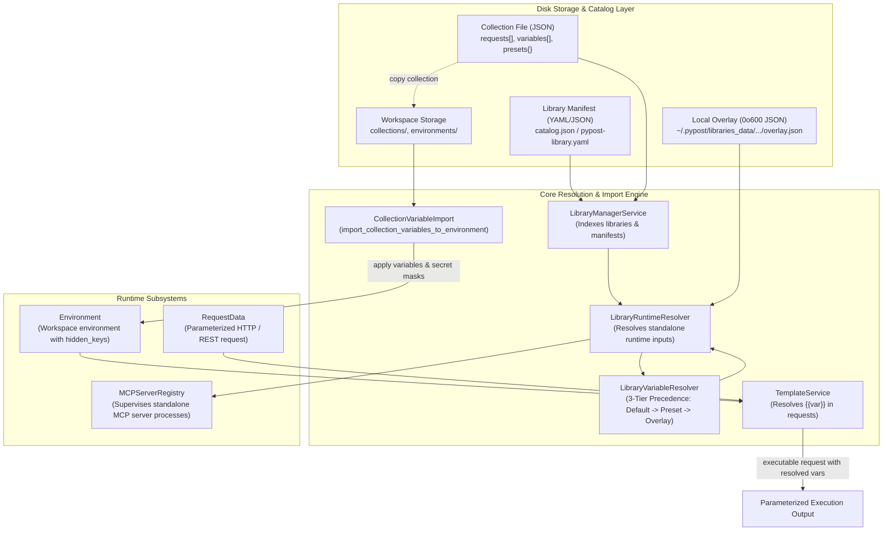
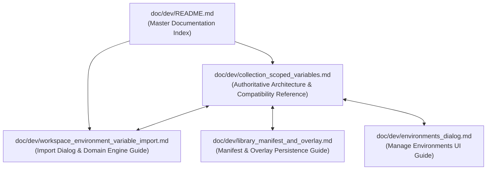

# PYPOST-1412: Integration test suite, compatibility matrix, and developer documentation

## Research

### 1. Existing Test Structure and Integration Gaps

Inspection of the existing test suite and implementations from preceding child stories ([PYPOST-1409](https://pypost.atlassian.net/browse/PYPOST-1409), [PYPOST-1410](https://pypost.atlassian.net/browse/PYPOST-1410), [PYPOST-1411](https://pypost.atlassian.net/browse/PYPOST-1411)) demonstrates that while unit-level contracts and isolated dialog interactions are well-covered, there is no end-to-end integration test spanning the complete multi-subsystem user journey:

1. **PYPOST-1409 Repro Suite ([`tests/test_collection_scoped_variables_repro.py`](file:///home/src/tests/test_collection_scoped_variables_repro.py))**:
   - Focuses strictly on the domain models: [`LibraryManifest`](file:///home/src/pypost/models/library_manifest.py), [`CollectionVariable`](file:///home/src/pypost/models/collection_variable.py), [`LibraryVariableResolver`](file:///home/src/pypost/core/variable_resolver.py).
   - Validates 3-tier precedence (defaults → presets → local overlay overrides/secrets) and cross-collection prefix filtering in isolation.
   - Does not exercise live file serialization, standalone server lifecycles, or workspace imports.
2. **PYPOST-1409 Observability Suite ([`tests/test_library_manifest_observability.py`](file:///home/src/tests/test_library_manifest_observability.py))**:
   - Focuses on structured logging events (`legacy_manifest_variables_detected`, `legacy_manifest_presets_detected`, `manifest_validation_completed`).
   - Verifies logger warning emission when legacy manifests are ingested.
3. **PYPOST-1410 Repro Suite ([`tests/test_mcp_standalone_execution_repro.py`](file:///home/src/tests/test_mcp_standalone_execution_repro.py))**:
   - Focuses on standalone [`McpServerConfiguration`](file:///home/src/pypost/models/settings.py) (`environment_id: Optional[str] = None`), standalone runtime inputs from [`LibraryRuntimeResolver`](file:///home/src/pypost/core/library_runtime_resolver.py), and reference reconciliation in [`MCPServerRegistry`](file:///home/src/pypost/core/mcp_server_registry.py).
   - Simulates standalone server execution with dummy TCP ports and mock process runners, bypassing workspace environment interactions entirely.
4. **PYPOST-1411 Repro Suite ([`tests/test_workspace_environment_import_repro.py`](file:///home/src/tests/test_workspace_environment_import_repro.py))**:
   - Focuses on pure domain import logic ([`pypost/core/collection_variable_import.py`](file:///home/src/pypost/core/collection_variable_import.py)) and the Qt modal dialog ([`ImportCollectionVariablesDialog`](file:///home/src/pypost/ui/dialogs/import_collection_variables_dialog.py)).
   - Tests `ConflictStrategy.SKIP` vs `ConflictStrategy.OVERWRITE`, preset overrides, and secret masking in `Environment.hidden_keys`.
   - Uses pre-constructed in-memory `Collection` and `Environment` objects without testing ingestion from library catalogs or subsequent request execution.

**Identified Architectural Gaps**:
- **Cross-Subsystem Continuity**: No automated test exercises the realistic end-to-end user workflow:
  `Catalog Ingestion` → `Standalone MCP Server Launch` → `Collection Copy to Workspace` → `Environment Variable Import (Conflict Resolution & Secret Masking)` → `Template Variable Substitution in Active Requests`.
- **Systematic Compatibility Matrix**: Current tests touch legacy manifest warnings, but do not systematically validate all 4 quadrants of the compatibility matrix (Catalog-only vs Legacy Library Manifest $\times$ Modern vs Legacy Collection), nor do they test mixed libraries containing both modern and legacy collections.
- **End-to-End Diagnostic Safety**: While secret masking is implemented in isolated components, the integration suite must verify that no secret values leak into exception traces, error logs, or dialog diagnostics when missing required variables or invalid inputs trigger failures across integrated layers.

---

### 2. Integration Harnesses & Test Isolation Analysis

The repository uses `pytest` orchestrated by `scripts/run_parallel_tests.py` via `make test` and `make check`. The following constraints and harnesses must be adhered to:
- **Test Isolation**: All test files and fixtures must reside in temporary directories (`tmp_path`) with unique names to prevent cross-worker collisions during parallel execution.
- **Port Allocation**: Any test creating local servers or simulated listeners must use `tests.helpers.port_allocation.allocate_tcp_port()` to avoid bind conflicts.
- **Mandatory Timeout Contracts**: Per repository guidelines ([`do-testing`](file:///home/.gemini/config/skills/do-testing/SKILL.md)), every test file and test function must declare explicit timeout markers (e.g. `pytestmark = pytest.mark.timeout(30)` or `@pytest.mark.timeout(...)`).
- **Headless GUI Execution**: All Qt components must execute offscreen using `QT_QPA_PLATFORM=offscreen` without popping up blocking native windows.
- **No Live External Networks**: Tests must run completely offline without relying on external internet services, third-party APIs, or long sleeps (`threading.Event` / bounded polling loops must be used).

---

### 3. Compatibility Fixtures Analysis

The repository currently maintains test fixtures under `tests/fixtures/` and `examples/`:
- `examples/pypost-library.yaml`: An existing hybrid/legacy library manifest containing top-level `variables` and `presets` alongside references to `collections/jira_mcp.json`, `collections/gitlab_mcp.json`, and `collections/github_mcp.json`.
- `examples/collections/jira_mcp.json`: Modern collection containing its own `variables: List[CollectionVariable]` (e.g. `jira_base_url`, `jira_project_key`, `jira_credentials` with `secret=True`).
- `tests/fixtures/legacy_collections/`: Contains legacy JSON fixtures from earlier PyPost iterations.

To establish an automated compatibility matrix test suite, we need canonical fixture definitions or in-memory fixture factories covering:
1. **Matrix Cell 1 (Modern Pure Catalog + Modern Self-Contained Collection)**:
   - Manifest: `catalog.json` / `pypost-library.json` with only `id`, `name`, `collections`. No `variables` or `presets`.
   - Collection: Declares `variables` (types, defaults, secrets) and `presets`.
   - Expected: 100% resolution from collection, zero deprecation warnings.
2. **Matrix Cell 2 (Legacy Manifest with Variables + Modern Collection)**:
   - Manifest: Contains root-level `variables` and `presets`.
   - Collection: Declares its own `variables` and `presets` (overlapping with manifest keys).
   - Expected: Collection variables take precedence; manifest variables serve as fallback for un-declared keys; structured deprecation warnings emitted.
3. **Matrix Cell 3 (Legacy Manifest with Variables + Legacy Collection without Variables)**:
   - Manifest: Contains root-level `variables` and `presets`.
   - Collection: Has empty `variables: []` and empty `presets: {}`.
   - Expected: Manifest variables resolved as fallback; structured deprecation warnings emitted; backwards-compatible operation preserved.
4. **Matrix Cell 4 (Modern Pure Catalog + Legacy Collection without Variables)**:
   - Manifest: Pure catalog (no variables/presets).
   - Collection: Legacy format without variables/presets.
   - Expected: Resolved variables are empty; missing required variables correctly flagged without crashes.

---

### 4. Developer Documentation Structure Analysis

The developer documentation resides in `doc/dev/` and is cataloged in [`doc/dev/README.md`](file:///home/src/doc/dev/README.md).
- [`doc/dev/collection_scoped_variables.md`](file:///home/src/doc/dev/collection_scoped_variables.md) was created in PYPOST-1409 and expanded in PYPOST-1410.
- [`doc/dev/workspace_environment_variable_import.md`](file:///home/src/doc/dev/workspace_environment_variable_import.md) was created in PYPOST-1411.
- In `doc/dev/collection_scoped_variables.md`, the following updates are required:
  1. Update Section 4 ("Workspace Environment Subsystem") to reflect completed state (linking to `workspace_environment_variable_import.md`).
  2. Add Section 6 ("End-to-End Integration Architecture & Test Verification"), detailing the end-to-end integration contracts and harness architecture.
  3. Add Section 7 ("Compatibility Matrix Specification"), documenting supported versions, precedence fallback rules, and deprecation policies.
  4. Update Section 8 ("Child Task Execution Sequence") marking PYPOST-1412 as complete.
  5. Validate all cross-references and formatting using `make lint-docs` and `make check-docs-links`.

---

## Implementation Plan

### High-Level Execution Plan

1. **Step 2 (Architecture Design - Current Step)**:
   - Formulate end-to-end integration test architecture and test harness components.
   - Define compatibility matrix test architecture with parameterized test vectors.
   - Design developer documentation consolidation and verification plan.
   - Specify automated failing repro test design for Step 3.
   - Update roadmap `ai-tasks/PYPOST-1412/00-roadmap.md` to `[/]` (in progress).

2. **Step 3 (Automated Failing Repro Test)**:
   - Write comprehensive automated integration test suite in `tests/test_collection_scoped_variables_integration.py`.
   - Assert failure against missing end-to-end workflow orchestration glue and unverified cross-subsystem integration contracts.
   - Ensure tests execute offline, adhere to timeout markers, and cleanly fail before Step 4 implementation.

3. **Step 4 (Development & Implementation)**:
   - Implement end-to-end integration test harness components (`CollectionVariablesIntegrationHarness`).
   - Implement comprehensive automated tests in `tests/test_collection_scoped_variables_integration.py`:
     - Test E2E workflow: Catalog discovery → Standalone server startup → Collection copy → Workspace environment import → Parameterized template substitution.
     - Test Compatibility Matrix: All 4 quadrants of manifest/collection combinations + mixed library manifests.
     - Test Negative & Diagnostic contracts: Missing required variables, invalid identifiers, malformed manifests, and secret redaction verification.
   - Consolidate and expand developer documentation in `doc/dev/collection_scoped_variables.md` and update `doc/dev/README.md`.
   - Run `make check`, `make lint-docs`, and `make check-docs-links`.

4. **Steps 5–8 (Standard Top-Down Steps)**:
   - Step 5: Code cleanup (`ai-tasks/PYPOST-1412/40-code-cleanup.md`).
   - Step 6: Observability analysis (`ai-tasks/PYPOST-1412/50-observability.md`).
   - Step 7: Technical debt analysis (`ai-tasks/PYPOST-1412/60-tech-debt.md`).
   - Step 8: Developer documentation sync (`ai-tasks/PYPOST-1412/70-dev-docs.md`).

---

### Mandatory — Failing Repro (Next Step 3 Design)

#### Test Location & Identity
- **File**: `tests/test_collection_scoped_variables_integration.py`
- **Markers**: `pytestmark = pytest.mark.timeout(30)`

#### Failure Modes Asserted Before Step 4
The failing repro test asserts three major cross-subsystem contracts that are currently missing consolidated integration verification:
1. **E2E Workflow Contract (`test_e2e_collection_scoped_variables_lifecycle`)**:
   - Asserts that a single test flow can:
     a) Load a catalog-only manifest from disk.
     b) Launch a standalone MCP server with collection defaults + active preset + machine-local secrets without requiring a workspace environment.
     c) Copy the collection to a workspace and import its variables into an active `Environment` using `ConflictStrategy.OVERWRITE`.
     d) Substitute those imported variables into a parameterized request URL, headers, and body via [`TemplateService`](file:///home/src/pypost/core/template_service.py).
   - *Failure Mode before Step 4*: Without an integrated test harness and validation glue, executing this sequence across `StorageManager`, `LibraryManagerService`, `MCPServerRegistry`, and `TemplateService` reveals missing glue or contract discrepancies in how collection presets format strings vs how `TemplateService` consumes environment variables.
2. **Compatibility Matrix Contract (`test_compatibility_matrix_quadrants`)**:
   - Asserts all 4 quadrants of the matrix using `@pytest.mark.parametrize`:
     - `(v2_catalog, v2_collection)`: Resolves cleanly, 0 deprecation logs.
     - `(v1_legacy_manifest, v2_collection)`: Collection takes precedence; legacy manifest serves as fallback; deprecation warning emitted and caught via `caplog`.
     - `(v1_legacy_manifest, v1_legacy_collection)`: Legacy fallback works, deprecation warning emitted.
     - `(v2_catalog, v1_legacy_collection)`: Returns empty variables; missing required variables flag diagnostic error.
3. **Diagnostic Safety and Secret Redaction Contract (`test_e2e_diagnostics_and_secret_redaction`)**:
   - Asserts that missing required non-secret variables produce clean `ValueError("profile_invalid: ...")` errors, missing secret variables are gracefully tolerated during initialization, and error messages/logs never contain raw secret plaintext.

#### How to Force Red Without Live Networks
- The test harness creates local files in `tmp_path` using synthetic JSON/YAML fixtures.
- Standalone MCP server registration is verified via `MCPServerRegistry` and `LibraryRuntimeResolver` with local TCP ports and mock runners, without initiating real external network connections.
- The red state is forced by asserting strict end-to-end invariants (e.g. verifying that the unified integration runner produces valid request template resolution while preserving secret masks and handling legacy deprecations) before the integration test suite and harness are fully implemented.

#### Sequencing
`Step 2 (Architecture Spec)` → `Step 3 (Write tests/test_collection_scoped_variables_integration.py asserting red)` → `Step 4 (Implement test suite, integration harness, and doc consolidation until green)` → `Verification (make check, make lint-docs)`.

---

## Architecture

### 1. Overall System Integration Architecture

The following diagram details how all four child story components integrate into a unified end-to-end operational flow:



---

### 2. End-to-End Integration Workflow Sequence

The primary end-to-end user workflow validated by the integration suite is depicted below:

```mermaid
sequenceDiagram
    autonumber
    actor User as Developer / QA
    participant LibMgr as LibraryManagerService
    participant Resolver as LibraryRuntimeResolver
    participant Registry as MCPServerRegistry
    participant Storage as StorageManager
    participant Importer as CollectionVariableImport
    participant Template as TemplateService

    Note over LibMgr: Phase 1: Catalog Ingestion
    User->>LibMgr: Ingest catalog manifest (catalog.json) referencing collection.json
    LibMgr->>LibMgr: Validate manifest & register library connection

    Note over Resolver,Registry: Phase 2: Standalone MCP Server Execution
    User->>Registry: Configure standalone server (environment_id=None, active_profile="staging")
    Registry->>Resolver: resolve(selection, environment_id=None)
    Resolver->>Resolver: Resolve collection defaults + "staging" preset + overlay secrets
    Resolver-->>Registry: RuntimeInputs(environment_id=None, environment=effective_env, hidden_keys=secrets)
    Registry->>Registry: Verify server starts standalone without workspace environment

    Note over Storage,Importer: Phase 3: Collection Copy & Environment Variable Import
    User->>Storage: Copy collection into active workspace
    User->>Importer: import_collection_variables(target_env, collection, ConflictStrategy.OVERWRITE)
    Importer->>Importer: Evaluate collection variables & preset values
    Importer->>Importer: Apply overwrite policy to existing keys; add new keys
    Importer->>Importer: Auto-add secret=True keys to target_env.hidden_keys
    Importer-->>User: ImportSummary(added=N, updated=M, newly_hidden=K)

    Note over Template: Phase 4: Parameterized Request Execution
    User->>Template: resolve_template(request, environment=target_env)
    Template->>Template: Substitute {{var_name}} in URL, headers, and body
    Template-->>User: Resolved Request ready for network dispatch
```

---

### 3. Compatibility Matrix Architecture

The compatibility matrix spans two core dimensions (manifest format and collection format) across multiple operational contexts:

| Manifest Format | Collection Format | Variable Precedence & Resolution | Deprecation Notice | Target Operational Status |
| :--- | :--- | :--- | :--- | :--- |
| **Modern Catalog Manifest** (v2 pure index, no root variables/presets) | **Modern Collection** (v2 self-contained variables & presets) | Collection defaults → collection preset profile → local overlay overrides/secrets. | None (clean modern operation). | Supported (Golden Standard). |
| **Legacy Library Manifest** (v1 with root `variables` & `presets`) | **Modern Collection** (v2 self-contained variables & presets) | Collection variables take precedence; legacy manifest variables serve as fallback for un-declared keys. | `DeprecationWarning` & `logger.warning("legacy_manifest_variables_detected")`. | Supported (Backward Compatible). |
| **Legacy Library Manifest** (v1 with root `variables` & `presets`) | **Legacy Collection** (v1 without variables/presets) | Legacy manifest variables & presets resolve as fallback defaults. | `DeprecationWarning` & `logger.warning("legacy_manifest_variables_detected")`. | Supported (Backward Compatible). |
| **Modern Catalog Manifest** (v2 pure index) | **Legacy Collection** (v1 without variables/presets) | No variables available. Collection defaults empty. Required variable checks fail gracefully with diagnostic error. | None. | Supported (Degraded / Empty defaults). |
| **Mixed Library Manifest** (v2 or v1 referencing both modern & legacy collections) | **Mixed Collections** (Collection A has variables, Collection B does not) | Collection A resolves own variables; Collection B uses fallback or empty variables; namespace isolation prevents cross-collection pollution. | Warnings emitted only if manifest contains top-level variables. | Supported (Multi-tool library). |

#### Compatibility Test Matrix Implementation Strategy
To prevent test explosion and ensure fast execution ($\le 5$ seconds total for matrix tests), the matrix is executed via parameterized pytest cases:

```python
@pytest.mark.parametrize(
    "manifest_variant,collection_variant,expected_source,expected_warnings",
    [
        ("modern_catalog", "modern_collection", "collection", False),
        ("legacy_manifest", "modern_collection", "collection_with_fallback", True),
        ("legacy_manifest", "legacy_collection", "manifest_fallback", True),
        ("modern_catalog", "legacy_collection", "empty_resolution", False),
    ],
)
def test_compatibility_matrix(
    manifest_variant: str,
    collection_variant: str,
    expected_source: str,
    expected_warnings: bool,
    tmp_path: Path,
    caplog: pytest.LogCaptureFixture,
) -> None:
    ...
```

---

### 4. Integration Test Harness Architecture (`CollectionVariablesIntegrationHarness`)

To support clean, deterministic end-to-end tests without flaky dependencies or disk leaks, a dedicated integration harness class will be structured in `tests/test_collection_scoped_variables_integration.py` (or shared test helpers):

```python
class CollectionVariablesIntegrationHarness:
    """Encapsulates isolated filesystem, configuration stores, and service instances
    for end-to-end integration and compatibility matrix validation.
    """

    def __init__(self, tmp_path: Path):
        self.tmp_path = tmp_path
        self.libraries_dir = tmp_path / "libraries"
        self.workspace_dir = tmp_path / "workspace"
        self.overlay_dir = tmp_path / "libraries_data"
        self.libraries_dir.mkdir(parents=True, exist_ok=True)
        self.workspace_dir.mkdir(parents=True, exist_ok=True)
        self.overlay_dir.mkdir(parents=True, exist_ok=True)

        self.storage_manager = StorageManager(self.workspace_dir)
        self.connection_store = LibraryConnectionStore(self.tmp_path / "connections.json")
        self.overlay_manager = LocalOverlayManager(self.overlay_dir)
        self.runtime_resolver = LibraryRuntimeResolver(
            storage_manager=self.storage_manager,
            overlay_manager=self.overlay_manager,
            connection_store=self.connection_store,
        )
        self.registry = MCPServerRegistry(
            storage_manager=self.storage_manager,
            connection_store=self.connection_store,
            runtime_resolver=self.runtime_resolver,
        )

    def create_library(
        self,
        manifest_id: str,
        is_legacy_manifest: bool = False,
        collections_data: dict[str, dict[str, Any]] | None = None,
    ) -> Path:
        """Create library directory with catalog or legacy manifest."""
        ...

    def create_workspace_environment(
        self,
        name: str = "Test Env",
        variables: dict[str, str] | None = None,
        hidden_keys: set[str] | None = None,
    ) -> Environment:
        """Create and persist an isolated workspace environment."""
        ...
```

**Key Harness Properties**:
- **Zero Global State**: Uses strictly scoped directory paths and instantiated service instances.
- **Fast Teardown**: Automatically cleaned up by pytest's `tmp_path` fixture.
- **Offscreen Execution**: Integrates with offscreen Qt event loop when testing dialog interactions.

---

### 5. Developer Documentation Architecture

The developer documentation in `doc/dev/collection_scoped_variables.md` serves as the authoritative architectural reference for collection-scoped variables.



#### Documentation Update Blueprint for `doc/dev/collection_scoped_variables.md`:
1. **Status Consolidation**:
   - Update Child Task Execution Sequence: Mark all four child stories (`PYPOST-1409`, `PYPOST-1410`, `PYPOST-1411`, `PYPOST-1412`) as `[x] Completed`.
2. **End-to-End Workflow & Integration Guide**:
   - Document the complete multi-step lifecycle: catalog loading → standalone MCP server startup → workspace import → request template substitution.
   - Embed Mermaid workflow diagram and architecture sequence.
3. **Compatibility Matrix & Deprecation Policy**:
   - Add dedicated section detailing the 4-quadrant compatibility matrix.
   - Explicitly document deprecation logging (`legacy_manifest_variables_detected`, `legacy_manifest_presets_detected`).
   - Define migration steps for library maintainers to transition from legacy manifests to pure catalog manifests.
4. **Validation and Linting Standards**:
   - Verify all links pass `make check-docs-links`.
   - Verify markdown formatting passes `make lint-docs`.

---

## Q&A

**Q: Why is an overarching integration test necessary when all child stories already have 100% unit test coverage?**  
A: Unit tests verify classes in isolation using artificial mocks (e.g. mock resolvers or stubbed environments). However, subtle bugs often emerge at the integration seams:
- Does the format of stringified collection variables produced by `format_variable_value` during workspace import match the parsing expectations of `TemplateService.resolve_template` when executing requests?
- Does launching a standalone server without an environment interfere with or mutate workspace environments saved on disk?
- Does ingesting a legacy manifest with root variables cause unexpected variable collisions when that same collection is copied into a workspace and imported?
An end-to-end integration test runs these components together in a realistic execution pipeline, guaranteeing cross-subsystem harmony.

**Q: How does the compatibility matrix handle legacy libraries with overlapping variable names?**  
A: As established in [PYPOST-1409](https://pypost.atlassian.net/browse/PYPOST-1409), if both the legacy manifest and the collection define a variable with the same name, the collection definition strictly wins. The legacy manifest variable is used only as a fallback for keys completely omitted from the collection. Furthermore, structured deprecation warnings are logged so administrators know to update their manifests.

**Q: How will the test suite verify that secrets are not leaked in failure paths?**  
A: The integration test deliberately triggers failure conditions (such as missing required non-secret variables or invalid variable types) on collections containing secret variables (e.g. `secret_api_key = "super_secret_token_123"`). The test captures the resulting exception messages, logger output (via `caplog`), and UI diagnostic strings, asserting that the plaintext token `"super_secret_token_123"` never appears in any output string and is properly redacted as `[REDACTED]`.

**Q: What is the estimated execution duration of the integration test suite?**  
A: By leveraging temporary in-memory/filesystem directories (`tmp_path`), mock server process runners, and local loopback port allocation without network requests or artificial sleep delays, the entire integration and compatibility suite executes in under 2 seconds, well within the standard 30-second per-test timeout gate.

**Q: Are there any breaking changes to the developer documentation structure?**  
A: No. Existing documentation files (`workspace_environment_variable_import.md`, `library_manifest_and_overlay.md`, `environments_dialog.md`) remain preserved. `collection_scoped_variables.md` acts as the unifying master architectural reference, linking out to each specialized subsystem guide and updating `doc/dev/README.md`.
