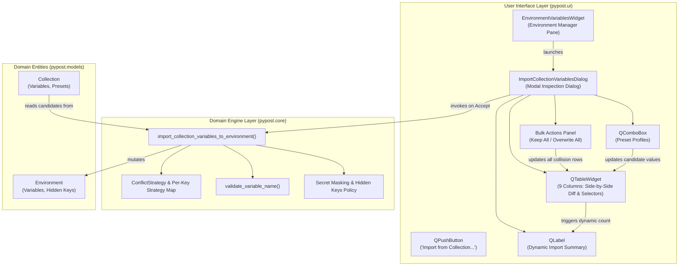
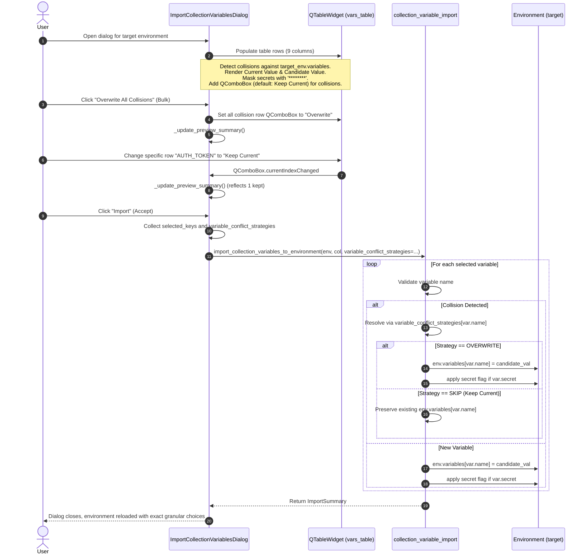
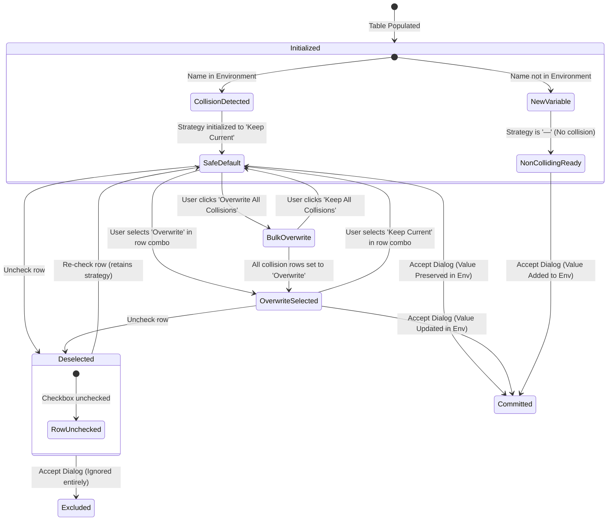

# PYPOST-1414: Per-variable conflict strategy and side-by-side diff inspector in collection variable import

## Research

### 1. Context and Problem Analysis

In [PYPOST-1411](file:///home/src/ai-tasks/PYPOST-1411/20-architecture.md), PyPost introduced a collection variable import dialog ([`ImportCollectionVariablesDialog`](file:///home/src/pypost/ui/dialogs/import_collection_variables_dialog.py)) and pure domain synchronization engine ([`import_collection_variables_to_environment`](file:///home/src/pypost/core/collection_variable_import.py)). This enabled users to import collection-declared variables into workspace environments, evaluate preset profiles, validate Jinja-compatible variable names, and automatically flag secret variables into environment `hidden_keys`.

However, the initial implementation utilized a global conflict resolution policy with two dialog-wide radio buttons:
- "Skip existing variables (keep current environment values)" (`ConflictStrategy.SKIP`)
- "Overwrite existing variables (replace with collection values)" (`ConflictStrategy.OVERWRITE`)

As outlined in [10-requirements.md](file:///home/src/ai-tasks/PYPOST-1414/10-requirements.md), this global, all-or-nothing approach introduced critical limitations:
1. **Lack of Granular Control (All-or-Nothing Dilemma)**: Users often need to import updated base URLs or service endpoints from a shared collection while preserving locally customized secrets, development tokens, or custom port overrides. Under the global policy, users were forced to choose between losing local overrides (overwrite all) or missing out on new configurations (skip all).
2. **Blind Overwrite Risk**: The preview table showed only a single `Value` column containing the incoming candidate value. Users had no visual indication of what value currently existed in their environment for colliding keys. They had to leave the dialog, check their environment table, and manually compare values from memory.
3. **Secret Exposure Vulnerability**: If a colliding variable contained sensitive data, visual inspection required careful masking so that neither current nor candidate secret values were exposed in plaintext on screen.
4. **Tedious Configuration in Large Imports**: In collections with dozens of variables, manual row-by-row toggling without bulk preset controls is cumbersome.

The goal of **PYPOST-1414** is to redesign the collection variable import experience to feature:
- A **Side-by-Side Diff Inspector** displaying `Current Value` (environment) alongside `Candidate Value` (collection/preset).
- **Per-Variable Conflict Strategy** selectors for colliding keys (`Keep Current` vs `Overwrite`).
- **Safe Baseline Defaults** (`Keep Current` on all collisions).
- **Bulk Strategy Controls** ("Keep All Collisions", "Overwrite All Collisions") for rapid configuration.
- **Strict Secret Masking** across both comparison columns whenever a variable is marked secret in either collection or environment.
- **Dynamic Real-Time Summary** reflecting additions, overwrites, kept values, and deselections.

---

### 2. Code Analysis of Existing Components

#### 2.1 `pypost/core/collection_variable_import.py`
- **[`ConflictStrategy`](file:///home/src/pypost/core/collection_variable_import.py#L16-L20)**:
  ```python
  class ConflictStrategy(str, Enum):
      SKIP = "skip"
      OVERWRITE = "overwrite"
  ```
- **[`ImportSummary`](file:///home/src/pypost/core/collection_variable_import.py#L24-L49)**:
  Tracks `added_keys`, `updated_keys`, `skipped_keys`, `invalid_keys`, and `newly_hidden_keys`.
- **[`import_collection_variables_to_environment`](file:///home/src/pypost/core/collection_variable_import.py#L62-L176)**:
  - Takes `conflict_strategy: ConflictStrategy = ConflictStrategy.SKIP`.
  - Loops over `collection.variables`.
  - For collisions (`var.name in environment.variables`), it unconditionally uses the single `conflict_strategy` passed to the function.
  - Secret handling: `if var.secret:` adds `var.name` to `environment.hidden_keys` and removes from `mcp_overridable_keys`.
- **Extension Required**:
  - Accept an optional `variable_conflict_strategies: dict[str, ConflictStrategy] | None = None` mapping variable names to their specific resolution policy.
  - For each colliding variable: check if `var.name in variable_conflict_strategies`. If present, use the specified strategy; otherwise fall back to `conflict_strategy`.
  - When a colliding key is resolved with `ConflictStrategy.OVERWRITE`, update `environment.variables[var.name]`, track in `summary.updated_keys`, and apply secret flags if `var.secret` is True.
  - When a colliding key is resolved with `ConflictStrategy.SKIP`, leave `environment.variables[var.name]` untouched, track in `summary.skipped_keys`, and do not modify the variable value.

#### 2.2 `pypost/ui/dialogs/import_collection_variables_dialog.py`
- **Current Table Architecture**:
  - `vars_table = QTableWidget(0, 7)`
  - Columns: `COL_SELECT = 0`, `COL_NAME = 1`, `COL_VALUE = 2`, `COL_TYPE = 3`, `COL_SECRET = 4`, `COL_STATUS = 5`, `COL_DESC = 6`.
  - Shows only the candidate collection value (`COL_VALUE`). Current environment values are invisible.
  - Has global radio buttons `self.skip_radio` and `self.overwrite_radio`.
  - Summary label formats a simple string based on `self.overwrite_radio.isChecked()`.
- **Extension Required**:
  - Expand table to 9 columns:
    - `COL_SELECT = 0`: Checkbox (include/exclude row).
    - `COL_NAME = 1`: Variable name.
    - `COL_CURRENT_VALUE = 2`: Value currently in `target_environment.variables` (or `—` if new), masked if secret in either environment or collection.
    - `COL_CANDIDATE_VALUE = 3`: Value from collection / active preset, masked if secret in either environment or collection.
    - `COL_STRATEGY = 4`: For collisions, an embedded `QComboBox` offering `"Keep Current"` (`ConflictStrategy.SKIP`) and `"Overwrite"` (`ConflictStrategy.OVERWRITE`). For non-colliding (new) variables, renders `—`.
    - `COL_TYPE = 5`: Variable type.
    - `COL_SECRET = 6`: `"Yes"` / `"No"`.
    - `COL_STATUS = 7`: `"Exists (Collision)"` / `"New"`.
    - `COL_DESC = 8`: Variable description.
  - Replace/augment global radio buttons with bulk action buttons:
    - `self.bulk_keep_current_btn = QPushButton("Keep All Collisions")`
    - `self.bulk_overwrite_btn = QPushButton("Overwrite All Collisions")`
  - When preset profile is switched via `preset_combo`, update `COL_CANDIDATE_VALUE` without resetting the user's per-row strategy choices.
  - Collect per-variable decisions on accept and pass `variable_conflict_strategies` to `import_collection_variables_to_environment`.

#### 2.3 `pypost/ui/widget_ids.py`
- Contains registered widget identifiers:
  - `COLLECTION_VARIABLE_IMPORT_BUTTON`
  - `IMPORT_COLLECTION_VARIABLES_DIALOG`
  - `IMPORT_COLLECTION_SOURCE_COMBO`
  - `IMPORT_COLLECTION_PRESET_COMBO`
  - `IMPORT_COLLECTION_VARS_TABLE`
  - `IMPORT_COLLECTION_SELECT_ALL_BUTTON`
  - `IMPORT_COLLECTION_DESELECT_ALL_BUTTON`
- **Extension Required**:
  - Register `IMPORT_COLLECTION_BULK_KEEP_CURRENT_BUTTON`
  - Register `IMPORT_COLLECTION_BULK_OVERWRITE_BUTTON`
  - Register naming convention for per-row strategy combo boxes: `IMPORT_COLLECTION_ROW_STRATEGY_COMBO_PREFIX = "pypost_import_strategy_combo_"`

---

### 3. Design Options and Trade-offs

| Design Aspect | Option A | Option B (Selected) | Rationale |
| --- | --- | --- | --- |
| **Conflict Strategy Scope** | Global radio buttons only with optional row exceptions. | First-class per-row selector on every colliding row + Bulk action preset buttons. | **Option B** removes the confusing dual-tier hierarchy. Every colliding variable has an explicit, visible strategy in its own row. Bulk buttons provide instant baseline configuration. |
| **Diff Presentation** | Single `Value` column with diff syntax (e.g. `old -> new`). | Separate side-by-side columns: `Current Value` and `Candidate Value`. | **Option B** provides clean tabular readability, straightforward secret masking, and avoids clutter in table cells. |
| **Strategy UI Widget** | Split buttons or toggle switches in table cell. | `QComboBox` with `["Keep Current", "Overwrite"]` in table cell. | Standard PySide6 widget, accessible, lightweight, clearly displays selected option. |
| **Bulk Actions** | Sticky radio buttons that override row changes. | Immediate action buttons (`QPushButton`) that batch-set row combos. | Action buttons decouple initial baseline setup from subsequent fine-tuning: users can click "Overwrite All Collisions" and then change one specific token back to "Keep Current". |
| **Default Strategy** | Last used or Overwrite. | Safe baseline: `Keep Current` (`ConflictStrategy.SKIP`). | Adheres to NFR1 (non-destructive safety). Prevents accidental overwrites. |
| **Secret Masking** | Mask only if collection variable is secret. | Mask if secret in collection **OR** secret in target environment (`hidden_keys`). | Guarantees complete confidentiality. Existing environment secrets are never exposed on screen even if the incoming collection variable is unflagged. |

---

## Implementation Plan

### High-Level Roadmap

1. **Step 3: Mandatory Failing Repro Tests**:
   - Write comprehensive red tests under `tests/test_workspace_environment_import_diff_repro.py` covering pure domain per-variable resolution, side-by-side diff display, secret masking in diff inspector, per-row combo selection, and bulk strategy buttons.
2. **Step 4: Development**:
   - **Iteration 1**: Extend `pypost/core/collection_variable_import.py` to support `variable_conflict_strategies: dict[str, ConflictStrategy] | None`, per-key resolution, and secret flag consistency.
   - **Iteration 2**: Register new widget IDs in `pypost/ui/widget_ids.py` (`IMPORT_COLLECTION_BULK_KEEP_CURRENT_BUTTON`, `IMPORT_COLLECTION_BULK_OVERWRITE_BUTTON`).
   - **Iteration 3**: Enhance `ImportCollectionVariablesDialog` in `pypost/ui/dialogs/import_collection_variables_dialog.py`:
     - 9-column table layout with `Current Value`, `Candidate Value`, and `Conflict Strategy` columns.
     - Side-by-side diff rendering with dual secret masking (`HIDDEN_MASK`).
     - Per-row `QComboBox` for colliding variables defaulting to `Keep Current`.
     - Bulk action controls ("Keep All Collisions", "Overwrite All Collisions").
     - Dynamic preview summary calculation.
     - Preserving row strategies during preset changes.
     - Pass `variable_conflict_strategies` to domain engine on accept.
   - **Iteration 4**: Run full verification suite (`make check`, `make typecheck`, `make test`, `make lint`).
3. **Step 5: Code Cleanup**:
   - Remove dead code, verify formatting, update cleanup report in `ai-tasks/PYPOST-1414/40-code-cleanup.md`.
4. **Step 6: Observability**:
   - Ensure structured logging captures per-variable strategy counts without logging secret values.
5. **Step 7: Technical Debt**:
   - Record technical debt analysis in `ai-tasks/PYPOST-1414/60-tech-debt.md`.
6. **Step 8: Dev Docs**:
   - Document side-by-side diff inspector and per-variable conflict strategy in `doc/dev/workspace_environment_variable_import.md`.

---

### Mandatory — Failing Repro (next Step 3)

The failing repro tests will be placed in a dedicated test file:
`tests/test_workspace_environment_import_diff_repro.py`

#### What the Red Tests Assert (Desired Behaviors):
1. **Domain Engine Per-Variable Conflict Strategy (`test_core_per_variable_conflict_strategy`)**:
   - When an environment contains `var_keep = "old_keep"` and `var_overwrite = "old_overwrite"`, and the collection contains `var_keep = "new_keep"` and `var_overwrite = "new_overwrite"`:
   - Calling `import_collection_variables_to_environment` with `variable_conflict_strategies={"var_keep": ConflictStrategy.SKIP, "var_overwrite": ConflictStrategy.OVERWRITE}` must:
     - Keep `env.variables["var_keep"] == "old_keep"` and include `"var_keep"` in `summary.skipped_keys`.
     - Update `env.variables["var_overwrite"] == "new_overwrite"` and include `"var_overwrite"` in `summary.updated_keys`.
     - Not fail or overwrite `var_keep`.
2. **Dialog Side-by-Side Diff Inspector (`test_dialog_side_by_side_diff_columns`)**:
   - Assert `dialog.vars_table.columnCount() == 9`.
   - Assert header labels include `"Current Value"`, `"Candidate Value"`, and `"Conflict Strategy"`.
   - For an existing colliding variable `host`, verify `COL_CURRENT_VALUE` shows the environment value and `COL_CANDIDATE_VALUE` shows the collection value.
   - For a new variable, verify `COL_CURRENT_VALUE` indicates no prior value (`—`) and `COL_CANDIDATE_VALUE` shows the candidate value.
3. **Diff Inspector Secret Masking Contract (`test_dialog_diff_secret_masking`)**:
   - When a variable is secret in the collection, verify both its candidate value and current value (if colliding) are masked as `********` (`HIDDEN_MASK`).
   - When a variable is in `env.hidden_keys` but NOT marked secret in the collection, verify its current value and candidate value are masked as `********`.
   - Ensure sensitive plaintext values never appear in table items.
4. **Per-Row Strategy Selector and Default (`test_dialog_per_row_strategy_selection`)**:
   - Colliding rows have a `QComboBox` in `COL_STRATEGY` with options `"Keep Current"` and `"Overwrite"`, defaulting to `"Keep Current"`.
   - Non-colliding rows show `"—"` in `COL_STRATEGY` without an active combo box.
   - Changing row 0 to `"Overwrite"` and leaving row 1 as `"Keep Current"`, then accepting the dialog:
     - Confirms row 0 is updated in `target_environment`.
     - Confirms row 1 remains untouched in `target_environment`.
5. **Bulk Strategy Actions and Dynamic Summary (`test_dialog_bulk_strategy_and_dynamic_summary`)**:
   - Assert bulk buttons `bulk_keep_current_btn` and `bulk_overwrite_btn` exist.
   - Clicking `bulk_overwrite_btn` updates all colliding row combos to `"Overwrite"` and updates `summary_label` (e.g. `"X new to add, Y existing to overwrite, 0 existing to keep"`).
   - Clicking `bulk_keep_current_btn` updates all colliding row combos to `"Keep Current"` and updates `summary_label` (e.g. `"X new to add, 0 existing to overwrite, Y existing to keep"`).
   - Changing an individual row updates the summary accordingly.

#### Test Execution and Failure Sequencing:
- Tests use standard pytest fixtures (`qapp`, in-memory domain objects), requiring no live network or external daemons.
- In Step 3, these tests will fail (Red) because:
  - `import_collection_variables_to_environment` does not yet accept `variable_conflict_strategies`.
  - `ImportCollectionVariablesDialog` table currently has only 7 columns without separate `Current Value` / `Candidate Value` columns or per-row strategy combos.
  - Bulk action buttons do not exist yet.
- In Step 4, implementation will turn all tests green.

---

## Architecture

### 1. System Module Diagram



---

### 2. Component Responsibilities & Module Interactions

| Component | Responsibility | Changes in PYPOST-1414 |
| --- | --- | --- |
| **`pypost.core.collection_variable_import`** | Pure domain engine that calculates diffs, validates names, applies conflict strategies, and mutates target environment. | Added `variable_conflict_strategies: dict[str, ConflictStrategy] | None` parameter. Evaluates per-variable resolution when keys collide. Maintains strict secret masking contract. |
| **`ImportCollectionVariablesDialog`** | Modal UI presenting variable candidates, side-by-side diff inspection, per-row resolution controls, and dynamic preview summary. | Expanded to 9 columns (`Current Value`, `Candidate Value`, `Conflict Strategy`). Added per-row combo box for collisions. Added bulk strategy buttons. Enforces secret masking in both diff columns. Preserves row strategies across preset switches. |
| **`pypost.ui.widget_ids`** | Stable automation identifiers for agent and UI test lookup. | Added `IMPORT_COLLECTION_BULK_KEEP_CURRENT_BUTTON`, `IMPORT_COLLECTION_BULK_OVERWRITE_BUTTON`, and row strategy combo naming conventions. |
| **`EnvironmentVariablesWidget`** | Primary environment variables editing surface. | No direct changes required; benefits transparently from the improved dialog workflow and domain engine. |

---

### 3. Data Flow and Sequence Diagram



---

### 4. Table Layout Specification

The inspection table (`self.vars_table`) is structured with 9 columns:

| Column Index | Constant Name | Header Label | Width Mode | Content / Widget |
| --- | --- | --- | --- | --- |
| 0 | `COL_SELECT` | `""` | ResizeToContents | `QTableWidgetItem` with check state (Checked / Unchecked) |
| 1 | `COL_NAME` | `"Name"` | ResizeToContents | Variable name (`str`, read-only) |
| 2 | `COL_CURRENT_VALUE` | `"Current Value"` | Stretch | Target environment value, `HIDDEN_MASK` if secret, or `"—"` if new |
| 3 | `COL_CANDIDATE_VALUE` | `"Candidate Value"` | Stretch | Incoming collection/preset value, `HIDDEN_MASK` if secret |
| 4 | `COL_STRATEGY` | `"Conflict Strategy"` | ResizeToContents | `QComboBox` (`["Keep Current", "Overwrite"]`) for collisions; `"—"` for new variables |
| 5 | `COL_TYPE` | `"Type"` | ResizeToContents | Variable type (`"string"`, `"integer"`, etc.) |
| 6 | `COL_SECRET` | `"Secret"` | ResizeToContents | `"Yes"` or `"No"` |
| 7 | `COL_STATUS` | `"Status"` | ResizeToContents | `"Exists (Collision)"` or `"New"` |
| 8 | `COL_DESC` | `"Description"` | Stretch | Variable description |

---

### 5. Collision Row Lifecycle State Machine



---

### 6. Public Interfaces and Function Signatures

#### Domain Engine (`pypost/core/collection_variable_import.py`)
```python
def import_collection_variables_to_environment(
    environment: Environment,
    collection: Collection,
    conflict_strategy: ConflictStrategy = ConflictStrategy.SKIP,
    selected_keys: set[str] | None = None,
    preset_name: str | None = None,
    variable_conflict_strategies: dict[str, ConflictStrategy] | None = None,
) -> ImportSummary:
    """Import declared collection variables into the target environment.

    Args:
        environment: The destination working environment to mutate.
        collection: The source collection providing variable declarations and presets.
        conflict_strategy: Default conflict policy for existing keys (fallback).
        selected_keys: Optional set of variable names to selectively import.
            If None, all variables are candidate for import.
        preset_name: Optional preset profile name to take values from instead of base defaults.
        variable_conflict_strategies: Optional per-variable mapping from variable name
            to specific ConflictStrategy (ConflictStrategy.SKIP or ConflictStrategy.OVERWRITE).
            When specified for a colliding key, overrides conflict_strategy.

    Returns:
        ImportSummary detailing added, updated, skipped, invalid, and newly hidden variables.
    """
```

#### Dialog Helper APIs (`ImportCollectionVariablesDialog`)
```python
class ImportCollectionVariablesDialog(QDialog):
    def get_row_strategy(self, row: int) -> ConflictStrategy | None:
        """Return the selected ConflictStrategy for row, or None if non-colliding."""

    def set_row_strategy(self, row: int, strategy: ConflictStrategy) -> None:
        """Set the ConflictStrategy combo box for row if it is a colliding row."""

    def get_variable_conflict_strategies(self) -> dict[str, ConflictStrategy]:
        """Return a mapping of variable name to chosen ConflictStrategy for all colliding rows."""

    def bulk_set_collision_strategy(self, strategy: ConflictStrategy) -> None:
        """Set the ConflictStrategy on all colliding rows to strategy and refresh summary."""
```

#### Automation Widget IDs (`pypost/ui/widget_ids.py`)
```python
IMPORT_COLLECTION_BULK_KEEP_CURRENT_BUTTON: Final[str] = (
    "pypost_import_collection_bulk_keep_current_button"
)
IMPORT_COLLECTION_BULK_OVERWRITE_BUTTON: Final[str] = (
    "pypost_import_collection_bulk_overwrite_button"
)
IMPORT_COLLECTION_ROW_STRATEGY_COMBO_PREFIX: Final[str] = (
    "pypost_import_strategy_combo_"
)
```

---

## Q&A

**Q1: Why is per-variable strategy better than global radio buttons?**  
**A**: Real-world environments contain mixed data: shared endpoint definitions (which should be updated when collection presets evolve) and personal development tokens or custom local ports (which must not be wiped out). A global radio button forces users to either lose local overrides or fail to adopt new settings. Per-variable strategy gives precise control over each variable.

**Q2: What is the default strategy for colliding variables and why?**  
**A**: The default strategy for every colliding variable is **Keep Current** (`ConflictStrategy.SKIP`). This satisfies NFR1 (data safety) by preventing accidental data loss if a user opens the dialog and clicks Import without changing options.

**Q3: How does the side-by-side diff inspector handle sensitive/secret credentials?**  
**A**: If a variable is marked as secret in the collection, OR is currently present in `environment.hidden_keys`, its value is masked (`********`) in both the `Current Value` and `Candidate Value` columns. Plaintext secrets are never rendered in the comparison view.

**Q4: How do bulk action controls interact with individual row strategies?**  
**A**: Bulk action buttons ("Keep All Collisions", "Overwrite All Collisions") serve as rapid preset tools. Clicking a bulk button updates all colliding row dropdowns immediately. The user can then customize individual rows as needed before confirming the import.

**Q5: What happens when the user switches preset profiles?**  
**A**: Switching the preset profile refreshes the `Candidate Value` column with values from the selected profile. Current values, collision badges, and user-selected per-row conflict strategies are preserved across profile switches.

**Q6: What happens if a user unchecks a colliding row?**  
**A**: Unchecked rows are excluded from `selected_keys`. The import engine skips them completely, leaving the target environment variable untouched regardless of what strategy was selected on that row.

**Q7: How are non-colliding (new) variables handled in the strategy column?**  
**A**: Non-colliding variables do not exist in the environment, so there is no conflict to resolve. Their strategy column renders `"—"` (disabled / non-editable), and their default action is to be added when checked.
