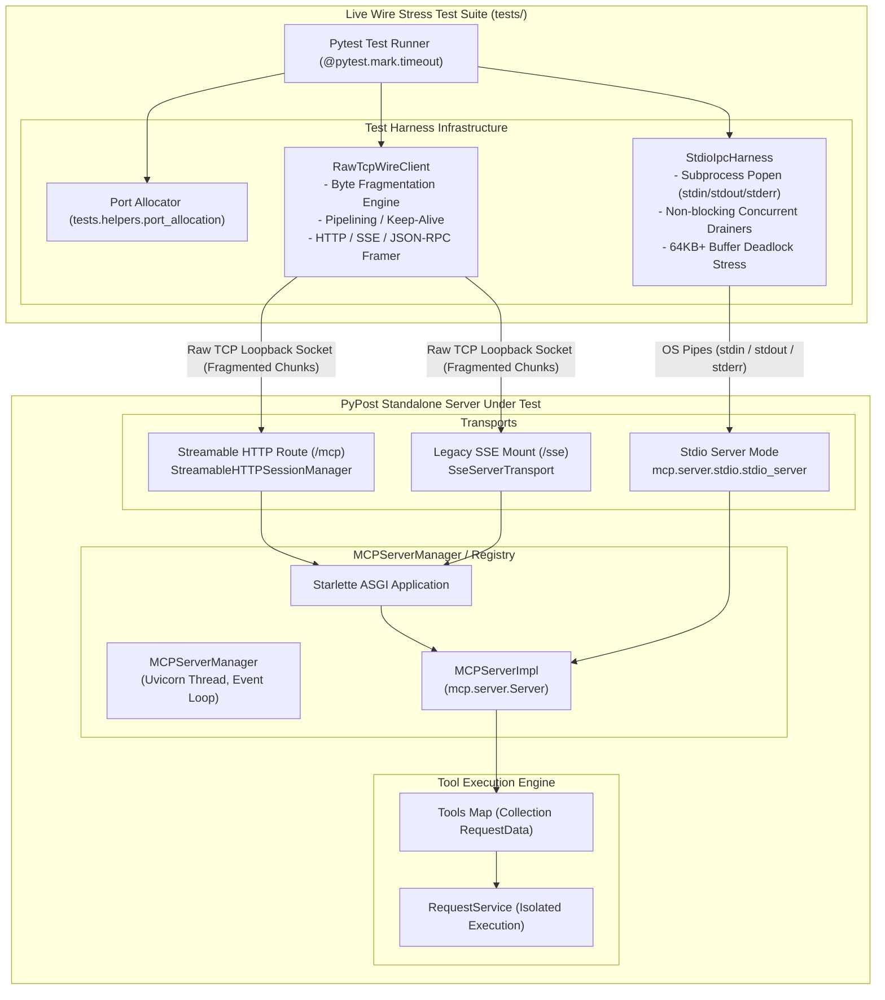
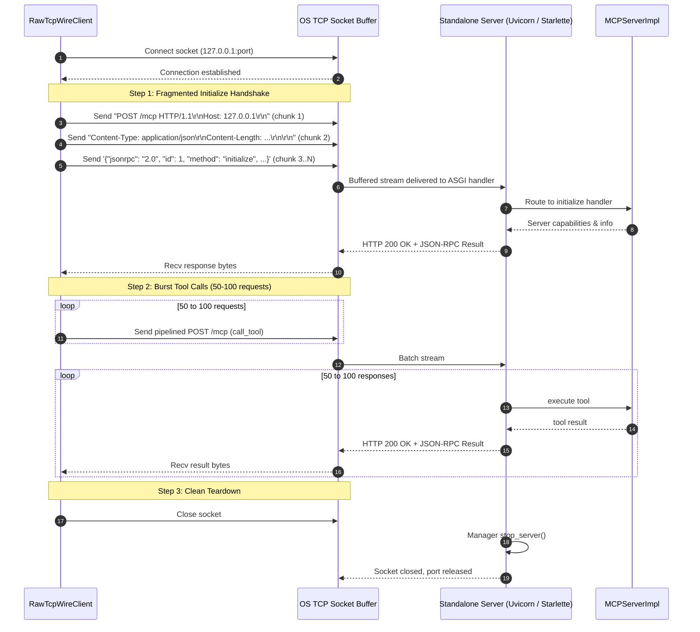
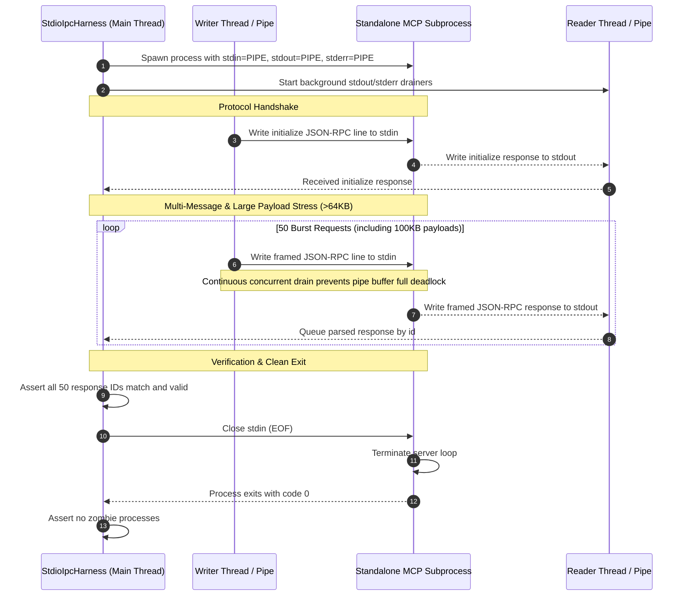

# PYPOST-1416: Live Wire IPC and Stdio Transport Stress Testing for Standalone MCP Servers

## Research

### 1. Problem Context and Technical Motivation

In PyPost, Model Context Protocol (MCP) servers expose API collections as discoverable, executable AI tools and resources. Prior development phases ([PYPOST-1410](file:///home/src/ai-tasks/PYPOST-1410/20-architecture.md) and [PYPOST-1412](file:///home/src/ai-tasks/PYPOST-1412/20-architecture.md)) established standalone server configuration and execution without workspace environments, verifying collection variable resolution and registry lifecycles. However, those tests operated almost entirely in-process or via high-level abstractions:
- In-process unit tests bypass the operating system's networking stack, socket buffers, kernel pipe buffers, and wire framing.
- Physical wire communication introduces failure modes that in-memory mocks never reveal:
  1. **TCP Packet Fragmentation and Boundary Splitting**: Stream-oriented TCP sockets deliver bytes in arbitrary packet sizes (governed by MTU, Nagle's algorithm, kernel socket buffers). A single JSON-RPC message may arrive split across multiple socket reads, or multiple HTTP/JSON-RPC messages may arrive coalesced within a single TCP packet.
  2. **OS Stdio Pipe Buffering and Deadlocks**: Operating system pipes (`stdin`/`stdout`) have fixed buffer limits (typically 64KB on Linux). If a client floods `stdin` with a multi-message burst or large payloads while blocking on reading `stdout` (or vice versa), both client and server can deadlock indefinitely on full kernel pipe buffers.
  3. **High-Concurrency Bursts and Pipelining**: Back-to-back bursts of 50–100 requests can exhaust connection pools, trigger race conditions in ASGI request lifespans, or drop messages.
  4. **Resource Hygiene and Teardown Leaks**: Improper socket closure can leave TCP ports stuck in `TIME_WAIT` without `SO_REUSEADDR`, or leave worker threads and child processes orphaned in the background.

To ensure production robustness for standalone MCP servers, we must build a live wire stress-testing harness that exercises standalone MCP servers across physical loopback TCP sockets and OS stdio process pipes under sustained load, packet fragmentation, and pipe buffer pressure.

---

### 2. Analysis of Existing Code Components

#### 2.1 Standalone MCP Server Implementation and Transports
- **[`MCPServerImpl`](file:///home/src/pypost/core/mcp_server_impl.py)**:
  - Initializes `mcp.server.Server(name)`.
  - Registers MCP handlers for `tools/list` (`list_tools`) and `tools/call` (`call_tool`).
  - Creates the ASGI Starlette application via `create_app()`:
    - Route `/mcp`: Mounts `build_streamable_http_route(self.server)` using `mcp.server.streamable_http_manager.StreamableHTTPSessionManager`.
    - Route `/sse`: Mounts `build_legacy_sse_app(self.server)` via `starlette.routing.Mount(MCP_LEGACY_SSE_MOUNT_PATH, ...)` using `mcp.server.sse.SseServerTransport`.
- **[`MCPServerManager`](file:///home/src/pypost/core/qt/mcp_server.py)**:
  - Manages background Uvicorn server execution in a dedicated daemon thread `_run_uvicorn()`.
  - Emits Qt signals: `status_changed(bool)`, `start_failed(str)`, `activity_recorded(entry)`.
  - Exposes `start_server(port, tools, host)`, `stop_server()`, and `is_running()`.
  - Provides `_wait_until_port_bindable(timeout=10.0)` which checks `SO_REUSEADDR` socket re-binding.
- **[`MCPServerRegistry`](file:///home/src/pypost/core/mcp_server_registry.py)**:
  - Owns multiple `MCPServerManager` instances keyed by configuration ID.
  - Manages startup, shutdown, reconfiguration, and reference reconciliation for standalone and library-backed servers.

#### 2.2 Existing Stdio and Process Patterns in PyPost
- **[`pypost/agent/ui_actions_mcp.py`](file:///home/src/pypost/agent/ui_actions_mcp.py)**:
  - Demonstrates out-of-process MCP server execution over stdio:
    ```python
    async with stdio_server() as (read_stream, write_stream):
        await bridge.server.run(read_stream, write_stream, init_options)
    ```
  - Tested in [`tests/test_agent_ui_actions_mcp.py`](file:///home/src/tests/test_agent_ui_actions_mcp.py) using `mcp.client.stdio.StdioServerParameters` and `stdio_client`.
  - Stdio transport for standalone servers can be invoked either via a lightweight subprocess runner or standard MCP stdio bridging.

#### 2.3 Ephemeral Port Allocation and Testing Infrastructure
- **[`tests/helpers/port_allocation.py`](file:///home/src/tests/helpers/port_allocation.py)**:
  - Provides `allocate_tcp_port(host="127.0.0.1") -> int` protected by file locks (`/tmp/pypost-test-port.lock`) and counter persistence.
  - Ensures clean, collision-free TCP port allocation across parallel pytest workers.

---

### 3. Wire Protocol Framing & Transport Specifications

#### 3.1 Streamable HTTP Wire Protocol (`/mcp`)
- Transport endpoint: `POST http://127.0.0.1:{port}/mcp`
- Headers:
  - `Content-Type: application/json`
  - `Accept: application/json, text/event-stream`
- Request body: Standard JSON-RPC 2.0 object:
  ```json
  {"jsonrpc": "2.0", "id": 1, "method": "initialize", "params": {...}}
  ```
- Server response:
  - HTTP 200 OK with `Content-Type: application/json` or `text/event-stream`.
- Wire Framing Challenges:
  - HTTP chunked transfer encoding (`Transfer-Encoding: chunked`).
  - Packet segmentation across socket `send` calls (e.g., header split from body, body split across arbitrary 1-byte, 7-byte, or 64-byte fragments).
  - TCP keep-alive pipelining: multiple HTTP requests delivered over the same TCP socket connection.

#### 3.2 Legacy SSE Wire Protocol (`/sse` & `/sse/messages`)
- Step 1: Client opens GET stream:
  `GET /sse HTTP/1.1\r\nHost: 127.0.0.1:{port}\r\nAccept: text/event-stream\r\n\r\n`
- Step 2: Server responds with SSE stream:
  ```http
  HTTP/1.1 200 OK
  Content-Type: text/event-stream
  Cache-Control: no-cache

  event: endpoint
  data: /sse/messages?session_id=3fa85f64-5717-4562-b3fc-2c963f66afa6
  ```
- Step 3: Client posts JSON-RPC message to the session endpoint:
  `POST /sse/messages?session_id=... HTTP/1.1\r\n...`
- Step 4: Server responds with HTTP 202 Accepted, and streams the JSON-RPC response back over the established GET SSE connection:
  ```http
  event: message
  data: {"jsonrpc": "2.0", "id": 1, "result": {...}}
  ```

#### 3.3 Stdio OS Pipe IPC Protocol
- Standard stream model:
  - `stdin`: Client writes newline-delimited JSON-RPC 2.0 strings (`{"jsonrpc":"2.0",...}\n`).
  - `stdout`: Server writes newline-delimited JSON-RPC 2.0 responses.
  - `stderr`: Diagnostics and logging (must not contaminate JSON-RPC streams).
- Buffer and Concurrency Challenges:
  - Linux pipe buffer is 64KB (`PIPE_BUF` typically 4KB atomic, buffer size 65536 bytes). Writing a 100KB payload in a single blocking `write` deadlocks if the reader is blocked waiting for write completion.
  - The stress harness must implement concurrent, asynchronous reading and writing (or threaded workers) to continuously drain OS pipe buffers.

---

## Implementation Plan

### High-Level Execution Phases

1. **Phase 1: Architecture and Test Design (Step 2 — Current)**:
   - Establish `ai-tasks/PYPOST-1416/20-architecture.md` detailing wire IPC client abstractions, packet fragmentation engine, stdio subprocess stress driver, and teardown contracts.
   - Specify the automated failing repro test in `tests/test_mcp_standalone_wire_ipc_repro.py`.

2. **Phase 2: Failing Repro Test Creation (Step 3)**:
   - Implement `tests/test_mcp_standalone_wire_ipc_repro.py`.
   - Implement low-level wire socket test client and stdio IPC harness.
   - Execute red tests to verify that the stress scenarios run and assert strict wire framing, packet fragmentation, and concurrency contracts.

3. **Phase 3: Development and Stress Hardening (Step 4)**:
   - Run tests until green.
   - If any framing bugs, packet chunk parsing errors, or pipe buffer deadlocks emerge under stress, apply targeted fixes to standalone server handlers or connection management.
   - Validate 50–100 burst throughput assertions, large payload handling (>64KB), and clean port/process teardown.

4. **Phase 4: Cleanup, Observability, Tech Debt & Dev Docs (Steps 5–8)**:
   - Code cleanup in `40-code-cleanup.md`.
   - Verify metrics and structured logging in `50-observability.md`.
   - Document any remaining tech debt in `60-tech-debt.md`.
   - Update developer documentation under `doc/dev/`.

---

### Mandatory — Failing Repro (next Step 3)

- **Target File**: [`tests/test_mcp_standalone_wire_ipc_repro.py`](file:///home/src/tests/test_mcp_standalone_wire_ipc_repro.py)
- **What it asserts (desired behavior)**:
  1. `test_tcp_wire_packet_fragmentation_streamable_http`:
     - Spawns a standalone MCP server via `MCPServerManager` with an allocated port.
     - Connects a raw `socket.socket` directly over loopback TCP.
     - Transmits a complete MCP protocol sequence (`initialize` -> `notifications/initialized` -> `tools/list` -> `tools/call`) where HTTP request headers and JSON-RPC payloads are intentionally fragmented into micro-chunks (1-byte and 7-byte chunks) sent across individual TCP packets.
     - Asserts that the standalone server reassembles fragmented packets cleanly, returns valid HTTP 200 responses, and emits correct JSON-RPC results without syntax or framing errors.
  2. `test_tcp_wire_pipelined_burst_stress`:
     - Opens a TCP connection to the standalone server.
     - Floods 50–100 tool execution requests in a rapid burst over the wire.
     - Asserts all 50–100 responses are received, all request IDs are matched, throughput is maintained without connection resets, and latency remains bounded.
  3. `test_stdio_subprocess_ipc_large_payload_and_burst`:
     - Spawns a standalone MCP server process with redirected `stdin`, `stdout`, and `stderr`.
     - Injects a continuous burst of 50 requests including large payloads (>64KB) across the stdio pipe.
     - Concurrently drains `stdout` and `stderr` using dedicated asynchronous workers to prevent OS pipe deadlocks.
     - Asserts that all requests complete successfully and that closing `stdin` terminates the process cleanly within bounded timeout with return code 0, leaving no orphan processes.
  4. `test_wire_lifecycle_teardown_and_port_rebind`:
     - Subjects a standalone server to an active wire burst, signals shutdown, and verifies immediate TCP port release without `EADDRINUSE` on rapid re-binding.
- **Why it is Red initially**:
  - The file does not currently exist. Standalone servers have never been subjected to raw byte-level packet fragmentation or OS pipe buffer stress tests.
- **Sequencing**:
  Step 2 (Architecture approved) -> Step 3 (Write red repro tests in `tests/test_mcp_standalone_wire_ipc_repro.py`) -> Step 4 (Execute and harden until green).

---

## Architecture

### 1. System Module & Component Architecture



---

### 2. Module Responsibilities and Boundaries

| Component | Responsibility | Interacting Modules |
| --- | --- | --- |
| **`RawTcpWireClient`** | Establishes physical loopback TCP connections via `socket.socket`. Injects fragmented byte streams, partial packet sends, and burst pipelining. Parses raw HTTP status lines, headers, chunked bodies, and JSON-RPC payloads. | Standalone server `/mcp` and `/sse` endpoints over loopback TCP. |
| **`StdioIpcHarness`** | Manages child subprocess execution for standalone MCP stdio communication. Coordinates non-blocking background reader threads for `stdout` and `stderr` to prevent OS pipe deadlocks under large payload bursts (>64KB). | Subprocess OS pipes (`stdin`, `stdout`, `stderr`), standalone MCP stdio entry. |
| **`MCPServerManager`** | Manages Uvicorn lifecycle, ASGI application hosting, thread creation, and clean socket binding/teardown. | `MCPServerImpl`, Starlette, Uvicorn, OS socket layer. |
| **`MCPServerImpl`** | Registers collection requests as MCP tools, coordinates protocol requests (`initialize`, `tools/list`, `tools/call`), and delegates execution to `RequestService`. | `Starlette`, `Server`, `RequestService`. |
| **`PortAllocation`** | Allocates conflict-free ephemeral TCP ports across parallel test workers. | `MCPServerManager`, `RawTcpWireClient`. |

---

### 3. Protocol Interaction Sequences

#### Sequence A: Fragmented Raw TCP Streamable HTTP Negotiation & Execution



#### Sequence B: Stdio IPC Subprocess Stress Flow & Deadlock Avoidance



---

### 4. Wire Framing & Packet Fragmentation Design Details

The `RawTcpWireClient` implements granular byte segmentation controls:
- **`send_fragmented(data: bytes, chunk_size: int = 7, delay: float = 0.0)`**:
  Splits `data` into slices of length `chunk_size` and issues individual `sock.send()` calls for each slice.
- **Micro-Chunk Stress**:
  - `chunk_size=1`: Sends each byte as an individual packet. Exercises the most extreme byte-by-byte boundary handling of Starlette/Uvicorn HTTP request parsing.
  - `chunk_size=7` or `13`: Non-power-of-two chunk boundaries that split HTTP delimiter sequences (`\r\n\r\n`) and JSON quote/brace boundaries across packets.
- **Pipelined Request Packing**:
  - `send_pipelined(requests: list[bytes])`:
    Concatenates multiple complete HTTP requests into a single monolithic byte buffer and transmits it via `sock.sendall()`. Verifies that the server protocol handler processes all back-to-back requests on the keep-alive connection without dropping or corrupting subsequent messages.
- **Response Frame Assembler**:
  - Reads from the socket using a 4096-byte buffer.
  - Parses HTTP status line, headers (`Content-Length` or chunked transfer markers), and extracts the exact JSON payload.
  - Matches each response's `id` against the dispatched request `id`.

---

### 5. Stdio IPC Non-Blocking Subprocess Design Details

To prevent the classic OS pipe buffer deadlock (where `stdin` write blocks because kernel pipe buffer is full, while child process blocks writing to `stdout` because the client has not read it):
- **`StdioIpcHarness` Architecture**:
  1. Spawns the child process:
     ```python
     process = subprocess.Popen(
         [sys.executable, "-m", "pypost.agent.ui_actions_mcp", ...],  # or standalone runner
         stdin=subprocess.PIPE,
         stdout=subprocess.PIPE,
         stderr=subprocess.PIPE,
         text=False,  # Raw binary bytes for exact framing control
         bufsize=0,   # Unbuffered pipes
     )
     ```
  2. Background Reader Thread:
     Runs in a daemon thread, reading binary lines from `process.stdout`. For every `\n`-delimited line, parses JSON-RPC 2.0 and deposits the parsed dictionary into a thread-safe `queue.Queue` or a dict of futures keyed by message `id`.
  3. Background Error Drainer:
     Drains `process.stderr` into an in-memory buffer to prevent stderr pipe full stalls and to capture diagnostic logs if the process crashes.
  4. Non-Blocking Writer:
     Serializes JSON-RPC requests, appends `\n`, and writes to `process.stdin.write()`, followed by `process.stdin.flush()`.
  5. Bounded Teardown:
     Closes `stdin`, awaits process exit via `process.wait(timeout=5.0)`. If timeout expires, terminates or kills the process to prevent leaked orphans.

---

## Q&A

**Q: Why not use existing high-level MCP client libraries (like `mcp.client.session.ClientSession`) for all stress tests?**  
A: High-level MCP client libraries serialize the entire message in memory and hand it to high-level HTTP client libraries (like `httpx`) that handle framing and socket reads automatically. While suitable for integration testing, they hide packet fragmentation, partial packet sends, raw TCP keep-alive pipelining, and byte-level framing boundaries. Using a custom raw socket client allows us to intentionally corrupt framing, inject byte-by-byte fragmentation, and test pipelined packet delivery directly against standalone server listeners.

**Q: How do we prevent OS pipe deadlocks during stdio stress testing?**  
A: OS pipes have limited buffer capacity (64KB on Linux). If a test writes a 100KB payload or 50 requests totaling >64KB while waiting synchronously before reading the output, the process will deadlock. The test harness solves this by running a dedicated background thread that asynchronously drains `stdout` and `stderr` continuously, ensuring pipe buffers never fill up.

**Q: How does this test harness avoid test flakiness and port collisions in CI?**  
A: All tests use `tests.helpers.port_allocation.allocate_tcp_port()`, which uses an OS-level file lock and atomic counter to distribute distinct ephemeral ports across parallel pytest workers. Additionally, all socket connections, child processes, and server managers are wrapped in `try ... finally` context managers that guarantee process termination, pipe closure, and socket release. All tests declare explicit timeouts conforming to `@pytest.mark.timeout(30)` or `60`.

**Q: What standalone server tools will be exercised during the stress tests?**  
A: The harness exercises both lightweight built-in tools (such as echo/ping tools that return immediate responses) and data-intensive tools (that accept or return large payloads >64KB) to verify high throughput (50–100 bursts) as well as buffer capacity under real-world loads.
