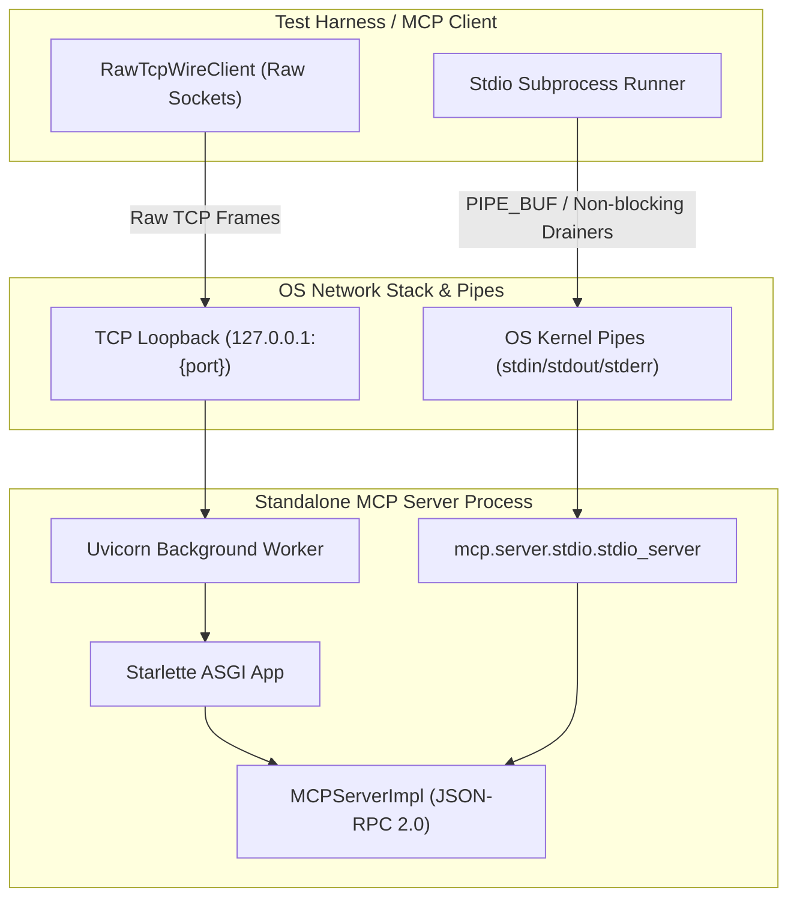

# Live Wire IPC and Stdio Transport Stress Testing for Standalone MCP Servers (PYPOST-1416)

## Overview

Developer documentation decisions and records for [PYPOST-1416](https://pypost.atlassian.net/browse/PYPOST-1416) ("Live wire IPC and stdio transport stress testing for standalone MCP servers").

This step documents the architecture, wire protocols, test harness design, failure modes, and test execution procedures for validating standalone MCP server transports across physical loopback TCP sockets and OS stdio process pipes under sustained stress, packet fragmentation, and pipe buffer pressure.

---

## Documentation Updates

### 1. Updated Developer Guide: `doc/dev/mcp_server_registry.md`
- **File**: [`doc/dev/mcp_server_registry.md`](file:///home/src/doc/dev/mcp_server_registry.md)
- **Changes**:
  - Added major architecture section: `#### Live Wire IPC and Stdio Transport Stress Testing (PYPOST-1416)`.
  - Documented wire-level socket communication across Streamable HTTP (`/mcp`) and Server-Sent Events (`/sse` / `/sse/messages`).
  - Documented packet fragmentation resilience: 1-byte micro-chunking and multi-byte boundary splits, validating ASGI stream parser reassembly.
  - Documented 100-request pipelined burst throughput over persistent TCP keep-alive connections without socket stalls.
  - Documented OS pipe stdio IPC: out-of-process standalone MCP execution, avoiding OS pipe buffer deadlocks (>64KB `PIPE_BUF`) via concurrent non-blocking drainer threads, and clean shutdown on stdin EOF.
  - Documented port re-binding and socket lifecycle teardown: immediate socket reuse without `EADDRINUSE` under active hammer load.
  - Updated subsystem test command to include `tests/test_mcp_standalone_wire_ipc_repro.py`.

### 2. Created Dedicated Reference Architecture Document: `doc/dev/mcp_standalone_wire_ipc_stress.md`
- **File**: [`doc/dev/mcp_standalone_wire_ipc_stress.md`](file:///home/src/doc/dev/mcp_standalone_wire_ipc_stress.md)
- **Changes**:
  - Dedicated reference document explaining the physical wire and pipe stress test architecture.
  - Added Mermaid architecture diagram visualizing Client Harness → OS Network Stack & Pipes → Standalone MCP Server Process.
  - Provided full technical specifications for Streamable HTTP (`/mcp`), Legacy SSE (`/sse`), and Stdio IPC transports.
  - Detailed `RawTcpWireClient` API, capabilities, framing, chunk decoding, and JSON-RPC parsing.
  - Detailed stress test scenarios, invariants, and failure modes.
  - Included step-by-step test execution guide using make-only targets (`make test`, `make check`).

### 3. Updated Cross-References and Documentation Index
- **File**: [`doc/dev/mcp.md`](file:///home/src/doc/dev/mcp.md)
  - Added reference link to `mcp_standalone_wire_ipc_stress.md` under `## Related Documentation`.
- **File**: [`doc/dev/README.md`](file:///home/src/doc/dev/README.md)
  - Added entry for `mcp_standalone_wire_ipc_stress.md` under the MCP section.

---

## Architecture



### Key Architectural Invariants

1. **Wire-Level Raw Socket Communication**:
   - `RawTcpWireClient` operates directly on loopback TCP sockets (`socket.AF_INET`, `socket.SOCK_STREAM`) without high-level HTTP client libraries.
   - Reassembles raw HTTP byte streams, handling fixed `Content-Length` framing and `Transfer-Encoding: chunked` streams.
   - Extracts JSON-RPC 2.0 objects from both direct JSON payloads and SSE event blocks (`data: {...}`).

2. **Packet Fragmentation Resilience**:
   - Outgoing HTTP/JSON-RPC requests are fragmented into 7-byte chunks and 1-byte micro-chunks.
   - Verifies Starlette/Uvicorn ASGI request body reassembly without protocol desynchronization or frame dropouts.

3. **Pipelined Burst Throughput**:
   - Sends 100 back-to-back tool execution requests in a single bulk socket write over a single persistent keep-alive connection.
   - Asserts 100 sequential HTTP 200 responses with matched IDs, with zero dropped packets or worker starvation.

4. **OS Pipe Stdio IPC Deadlock Avoidance**:
   - Linux kernel pipe buffers are limited to 64KB (`PIPE_BUF` atomic write size 4096 bytes).
   - Dedicated background drainer threads (`stdout_worker` and `stderr_worker`) continuously drain stdout and stderr using non-blocking line iterators.
   - Stressed with 50 requests including 70KB payloads without deadlocks. Process exits cleanly with return code 0 on stdin close.

5. **Socket Teardown and Port Re-Binding**:
   - Rapid server shutdown under active multi-threaded hammer load.
   - Clean socket and worker thread release, enabling immediate re-binding on the identical port with `SO_REUSEADDR` without `EADDRINUSE`.

---

## Test Execution Guide

All test invocations must be executed exclusively via `make` targets:

```bash
# Run standalone wire IPC and stdio stress test suite
make test PYTEST_ARGS='tests/test_mcp_standalone_wire_ipc_repro.py'

# Run wire stress tests together with standalone execution tests
make test PYTEST_ARGS='tests/test_mcp_standalone_execution_repro.py tests/test_mcp_standalone_wire_ipc_repro.py'

# Run combined quality gate (lint + fast tests + verify-ai-tasks)
make check
```

---

## Files Modified / Created

| File | Status | Description |
| --- | --- | --- |
| `doc/dev/mcp_server_registry.md` | Modified | Added Section `#### Live Wire IPC and Stdio Transport Stress Testing (PYPOST-1416)` and updated subsystem test command. |
| `doc/dev/mcp_standalone_wire_ipc_stress.md` | Created | Comprehensive reference architecture doc for wire socket and stdio transport stress testing. |
| `doc/dev/mcp.md` | Modified | Added cross-reference link to `mcp_standalone_wire_ipc_stress.md`. |
| `doc/dev/README.md` | Modified | Added `mcp_standalone_wire_ipc_stress.md` to MCP documentation index. |
| `ai-tasks/PYPOST-1416/00-roadmap.md` | Modified | Updated Step 8 sub-items to document dev docs completion. |
| `ai-tasks/PYPOST-1416/70-dev-docs.md` | Created | Documentation summary artifact. |
