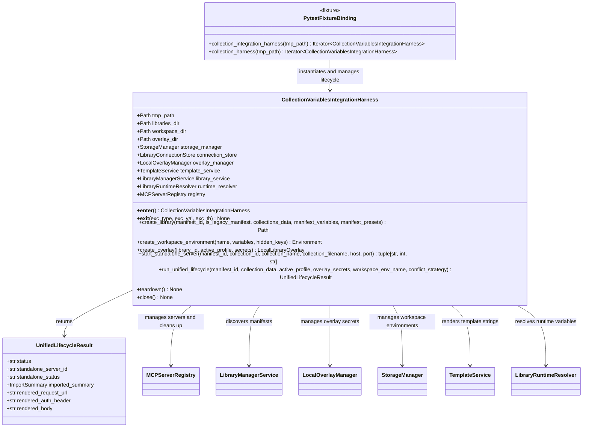
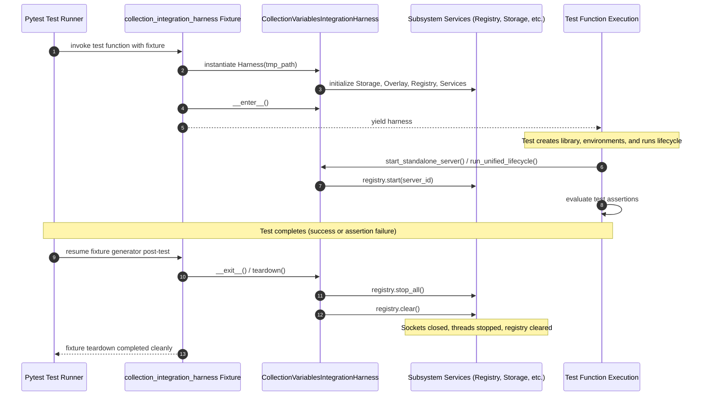

# PYPOST-1417: Reusable Multi-Subsystem Integration Harness Helper

## Research

### 1. Analysis of Existing In-Test Harness Implementation

In [PYPOST-1412](https://pypost.atlassian.net/browse/PYPOST-1412), the end-to-end integration and compatibility matrix test suite was implemented in [`tests/test_collection_scoped_variables_integration.py`](file:///home/src/tests/test_collection_scoped_variables_integration.py). Within this module, two foundational constructs were introduced:

1. **[`UnifiedLifecycleResult`](file:///home/src/tests/test_collection_scoped_variables_integration.py#L43-L54)**:
   A dataclass encapsulating the outcome of an end-to-end multi-subsystem execution journey:
   - `status: str`
   - `standalone_server_id: str`
   - `standalone_status: str`
   - `imported_summary: ImportSummary`
   - `rendered_request_url: str`
   - `rendered_auth_header: str`
   - `rendered_body: str`

2. **[`CollectionVariablesIntegrationHarness`](file:///home/src/tests/test_collection_scoped_variables_integration.py#L56-L231)**:
   A test orchestration class that sets up isolated temporary directory structures and coordinates seven core services:
   - **`tmp_path` File Tree**: Configures subdirectories for `libraries`, `workspace`, and `libraries_data` (overlay storage).
   - **[`StorageManager`](file:///home/src/pypost/core/storage.py)**: Persists workspace environments and collection definitions.
   - **[`LibraryConnectionStore`](file:///home/src/pypost/core/library_connection_store.py)**: Manages local library manifest connections backed by `connections.json`.
   - **[`LocalOverlayManager`](file:///home/src/pypost/core/local_overlay_manager.py)**: Reads and persists profile secrets and active profile selections.
   - **[`TemplateService`](file:///home/src/pypost/core/template_service.py)**: Executes Jinja-style variable interpolation for URLs, headers, and request bodies.
   - **[`LibraryManagerService`](file:///home/src/pypost/core/library_manager_service.py)**: Discovers library directories, validates manifests, and parses collection files.
   - **[`LibraryRuntimeResolver`](file:///home/src/pypost/core/library_runtime_resolver.py)**: Resolves effective runtime variables for standalone server candidates.
   - **[`MCPServerRegistry`](file:///home/src/pypost/core/mcp_server_registry.py)**: Validates, upserts, starts, and monitors local/standalone MCP servers.

### 2. Identified Lifecycle Risks and Code Duplication

While the existing harness successfully drives the integration tests, co-locating it inside a single test file introduces significant architectural deficiencies:

- **Lack of Centralized Reusability**: Other test suites requiring multi-subsystem orchestration (e.g. standalone execution tests, wire IPC validation, concurrent server lifecycle tests) cannot reuse this harness without importing directly from a test file, violating clean separation of test helpers from test suites.
- **Resource Leakage and Unreliable Teardown**:
  - In `test_e2e_collection_scoped_variables_lifecycle`, teardown is handled via manual `try ... finally: harness.registry.stop_all()`.
  - In `test_compatibility_matrix_quadrants` and `test_e2e_diagnostics_and_secret_redaction`, no explicit teardown is invoked on the harness. While those specific tests do not launch live servers, future tests modifying registry state or starting background workers could easily leak sockets or threads if cleanup is forgotten.
  - If an unhandled exception or assertion failure occurs before the manual cleanup block, spawned server threads or TCP listener sockets could remain active, leading to flaky port collisions or test runner hangs.
- **Absence of Context Manager and Pytest Fixture Protocol**: The harness lacks `__enter__` and `__exit__` dunder methods, preventing idiomatic Python `with` blocks. Furthermore, no standard pytest fixture binding exists, forcing every test author to manually instantiate the harness and wire temporary directories.

### 3. Investigation of Multi-Subsystem Service Cleanup Contracts

Review of the subsystem services managed by the harness demonstrates:

| Subsystem Component | Resource Type | Teardown / Cleanup Method | Behavior / Risk |
| --- | --- | --- | --- |
| `MCPServerRegistry` | Background threads, HTTP/TCP server managers | `stop_all()`, `clear()` | `stop_all()` iterates through all registered server managers and terminates servers; `clear()` empties internal registry configurations and managers. |
| `LibraryConnectionStore` | Ephemeral JSON file on disk | File deletion on `tmp_path` cleanup | No open file handles retained; writes atomically per transaction. |
| `LocalOverlayManager` | Ephemeral JSON files on disk | File deletion on `tmp_path` cleanup | Reads/writes on demand; stateless. |
| `StorageManager` | Ephemeral JSON files on disk | File deletion on `tmp_path` cleanup | Pure filesystem I/O without background state. |
| `LibraryManagerService` | Git operations / local directory caching | None | Pure filesystem operations. |
| `TemplateService` | In-memory Jinja environment | None | Stateless string substitution. |
| `LibraryRuntimeResolver` | In-memory resolution logic | None | Stateless resolver. |

Therefore, the critical cleanup requirement for the harness is guaranteeing that `registry.stop_all()` and `registry.clear()` are executed deterministically upon test completion or error.

---

## Implementation Plan

### High-Level Execution Plan

1. **Step 2 (Architecture Design - Current Step)**:
   - Formulate system component model, module interactions, and sequence diagrams.
   - Design public API contract for `tests/helpers/collection_integration_harness.py`.
   - Specify context manager semantics and pytest fixture lifecycle bindings.
   - Design the mandatory failing repro test for Step 3.
   - Update `ai-tasks/PYPOST-1417/00-roadmap.md` to `[/]` with sub-items.

2. **Step 3 (Mandatory Failing Repro Test)**:
   - Create `tests/test_collection_integration_harness_repro.py`.
   - Implement test assertions validating:
     - Module importability from `tests.helpers.collection_integration_harness`.
     - Context manager lifecycle (`with CollectionVariablesIntegrationHarness(tmp_path) as harness:`): starting an MCP server and verifying automatic stop upon context exit.
     - Pytest fixture binding (`collection_integration_harness`): verifying service wiring, standalone server startup, and automated post-test teardown.
     - Programmatic helper methods: `create_library`, `create_workspace_environment`, `create_overlay`, `start_standalone_server`, and `run_unified_lifecycle`.
     - Teardown idempotency: calling `teardown()` or `close()` multiple times without error.
   - Force initial red test failure: `tests/helpers/collection_integration_harness.py` does not yet exist (`ModuleNotFoundError`).

3. **Step 4 (Development & Implementation)**:
   - Create `tests/helpers/collection_integration_harness.py` implementing:
     - `UnifiedLifecycleResult` dataclass.
     - `CollectionVariablesIntegrationHarness` class with full multi-subsystem service coordination.
     - Context manager protocol (`__enter__`, `__exit__`).
     - Explicit idempotent `teardown()` and `close()` methods.
     - Programmatic helper methods: `create_library`, `create_workspace_environment`, `create_overlay`, `start_standalone_server`, `run_unified_lifecycle`.
     - Pytest fixtures: `@pytest.fixture def collection_integration_harness(tmp_path: Path)` and alias `collection_harness`.
   - Verify that `tests/test_collection_integration_harness_repro.py` turns green.
   - Refactor `tests/test_collection_scoped_variables_integration.py` to import and consume the shared helper and fixture, removing local duplicate definitions.
   - Verify that the entire test suite passes (`make test` / `make check`).

4. **Step 5 (Code Cleanup)**:
   - Audit code structure, remove redundant boilerplate, and verify flake8 compliance (`make lint`).
   - Create `ai-tasks/PYPOST-1417/40-code-cleanup.md`.

5. **Step 6 (Observability)**:
   - Audit structured logging, diagnostic traces, and secret redaction across the harness helper.
   - Create `ai-tasks/PYPOST-1417/50-observability.md`.

6. **Step 7 (Technical Debt Analysis)**:
   - Review implementation for edge cases or remaining tech debt.
   - Create `ai-tasks/PYPOST-1417/60-tech-debt.md`.

7. **Step 8 (Dev Docs)**:
   - Update developer documentation under `doc/dev/collection_scoped_variables.md` to document the reusable integration harness helper and fixture.

---

### Mandatory — Failing Repro (next Step 3)

- **Test Module Path**: `tests/test_collection_integration_harness_repro.py`
- **What it Asserts**:
  1. **Contract Existence**: Verifies that `CollectionVariablesIntegrationHarness`, `UnifiedLifecycleResult`, and `collection_integration_harness` can be imported from `tests.helpers.collection_integration_harness`.
  2. **Context Manager Lifecycle Guarantee**:
     - Enters `with CollectionVariablesIntegrationHarness(tmp_path) as harness:`.
     - Uses `harness.start_standalone_server(...)` to start an active MCP server on a dynamically allocated TCP port.
     - Asserts `harness.registry.is_running(server_id) is True`.
     - Exits the `with` block.
     - Asserts `harness.registry.is_running(server_id) is False` and server state is `"stopped"`, proving automatic post-block teardown.
  3. **Pytest Fixture Binding**:
     - Defines a test function accepting the `collection_integration_harness` fixture.
     - Confirms all subsystem services are initialized and accessible (`storage_manager`, `library_service`, `registry`, `overlay_manager`, `template_service`, `runtime_resolver`).
  4. **Programmatic Scaffolding Helpers**:
     - Tests `create_library` (with both catalog-only and legacy manifests).
     - Tests `create_workspace_environment` (with variables and hidden keys).
     - Tests `create_overlay` (with secrets and active profile).
     - Tests `run_unified_lifecycle` (returning a valid `UnifiedLifecycleResult`).
  5. **Teardown Idempotency & Safety**:
     - Verifies that calling `teardown()` or `close()` multiple times does not raise exceptions.
- **How Failure is Forced Without Live External Dependencies**:
  In Step 3, `tests/helpers/collection_integration_harness.py` does not exist. Running the repro test immediately fails with `ModuleNotFoundError: No module named 'tests.helpers.collection_integration_harness'`.
- **Sequencing**:
  1. Step 3: Author `tests/test_collection_integration_harness_repro.py` (Red / Failing).
  2. Step 4: Author `tests/helpers/collection_integration_harness.py` and refactor existing tests (Green / Passing).

---

## Architecture

### 1. Component Relationship & Architecture Overview

The reusable integration harness serves as a facade and coordinator across storage, manifest, overlay, runtime resolution, and server registry subsystems:



---

### 2. Lifecycle & Teardown Execution Flow

The sequence diagram below illustrates how the pytest fixture and context manager guarantee resource cleanup, even when assertions fail:



---

### 3. Detailed Component Responsibilities

1. **[`CollectionVariablesIntegrationHarness`](file:///home/src/tests/helpers/collection_integration_harness.py)**:
   - **Filesystem Initialization**: Establishes unique isolated directory hierarchies under `tmp_path` for libraries (`/libraries`), workspace files (`/workspace`), and local overlay data (`/libraries_data`).
   - **Service Wiring**: Automatically instantiates and cross-wires the 7 core services needed for library manifest discovery, variable resolution, and MCP server management.
   - **Context Manager**: Implements `__enter__` returning `self`, and `__exit__` invoking `self.teardown()`.
   - **Teardown & Cleanup (`teardown()` / `close()`)**:
     - Coordinates graceful shutdown of all running server managers via `self.registry.stop_all()`.
     - Clears cached configurations via `self.registry.clear()`.
     - Safe and idempotent: can be invoked multiple times without error. Any exceptions raised during server shutdown are logged/captured without masking caller exceptions.
   - **Programmatic Helpers**:
     - `create_library(...)`: Generates library manifests (v1 legacy or v2 catalog), collection JSON files, and registers the connection in `library_service`.
     - `create_workspace_environment(...)`: Generates and persists `Environment` models with secret masking in `storage_manager`.
     - `create_overlay(...)`: Generates and saves `LocalLibraryOverlay` configurations with active profiles and secrets in `overlay_manager`.
     - `start_standalone_server(...)`: Encapsulates dynamic port allocation (`allocate_tcp_port`), candidate validation, configuration upsert, and server launch in `registry`.
     - `run_unified_lifecycle(...)`: Drives complete end-to-end multi-subsystem workflow, returning `UnifiedLifecycleResult`.

2. **[`UnifiedLifecycleResult`](file:///home/src/tests/helpers/collection_integration_harness.py)**:
   - Dataclass carrying structured execution metrics for end-to-end integration assertions.

3. **[`collection_integration_harness`](file:///home/src/tests/helpers/collection_integration_harness.py) Fixture**:
   - Pytest generator fixture scoped to `function`.
   - Takes `tmp_path: Path`.
   - Uses context manager `with CollectionVariablesIntegrationHarness(tmp_path) as harness:` and yields `harness`.
   - Guarantees teardown upon test completion, failure, or timeout.
   - Provided with alias `collection_harness`.

---

### 4. Interface Specification

```python
@dataclass
class UnifiedLifecycleResult:
    status: str
    standalone_server_id: str
    standalone_status: str
    imported_summary: ImportSummary
    rendered_request_url: str
    rendered_auth_header: str
    rendered_body: str


class CollectionVariablesIntegrationHarness:
    def __init__(self, tmp_path: Path) -> None: ...
    def __enter__(self) -> CollectionVariablesIntegrationHarness: ...
    def __exit__(
        self,
        exc_type: type[BaseException] | None,
        exc_val: BaseException | None,
        exc_tb: types.TracebackType | None,
    ) -> None: ...

    def teardown(self) -> None: ...
    def close(self) -> None: ...

    def create_library(
        self,
        manifest_id: str,
        is_legacy_manifest: bool = False,
        collections_data: dict[str, dict[str, Any]] | None = None,
        manifest_variables: list[CollectionVariable] | None = None,
        manifest_presets: dict[str, dict[str, Any]] | None = None,
    ) -> Path: ...

    def create_workspace_environment(
        self,
        name: str = "Test Env",
        variables: dict[str, str] | None = None,
        hidden_keys: set[str] | None = None,
    ) -> Environment: ...

    def create_overlay(
        self,
        library_id: str,
        active_profile: str = "",
        secrets: dict[str, str] | None = None,
    ) -> LocalLibraryOverlay: ...

    def start_standalone_server(
        self,
        manifest_id: str,
        collection_id: str,
        collection_filename: str | None = None,
        collection_name: str | None = None,
        host: str = "127.0.0.1",
        port: int | None = None,
    ) -> tuple[str, int, str]: ...

    def run_unified_lifecycle(
        self,
        *,
        manifest_id: str,
        collection_data: dict[str, Any],
        active_profile: str,
        overlay_secrets: dict[str, str],
        workspace_env_name: str,
        conflict_strategy: ConflictStrategy,
    ) -> UnifiedLifecycleResult: ...


@pytest.fixture
def collection_integration_harness(tmp_path: Path) -> Iterator[CollectionVariablesIntegrationHarness]: ...

collection_harness = collection_integration_harness
```

---

## Q&A

- **Q: Why should `CollectionVariablesIntegrationHarness` live in `tests/helpers/collection_integration_harness.py` rather than `tests/conftest.py`?**
  A: Placing the harness in `tests/helpers/` follows standard modularity practices: helpers can be imported explicitly with static typing and autocomplete support (`from tests.helpers.collection_integration_harness import CollectionVariablesIntegrationHarness`), while the fixture binding can still be consumed by pytest without cluttering `conftest.py` with multi-subsystem orchestration logic.
- **Q: What happens if an exception is raised inside `harness.teardown()` during fixture teardown?**
  A: The teardown implementation wraps `registry.stop_all()` and `registry.clear()` with defensive exception handling so that any secondary errors encountered during cleanup (e.g. server already stopped) do not mask the primary test failure.
- **Q: How does this change affect existing tests in `tests/test_collection_scoped_variables_integration.py`?**
  A: It completely eliminates in-test boilerplate and replaces manual `try ... finally: harness.registry.stop_all()` blocks with either the `collection_integration_harness` fixture or the context manager, maintaining 100% backward compatibility of test assertions.
- **Q: Why is dynamic TCP port allocation required for standalone MCP servers in integration tests?**
  A: Tests run concurrently via `scripts/run_parallel_tests.py` using multiple worker processes. Fixed port numbers cause intermittent bind collisions. `allocate_tcp_port()` provides conflict-free ephemeral ports across parallel workers.
