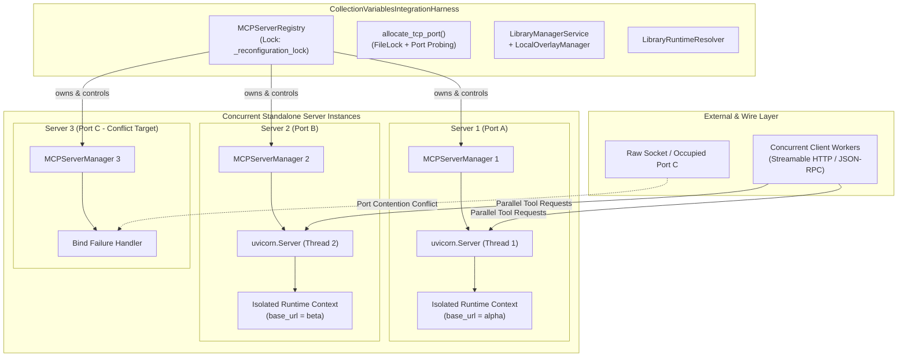

# PYPOST-1418: Concurrent Multi-Server Lifecycle Execution and Port Contention Testing

## Research

### 1. Registry Architecture and Concurrency Model (`pypost/core/mcp_server_registry.py`)

The [`MCPServerRegistry`](file:///home/src/pypost/core/mcp_server_registry.py#L65-L100) acts as the centralized lifecycle controller for multiple MCP server instances in PyPost. Key architectural attributes include:

- **Instance Ownership**: Each registered endpoint configuration is mapped to an independent [`MCPServerManager`](file:///home/src/pypost/core/qt/mcp_server.py#L47-L80) stored in `self._managers: dict[str, MCPServerManager]`. Server configurations are maintained in `self._configurations: dict[str, McpServerConfiguration]`, and statuses in `self._statuses: dict[str, McpServerStatus]`.
- **Locking & Synchronization**:
  - `self._reconfiguration_lock = threading.RLock()`: An reentrant lock protecting `self._pending_reconfigurations: dict[str, _PendingReconfiguration]`. It guards atomic lifecycle swaps during hot reload (`reconfigure`), rollback on startup failure (`_rollback_reconfiguration`), and concurrent cleanup during `stop()` and `remove()`.
  - Configuration isolation: Collections and environments are deep-copied (`model_copy(deep=True)`) before reaching managers. This prevents mutable updates in one collection or UI selection from bleeding into another endpoint's tool mappings or credentials.
- **Port Validation Logic**:
  - `_validate_available_port(configuration)`: Scans registered configurations (`self._configurations`) to reject duplicate port assignments in memory prior to starting or updating instances.
  - `_validate_os_port(host, port)`: Binds a temporary probe socket (`SO_REUSEADDR`) to preflight external OS port availability before shutting down an existing manager during reconfiguration.
- **Lifecycle Operations**:
  - `start(instance_id)`: Resolves runtime inputs (collection requests, variables, hidden/overridable keys) via `_runtime_inputs()`. If valid, starts the manager asynchronously in a background daemon thread running `uvicorn.Server.serve()`. Emits `status_changed` (`starting` -> `running`).
  - `stop(instance_id)`: Acquires `_reconfiguration_lock`, cancels pending candidate managers if in-flight, signals uvicorn via `_server_instance.should_exit = True` and `_stop_event.set()`, and joins the server thread with a 2.0s bounded wait. Emits `status_changed` (`stopped`).
  - `stop_all()`: Iterates over all known instances and invokes `stop(instance_id)` on each, terminating all background uvicorn instances.
  - `reconfigure(instance_id, configuration)`: Implements zero-downtime hot reload. If the server is currently running, it creates a new candidate `MCPServerManager`, begins startup, and keeps the old server serving traffic until the candidate binds (`_complete_reconfiguration`) or rolls back if bind fails (`_rollback_reconfiguration`).
  - `reconcile_references()`: Scans all configurations against active collections and environments, stopping and marking as `failed` only instances whose backing resources have been deleted.

### 2. Ephemeral Port Allocation and Contention Behaviors (`tests/helpers/port_allocation.py`)

The helper [`allocate_tcp_port`](file:///home/src/tests/helpers/port_allocation.py#L40-L62) coordinates cross-process ephemeral port allocation for parallel test workers:
- Uses `fcntl.flock` on `/tmp/pypost-test-port.lock` to synchronize counter increments in `/tmp/pypost-test-port.counter`.
- Iterates over port span `35,000` to `60,000`, testing bindability using `_can_bind(host, port)` (`SO_REUSEADDR`).
- Fallback: Binds to port `0` to let the OS kernel allocate an unused port if the counter loop exhausts.

**Port Contention Modes**:
1. *Internal Registry Contention*: Two configurations registered with the same port. Handled synchronously by `_validate_available_port()`, raising a `ValueError` without mutating registry state.
2. *External OS Port Contention*: An external socket or third-party daemon holds `(127.0.0.1, port)`. When uvicorn attempts to bind, `asyncio` raises `OSError(errno.EADDRINUSE)`.
   - Handled inside [`MCPServerManager._run_uvicorn`](file:///home/src/pypost/core/qt/mcp_server.py#L266-L315), which catches `OSError`, invokes `_notify_start_failed()`, and emits `start_failed(message)`.
   - `MCPServerRegistry` receives `start_failed` and updates status: `McpServerStatus(id, state="failed", message="<id> on port <port>: MCP server could not bind...")`.
   - The registry must remain unblocked, and other running servers must continue executing requests without disruption.

### 3. Integration Harness Capabilities (`tests/helpers/collection_integration_harness.py`)

The [`CollectionVariablesIntegrationHarness`](file:///home/src/tests/helpers/collection_integration_harness.py#L54-L124) provides an isolated filesystem and service fixture:
- Coordinates [`StorageManager`](file:///home/src/pypost/core/storage.py), [`LibraryConnectionStore`](file:///home/src/pypost/core/library_connection_store.py), [`LocalOverlayManager`](file:///home/src/pypost/core/local_overlay_manager.py), [`TemplateService`](file:///home/src/pypost/core/template_service.py), [`LibraryManagerService`](file:///home/src/pypost/core/library_manager_service.py), and [`MCPServerRegistry`](file:///home/src/pypost/core/mcp_server_registry.py).
- `start_standalone_server()` sets up a catalog library, validates the candidate configuration, registers it in `self.registry`, starts it, and awaits the `running` state.
- Harness `teardown()` and `close()` ensure all running servers are cleanly terminated via `self.registry.stop_all()`.
- Multi-server readiness: Multiple standalone servers can be instantiated sequentially or in parallel within the same harness instance, exercising concurrent lifecycles in completely isolated temporary directories.

### 4. Concurrency & Isolation Failure Modes to Guard Against

1. **Deadlocks in State Reconciliation**: If multiple threads call `start()`, `stop()`, or `reconfigure()` concurrently, improper lock acquisition order between Qt event signals and `_reconfiguration_lock` could deadlock the main thread.
2. **Variable Namespace Leaks**: If variable resolution relies on shared mutable state or process-global dictionaries, concurrent requests to Server A (e.g. `base_url = "https://alpha.internal"`) and Server B (e.g. `base_url = "https://beta.internal"`) could cross-contaminate.
3. **Hot Reload Lockup under Request Burst**: Reconfiguring Server A while Servers B and C are actively responding to HTTP requests must not block worker threads or cause requests on Servers B/C to time out or drop.
4. **Socket Descriptor Leaks (`TIME_WAIT` / `EADDRINUSE`)**: Concurrent `stop_all()` must cleanly shutdown all uvicorn servers, wait for threads to exit, close OS sockets, and allow immediate rebinding on the same ports.

---

## Implementation Plan

### High-Level Implementation Steps

1. **Step 2 (Architecture)**: Document architectural model, module contracts, thread safety mechanics, and Step 3 red test designs.
2. **Step 3 (Failing Repro Test)**: Create [`tests/test_mcp_concurrent_multiserver_repro.py`](file:///home/src/tests/test_mcp_concurrent_multiserver_repro.py) specifying automated test scenarios validating the 5 core concurrency dimensions.
3. **Step 4 (Development)**:
   - Ensure test suite execution is fully deterministic, uses bounded synchronization (no arbitrary sleeps), and achieves 100% clean teardown.
   - Address any concurrency or port collision handling bugs in `pypost/core/mcp_server_registry.py` or `pypost/core/qt/mcp_server.py` uncovered by the tests.
4. **Step 5 (Code Cleanup)**: Run linting and static analysis via `make check`.
5. **Step 6 (Observability)**: Validate metric tracking (`mcp_server_instance_counts`) under multi-server transitions.
6. **Step 7 (Technical Debt Analysis)**: Review concurrency boundaries and record any deferred improvements.
7. **Step 8 (Dev Docs)**: Document concurrent multi-server execution architecture in `doc/dev/mcp_concurrent_multiserver.md`.

### Mandatory — Failing Repro (next Step 3)

The failing repro test suite lives at [`tests/test_mcp_concurrent_multiserver_repro.py`](file:///home/src/tests/test_mcp_concurrent_multiserver_repro.py). It asserts the five core multi-server concurrency behaviors:

1. **`test_concurrent_multiserver_startup_three_instances`**:
   - *Behavior*: Concurrently starts 3 standalone MCP servers (Server 1, Server 2, Server 3) on distinct allocated TCP ports via `ThreadPoolExecutor(max_workers=3)`.
   - *Assertions*: All 3 servers reach `running` state concurrently, all 3 report `is_listening == True`, and all 3 successfully answer concurrent MCP `tools/list` JSON-RPC HTTP requests.
2. **`test_concurrent_multiserver_variable_isolation_overlapping_namespaces`**:
   - *Behavior*: Starts Server Alpha with variable `base_url="https://alpha.internal.net"` and Server Beta with variable `base_url="https://beta.internal.net"`, both exposing a tool `get_config` that echoes `base_url`.
   - *Assertions*: Concurrently fires 20 parallel requests to each server. All Alpha responses return `"https://alpha.internal.net"`, all Beta responses return `"https://beta.internal.net"`. Verifies zero cross-talk, zero variable leakage, and complete runtime isolation.
3. **`test_concurrent_multiserver_hot_reload_under_active_load`**:
   - *Behavior*: Servers B and C continuously execute requests in background threads. While under load, Server A is reconfigured (`reconfigure()`) with updated environment variables.
   - *Assertions*: Server A successfully reloads, transitions to `running`, and reflects the new variables. Servers B and C experience zero failed requests, zero connection drops, and zero registry lock delays.
4. **`test_concurrent_multiserver_port_collision_injection_and_resilience`**:
   - *Behavior*: Deliberately holds a raw TCP socket bound to a target port `P`. Attempts to start Server C on port `P` while Server A and B are running on distinct ports.
   - *Assertions*: Server C does not crash the process; its status transitions to `state=="failed"`; its status message contains `MCP server could not bind` and port `P`; Servers A and B continue serving requests unaffected; closing the raw socket and re-starting Server C on an available port succeeds cleanly.
5. **`test_concurrent_multiserver_concurrent_teardown_and_immediate_rebinding`**:
   - *Behavior*: Starts 3 servers. Triggers concurrent shutdown across all servers (`stop_all()` or parallel `stop()`). Immediately attempts to re-bind raw TCP sockets and start new server instances on the exact same ports.
   - *Assertions*: All server threads terminate within bounded timeout (<2.0s); all ports are released immediately; immediate re-bind succeeds without `EADDRINUSE`.

---

## Architecture

### Component Architecture & Module Responsibilities



### Module Responsibilities

| Module / Component | Responsibilities in Concurrent Execution |
| ------------------ | --------------------------------------- |
| [`MCPServerRegistry`](file:///home/src/pypost/core/mcp_server_registry.py) | Central registry coordinating multi-server instances. Manages configuration mapping, independent manager dispatch, `_reconfiguration_lock` acquisition, asynchronous status monitoring, and graceful failure handling. |
| [`MCPServerManager`](file:///home/src/pypost/core/qt/mcp_server.py) | Per-server lifecycle manager. Owns background `uvicorn.Server` worker thread, asyncio event loop, bind error translation (`format_mcp_bind_error`), tool execution dispatcher, and variable suppliers. |
| [`LibraryRuntimeResolver`](file:///home/src/pypost/core/library_runtime_resolver.py) | Generates independent runtime contexts (tools, environment variables, hidden keys, overridable keys) per collection. Enforces complete isolation so distinct servers never share mutable dictionary references. |
| [`CollectionVariablesIntegrationHarness`](file:///home/src/tests/helpers/collection_integration_harness.py) | Provides fixture orchestration for spinning up multiple independent standalone servers in isolated temporary storage, executing end-to-end multi-server scenarios, and guaranteeing teardown. |
| [`allocate_tcp_port`](file:///home/src/tests/helpers/port_allocation.py) | Cross-worker coordinated port allocator preventing inter-test and intra-test port collisions. |

### Module Interaction Scheme: Concurrent Startup & Request Execution

```mermaid
sequenceDiagram
    autonumber
    actor TestRunner as Test Runner
    participant Reg as MCPServerRegistry
    participant MgrA as MCPServerManager (Alpha)
    participant MgrB as MCPServerManager (Beta)
    participant Client as Test HTTP Client

    TestRunner->>Reg: start("srv-alpha") [Thread 1]
    TestRunner->>Reg: start("srv-beta") [Thread 2]
    par Concurrent Startup
        Reg->>MgrA: start_server(port_A, tools_A)
        MgrA->>MgrA: Launch Uvicorn Thread A
        MgrA-->>Reg: status_changed("running")
    and
        Reg->>MgrB: start_server(port_B, tools_B)
        MgrB->>MgrB: Launch Uvicorn Thread B
        MgrB-->>Reg: status_changed("running")
    end

    TestRunner->>Client: Send concurrent tool calls to Port A & Port B
    par Concurrent Invocations
        Client->>MgrA: POST /mcp (get_config)
        MgrA-->>Client: 200 OK (base_url: "alpha.internal")
    and
        Client->>MgrB: POST /mcp (get_config)
        MgrB-->>Client: 200 OK (base_url: "beta.internal")
    end
    Note over Client,MgrB: Strict variable isolation verified; no cross-talk
```

### Module Interaction Scheme: Port Collision Detection & Graceful Recovery

```mermaid
sequenceDiagram
    autonumber
    actor TestRunner as Test Runner
    participant Sock as External Occupied Socket
    participant Reg as MCPServerRegistry
    participant MgrC as MCPServerManager (Collision)

    TestRunner->>Sock: bind("127.0.0.1", port_C)
    TestRunner->>Reg: start("srv-collision") on port_C
    Reg->>MgrC: start_server(port_C, tools_C)
    MgrC->>MgrC: uvicorn attempts bind(port_C)
    Note over MgrC,Sock: EADDRINUSE: Address already in use
    MgrC->>MgrC: Catch OSError, format_mcp_bind_error()
    MgrC-->>Reg: start_failed("MCP server could not bind to 127.0.0.1:port_C")
    Reg->>Reg: _set_status("srv-collision", "failed", message)
    Note over Reg: Registry remains live; other servers unaffected
    TestRunner->>Sock: close() (release port_C)
    TestRunner->>Reg: start("srv-collision")
    Reg->>MgrC: start_server(port_C, tools_C)
    MgrC-->>Reg: status_changed("running")
```

---

## Q&A

**Q: How do we prevent race conditions when multiple standalone servers start simultaneously?**  
A: Each standalone server operates its own [`MCPServerManager`](file:///home/src/pypost/core/qt/mcp_server.py) with its own thread and independent `asyncio` event loop. Runtime variables and tool lists are deeply copied before passing into the manager, ensuring no shared mutable state exists between instances.

**Q: How is variable namespace isolation guaranteed when two servers share the same variable key (e.g. `base_url`)?**  
A: The registry constructs dedicated closure-based suppliers (`manager.set_variable_supplier(lambda: dict(variables))`) for each manager using distinct dictionary instances resolved by [`LibraryRuntimeResolver`](file:///home/src/pypost/core/library_runtime_resolver.py). Neither the manager nor the underlying `MCPServerImpl` accesses global variable registries.

**Q: What happens if an external process is already listening on a configured port?**  
A: During server startup, `MCPServerManager._run_uvicorn` catches `OSError(errno.EADDRINUSE)` from uvicorn's socket listener and triggers `_notify_start_failed()`. This records `McpServerStatus(id, state="failed", message="...")` in the registry without raising uncaught exceptions, locking the registry, or affecting peer servers.

**Q: How do we guarantee immediate port reusability after `stop()` or `stop_all()`?**  
A: `MCPServerManager.stop_server()` signals `uvicorn.Server.should_exit = True`, waits on `server_thread.join(timeout=2.0)`, and triggers `loop.close()` and socket release in the uvicorn worker thread. Tests verify that immediate subsequent `socket.bind()` calls on the same host/port succeed without `EADDRINUSE`.
