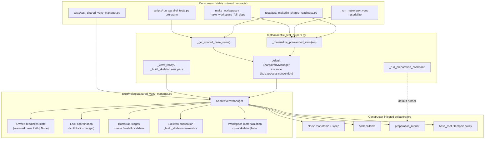

# PYPOST-1419: Encapsulate Shared Virtual Environment Lifecycle

## Research

### Codebase Analysis (Current State)

Shared Make-fixture preparation lives in `tests/makefile_test_helpers.py` (introduced / hardened across
PYPOST-1262, PYPOST-1298, PYPOST-1413). Lifecycle stages today are free functions plus a module-level
mutable path cache:

| Symbol | Role |
| --- | --- |
| `_SHARED_BASE_VENV: Path \| None` | Module-level mutable cache of the resolved shared base `.venv` path (source of truth today) |
| `_venv_ready(venv)` | Marker + `bin/python` readiness check |
| `_build_skeleton(venv_dir, skeleton_dir)` | Stages lightweight `.skeleton` with `_prewarmed_base.pth` |
| `_get_shared_base_venv(*, preparation_budget=20)` | Lock → bootstrap → validate → publish skeleton → cache path |
| `_run_preparation_command(...)` | Bounded subprocess supervisor (`SIGKILL` process group on timeout/failure) |
| `_materialize_prewarmed_venv(ws)` | Ensure shared base ready; `cp -a` skeleton (fallback: base) into `ws/.venv` |

Consumer entry points that must keep working unchanged (FR6):

- Fixtures: `make_workspace`, `make_workspace_full_deps` (call `_materialize_prewarmed_venv`)
- `_run_make` lazy materialization when `.venv` is missing
- `scripts/run_parallel_tests.py` pre-warm: imports `_get_shared_base_venv` from
  `tests.makefile_test_helpers`
- Suite `tests/test_makefile_shared_readiness.py` (PYPOST-1298 / PYPOST-1413): patches
  `_SHARED_BASE_VENV`, `_run_preparation_command`, `fcntl.flock`, and `time`; includes
  `test_parallel_workspace_materialization_under_load_budget`

Related docs to align in Step 8 (not this step): `doc/dev/shared_venv_materialization.md`,
`doc/dev/testing.md` section on shared Make fixture preparation.

### Origin (PYPOST-1413 Tech Debt)

`ai-tasks/PYPOST-1413/60-tech-debt.md` explicitly called out:

1. Module-level mutable `_SHARED_BASE_VENV` as stale-cache risk across workers/reloads
2. Free-function scatter (`_get_shared_base_venv`, `_build_skeleton`, `_materialize_prewarmed_venv`,
   `_venv_ready`, `_run_preparation_command`) instead of a cohesive `SharedVenvManager`

Follow-ups **out of scope** here (clear seams only): PYPOST-1420 (native materialization),
PYPOST-1421 (deeper readiness), PYPOST-1422 (extreme concurrency stress).

### Sibling Encapsulation Pattern (PYPOST-1429)

PYPOST-1429 extracted inline test IPC mechanics into `tests/helpers/mcp_stdio_harness.py` with:

- Cohesive class ownership + explicit API
- Dedicated unit suite (`tests/test_mcp_stdio_harness.py`)
- Consumer continuity via refactor of the original suite (no production `pypost/` changes)
- Step 3 red gate: import of the new helper fails until Step 4 lands

This ticket follows the same encapsulation shape for shared-venv lifecycle, adapted to keep the
existing public helper/fixture names in `tests.makefile_test_helpers` stable.

### External Patterns (Web Research)

- **File-lock serialized venv setup**: Projects such as [iso-env](https://github.com/zackees/iso-env)
  and CORAL wrap mutating venv install/bootstrap in exclusive file locks with timeouts so concurrent
  workers serialize once and reuse a ready environment — matching the existing `fcntl.flock`
  non-blocking poll + preparation budget in `_get_shared_base_venv`.
- **Constructor injection for mutable harness state**: Guidance from dependency-injection / testing
  literature ([Dependency Injector overview](https://python-dependency-injector.ets-labs.org/introduction/di_in_python.html),
  [constructor injection for testability](https://python-testing-debugging.com/advanced-mocking-test-doubles-in-python/dependency-injection-for-testability/))
  favors injecting collaborators (clock, lock, command runner, base root) so tests patch the
  **interface**, not module globals. Avoid a mutable module-level path singleton as the readiness
  source of truth; prefer one process-default manager instance **by convention**, with fresh
  instances constructible in tests.
- **No DI framework**: Keep injection as plain constructor parameters (Python idiom; lsr-python DI
  pattern). Do not add `dependency-injector` or similar packages.

### Architectural Options Evaluated

| Option | Description | Assessment |
| --- | --- | --- |
| **A. Class in-place only** | Define `SharedVenvManager` inside `makefile_test_helpers.py`; thin wrappers call a module default instance | ✅ Viable; minimal import churn. Module file is already large (~590 lines). |
| **B. Extract helper module + facades** | `tests/helpers/shared_venv_manager.py` owns the class; `makefile_test_helpers` keeps thin delegates + fixtures | ✅ **Selected** — matches PYPOST-1429 helper extraction, shrinks the helpers module, keeps FR6 import paths. |
| **C. Break into many small strategy classes** | Separate LockCoordinator, Bootstrapper, SkeletonPublisher, Materializer | ❌ Over-engineered for this debt ticket; FR1 asks for one cohesive manager. |
| **D. Hard-remove all underscore helpers immediately** | Force every suite to import `SharedVenvManager` directly | ❌ Violates FR6 / runner pre-warm import of `_get_shared_base_venv`. |

---

## Implementation Plan

### High-Level Sequencing

```
Step 1: Requirements (Complete)
   │
Step 2: Architecture (Current)
   │
Step 3: Failing Repro (Red)
   │   └─ tests/test_shared_venv_manager.py asserts SharedVenvManager ownership + DI stages
   │
Step 4: Development (Green)
   │   ├─ Add tests/helpers/shared_venv_manager.py (SharedVenvManager)
   │   ├─ Wire thin facades in tests/makefile_test_helpers.py
   │   ├─ Remove module-level mutable path cache as source of truth
   │   ├─ Adapt test_makefile_shared_readiness.py patches to manager seams
   │   └─ Preserve green on existing readiness / materialization suites
   │
Step 5–8: Cleanup, observability, tech debt, docs
```

### Step 4 Development Breakdown (Design Intent Only)

1. **Introduce `SharedVenvManager`** in `tests/helpers/shared_venv_manager.py` with constructor-injected
   collaborators (defaults = current production behavior).
2. **Move lifecycle bodies** from free functions into manager methods; preserve PYPOST-1413 semantics
   (budget countdown, lock poll, skeleton publish, `cp -a` materialization, failure messages).
3. **Facade layer** in `tests/makefile_test_helpers.py`:
   - Lazy module-default manager instance (process convention, not a path cache).
   - `_get_shared_base_venv` / `_materialize_prewarmed_venv` / `_venv_ready` / `_build_skeleton`
     delegate to the manager (or remain thin wrappers) so fixtures and
     `scripts/run_parallel_tests.py` need no rewrite.
4. **Eliminate `_SHARED_BASE_VENV` as SoT**: readiness path lives on the manager instance; update
   `private_shared_root` and related tests to reset/inject via manager APIs instead of assigning the
   global path cache.
5. **Green gate**: `tests/test_makefile_shared_readiness.py` (including load-budget test) +
   `make check`.

### Mandatory — Failing Repro (next Step 3)

This task **does** change harness structure and how readiness state is owned; it must **not** change
materialization success criteria, isolation, or preparation timing validated by PYPOST-1413.
Therefore Step 3 is **not** `N/A` — it encodes the new ownership/testability contract in red tests
while leaving behavioral regression coverage to the existing suite (kept green after Step 4).

- **Location**: `tests/test_shared_venv_manager.py`
- **Pytest timeout**: module `pytestmark = pytest.mark.timeout(30)` (per do-testing / lsr-python).
- **Forced red without live external deps**:
  1. Import `from tests.helpers.shared_venv_manager import SharedVenvManager`.
     Before Step 4 this fails with `ModuleNotFoundError: No module named 'tests.helpers.shared_venv_manager'`
     (same red-gate style as PYPOST-1429).
  2. After the module exists but before full encapsulation, additional assertions stay red until
     ownership moves (use these as the Step 3 target once the empty module stub is **not** used —
     Step 3 writes the full red suite against the intended API; Step 4 implements until green).
- **Desired assertions (post–Step 4 green; red until then)**:
  1. **Ownership**: Constructing `SharedVenvManager(...)` yields an object that exposes readiness /
     lifecycle operations; `tests.makefile_test_helpers` must not use a module-level mutable
     `_SHARED_BASE_VENV` path cache as the source of truth (assert absence of that global as SoT,
     or assert manager-owned attribute is what `_get_shared_base_venv` consults).
  2. **Isolated lock-contention stage (FR3)**: Inject a fake clock + flock that always raises
     `EAGAIN` / sleeps; with a tiny preparation budget, `ensure_ready()` (or equivalent) raises
     `RuntimeError` matching lock deadline/budget wording — no real NFS bootstrap.
  3. **Isolated stale-readiness recovery (FR2/FR3)**: Seed an incomplete base path on a temp root;
     inject a successful preparation runner stub; assert manager rebuilds / publishes marker +
     interpreter rather than returning the stale incomplete cache.
  4. **Isolated materialization failure diagnostics (FR5)**: Inject a runner that creates a partial
     target then raises `TimeoutExpired`; assert `RuntimeError` identifies materialization and
     partial target is cleaned on failure path (mirror existing
     `test_materialization_failure_is_bounded_and_retry_removes_partial_workspace` semantics at
     manager API level).
  5. **Facade continuity smoke**: After manager exists, calling
     `helpers._get_shared_base_venv` / `helpers._materialize_prewarmed_venv` still works when the
     default manager is wired (may be deferred to Step 4 green alongside readiness suite; Step 3
     focuses on manager import + DI stage assertions).
- **How to run red**:
  `make test PYTEST_ARGS="tests/test_shared_venv_manager.py"`
- **Sequencing**:
  - Step 2: this architecture + repro plan
  - Step 3: add `tests/test_shared_venv_manager.py`; confirm RED via `make test`
  - Step 4: implement manager + facades until that suite and
    `tests/test_makefile_shared_readiness.py` are GREEN; then `make check`

---

## Architecture

### System Module Diagram



### Module Responsibilities

| Module / Component | Responsibility |
| --- | --- |
| **`tests/helpers/shared_venv_manager.py`** | Owns `SharedVenvManager`: bootstrap, lock wait within budget, skeleton publish, readiness state, materialization, stage-scoped `RuntimeError` diagnostics. |
| **`SharedVenvManager`** | Single cohesive lifecycle owner (FR1). Instance attribute holds resolved shared base path (FR2). Methods are independently invocable / injectable for FR3. |
| **`tests/makefile_test_helpers.py`** | Keeps fixtures, Make helpers, seed helpers; provides thin facades and a lazy default manager so existing imports stay stable (FR6). Must not retain `_SHARED_BASE_VENV` as readiness SoT. |
| **`_run_preparation_command`** | Remains the default preparation runner (may stay in helpers module or be re-exported); injectable into the manager for tests. Behavior unchanged (FR5/NFR1). |
| **`tests/test_shared_venv_manager.py`** | Isolated lifecycle unit coverage with fakes (FR3/NFR3). |
| **`tests/test_makefile_shared_readiness.py`** | Behavioral regression for lock/budget/materialization/load (NFR1); adapted to manager seams without changing assertion intent. |

### Selected Patterns and Justification

1. **Cohesive Manager (Facade + Encapsulation)** — One class owns the lifecycle stages that today are
   scattered free functions (FR1, NFR2). Aligns with lsr-python guidance to prefer clear ownership
   over procedural globals.
2. **Constructor Dependency Injection** — Inject clock, flock, preparation runner, and base root so
   lock/timeout/failure/materialization paths are testable without full filesystem venv bootstrap
   (FR3, NFR3). No third-party DI container.
3. **Default Instance by Convention (not path singleton)** — Module exposes one lazy default
   `SharedVenvManager` for fixtures/runner; tests construct private instances or reset the default.
   Distinct from a module-level mutable `Path` cache (FR2).
4. **Stable Facade Functions** — Preserve `_get_shared_base_venv` / `_materialize_prewarmed_venv`
   signatures for FR6 and `run_parallel_tests.py`.
5. **Preserve Skeleton + `.pth` Materialization** — No change to PYPOST-1413 on-disk layout or
   `cp -a` path (NFR1; PYPOST-1420 deferred).

### Main Interfaces / APIs

```python
"""Shared virtualenv lifecycle for Makefile test workspaces.

Jira: PYPOST-1419
Architecture: ai-tasks/PYPOST-1419/20-architecture.md
"""

from __future__ import annotations

from collections.abc import Callable
from pathlib import Path
from typing import Protocol

import subprocess


class _Clock(Protocol):
    def monotonic(self) -> float: ...
    def sleep(self, seconds: float) -> None: ...


PreparationRunner = Callable[..., subprocess.CompletedProcess[str]]


class SharedVenvManager:
    """Own shared-base bootstrap, locking, skeleton publish, and workspace materialization."""

    def __init__(
        self,
        *,
        python_version: str | None = None,
        base_root: Path | None = None,
        marker_name: str | None = None,
        python_executable: str | None = None,
        preparation_runner: PreparationRunner | None = None,
        clock: _Clock | None = None,
        flock: Callable[..., None] | None = None,
    ) -> None:
        """Construct a manager with optional collaborator overrides for tests."""
        ...

    @property
    def resolved_base(self) -> Path | None:
        """Return owned readiness path, or None if not yet validated/published."""
        ...

    def clear_readiness(self) -> None:
        """Drop owned readiness so the next ensure_ready re-validates on disk."""
        ...

    def is_ready(self, venv: Path) -> bool:
        """True when marker and bin/python exist (existing _venv_ready semantics)."""
        ...

    def build_skeleton(self, venv_dir: Path, skeleton_dir: Path) -> None:
        """Publish lightweight .skeleton template (existing _build_skeleton semantics)."""
        ...

    def ensure_ready(self, *, preparation_budget: float = 20) -> Path:
        """Serialize bootstrap under flock; return ready shared base .venv path."""
        ...

    def materialize(self, workspace: Path, *, copy_timeout: float = 20) -> None:
        """Materialize workspace/.venv from skeleton (fallback: base); bounded failure."""
        ...
```

Facade contracts (unchanged signatures):

```python
def _get_shared_base_venv(*, preparation_budget: float = 20) -> Path:
    """Delegate to default SharedVenvManager.ensure_ready(...)."""
    ...

def _materialize_prewarmed_venv(ws: Path) -> None:
    """Delegate to default SharedVenvManager.materialize(ws)."""
    ...
```

### Interaction Scheme (Lifecycle)

1. Consumer calls `_get_shared_base_venv()` or `_materialize_prewarmed_venv(ws)`.
2. Facade resolves the default `SharedVenvManager`.
3. `ensure_ready`:
   - If owned `resolved_base` is ready → return it.
   - Else if on-disk base + skeleton ready → set owned state and return.
   - Else acquire exclusive non-blocking flock with budgeted sleep; bootstrap stages; publish
     skeleton; set owned readiness; unlock.
4. `materialize`:
   - `ensure_ready()`; if workspace `.venv` ready return; else `cp -a` from skeleton (else base);
     on failure remove partial target and raise contextual `RuntimeError`.

### Constraints Preserved

- POSIX venv layout only (`bin/python`, `lib/pythonX.Y/site-packages`).
- No production `pypost/` changes.
- No absorption of PYPOST-1420 / 1421 / 1422 scope.
- Existing failure message stages (`lock`, `creation`, `installation`, `validation`,
  `publication`, materialization) remain identifiable for CI triage (FR5).

---

## Q&A

**Q: Why extract to `tests/helpers/shared_venv_manager.py` instead of only nesting the class in
`makefile_test_helpers.py`?**  
A: Matches the PYPOST-1429 helper-extraction pattern, keeps fixture/Make utilities separate from
lifecycle ownership, and gives unit tests a clean import surface while facades preserve FR6.

**Q: Why keep underscore helper names at all?**  
A: `scripts/run_parallel_tests.py` and many suites already import `_get_shared_base_venv` /
`_materialize_prewarmed_venv`. Renaming them is out of scope and would violate FR6.

**Q: How is this different from replacing `_SHARED_BASE_VENV` with another module global?**  
A: The forbidden pattern is a **module-level mutable path cache as readiness source of truth**.
A lazy default **manager instance** owns readiness as an instance field; tests can construct
isolated managers or call `clear_readiness()` without a bare `Path | None` global SoT.

**Q: Will Step 3 change the load-budget test?**  
A: No. `test_parallel_workspace_materialization_under_load_budget` remains the behavioral
regression for NFR1. Step 3 adds a new suite for ownership/DI isolation; Step 4 keeps the load
budget test green.

**Q: Does encapsulation change skeleton / `.pth` materialization?**  
A: No intentional change (NFR1). Native in-process copy is PYPOST-1420.

**Q: Links used in research**  
- https://python-dependency-injector.ets-labs.org/introduction/di_in_python.html  
- https://python-testing-debugging.com/advanced-mocking-test-doubles-in-python/dependency-injection-for-testability/  
- https://github.com/zackees/iso-env (file-lock around venv install)  
- Sibling artifacts: `ai-tasks/PYPOST-1413/20-architecture.md`, `60-tech-debt.md`;
  `ai-tasks/PYPOST-1429/20-architecture.md`
