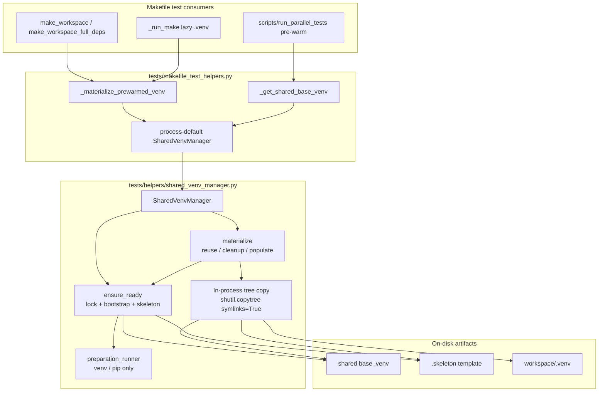

# PYPOST-1420: Native In-Process Workspace Materialization

## Research

### Codebase Analysis (Current State)

After PYPOST-1419, workspace materialization is owned by
`SharedVenvManager` in `tests/helpers/shared_venv_manager.py`. The population
step still shells out through the injected `preparation_runner`:

```237:258:tests/helpers/shared_venv_manager.py
    def materialize(self, workspace: Path, *, copy_timeout: float = 20) -> None:
        """Materialize workspace/.venv from skeleton (fallback: base); bounded failure."""
        base = self.ensure_ready()
        target = workspace / ".venv"
        if self.is_ready(target):
            return
        if target.exists():
            shutil.rmtree(target)
        skeleton = base.parent / ".skeleton"
        source = skeleton if self.is_ready(skeleton) else base
        try:
            self._run(
                ["cp", "-a", str(source), str(target)],
                timeout=copy_timeout,
                cleanup_budget=1,
            )
        except (subprocess.SubprocessError, OSError) as error:
            if target.exists():
                shutil.rmtree(target)
            raise RuntimeError(
                f"shared venv materialization failed: {target}: {error}"
            ) from error
```

Call chain for ordinary Makefile fixtures:

```
make_workspace / make_workspace_full_deps / _run_make
        │
        ▼
_materialize_prewarmed_venv(ws)   # tests/makefile_test_helpers.py facade
        │
        ▼
SharedVenvManager.materialize(ws)
        │
        ├─ ensure_ready()     # may still use preparation_runner for venv/pip (unchanged)
        └─ _run(["cp", "-a", …])  ← residual fork/exec per workspace (this ticket)
```

What stays subprocess-backed (out of materialization population scope):

| Stage | Mechanism today | This ticket |
| --- | --- | --- |
| Shared base `python -m venv` | `preparation_runner` | Unchanged |
| Shared base `pip install` / validation | `preparation_runner` | Unchanged |
| Skeleton publication | in-process (`build_skeleton` / `shutil` + symlinks) | Unchanged |
| Workspace `.venv` population | `cp -a` via `preparation_runner` | **Must become in-process** |

Existing coverage that encodes the `cp` seam today (must stay green after adaptation):

- `tests/test_shared_venv_manager.py::test_materialize_timeout_cleans_partial_target_and_identifies_stage`
  — injects a runner that fails when `cmd[0] == "cp"`.
- `tests/test_makefile_shared_readiness.py::test_materialization_failure_is_bounded_and_retry_removes_partial_workspace`
  — monkeypatches `_run_preparation_command` and inspects `cp` argv.
- `tests/test_makefile_shared_readiness.py::test_parallel_consumers_wait_for_one_builder_and_receive_ready_workspaces`
  — stubs `cp` with `shutil.copytree`.
- `tests/test_makefile_shared_readiness.py::test_parallel_workspace_materialization_under_load_budget`
  — FR7 / NFR1 non-regression for parallel prep timing.

Developer docs still describe `cp -a` explicitly
(`doc/dev/shared_venv_materialization.md`, `doc/dev/testing.md`,
`doc/dev/parallel_test_runner.md`) — Step 8 alignment only.

### Why `cp -a` Was Used

PYPOST-1413 replaced catastrophic `cp -al` full-base hardlink clones with a
lightweight `.skeleton` (bin symlinks + `_prewarmed_base.pth`) copied via
`cp -a`. That fixed NFS/timeout failures; residual per-workspace **process
spawn** for a tiny tree remains the debt called out for this ticket.

Skeleton `bin/*` entries are **symlinks** into the shared base. Population must
preserve those links (not dereference into huge file copies), matching
`cp -a` archive semantics for the skeleton layout.

### External Patterns (Web Research)

- **`shutil.copytree(..., symlinks=True)`** ([Python 3 `shutil` docs](https://docs.python.org/3/library/shutil.html)):
  Recursively copies a tree in-process. With `symlinks=True`, symbolic links in
  the source are recreated as links in the destination (metadata copied as far
  as the platform allows) — the in-process analogue of preserving skeleton
  `bin/` links instead of expanding them. Default `symlinks=False` would
  follow links and defeat the skeleton design.
- **Destination must be absent / cleared first**: CPython issue
  [#105919](https://github.com/python/cpython/issues/105919) documents that
  `copytree(..., dirs_exist_ok=True, symlinks=True)` can fail to overwrite
  existing symlink destinations (`FileExistsError`). Current
  `materialize` already `rmtree`s a non-ready target before population, so the
  destination is empty — prefer **not** relying on `dirs_exist_ok` overwrite of
  symlinks.
- **Asserting no spawn in tests** ([pytest monkeypatch howto](https://docs.pytest.org/en/stable/how-to/monkeypatch.html),
  mock + assert patterns): Patch the collaborator the SUT uses (here the
  manager’s `preparation_runner` / `_run` path), wrap with `unittest.mock.Mock`,
  and `assert_not_called` for population — prefer seam assertion over brittle
  global `subprocess.Popen` patches that would also break unrelated bootstrap
  if `ensure_ready` ran.

### Architectural Options Evaluated

| Option | Description | Assessment |
| --- | --- | --- |
| **A. `shutil.copytree(src, dst, symlinks=True)` inside `materialize`** | Replace `self._run(["cp", "-a", …])` with stdlib tree copy; keep `rmtree` + readiness/reuse/failure cleanup | ✅ **Selected** — in-process, preserves skeleton symlinks, already used elsewhere in helpers/tests, no new deps |
| **B. Inject optional `tree_copier` collaborator defaulting to `copytree`** | Same as A, plus DI for failure injection without relying on `cp` argv | ✅ Compatible enhancement — preferred for FR5 testability after the `cp` seam disappears |
| **C. Hardlink/`os.link` walk of skeleton** | Recreate `cp -al`-like linking for the tiny skeleton | ❌ Unnecessary complexity; skeleton is already tiny; hardlinks do not help the spawn-overhead goal more than copytree |
| **D. Keep `cp -a` but run via threads / async** | Still forks an external OS process for population | ❌ Violates FR1 / NFR1 outcome |
| **E. Manual `pathlib`/`os.walk` custom copier** | Hand-rolled recursive copy | ❌ Reimplements `copytree`; higher maintenance for no gain |

---

## Implementation Plan

### High-Level Sequencing

```
Step 1: Requirements (Complete)
   │
Step 2: Architecture (Current)
   │
Step 3: Failing Repro (Red)
   │   └─ Assert materialize populates without preparation_runner / external cp
   │
Step 4: Development (Green)
   │   ├─ In-process population in SharedVenvManager.materialize
   │   ├─ Adapt cp-argv failure stubs to tree-copier / shutil seams
   │   ├─ Keep ensure_ready bootstrap on preparation_runner
   │   └─ Green: shared_venv_manager + makefile_shared_readiness (+ load budget)
   │
Step 5–8: Cleanup, observability, tech debt, docs (replace cp -a narrative)
```

### Step 4 Development Breakdown (Design Intent Only — Do Not Implement Here)

1. **Population path**: In `SharedVenvManager.materialize`, after source selection
   (ready skeleton preferred, else base) and clearing a non-ready target, populate
   with in-process `shutil.copytree(source, target, symlinks=True)` (or an injected
   `tree_copier` with that default). Do **not** call `_run` / `preparation_runner`
   for population.
2. **Keep bootstrap subprocess**: `ensure_ready` continues to use
   `preparation_runner` for `venv` / `pip` / validation only.
3. **Failure / cleanup (FR3 / FR5)**: On copy/`OSError`/`shutil.Error`,
   `rmtree` any partial `target` and raise
   `RuntimeError(f"shared venv materialization failed: {target}: …")` retaining
   cause chaining — same consumer-visible stage wording as today.
4. **Timeout parameter**: Keep `materialize(..., copy_timeout=20)` signature for
   call-site stability. With in-process copy of a tiny skeleton, wall time is
   negligible; either (a) retain a soft deadline via injected `_clock` around the
   copy and treat overrun like today’s timeout path, or (b) document that
   `copy_timeout` is retained for API compatibility while failure injection moves
   to the tree-copier seam. Prefer (a) if cheap; do not reintroduce a subprocess
   solely to honor the timeout.
5. **Test adaptations (same change set as the fix)**:
   - Replace `cmd[0] == "cp"` failure stubs with a failing injected `tree_copier`
     (or monkeypatched `shutil.copytree` on the manager module) that creates a
     partial target then raises.
   - Parallel-consumer stubs that currently emulate `cp` via `copytree` should
     exercise the real in-process path (or no longer special-case `cp`).
6. **Facades unchanged (FR6)**: `_materialize_prewarmed_venv`, `make_workspace`,
   `make_workspace_full_deps` keep signatures and call sites.
7. **Docs**: Step 8 updates `shared_venv_materialization.md` / testing notes to
   describe in-process `copytree` (symlink-preserving), not `cp -a`.

### Mandatory — Failing Repro (next Step 3)

This task **does** change runtime harness behavior (FR1: no external OS process
for filesystem population). Step 3 is **not** `N/A`.

- **Location**: extend `tests/test_shared_venv_manager.py` (module already owns
  manager DI tests; keeps materialization contract next to PYPOST-1419 coverage).
- **Pytest timeout**: existing module `pytestmark = pytest.mark.timeout(30)`
  (do-testing / lsr-python).
- **Forced red without live external deps** (hermetic temp dirs + seeded
  skeleton/base; no real host shared venv / NFS):

  1. Seed a ready shared base + ready `.skeleton` under `tmp_path` (marker +
     `bin/python`, matching existing `_seed_interpreter` helpers).
  2. Construct `SharedVenvManager(base_root=..., preparation_runner=spy_runner,
     flock=noop)` where `spy_runner` records every `cmd` and must **not** be
     invoked for population (bootstrap should not run because on-disk base is
     already ready).
  3. Call `manager.materialize(workspace)`.
  4. **Desired assertions (green only after Step 4)**:
     - Target `workspace/.venv` is ready (`is_ready` / marker + `bin/python`).
     - `spy_runner` was **never** called with a command whose argv starts with
       `"cp"` (and ideally never called at all during this materialize, proving
       population did not go through `preparation_runner`).
     - Optionally strengthen with a `unittest.mock.Mock` wrapper around the
       manager’s `_run` / injected runner: `assert_not_called()` for the
       population phase.
  5. **Why it fails today**: current `materialize` always `_run(["cp", "-a", …])`,
     so the spy sees `cp` and the “no preparation_runner for population”
     assertion fails — red gate for Step 3.
  6. **Isolation check (same test or sibling)**: after materialize, mutate a file
     under the workspace `.venv` and assert the skeleton/base source is
     unchanged (FR2) — remains valid with copytree.
  7. **Sequencing**: research (done) → write red test(s) in Step 3 → implement
     in-process population in Step 4 until red tests + existing shared-readiness
     suite (including
     `test_parallel_workspace_materialization_under_load_budget`) are green →
     adapt obsolete `cp`-argv failure tests in the same Step 4 change set (do
     not weaken FR5 cleanup assertions).

Do **not** implement production changes in Step 3; only the failing automated
repro.

---

## Architecture

### Module Diagram



### Module Responsibilities

| Module / symbol | Responsibility after this task |
| --- | --- |
| `SharedVenvManager.materialize` | Readiness reuse; clear non-ready target; select skeleton vs base; **in-process** populate; cleanup + contextual `RuntimeError` on failure |
| `SharedVenvManager.ensure_ready` / `build_skeleton` / `is_ready` | Unchanged ownership from PYPOST-1419; bootstrap may still spawn via `preparation_runner` |
| `preparation_runner` / `_run` | Bounded subprocess supervisor for **bootstrap only**; not used for workspace population |
| Optional `tree_copier` (if introduced) | Injectable population function; default `lambda src, dst: shutil.copytree(src, dst, symlinks=True)` for FR5 failure injection |
| `tests.makefile_test_helpers` facades / fixtures | Stable outward contracts; no suite-wide consumer rewrites |
| `tests/test_shared_venv_manager.py` | Unit/DI contract including Step 3 in-process population assertion |
| `tests/test_makefile_shared_readiness.py` | Behavioral non-regression (isolation, failure cleanup, parallel load budget) |

### Dependencies

```
fixtures / facades
    → SharedVenvManager
        → ensure_ready → preparation_runner (subprocess) → shared base + skeleton
        → materialize  → stdlib shutil (in-process)     → workspace/.venv
```

No new third-party packages. No production `pypost/` changes. No redesign of
locking, skeleton publication, or readiness markers beyond what population needs.

### Selected Patterns

| Pattern | Application |
| --- | --- |
| **Keep cohesive owner** | Change only the population mechanism inside existing `SharedVenvManager` (NFR3; PYPOST-1419 boundary) |
| **Constructor injection** | Continue DI for runner/clock/flock; optionally add `tree_copier` so failure tests do not depend on `cp` argv |
| **Outcome-preserving refactor** | Same isolation, readiness reuse/cleanup, source preference, diagnostics wording; only remove external-process population (FR1–FR5, NFR2) |
| **Facade stability** | Public helper/fixture names unchanged (FR6) |

### Main Interfaces

```text
SharedVenvManager.materialize(workspace: Path, *, copy_timeout: float = 20) -> None
  Pre:  ensure_ready() has published or adopted a ready shared base (+ skeleton when ready)
  Post: workspace/.venv is ready, isolated from source; OR raises RuntimeError after cleanup
  Constraint: filesystem population MUST NOT invoke preparation_runner / external cp

# Optional DI (recommended for testability after cp seam removal):
SharedVenvManager(..., tree_copier: Callable[[Path, Path], None] | None = None)
  Default: shutil.copytree(src, dst, symlinks=True)
```

Facade (unchanged):

```text
_materialize_prewarmed_venv(ws: Path) -> None
  → _get_shared_venv_manager().materialize(ws)
```

### Interaction Scheme (Success Path)

1. Consumer calls `_materialize_prewarmed_venv(ws)` / `materialize(ws)`.
2. Manager `ensure_ready()` returns existing ready base (no bootstrap spawn if already ready).
3. If `ws/.venv` ready → return (FR3 reuse).
4. Else clear partial target; choose `.skeleton` if ready else base (FR4).
5. In-process `copytree(..., symlinks=True)` into `ws/.venv` (**no** `cp` process).
6. Target satisfies `is_ready`; siblings remain isolated (FR2).

### Failure Path

1. Tree copy raises (`OSError`, `shutil.Error`, or injected test failure).
2. Manager removes partial `ws/.venv` if present.
3. Raises `RuntimeError` identifying materialization and chaining the cause (FR5).

---

## Q&A

**Q: Why is `shutil.copytree(..., symlinks=True)` the default technique?**  
A: Requirements forbid external-process population and require isolation equivalent
to today’s skeleton clone. `copytree` with `symlinks=True` is the stdlib
in-process match for preserving skeleton `bin/` symlinks (see
[shutil docs](https://docs.python.org/3/library/shutil.html)). Requirements do not
mandate this API; architecture selects it for maintainability and zero new deps.

**Q: Does this remove all subprocess use from SharedVenvManager?**  
A: No. Bootstrap (`venv` / `pip` / validation) still uses `preparation_runner`.
Only the **workspace population** step must be in-process (FR1).

**Q: Why not keep asserting via `cmd[0] == "cp"` in failure tests?**  
A: That seam disappears with in-process copy. Step 4 should move failure
injection to an injectable `tree_copier` or module-local `shutil.copytree`
patch while preserving cleanup and diagnostic assertions.

**Q: Will parallel load-budget tests need new timing thresholds?**  
A: No new stricter budgets. NFR1 / FR7 require non-regression of the PYPOST-1413
suite (notably
`test_parallel_workspace_materialization_under_load_budget`); wall clock may
improve.

**Q: Scope vs PYPOST-1421 / PYPOST-1422?**  
A: Unchanged — deeper skeleton readiness validation and extreme concurrency
stress remain sibling tickets.

**Q: Must fixture import paths change?**  
A: No (FR6).
