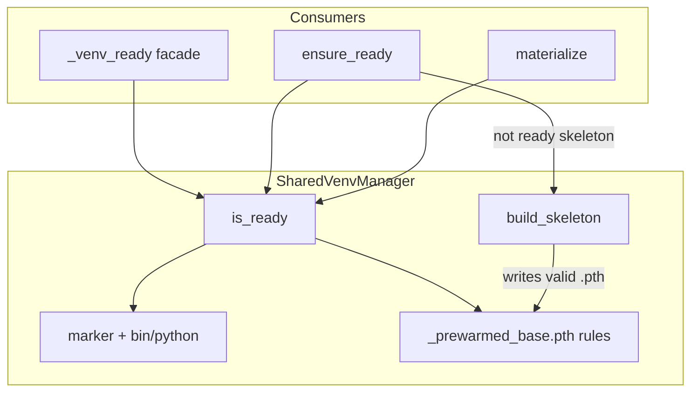

# PYPOST-1421: Deep Template Validation in Shared Venv Readiness

## Research

### Current readiness seam

`SharedVenvManager.is_ready` in `tests/helpers/shared_venv_manager.py` returns true when the
initialization marker and `bin/python` both exist. Facades in `tests/makefile_test_helpers.py`
delegate `_venv_ready` to that method. Call sites:

| Call site | Role of readiness |
| --- | --- |
| `ensure_ready` early cache / adopt | Skip bootstrap when base + skeleton are ready |
| `ensure_ready` rebuild gates | Rebuild base or `build_skeleton` when not ready |
| `materialize` target reuse | Skip copy when workspace `.venv` is ready |
| `materialize` source selection | `skeleton if is_ready(skeleton) else base` |

`build_skeleton` always writes:

`lib/python{ver}/site-packages/_prewarmed_base.pth` → absolute path of base site-packages.

Full shared bases install packages into their own site-packages and normally have no
`_prewarmed_base.pth`.

### Defect

A `.skeleton` with marker + interpreter but missing / corrupt / unreachable `.pth` is still
ready. `ensure_ready` will not rebuild it; `materialize` copies it. Suites then lose the fast
healthy-template path (slow base fallback after the fact, or “ready” workspaces that cannot
import shared deps). Debt: PYPOST-1413 → PYPOST-1419 item → this ticket.

### Options

| Option | Approach | Verdict |
| --- | --- | --- |
| **A. Deepen `is_ready` only** | After marker+python: for `.skeleton`, require readable `.pth` pointing at a readable directory; whenever `.pth` exists on any venv, validate the same way; bases without `.pth` stay ready | ✅ Selected — single owned seam, drives rebuild + source selection |
| **B. Validate only inside `materialize`** | Leave `is_ready` shallow; special-case source selection | ❌ Leaves `ensure_ready` accepting damaged skeletons |
| **C. Always require `.pth` on every venv** | Fail base readiness without redirect file | ❌ Breaks full-base adopt / fallback |
| **D. Raise dedicated “template damaged” errors** | New exception type on damage | ❌ Out of scope; fail-closed readiness + existing rebuild/fallback sufficient |

### Related docs / prior art

- `doc/dev/shared_venv_materialization.md` — documents shallow `is_ready` today; Step 8 must update.
- Python `site` module: `.pth` lines that are paths are added to `sys.path` when they exist as
  directories; validation should mirror “path line → readable directory”.

## Implementation Plan

1. Extend `SharedVenvManager.is_ready`:
   - Keep marker + `bin/python` as the first gate.
   - Resolve `lib/python{self._python_version}/site-packages/_prewarmed_base.pth`.
   - If `venv.name == ".skeleton"` and the file is missing → not ready.
   - If the file exists: read UTF-8 text; take the first non-empty, non-`#` comment, non-`import `
     line; require that path `is_dir()` and is readable (`os.access(..., R_OK)` or equivalent
     open/listdir probe). Empty / unreadable file / non-directory target → not ready.
   - Bases / workspace `.venv` without a `.pth` remain subject only to marker+python (unless a
     `.pth` is present, in which case it must be valid).
2. Keep `_venv_ready` as a pure delegate (no duplicated logic).
3. Adjust DI test fixtures that manually seed `.skeleton` so healthy cases include a valid
   `.pth` pointing at a readable directory (e.g. seeded base site-packages).
4. Docs: update `is_ready` row / readiness narrative in `doc/dev/shared_venv_materialization.md`
   (and any mirrored notes in `testing.md` if they restate the shallow check).

**Mandatory — Failing Repro (next Step 3):**

- **Where**: `tests/test_shared_venv_manager.py` (module already owns manager readiness;
  `pytestmark = pytest.mark.timeout(30)`).
- **What**: New test(s) asserting desired deep readiness:
  1. `.skeleton` with marker + interpreter but **missing** `_prewarmed_base.pth` →
     `is_ready` is False (and `_venv_ready` agrees).
  2. `.skeleton` with `.pth` pointing at a **non-existent / non-directory** path → False.
  3. `.skeleton` with `.pth` pointing at a **valid readable directory** (+ marker + interpreter)
     → True.
  4. Optional companion: `ensure_ready` rebuilds a damaged on-disk skeleton (missing `.pth`)
     via injected runner/flock so the published skeleton becomes ready—forces the
     `not is_ready(skeleton_dir)` rebuild path without live pip when architecture allows.
- **How to force without live external deps**: construct trees under `tmp_path` with
  `_seed_interpreter` + marker; write/omit `.pth` explicitly; no network / real shared root.
- **Sequencing**: research (this doc) → red test only (Step 3, no production fix) →
  implement `is_ready` until green (Step 4) → keep
  `tests/test_shared_venv_manager.py` + `tests/test_makefile_shared_readiness.py` green.

## Architecture



### Module responsibilities

| Module | Responsibility |
| --- | --- |
| `tests/helpers/shared_venv_manager.py` | Own deep `is_ready`; unchanged public method set |
| `tests/makefile_test_helpers.py` | Facade only; no parallel validation |
| `tests/test_shared_venv_manager.py` | Red/green coverage for missing/invalid/valid `.pth` |
| `tests/test_makefile_shared_readiness.py` | Remain green; uses real `build_skeleton` / shared base |

### Interface (behavioral contract)

```text
SharedVenvManager.is_ready(venv: Path) -> bool
  True iff:
    - marker file exists AND bin/python exists, AND
    - if venv is named ".skeleton": _prewarmed_base.pth exists under
      lib/python{ver}/site-packages, AND
    - if _prewarmed_base.pth exists: first path entry names a readable directory
```

No new public types. No change to `build_skeleton` output format (already correct).

### Patterns

- **Single owner**: validation stays on the readiness method every caller already uses.
- **Fail closed**: damaged template → not ready → rebuild or base fallback.
- **DI-friendly tests**: tmp_path trees; no production logging required on the healthy negative
  path (boolean gate).

## Q&A

**Q: Why require existence only for `.skeleton` by name?**  
A: Full bases and some workspace trees legitimately lack the redirect file. Skeleton publication
always creates it; absence means incomplete/damaged template. Presence anywhere still requires
a valid readable target.

**Q: Does materialize need a new error string?**  
A: No for this ticket. Source selection already falls back when `is_ready(skeleton)` is false;
`ensure_ready` rebuilds. Optional louder messaging is follow-up debt.

**Q: Will existing manager tests break before fixtures are updated?**  
A: Healthy-seeded `.skeleton` trees used as materialize sources must gain a valid `.pth` in
Step 4 (or rely on `ensure_ready` rebuild). Step 3 only adds failing assertions for the defect.
