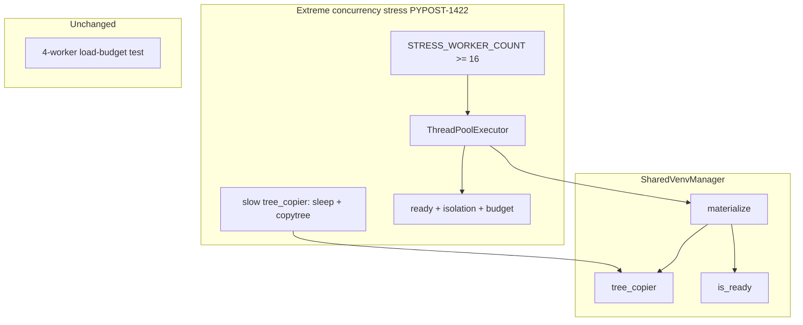

# PYPOST-1422: Extreme Concurrency Stress for Shared Venv Materialization

## Research

### Current coverage

| Test | Workers | Latency | Role |
| --- | --- | --- | --- |
| `tests/test_makefile_shared_readiness.py::test_parallel_workspace_materialization_under_load_budget` | 4 | Real I/O only | Ordinary NFR1 (≤5s per worker) via multiprocessing + `_materialize_prewarmed_venv` |
| `tests/test_shared_venv_manager.py` materialize cases | 1 | Injected fail/timeout via `tree_copier` | Unit/DI coverage for population, cleanup, in-process copy |

No automated case runs **16+** concurrent materializations under **simulated disk latency**.

### Population seam (post PYPOST-1420)

`SharedVenvManager.materialize` copies skeleton (fallback: base) via injectable
`tree_copier` (default `shutil.copytree(..., symlinks=True)`). Soft `copy_timeout`
is checked post-copy via `_clock`. This DI seam is the correct place to inject
deterministic per-population latency without NFS.

### Prior art in-repo

- `tests/test_session_slots_stress.py` — dedicated stress module, architecture
  constants (`STRESS_WORKER_COUNT`, budgets), `ThreadPoolExecutor`.
- `doc/dev/shared_venv_materialization.md` — documents 4-worker load budget;
  Step 8 must mention extreme stress.

### Options

| Option | Approach | Verdict |
| --- | --- | --- |
| **A. Dedicated stress module + ThreadPool + DI latency** | New `tests/test_shared_venv_extreme_concurrency.py`; private `SharedVenvManager` with slow `tree_copier` (sleep then real `copytree`); ≥16 threads | ✅ Selected — deterministic, offline, mirrors session-slots pattern, does not slow the 4-worker case |
| **B. Extend 4-worker multiprocessing test to 16** | Raise worker_count; no latency injection | ❌ Mixes ordinary NFR with extreme stress; hard to inject latency across forked processes without global patching |
| **C. Live NFS / tmpfs throttle** | Depend on external FS | ❌ Non-deterministic, not CI-portable |
| **D. Production lock / queue redesign first** | Change manager before any stress test | ❌ Premature; stress test is the acceptance signal; only fix production if stress fails honestly |

## Implementation Plan

1. Add `tests/test_shared_venv_extreme_concurrency.py` with architecture constants:
   - `STRESS_WORKER_COUNT = 16` (assert ≥ 16)
   - `SIMULATED_DISK_LATENCY_SECONDS` (small positive delay per population)
   - `STRESS_COMPLETION_BUDGET_SECONDS` (wall clock for all workers)
   - Explicit `@pytest.mark.timeout` / module `pytestmark` (≥60–120s tier)
2. Seed private base + ready `.skeleton` under `tmp_path` (reuse
   `_seed_ready_skeleton` pattern from manager tests).
3. Construct `SharedVenvManager(base_root=..., tree_copier=slow_copy, flock=no-op,
   preparation_runner=bootstrap)` where `slow_copy` sleeps then
   `shutil.copytree(..., symlinks=True)`.
4. Barrier / ThreadPool: 16 workers each call `manager.materialize(workspace_i)`.
5. Assert: no exceptions; each `.venv` `is_ready`; isolation marker; wall time ≤ budget.
6. Leave `test_parallel_workspace_materialization_under_load_budget` unchanged.
7. Docs: document extreme stress module + constants in
   `doc/dev/shared_venv_materialization.md` (and README index if needed).

**Mandatory — Failing Repro (next Step 3):**

- **Where**: `tests/test_shared_venv_extreme_concurrency.py` (new module).
- **What**: Test(s) asserting desired extreme-concurrency behavior:
  1. Worker count constant ≥ 16.
  2. 16+ concurrent `materialize` calls under simulated disk latency all succeed
     with ready, isolated workspace `.venv`s within the stress completion budget.
- **How to force red without live NFS**: In Step 3, land the module with the
  architecture constants and a stress test body that **fails for the intended
  missing coverage** (`pytest.fail` documenting that the extreme-concurrency
  harness is not yet implemented). Do **not** implement the green ThreadPool /
  latency harness until Step 4. Do not change production code in Step 3.
- **Sequencing**: research (this doc) → red sentinel test (Step 3) → implement
  green stress harness (Step 4) → keep existing readiness suite green.

## Architecture



### Module responsibilities

| Module | Responsibility |
| --- | --- |
| `tests/test_shared_venv_extreme_concurrency.py` | Extreme stress constants + harness |
| `tests/helpers/shared_venv_manager.py` | Unchanged unless stress exposes a real defect |
| `tests/test_makefile_shared_readiness.py` | Keep 4-worker load budget green |
| `doc/dev/shared_venv_materialization.md` | Document stress coverage (Step 8) |

### Interface (behavioral contract)

```text
STRESS_WORKER_COUNT >= 16
for each worker i in 0..STRESS_WORKER_COUNT-1:
  materialize(workspace_i) under simulated_disk_latency → ready .venv
wall_clock(all workers) <= STRESS_COMPLETION_BUDGET_SECONDS
isolation: mutation in workspace_0/.venv absent from siblings and source
```

## Q&A

**Q: Why threads instead of multiprocessing?**  
A: Injected `tree_copier` latency is per-manager and works naturally with threads;
forked processes would need cross-process patching of the default copier.

**Q: Why a new module instead of extending the readiness file?**  
A: Isolates longer timeout / stress constants from the fast offline readiness
suite and matches the session-slots stress pattern.

**Q: What if Step 4 stress fails against current production?**  
A: Fix the minimal production contention defect required for honest green; do not
weaken isolation, readiness, or the 4-worker NFR.
