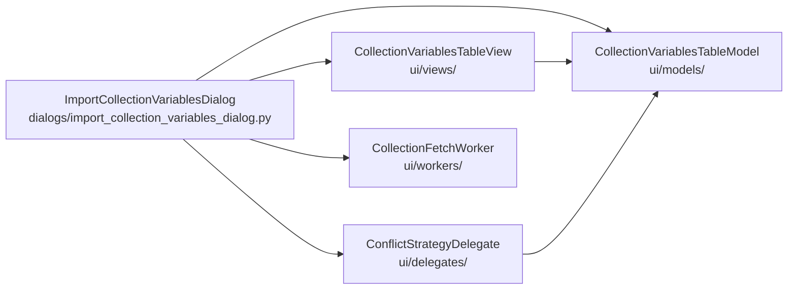

# PYPOST-1423: Extract Virtualization Components into Dedicated Modules

## Research

- Current monolith: `pypost/ui/dialogs/import_collection_variables_dialog.py` (~1,300 LOC)
  defines `CollectionVariableRowRecord`, proxy helpers, `CollectionVariablesTableModel`,
  `ConflictStrategyDelegate`, `CollectionVariablesTableView`, `CollectionFetchWorker`, and
  `ImportCollectionVariablesDialog`.
- Existing UI layout already has `pypost/ui/delegates/`; `models/`, `views/`, and `workers/`
  under `pypost/ui/` are new packages to create (with `__init__.py`).
- Delegate precedent: `pypost/ui/delegates/environment_name_delegate.py` (standalone
  `QStyledItemDelegate` module).
- Callers/tests import classes and `COL_*` constants from the dialog module
  (`tests/test_variable_import_virtualization_repro.py`, workspace import repros). Re-export
  from the dialog module preserves those paths.
- Dialog class body alone is ~555 LOC; extracting the four named components (plus their
  tightly coupled record/proxy helpers and column constants) is the scoped change. Getting
  absolute dialog-file LOC under 500 may remain a residual follow-up if the dialog class
  itself stays large; the Step 3 gate uses an OR so relocation alone can turn green.

## Implementation Plan

1. Add packages `pypost/ui/models/`, `pypost/ui/views/`, `pypost/ui/workers/` (delegates
   already exist).
2. Move column constants + row record + `CollectionVariablesTableModel` →
   `pypost/ui/models/collection_variables_table_model.py`.
3. Move `ConflictStrategyDelegate` →
   `pypost/ui/delegates/conflict_strategy_delegate.py`.
4. Move proxies + `CollectionVariablesTableView` →
   `pypost/ui/views/collection_variables_table_view.py`.
5. Move `CollectionFetchWorker` →
   `pypost/ui/workers/collection_fetch_worker.py`.
6. Slim dialog module to import + re-export + `ImportCollectionVariablesDialog` only.
7. Keep logging event names and signal contracts unchanged.
8. Green: Step 3 extraction gate + virtualization / import dialog tests via `make test`.

**Mandatory — Failing Repro (next Step 3):** Add
`tests/test_import_collection_variables_module_extract_repro.py` that asserts either:

- `import_collection_variables_dialog.py` physical line count `< 500`, **or**
- each of `CollectionVariablesTableModel`, `ConflictStrategyDelegate`,
  `CollectionVariablesTableView`, `CollectionFetchWorker` is defined in its target module
  path (`pypost/ui/models/…`, `delegates/…`, `views/…`, `workers/…`) and is not defined as a
  class body inside the dialog module source.

Before the extract both sides fail (LOC ≥ 500 and classes still in dialog). After Step 4
at least the target-module side passes. No production changes in Step 3.

## Architecture

| Module | Responsibility |
| ------ | -------------- |
| `ui/models/collection_variables_table_model.py` | Column schema, row record, virtualized table model |
| `ui/delegates/conflict_strategy_delegate.py` | On-demand strategy combo editor |
| `ui/views/collection_variables_table_view.py` | Virtualized view + legacy item/cellWidget facade |
| `ui/workers/collection_fetch_worker.py` | Background `read_collection` with cancel/generation |
| Dialog module | Layout, orchestration, re-exports for BC |

**Patterns:** Single Responsibility per file; facade re-exports at dialog boundary; no
behavior change.

## Q&A

- **Q:** Where do `COL_*` / `HEADERS` live?
  **A:** With the model module; dialog re-exports for existing test imports.
- **Q:** Where do `HeaderItemProxy` / `TableItemProxy` live?
  **A:** With the view module (only consumers).
