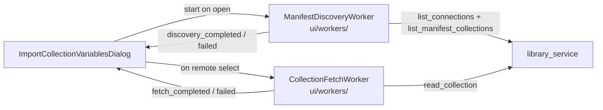

# PYPOST-1424: Asynchronous Connection and Remote Manifest Discovery

## Research

- Current bottleneck:
  [`ImportCollectionVariablesDialog.__init__`](file:///home/src/pypost/ui/dialogs/import_collection_variables_dialog.py)
  calls `library_service.list_connections()` then
  `list_manifest_collections(conn.stable_id)` synchronously before the dialog is
  interactive.
- Precedent: `CollectionFetchWorker` in `pypost/ui/workers/collection_fetch_worker.py`
  already offloads `read_collection` with generation tokens, cancel, and
  completed/failed signals.
- Related pattern: `LibraryMcpSourcePicker` uses `LibraryOperationWorker` for
  async `list_connections` / `list_manifest_collections`, but the import dialog
  should stay consistent with its dedicated QThread worker style rather than
  adopting the MCP picker facade.
- Existing tests that construct the dialog with a mocked library service assume
  remote combo entries exist immediately after `__init__`; they must wait for
  async discovery completion (bounded `processEvents` loop) once the fix lands.

## Implementation Plan

1. Add `ManifestDiscoveryWorker(QThread)` under `pypost/ui/workers/` that:
   - Calls `list_connections()` then `list_manifest_collections` per connection
     on the worker thread.
   - Emits structured combo entries (label + userData tuple) on success, or an
     exception on failure, with a generation id for discard.
   - Supports `cancel()` / interruption similar to `CollectionFetchWorker`.
2. Change dialog `__init__` to:
   - Populate workspace collections synchronously only.
   - Start discovery worker when `library_service` is present.
   - Show a lightweight discovering state (reuse loading chrome or dedicated
     status) without blocking construction.
3. On discovery completed: append library items to `collection_combo` (signals
   blocked appropriately); clear discovering UI.
4. On discovery failed: log warning, show non-modal error or status; leave
   workspace items usable.
5. Cancel discovery worker on reject/close/accept alongside fetch worker.
6. Re-export worker from dialog module if tests assert symbol presence (optional;
   prefer importing from workers package in new tests).
7. Update virtualization repro tests that assume sync library populate to wait
   for discovery.

**Mandatory — Failing Repro (next Step 3):** Add
`tests/test_async_manifest_discovery_repro.py` that:

- Provides a `library_service` whose `list_connections` sleeps ~150ms (and
  optionally `list_manifest_collections` also delayed).
- Constructs `ImportCollectionVariablesDialog` with a workspace collection.
- Asserts construction returns in well under the sleep budget (e.g. wall time
  `< 50ms` after construction returns, or that `list_connections` was not
  invoked before construction finished / is still in progress on a background
  thread).
- Asserts a discovery worker is active (`ManifestDiscoveryWorker` or equivalent
  tracked attribute) and that library combo entries appear only after a bounded
  `processEvents` wait—not during the synchronous constructor path.
- Asserts workspace items are present immediately after `__init__`.

Before the fix, `__init__` blocks on the slow `list_connections`, so either the
elapsed construction time exceeds the threshold or no background discovery worker
exists. No production changes in Step 3.

## Architecture

| Module | Responsibility |
| ------ | -------------- |
| `ManifestDiscoveryWorker` | Background catalog discovery; cancel + generation |
| `ImportCollectionVariablesDialog` | Instant workspace populate; async library append; lifecycle cancel |
| `CollectionFetchWorker` | Unchanged remote content fetch |

**Patterns:** QThread worker with generation discard; non-blocking UI init;
same signal/cancel lifecycle as collection fetch.

## Q&A

- **Q:** Reuse `LibraryOperationWorker`?
  **A:** Prefer a dedicated worker next to `CollectionFetchWorker` for
  dialog-specific payload (combo labels/userData) and consistent cancel/gen API.
- **Q:** Should discovery block selecting remote items?
  **A:** No — remotes appear when ready; workspace sources work immediately.
