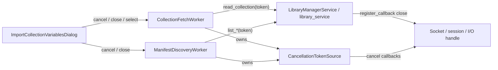

# PYPOST-1425: Low-Level Socket and HTTP Request Abort in Collection Fetch

## Research

- Current gap (PYPOST-1415 debt #3):
  `CollectionFetchWorker.cancel()` sets `_cancelled` and `requestInterruption()` only.
  `library_service.read_collection(...)` keeps running until the sync I/O returns; the
  dialog discards the result via `_fetch_generation`.
- Same pattern on discovery (PYPOST-1424 debt):
  `ManifestDiscoveryWorker.cancel()` mirrors fetch; `list_connections` /
  `list_manifest_collections` are not transport-aborted; dialog close `wait(1000)` can
  stall when listing ignores interruption.
- Existing cooperative abort primitive (PYPOST-1437):
  `pypost.core.cancellation.CancellationTokenSource` / `CancellationToken` already
  support `cancel()`, `register_callback()` (for closing sockets/sessions), and
  `throw_if_cancellation_requested()` → `OperationCancelledError`. Prefer reusing this
  over inventing a parallel AbortController type.
- Library facade today:
  `LibraryManagerService.read_collection` / `list_connections` /
  `list_manifest_collections` are sync and do not accept a cancellation token. Callers
  (workers) must pass an optional token; the service checks it between I/O steps and
  allows transport layers to register abort callbacks when they hold sockets/sessions.
- UI workers live in `pypost/ui/workers/collection_fetch_worker.py` and
  `manifest_discovery_worker.py` (extracted in PYPOST-1423 / added in PYPOST-1424).

## Implementation Plan

1. Wire each worker to a `CancellationTokenSource` owned for the worker lifetime.
2. On `cancel()`: set local cancel flags, `requestInterruption()`, and
   `CancellationTokenSource.cancel(...)` so registered transport abort callbacks run
   immediately (socket/session close).
3. Pass `cancellation_token=source.token` into library service calls
   (`read_collection`, `list_connections`, `list_manifest_collections`).
4. Extend `LibraryManagerService` methods with optional `cancellation_token` and
   cooperative checks (`throw_if_cancellation_requested`) between multi-step I/O;
   treat `OperationCancelledError` in workers as quiet interrupt (no failed signal).
5. Dispose the token source when the worker run ends.
6. Keep generation discard as a safety net for races; abort is the primary stop.

**Mandatory — Failing Repro (next Step 3):** Add
`tests/test_collection_fetch_transport_abort_repro.py` that:

- Builds a mock library service whose `read_collection` blocks on a threading Event
  until a cancellation-token callback (simulating socket close) fires, then raises
  `OperationCancelledError` (or equivalent aborted error).
- Starts `CollectionFetchWorker`, waits until the mock is blocked, calls `cancel()`,
  and asserts `worker.wait(...)` returns promptly (well under the would-have-blocked
  budget, e.g. elapsed &lt; 0.5s vs a 5s block) **and** that the abort callback ran.
- Adds a parallel assertion for `ManifestDiscoveryWorker` + blocking
  `list_connections` / `list_manifest_collections` with the same abort-on-cancel
  contract.
- Before the fix, cancel does not cancel a token / does not pass a token, so the mock
  stays blocked for the full budget and the wait/elapsed assertion fails.

No production changes in Step 3.

## Architecture

| Module | Responsibility |
| ------ | -------------- |
| `CancellationTokenSource` / `CancellationToken` | Shared abort signal + transport close callbacks |
| `CollectionFetchWorker` | Own CTS; pass token to `read_collection`; quiet cancel |
| `ManifestDiscoveryWorker` | Own CTS; pass token to list APIs; quiet cancel |
| `LibraryManagerService` | Optional token; cooperative checks between I/O steps |
| Dialog | Unchanged cancel entry points; benefits from faster join |

**Patterns:** Cooperative cancellation with transport abort callbacks; QThread
interruption retained; generation discard retained as secondary safety.

## Q&A

- **Q:** New AbortController type?
  **A:** No — reuse `CancellationTokenSource` from PYPOST-1437; it already matches the
  AbortController callback/close model.
- **Q:** Must every filesystem read be interruptible mid-`read()`?
  **A:** Prefer cooperative checkpoints plus callback-driven close when a real
  socket/session exists. Mid-syscall interrupt of local disk I/O is out of scope;
  blocked network/session I/O that registers close is in scope.
- **Q:** Should cancelled I/O emit `fetch_failed` / `discovery_failed`?
  **A:** No — treat as interrupt; UI already handles cancel via generation/loading
  chrome.
