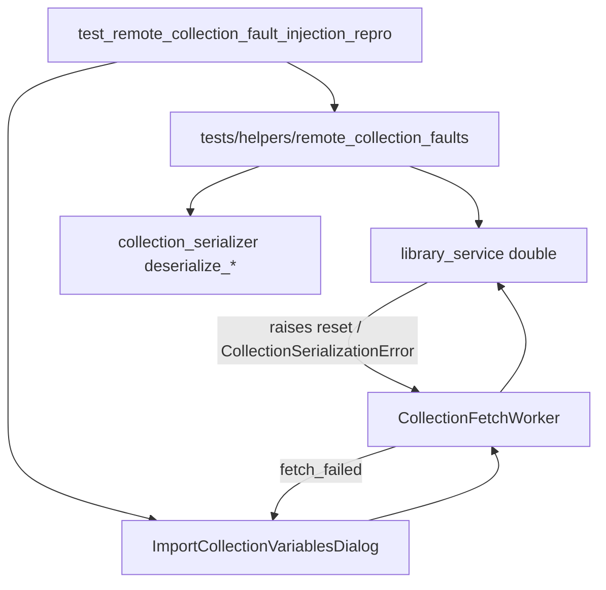

# PYPOST-1426: Fault-Injection Test Suite for Flaky Networks and Corrupted Manifests

## Research

### Existing coverage

- `tests/test_variable_import_virtualization_repro.py::test_non_modal_error_handling_and_retry`
  covers clean `TimeoutError` → inline `error_container` + Retry → success. It does
  not cover `ConnectionResetError` / mid-stream drop, truncated JSON, or schema
  violations.
- `tests/test_collection_fetch_transport_abort_repro.py` (PYPOST-1425) proves
  `CancellationToken` abort on cancel for fetch/discovery workers, but does not
  combine abort with mid-stream reset or corrupt payload recovery UX.
- `CollectionFetchWorker.run` already emits `fetch_failed` for any non-cancel
  `Exception` and quiets `OperationCancelledError`. Dialog `_on_fetch_failed`
  shows the banner and clears the model.
- `deserialize_collection_from_json` / `deserialize_collection_from_dict` raise
  `CollectionSerializationError` for truncated JSON and invalid variable schemas
  (non-string names, unsupported types, non-object roots).

### Gap

PYPOST-1415 debt called out missing fault-injection cases. Without them, a future
change could swallow corrupt payloads into empty tables, crash the UI thread on
unexpected exception types, or treat mid-stream reset differently from timeout.

### Patterns

- Prefer MagicMock / helper factories over live sockets for deterministic CI.
- Reuse dialog wait helpers (`processEvents` + deadline) from virtualization /
  discovery repros.
- Caplog: rely on behavioral assertions (C3) for ERROR-path fetch failures; optional
  structured prefix asserts where useful.
- Optional shared helper under `tests/helpers/` keeps fault scenarios readable and
  reusable (reset mid-stream, truncated JSON, bad schema).

## Implementation Plan

1. Add `tests/helpers/remote_collection_faults.py` with factory helpers that build
   library-service doubles raising:
   - `ConnectionResetError` / `BrokenPipeError` (network drop / TCP reset)
   - Mid-stream: block until optional cancel abort callback, else raise reset
   - `CollectionSerializationError` via real `deserialize_collection_from_json` on
     truncated JSON and schema-invalid variable payloads
2. Add `tests/test_remote_collection_fault_injection_repro.py` asserting:
   - Each fault class → dialog remains open, loading hidden, error banner visible,
     Retry enabled, table row count 0 (no partial apply)
   - Retry after reset recovers when subsequent read succeeds
   - Cancel during mid-stream block aborts via token callback without showing
     fetch failure for that generation (PYPOST-1425 contract)
   - Worker unit path: `fetch_failed` receives the injected exception for
     serialization / reset faults
3. Harden production only if repro finds a gap (unexpected crash or partial apply);
   prefer leaving worker/dialog generic Exception handling intact when already correct.
4. Document the suite in `doc/dev/workspace_environment_variable_import.md`.

**Mandatory — Failing Repro (next Step 3):** Create
`tests/test_remote_collection_fault_injection_repro.py` that asserts the contracts
above against current code **without** production changes. Expected initial red
modes if gaps exist: crash on certain exception types, partial table after reset,
or cancel-during-stream still emitting `fetch_failed`. If production already
satisfies a case, that case goes green immediately; Development then completes the
full scenario matrix and helper module until the suite is complete and green.

## Architecture

| Module | Responsibility |
| ------ | -------------- |
| `remote_collection_faults` helper | Build faulting `read_collection` side effects without live I/O |
| `test_remote_collection_fault_injection_repro` | Dialog + worker contracts for flaky / corrupt remotes |
| `CollectionFetchWorker` / dialog (existing) | Surface non-cancel faults as inline error; quiet cancel/abort |
| `collection_serializer` (existing) | Raise `CollectionSerializationError` for truncated/invalid JSON |

**Patterns:** Fault injection via test doubles; reuse transport abort tokens for
cancel-during-stream; characterization + hardening of recovery UX.

## Q&A

- **Q:** Real TCP server required?
  **A:** No for CI determinism — simulate reset/drop with raised OS errors and
  abort-callback mid-stream blocks. Real HTTP session abort remains PYPOST-1454.
- **Q:** New production APIs?
  **A:** Not required if generic worker/dialog handling already covers the fault
  classes; only harden if repro fails.
- **Q:** Discovery corrupt manifests in scope?
  **A:** Focus is remote *collection* import payloads per ticket; discovery listing
  faults may be follow-up if not covered by existing discovery tests.
