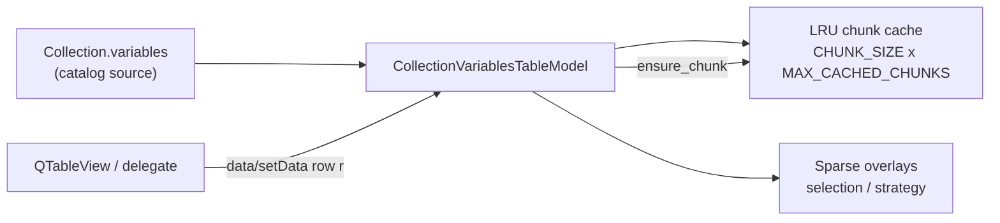

# PYPOST-1427: Paged Model Virtualization for Extreme Collections

## Research

### Current behavior

- `CollectionVariablesTableModel.load_collection` clears `_records` and, for every
  `collection.variables` entry, builds a `CollectionVariableRowRecord` on the UI
  thread, then `endResetModel()`.
- `rowCount` / `data` / selection / strategy / summary APIs all assume a fully
  populated `_records` list.
- Qt view virtualization already limits widgets; the remaining cost is the Python
  record graph (PYPOST-1415 debt #Performance Concerns / follow-up #5).
- Model lives in `pypost/ui/models/collection_variables_table_model.py` (PYPOST-1423).

### Qt / paging patterns

- `QAbstractTableModel` can report a large `rowCount` while materializing cells
  lazily in `data()`; this matches Qt’s view “only paint visible rows” contract.
- Common pattern: fixed-size chunks + LRU eviction, with **sparse overlays** for
  mutations (selection / strategy) so eviction does not lose user decisions.
- Avoid holding parallel full copies of display strings for untouched rows.

### Constraints

- Dialog, delegate, and compatibility view must keep working without API breaks
  for `get_record`, `get_selected_keys`, `get_conflict_strategies`,
  `get_summary_counts`, `set_all_*`, `update_preset`.
- Collection domain list remains the catalog source of truth; this task does not
  stream variables from disk inside the model.

## Implementation Plan

1. Introduce chunk constants (`CHUNK_SIZE`, `MAX_CACHED_CHUNKS`) and an LRU chunk
   map on `CollectionVariablesTableModel`.
2. Change `load_collection` to reset sparse state + caches, bind
   `collection.variables` / preset, set logical row count, and **not** allocate
   one record per variable.
3. On row access (`data`, `flags`, `setData`, `get_record`, …), ensure the
   owning chunk is materialized; apply sparse selection/strategy overlays;
   evict least-recent chunks when over the cap.
4. Implement bulk APIs via default + override maps (clear/set defaults) and
   patch only currently cached records; emit bounding `dataChanged` as today.
5. Implement summary / selected-key / conflict-strategy getters by scanning the
   lightweight variable list + overlays (no full record materialization).
6. Invalidate or rebuild cached candidate displays on `update_preset`.
7. Add debug logs for load (logical rows, zero eager records), chunk fetch, and
   eviction counts.
8. Document paged behavior in `doc/dev/workspace_environment_variable_import.md`.

**Mandatory — Failing Repro (next Step 3):** Add
`tests/test_collection_variables_paged_model_repro.py` that:

- Builds a 50,000-variable `Collection` + target `Environment` (no dialog/network).
- Asserts `load_collection` completes under a tight wall-clock budget (e.g. &lt; 100ms)
  proving no full eager record loop.
- Asserts after load, before any row access, materialized cache size is 0 (or
  well below `N`).
- Touches rows across the range (0, mid, last, and many chunk boundaries), then
  asserts `cached_record_count <= CHUNK_SIZE * MAX_CACHED_CHUNKS`.
- Asserts correct `data()` / selection persistence after forcing eviction
  (access enough distinct chunks to exceed the cache cap).
- Asserts `get_summary_counts` / `get_selected_keys` remain correct with sparse
  toggles without requiring full materialization.

Expected initial red: current model allocates `N` records during
`load_collection` (load time and/or `len(_records) == N` / unbounded cache).

## Architecture

| Module | Responsibility |
| ------ | -------------- |
| `collection_variables_table_model.py` | Paged materialization, sparse mutation state, public model API |
| Dialog / view / delegate (unchanged contracts) | Continue calling existing model methods |
| `test_collection_variables_paged_model_repro.py` | Extreme-N load, bound, correctness after eviction |

**Patterns:** Lazy chunk materialization; LRU eviction; sparse overlay for
durable user decisions; collection list as immutable catalog for the session.

## Q&A

- **Q:** Stream from library I/O inside the model?
  **A:** No — collection is already deserialized; paging bounds **record**
  overhead only.
- **Q:** Keep `_records` as a dense list for compatibility?
  **A:** No — replace with chunk cache + logical length; expose
  `cached_record_count` for tests/observability.
