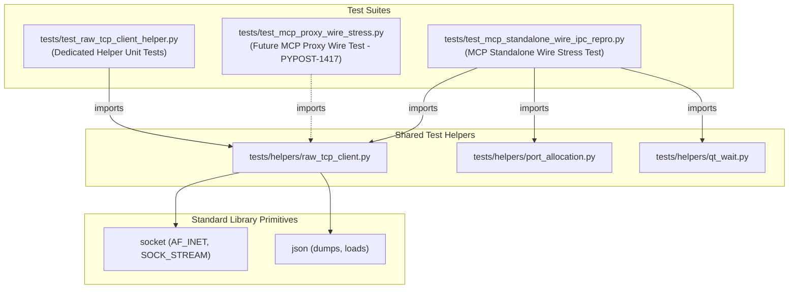

# PYPOST-1428: Extract RawTcpWireClient to Shared Test Helper

## Research

### Current State Analysis

In [PYPOST-1416](file:///home/src/ai-tasks/PYPOST-1416/10-requirements.md), low-level TCP wire injection and response parsing capabilities were developed to perform wire IPC stress testing on standalone Model Context Protocol (MCP) servers. These utilities were defined locally inside `tests/test_mcp_standalone_wire_ipc_repro.py`:

1. **`RawTcpWireClient`** (lines 29–189):
   - Establishes raw TCP stream sockets (`socket.AF_INET`, `socket.SOCK_STREAM`) against the loopback interface (`127.0.0.1`).
   - Provides context manager semantics (`__enter__` and `__exit__`) for guaranteed socket lifecycle cleanup (`sock.shutdown(socket.SHUT_RDWR)` with `OSError` suppression, followed by `sock.close()`).
   - Formats HTTP/1.1 POST requests (`build_post_request`) with standard headers (`Content-Type: application/json`, `Accept: application/json, text/event-stream`, `Connection: keep-alive`) and custom session tracking headers (`mcp-session-id`).
   - Supports granular byte segmentation:
     - `send_fragmented(data, chunk_size=7, delay=0.0)`: Injects data in small packet slices across loopback TCP to exercise kernel buffering, partial receives, and frame reassembly.
     - `send_all(data)`: Transmits full packet bursts for pipelined request stress testing.
   - Implements wire-level HTTP response stream framing (`read_http_response`):
     - Parses status lines and headers from `\r\n\r\n` delimited byte streams.
     - Automatically captures and retains `mcp-session-id` from server response headers.
     - Decodes `Transfer-Encoding: chunked` bodies according to RFC 9112 (hex chunk size, chunk payload, trailing CRLF, and terminating `0\r\n\r\n`).
     - Decodes `Content-Length` bounded bodies.
     - Preserves unread stream data in `_unread_buffer` across consecutive calls on persistent keep-alive connections.

2. **`parse_jsonrpc_from_response`** (lines 190–211):
   - Extracts structured JSON-RPC message objects from raw byte bodies.
   - Handles standard single JSON payloads (`application/json`).
   - Handles Server-Sent Events (`text/event-stream`), iterating line-by-line over `data:` prefixed lines and decoding embedded JSON-RPC envelopes.

### Repository Test Helpers Patterns

Inspection of `tests/helpers/` shows a clear modular convention:
- **Dedicated Helper Modules**: Reusable utilities are structured as focused, standalone modules under `tests/helpers/` (e.g., `mcp_live_server.py`, `port_allocation.py`, `qt_wait.py`, `process_until.py`).
- **Low Coupling**: Test helpers avoid importing unnecessary application internals, keeping dependencies minimal to avoid circular imports or test runner discovery issues.
- **Strict Lint Baseline**: The repository enforces flake8 compliance across `tests/` via `scripts/check_test_lint_baseline.py`. Any new file placed in `tests/helpers/` must be 100% flake8-clean with zero new lint findings.
- **Type Annotations**: All helper functions and methods must use complete type annotations compatible with Python 3.11+ (PEP 484, PEP 585, PEP 604 union syntax).

### Problems Identified

- **Code Duplication Risk**: Upcoming MCP test suites (such as PYPOST-1417 MCP proxy wire stress tests and PYPOST-1430 protocol fuzzing) require the exact same low-level socket injection and chunk/SSE response parsing logic.
- **Anti-Pattern Cross-Test Imports**: Importing `RawTcpWireClient` from `test_mcp_standalone_wire_ipc_repro.py` in other test files couples unrelated test suites, impairs test runner parallelism, and risks test pollution.
- **Lack of Dedicated Unit Testing**: `RawTcpWireClient` was only tested indirectly through live MCP server integration tests. Edge cases in HTTP framing, chunked decoding, and SSE parsing should be validated by dedicated, fast unit tests.

---

## Implementation Plan

### High-Level Sequencing

```
Step 1: Requirements Gathering (Complete)
   │
Step 2: High-Level Architecture Design (Current Step)
   │
Step 3: Automated Failing Repro Test (Red)
   │   └─ Create tests/test_raw_tcp_client_helper.py importing tests.helpers.raw_tcp_client
   │   └─ Execute via make test -> Fails with ModuleNotFoundError
   │
Step 4: Development (Green)
   │   ├─ Create tests/helpers/raw_tcp_client.py with RawTcpWireClient and parse_jsonrpc_from_response
   │   ├─ Expose symbols cleanly for external test imports
   │   ├─ Refactor tests/test_mcp_standalone_wire_ipc_repro.py to import from tests.helpers.raw_tcp_client
   │   └─ Verify green state across both new unit test and existing integration test
   │
Step 5: Code Cleanup
   │   └─ Run make lint, check flake8 compliance, format docstrings, verify zero new lint findings
   │
Step 6: Observability
   │   └─ Document failure diagnostics and socket lifecycle trace points
   │
Step 7: Technical Debt Analysis
   │   └─ Evaluate zero-copy buffer improvements (memoryview) and IPv6 loopback extensions
   │
Step 8: Dev Docs & Commit
   │   └─ Update developer documentation in doc/dev/ to reflect shared helper location
```

### Mandatory — Failing Repro (next Step 3)

- **Context**: This task is a pure refactor and test infrastructure extraction. No production runtime application code in `pypost/` is altered.
- **Automated Red Test**:
  - **Location**: `tests/test_raw_tcp_client_helper.py`
  - **Test Assertions**:
    1. Import assertion: `from tests.helpers.raw_tcp_client import RawTcpWireClient, parse_jsonrpc_from_response`.
    2. Request builder unit test: verifies `build_post_request` produces well-formed HTTP/1.1 byte arrays with correct `Content-Length`, `mcp-session-id`, `Host`, and JSON payload.
    3. SSE and JSON-RPC parser unit test: verifies `parse_jsonrpc_from_response` correctly decodes both standard JSON-RPC objects and multi-line Server-Sent Events (`data: ...`), while safely discarding non-JSON or malformed lines.
    4. Chunked transfer decoding unit test: verifies `read_http_response` decodes chunked HTTP/1.1 response bodies and preserves unread trailing buffer bytes.
    5. Context manager lifecycle unit test: verifies socket connection, teardown, and clean resource closure on context exit.
  - **Forced Failure**: Running `make test PYTEST_ARGS="tests/test_raw_tcp_client_helper.py"` before `tests/helpers/raw_tcp_client.py` is implemented will fail immediately with:
    `ModuleNotFoundError: No module named 'tests.helpers.raw_tcp_client'`
  - **No External Dependencies**: The unit tests will run entirely against in-memory byte buffers or standard loopback sockets without requiring external network services or full MCP application harnesses.

---

## Architecture

### System & Module Architecture



### Module Responsibilities

| Component | Location | Responsibility |
| --- | --- | --- |
| **`tests/helpers/raw_tcp_client.py`** | Shared Test Helper Module | Centralized test utility module containing `RawTcpWireClient` and `parse_jsonrpc_from_response`. Houses low-level socket handling, HTTP/1.1 request formatting, packet fragmentation, chunked stream framing, and SSE payload parsing. |
| **`RawTcpWireClient`** | Class inside helper | Encapsulates a raw TCP socket client with explicit context management, granular transmission controls (`send_fragmented`, `send_all`), and wire HTTP response stream decoding (`read_http_response`). |
| **`parse_jsonrpc_from_response`** | Function inside helper | Pure utility parsing JSON-RPC objects from raw byte payloads across both direct JSON bodies and multi-line SSE `data:` event streams. |
| **`tests/test_raw_tcp_client_helper.py`** | Dedicated Unit Test Suite | Comprehensive unit tests for `RawTcpWireClient` and `parse_jsonrpc_from_response` covering framing, chunk decoding, header parsing, session capture, and lifecycle. |
| **`tests/test_mcp_standalone_wire_ipc_repro.py`** | Integration Test Consumer | Existing standalone MCP server wire stress suite, refactored to consume `RawTcpWireClient` and `parse_jsonrpc_from_response` from `tests.helpers.raw_tcp_client`. |

### Detailed API Contract & Interface Specifications

#### 1. `RawTcpWireClient`

```python
class RawTcpWireClient:
    """Raw TCP socket client for injecting fragmented frames, pipelining, and bursts.

    Designed for wire-level testing of HTTP/1.1 and MCP streamable transports.
    """

    def __init__(self, host: str, port: int, timeout: float = 10.0) -> None:
        """Initialize wire client with target host, port, and socket timeout.

        Args:
            host: Target hostname or IP address (typically '127.0.0.1').
            port: Target TCP port number.
            timeout: Socket timeout in seconds for connect and read operations.
        """
        ...

    def connect(self) -> None:
        """Establish physical TCP connection to (host, port).

        Creates socket.socket(socket.AF_INET, socket.SOCK_STREAM) with timeout.
        """
        ...

    def close(self) -> None:
        """Gracefully shut down and close the underlying socket descriptor."""
        ...

    def __enter__(self) -> RawTcpWireClient:
        """Connect socket upon entering context block."""
        ...

    def __exit__(self, exc_type: Any, exc_val: Any, exc_tb: Any) -> None:
        """Close socket upon exiting context block."""
        ...

    def build_post_request(
        self,
        payload: dict[str, Any],
        path: str = "/mcp",
        session_id: str | None = None,
    ) -> bytes:
        """Construct raw HTTP/1.1 POST request bytes with JSON-RPC payload.

        Args:
            payload: JSON-serializable dictionary representing the JSON-RPC request.
            path: Target HTTP endpoint URI path (default '/mcp').
            session_id: Optional MCP session ID override; defaults to self.session_id.

        Returns:
            Formatted raw HTTP/1.1 request bytes including headers and body.
        """
        ...

    def send_fragmented(
        self,
        data: bytes,
        chunk_size: int = 7,
        delay: float = 0.0,
    ) -> None:
        """Transmit byte sequence in small fragmented chunks to simulate packet fragmentation.

        Args:
            data: Raw bytes to transmit over the socket.
            chunk_size: Maximum slice size per socket sendall call (default 7 bytes).
            delay: Optional sleep interval in seconds between slice transmissions.
        """
        ...

    def send_all(self, data: bytes) -> None:
        """Transmit entire byte sequence in a single call for burst or pipelined requests.

        Args:
            data: Raw bytes to transmit.
        """
        ...

    def read_http_response(self) -> tuple[int, dict[str, str], bytes]:
        """Read a single complete HTTP/1.1 response from the persistent socket stream.

        Handles:
        - Header delimiter search (\r\n\r\n) across incoming socket reads.
        - Status line parsing and lowercase header map extraction.
        - Capturing 'mcp-session-id' header into self.session_id.
        - Decoding 'Transfer-Encoding: chunked' bodies.
        - Decoding 'Content-Length' bounded bodies.
        - Preserving remaining unread stream bytes in self._unread_buffer.

        Returns:
            Tuple of (status_code: int, headers: dict[str, str], body_bytes: bytes).

        Raises:
            ConnectionResetError: If connection is closed by peer during read.
            socket.timeout: If socket timeout expires before full response arrives.
        """
        ...
```

#### 2. `parse_jsonrpc_from_response`

```python
def parse_jsonrpc_from_response(body_bytes: bytes) -> list[dict[str, Any]]:
    """Parse JSON-RPC messages from application/json body or text/event-stream SSE events.

    Args:
        body_bytes: Raw response body bytes received from the wire.

    Returns:
        List of parsed JSON-RPC message dictionaries. If no valid JSON-RPC
        payloads are present, returns an empty list.
    """
    ...
```

### Socket Lifecycle & Error Handling Strategy

1. **Deterministic Lifecycle**:
   - `RawTcpWireClient` implements the context manager protocol (`__enter__` / `__exit__`).
   - Entering the context calls `connect()`.
   - Exiting the context calls `close()`, which issues `sock.shutdown(socket.SHUT_RDWR)` wrapped in `try/except OSError` (safely ignoring `ENOTCONN` if the server closed the connection first) before executing `sock.close()`.
   - The socket instance variable `self.sock` is set to `None` upon closure, preventing dangling descriptor references.

2. **Buffer Management Across Pipelining**:
   - When multiple HTTP requests are pipelined on the same connection, responses arrive in sequence over the socket.
   - `_unread_buffer` preserves any byte prefix read beyond the boundary of the current HTTP message (e.g., following the end chunk of chunked encoding or after the `Content-Length` boundary).
   - Subsequent calls to `read_http_response()` consume from `_unread_buffer` before reading additional data from the network socket.

3. **Error Handling**:
   - `ConnectionResetError`: Raised if `sock.recv()` returns 0 bytes while awaiting the end of headers or chunk data, providing informative error messages for test diagnostics.
   - `socket.timeout`: Preserved directly from standard library socket operations when servers fail to respond within `self.timeout`.
   - Malformed SSE / JSON: `parse_jsonrpc_from_response` safely ignores non-JSON lines and syntax errors, returning only valid decoded JSON-RPC frames.

---

## Q&A

**Q: Why extract `RawTcpWireClient` to `tests/helpers/raw_tcp_client.py` rather than `pypost/`?**  
A: `RawTcpWireClient` is specifically a test harness utility designed for network fault injection (packet fragmentation, raw pipelining bursts, keep-alive framing inspection). It has no role in the production runtime application and should never be packaged into production wheels or distributions.

**Q: Should `RawTcpWireClient` be imported into `tests/helpers/__init__.py`?**  
A: Following the convention of existing helpers in `tests/helpers/` (such as `mcp_live_server.py` and `port_allocation.py`), callers import directly from the module (`from tests.helpers.raw_tcp_client import RawTcpWireClient, parse_jsonrpc_from_response`). This avoids bloating `__init__.py` and avoids unintended import side effects.

**Q: How does the Step 3 failing repro ensure TDD compliance for a refactoring task?**  
A: While existing integration tests in `test_mcp_standalone_wire_ipc_repro.py` already validate `RawTcpWireClient`, creating a new dedicated unit test file `tests/test_raw_tcp_client_helper.py` importing `tests.helpers.raw_tcp_client` provides an immediate red test (`ModuleNotFoundError`). This satisfies the Top-Down workflow requirement for an automated failing repro before creating the new module.

**Q: Does extracting the helper risk any regressions in `tests/test_mcp_standalone_wire_ipc_repro.py`?**  
A: No. The internal logic of `RawTcpWireClient` and `parse_jsonrpc_from_response` will remain completely compatible with the existing implementation. `tests/test_mcp_standalone_wire_ipc_repro.py` will simply swap its local definitions for the import statement.
