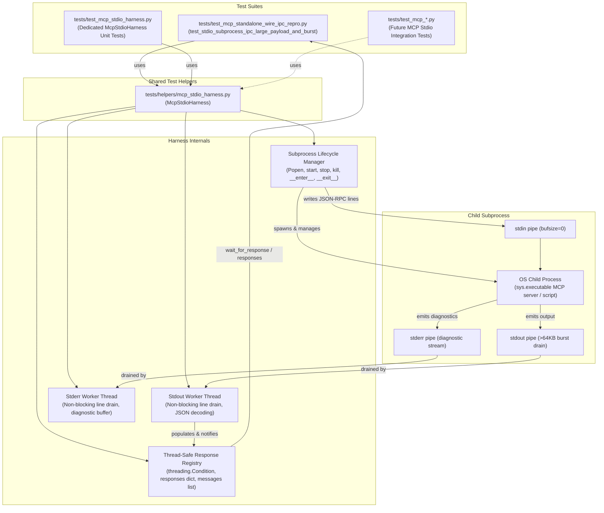

# PYPOST-1429: Encapsulate Subprocess Stdio IPC Harness

## Research

### Current State Analysis

In Model Context Protocol (MCP) server architectures, standard input/output (`stdio`) constitutes a fundamental bidirectional stream transport alongside HTTP/SSE network streams. Testing MCP stdio transports requires spawning child processes that execute MCP server instances, exchanging framed JSON-RPC messages across operating system standard streams (`stdin`, `stdout`, `stderr`), managing asynchronous stream consumption, and handling safe process lifecycles.

In `tests/test_mcp_standalone_wire_ipc_repro.py`, lines 239–415 define `test_stdio_subprocess_ipc_large_payload_and_burst`. This test stresses the stdio transport with a 50-request burst containing payloads exceeding 64KB (70KB) to verify pipe buffer handling and clean shutdown on stdin EOF. However, child process creation, stream reading, synchronization, and teardown are implemented entirely inline within the test function:

1. **Inline Process Management (lines 291–297)**:
   - Spawns a child process using `subprocess.Popen([sys.executable, "-c", server_script], stdin=subprocess.PIPE, stdout=subprocess.PIPE, stderr=subprocess.PIPE, bufsize=0)`.
   - Relies on unbuffered OS pipes (`bufsize=0`).
2. **Inline Background Reader Threads (lines 299–326)**:
   - Manages raw dictionaries (`responses: dict[Any, dict[str, Any]]`) guarded by a `threading.Lock()`.
   - Collects diagnostic output into `stderr_output: list[str]`.
   - Implements `stdout_worker()` and `stderr_worker()` in daemon threads (`t_out`, `t_err`), using `iter(process.stdout.readline, b"")` and `iter(process.stderr.readline, b"")`.
   - Catches JSON decoding exceptions and appends them to stderr output.
3. **Manual Timeout Polling Loops (lines 344–350, 378–384)**:
   - Implements custom busy-wait polling loops with `time.time() < deadline` and `time.sleep(0.02)` / `time.sleep(0.05)` under lock acquisition.
4. **Manual Teardown & Process Cleanup (lines 400–409)**:
   - Closes `process.stdin` manually.
   - Waits for process exit (`process.wait(timeout=5.0)`).
   - In a `finally:` block, polls process status, issues `process.kill()` with `process.wait(timeout=2.0)` if still alive, and joins `t_out` and `t_err` with 1.0s timeouts.

### Existing Helper Patterns in `tests/helpers/`

Inspection of `tests/helpers/` (e.g., `tests/helpers/raw_tcp_client.py` extracted in PYPOST-1428, `mcp_live_server.py`, `port_allocation.py`, `qt_wait.py`) reveals key architectural conventions:
- **Focused, Decoupled Modules**: Reusable test infrastructure resides in dedicated modules under `tests/helpers/` rather than embedded in test scenarios or application runtime packages (`pypost/`).
- **Context Manager Semantics**: Classes managing external resources (sockets, processes, servers) implement `__enter__` and `__exit__` to guarantee deterministic initialization and cleanup, ensuring that assertion failures or unhandled exceptions do not leak operating system resources.
- **Strict Quality Compliance**: Helpers adhere to Python 3.11+ type annotations (`from __future__ import annotations`, PEP 484, PEP 585, PEP 604 union types), full docstrings, and strict flake8 lint standards (`make lint`).
- **Clean Import Surface**: Helpers are imported directly by tests (e.g., `from tests.helpers.mcp_stdio_harness import McpStdioHarness`), keeping `tests/helpers/__init__.py` lightweight.

### Problems Identified

1. **Deadlock and Resource Leak Risks**:
   - The Linux OS kernel pipe buffer capacity is 64KB (65,536 bytes). If a child process writes more data to `stdout` or `stderr` than the pipe buffer can accommodate while the parent is blocked or not actively reading, the child process blocks on write. If the parent waits for the child to exit or write more data, both processes deadlock indefinitely.
   - Writing custom thread management and teardown logic inline in each test invites flakiness. Any unhandled exception prior to cleanup or missing `finally` clauses leaves orphaned child processes, unjoined threads, and open pipe file descriptors in automated CI environments.
2. **Duplication and Lack of Reusability**:
   - Other MCP test suites (such as CLI invocation tests, client-server integration suites, and protocol fuzzing) require identical stdio child process management, non-blocking stream draining, and correlated response matching. Forcing each test suite to reinvent subprocess management produces code duplication.
3. **High Cognitive Overhead**:
   - Scenarios in `tests/test_mcp_standalone_wire_ipc_repro.py` combine high-level protocol assertions with low-level thread synchronization, pipe polling loops, and process termination mechanics, obscuring test intent.
4. **Lack of Dedicated Unit Testing**:
   - The stdio subprocess handling logic was only exercised indirectly through the complex MCP server script. Edge cases in process lifecycle, timeout enforcement, thread joining, and stderr capture lack isolated unit test coverage.

---

## Implementation Plan

### High-Level Sequencing

```
Step 1: Requirements Gathering (Complete)
   │
Step 2: High-Level Architecture Design (Current Step)
   │
Step 3: Automated Failing Repro Test (Red)
   │   └─ Create tests/test_mcp_stdio_harness.py importing tests.helpers.mcp_stdio_harness
   │   └─ Execute via make test -> Fails with ModuleNotFoundError: tests.helpers.mcp_stdio_harness
   │
Step 4: Development (Green)
   │   ├─ Create tests/helpers/mcp_stdio_harness.py with McpStdioHarness
   │   ├─ Implement subprocess lifecycle, asynchronous daemon reader threads, response registry, and timeouts
   │   ├─ Verify green state on unit tests in tests/test_mcp_stdio_harness.py
   │   ├─ Refactor tests/test_mcp_standalone_wire_ipc_repro.py to consume McpStdioHarness
   │   └─ Verify green state on integration test test_stdio_subprocess_ipc_large_payload_and_burst
   │
Step 5: Code Cleanup
   │   └─ Run make lint, check flake8 compliance, format docstrings, verify zero new lint findings
   │
Step 6: Observability
   │   └─ Document failure diagnostics, stderr capture, and process exit code visibility
   │
Step 7: Technical Debt Analysis
   │   └─ Record any remaining constraints or future enhancements in 60-tech-debt.md
   │
Step 8: Dev Docs & Commit
   │   └─ Update developer documentation in doc/dev/ to reflect the shared stdio harness
```

### Mandatory — Failing Repro (next Step 3)

- **Context**: This task encapsulates test infrastructure and refactors existing test logic. Application runtime code under `pypost/` remains untouched.
- **Automated Red Test**:
  - **Location**: `tests/test_mcp_stdio_harness.py`
  - **Declared Pytest Timeout**: Class or module-level `pytestmark = pytest.mark.timeout(15)`.
  - **Test Assertions**:
    1. **Import assertion**: `from tests.helpers.mcp_stdio_harness import McpStdioHarness`.
    2. **Lifecycle and Context Manager**: Launch a simple Python echo child process using `McpStdioHarness([sys.executable, "-c", ...])` within a `with` block, asserting `harness.is_alive` is `True`, stdin/stdout work, and the process terminates cleanly on context exit (`harness.is_alive` becomes `False`).
    3. **Correlated Request-Response Waiting**: Send structured JSON-RPC messages and assert `harness.wait_for_response(msg_id, timeout=...)` returns the correlated response dictionary.
    4. **Batch Response Retrieval**: Send multiple messages and assert `harness.wait_for_responses(count, timeout=...)` waits until all responses are received.
    5. **Timeout Enforcement**: Call `harness.wait_for_response("non-existent-id", timeout=0.1)` and assert it raises `TimeoutError` with captured stderr diagnostics in the exception message.
    6. **Asynchronous Stderr Capture**: Child process writes diagnostic messages to stderr; assert `harness.get_stderr()` contains the expected stderr text without deadlocking.
    7. **Forceful Teardown on Hung Process**: Launch a child process running `while True: time.sleep(1)`. On context exit or `harness.stop()`, assert the harness kills the hung process and joins reader threads within bounded deadlines.
  - **Forced Failure**: Running `make test PYTEST_ARGS="tests/test_mcp_stdio_harness.py"` before `tests/helpers/mcp_stdio_harness.py` is created will fail immediately with:
    `ModuleNotFoundError: No module named 'tests.helpers.mcp_stdio_harness'`
  - **No External Dependencies**: Tests run against standard Python child processes using `sys.executable` and standard library modules without requiring external network services or full MCP server stacks.

---

## Architecture

### System & Module Architecture



### Module Responsibilities

| Component | Location | Responsibility |
| --- | --- | --- |
| **`tests/helpers/mcp_stdio_harness.py`** | Shared Test Helper Module | Centralized test utility module containing `McpStdioHarness`. Encapsulates child process execution, asynchronous stream reading, thread synchronization, timeout enforcement, and guaranteed process teardown. |
| **`McpStdioHarness`** | Class inside helper | Provides an ergonomic context manager and operational API for stdio-based subprocess testing: launching processes, writing JSON-RPC requests/notifications to `stdin`, awaiting responses by ID or count with timeouts, capturing `stderr`, and ensuring safe termination. |
| **`tests/test_mcp_stdio_harness.py`** | Dedicated Unit Test Suite | Comprehensive unit tests for `McpStdioHarness` covering process lifecycle, context manager teardown, response registry synchronization, timeout enforcement, pipe deadlock prevention, and stderr diagnostic collection. |
| **`tests/test_mcp_standalone_wire_ipc_repro.py`** | Integration Test Consumer | Standalone MCP server stress test suite, refactored to consume `McpStdioHarness` in `test_stdio_subprocess_ipc_large_payload_and_burst`, removing inline threads, locks, and poll loops while retaining 100% of functional assertions. |

---

### Detailed API Contract: `McpStdioHarness`

```python
"""Subprocess stdio IPC test harness for MCP transports.

Encapsulates child process execution, non-blocking asynchronous stream
reading, response registry synchronization, and timeout enforcement.

Jira: PYPOST-1429
Architecture: ai-tasks/PYPOST-1429/20-architecture.md
"""

from __future__ import annotations

import json
import subprocess
import threading
import time
from pathlib import Path
from typing import Any, Callable, Sequence


class McpStdioHarness:
    """Subprocess stdio IPC test harness with asynchronous stream draining.

    Manages child process lifecycle, non-blocking background stdout/stderr
    reader worker threads, synchronized response collection, and bounded
    timeout enforcement. Prevents OS pipe deadlocks (>64KB buffers) and
    guarantees clean process cleanup.
    """

    def __init__(
        self,
        command: Sequence[str | Path] | str,
        *,
        cwd: str | Path | None = None,
        env: dict[str, str] | None = None,
        auto_start: bool = True,
    ) -> None:
        """Initialize the stdio harness with target command and execution options.

        Args:
            command: Command argument sequence (or shell string) to execute.
            cwd: Optional working directory for the child process.
            env: Optional environment dictionary override for the child process.
            auto_start: If True, automatically launches the child process and worker
                threads during initialization. If False, requires explicit start() call.
        """
        ...

    def start(self) -> None:
        """Launch the child process and spawn asynchronous reader threads.

        Spawns child process with subprocess.PIPE on stdin, stdout, and stderr with
        bufsize=0. Starts dedicated daemon threads for stdout and stderr draining.

        Raises:
            RuntimeError: If the process is already running.
        """
        ...

    def close_stdin(self) -> None:
        """Flush and close child process stdin to signal EOF.

        Safe to call multiple times or if stdin is already closed.
        """
        ...

    def stop(self, timeout: float = 5.0) -> int:
        """Stop child process gracefully with fallback to forceful termination.

        Closes stdin if open, waits up to timeout seconds for process exit. If the
        process does not exit within timeout, issues kill() and waits up to 2.0s.
        Joins background reader threads and returns the final process returncode.

        Args:
            timeout: Graceful exit timeout in seconds before issuing kill().

        Returns:
            The integer process returncode.
        """
        ...

    def kill(self, timeout: float = 2.0) -> int:
        """Forcefully terminate the child process immediately.

        Issues process.kill(), waits up to timeout seconds, joins reader threads.

        Args:
            timeout: Maximum wait time in seconds after kill().

        Returns:
            The integer process returncode.
        """
        ...

    def wait_for_exit(self, timeout: float = 5.0) -> int:
        """Wait for child process to terminate and return its exit code.

        Args:
            timeout: Maximum wait time in seconds before raising TimeoutError.

        Returns:
            The integer process returncode.

        Raises:
            TimeoutError: If the child process does not terminate within timeout.
        """
        ...

    def __enter__(self) -> McpStdioHarness:
        """Context manager entry: starts process if not running, returns self."""
        ...

    def __exit__(self, exc_type: Any, exc_val: Any, exc_tb: Any) -> None:
        """Context manager exit: guarantees stop() is executed, cleaning up all resources."""
        ...

    @property
    def is_alive(self) -> bool:
        """Return True if the child process is currently running."""
        ...

    @property
    def returncode(self) -> int | None:
        """Return the process returncode if terminated, or None if still running."""
        ...

    def send_raw(self, data: bytes | str) -> None:
        """Transmit raw bytes or string to child process stdin and flush immediately.

        Args:
            data: Raw string or bytes to write. If newline is missing, it is appended.

        Raises:
            RuntimeError: If process is not running or stdin is closed.
        """
        ...

    def send_message(self, message: dict[str, Any] | str) -> None:
        """Transmit a JSON-RPC message dictionary (or JSON string) to stdin and flush.

        Args:
            message: Dictionary to serialize to JSON or raw JSON string.

        Raises:
            RuntimeError: If process is not running or stdin is closed.
        """
        ...

    def send_request(
        self,
        request_id: Any,
        method: str,
        params: dict[str, Any] | None = None,
    ) -> None:
        """Convenience method to format and transmit a standard JSON-RPC 2.0 request.

        Args:
            request_id: Identifier for request/response correlation.
            method: JSON-RPC method name.
            params: Optional parameter mapping.
        """
        ...

    def send_notification(
        self,
        method: str,
        params: dict[str, Any] | None = None,
    ) -> None:
        """Convenience method to format and transmit a standard JSON-RPC 2.0 notification.

        Args:
            method: JSON-RPC method name.
            params: Optional parameter mapping.
        """
        ...

    def get_response(self, request_id: Any) -> dict[str, Any] | None:
        """Look up a received response by ID in a thread-safe manner.

        Args:
            request_id: Identifier to look up.

        Returns:
            Response dictionary if received, or None if not yet arrived.
        """
        ...

    def get_all_responses(self) -> dict[Any, dict[str, Any]]:
        """Return a thread-safe copy of all collected response dictionaries keyed by ID."""
        ...

    def get_messages(self) -> list[dict[str, Any]]:
        """Return a thread-safe ordered list copy of all received JSON-RPC messages."""
        ...

    def get_stderr(self) -> str:
        """Return all captured standard error output as a single decoded string."""
        ...

    def wait_for_response(
        self,
        request_id: Any,
        timeout: float = 5.0,
    ) -> dict[str, Any]:
        """Wait until a response matching request_id arrives or timeout expires.

        Uses thread condition synchronization to wake up immediately when the response
        is decoded by the stdout worker.

        Args:
            request_id: Expected response identifier.
            timeout: Maximum wait time in seconds.

        Returns:
            The matched response dictionary.

        Raises:
            TimeoutError: If the response is not received within timeout seconds. Includes
                captured stderr output in the exception message for diagnostics.
        """
        ...

    def wait_for_responses(
        self,
        total_count: int,
        timeout: float = 15.0,
    ) -> dict[Any, dict[str, Any]]:
        """Wait until at least total_count responses have arrived or timeout expires.

        Args:
            total_count: Minimum number of responses expected in the registry.
            timeout: Maximum wait time in seconds.

        Returns:
            Thread-safe copy of all collected responses.

        Raises:
            TimeoutError: If total_count responses are not received within timeout seconds.
        """
        ...

    def wait_for_predicate(
        self,
        predicate: Callable[[McpStdioHarness], bool],
        timeout: float = 5.0,
        interval: float = 0.05,
    ) -> None:
        """Wait until custom condition predicate returns True or timeout expires.

        Args:
            predicate: Callable taking self and returning bool.
            timeout: Maximum wait time in seconds.
            interval: Poll interval in seconds if condition variable is not triggered.

        Raises:
            TimeoutError: If predicate does not evaluate to True within timeout seconds.
        """
        ...
```

---

### Internal Mechanics & Concurrency Architecture

#### 1. Process Lifecycle and Context Management
- `start()` spawns `subprocess.Popen` with `stdin=subprocess.PIPE`, `stdout=subprocess.PIPE`, `stderr=subprocess.PIPE`, `bufsize=0`.
- Stored as `self.process`.
- Implements context manager protocol (`__enter__` and `__exit__`).
  - Entering returns `self`.
  - Exiting unconditionally calls `self.stop()`. Even if an assertion in the test fails or an unexpected exception occurs, `self.stop()` runs, terminating the child process and joining worker threads.

#### 2. Asynchronous Stream Draining & OS Pipe Deadlock Prevention
- On Linux and Unix systems, OS pipe buffers are bounded (typically 64KB). If a child process writes >64KB to stdout or stderr without parent draining, the OS pipe buffer fills up and kernel-level writes block. If the parent is blocked or waiting, both processes deadlock.
- `McpStdioHarness` launches two background daemon threads immediately upon starting the child:
  - **`_stdout_worker`**: Continuously executes `iter(self.process.stdout.readline, b"")`. As data arrives, raw lines are decoded as UTF-8, stripped, and parsed as JSON. If the parsed message contains `"id"`, it is stored in `self._responses[msg["id"]]`. The message is also appended to `self._messages`. Upon updating, `self._condition.notify_all()` is invoked under `self._lock`. If JSON parsing fails (e.g. non-JSON text output), the error is logged into `self._stdout_decode_errors`.
  - **`_stderr_worker`**: Continuously executes `iter(self.process.stderr.readline, b"")`. Lines are decoded with `errors="replace"` and appended to `self._stderr_lines`.
- Because both worker threads read continuously in the background, kernel pipe buffers never saturate, completely eliminating OS pipe deadlock even for massive payload bursts (>70KB).

#### 3. Response Registry and Condition Synchronization
- Avoids busy-sleeping loops (`time.sleep(0.02)`).
- Uses `threading.Lock` and `threading.Condition(self._lock)`:
  - When `wait_for_response(msg_id, timeout)` is called, the calling thread acquires `self._condition` and calls `self._condition.wait_for(lambda: msg_id in self._responses, timeout=timeout)`.
  - The instant `_stdout_worker` decodes the message, it signals `notify_all()`, waking the waiting thread with sub-millisecond latency.
  - If the timeout expires before the response arrives, a descriptive `TimeoutError` is raised including elapsed time and `self.get_stderr()`.

#### 4. Graceful and Forceful Termination
- **Graceful path**:
  - `close_stdin()` closes the stdin stream to send EOF. Standard MCP servers exit cleanly upon receiving EOF on stdin.
  - `wait_for_exit(timeout)` waits up to `timeout` (default 5.0s) for the process to terminate with returncode 0.
- **Forceful fallback**:
  - In `stop()`, if the process is still running after the graceful deadline, `self.kill()` is invoked.
  - `kill()` calls `self.process.kill()`, waits up to 2.0s, and ensures reader threads `_t_out.join(timeout=1.0)` and `_t_err.join(timeout=1.0)` are completed.
  - Closes any remaining open file descriptors.

---

## Q&A

**Q: Why extract `McpStdioHarness` to `tests/helpers/mcp_stdio_harness.py` instead of a production package?**  
A: `McpStdioHarness` is strictly a test infrastructure utility for spawning mock and real child processes, verifying wire protocols, capturing stderr logs, and testing transport resilience. It is not part of the runtime `pypost` application and should never be packaged into production distributions.

**Q: Why use Python `threading` and `subprocess.Popen` instead of `asyncio.subprocess`?**  
A: MCP test suites across pytest run in synchronous test functions or standard threads (e.g., PySide6 / Qt test fixtures like `qapp` in `test_mcp_standalone_wire_ipc_repro.py`). Running a synchronous context manager backed by daemon threads allows any pytest test function—whether synchronous or asynchronous—to easily interact with stdio child processes without requiring an event loop in the test runner thread.

**Q: How does `McpStdioHarness` prevent OS pipe deadlocks for large payloads (>64KB)?**  
A: Standard OS pipes have a 64KB kernel buffer. In `test_stdio_subprocess_ipc_large_payload_and_burst`, the child process produces responses containing 70KB payloads. If the parent process were to wait or block on stdin without reading stdout, the kernel buffer would fill up and cause the child to hang on write. `McpStdioHarness` runs continuous background reader threads on stdout and stderr that drain buffers immediately into user space memory, ensuring the kernel pipe buffers never fill up.

**Q: How does `McpStdioHarness` prevent zombie child processes in CI?**  
A: By providing `__enter__` and `__exit__`, any exception or assertion failure in the test automatically triggers `stop()`. `stop()` attempts a graceful shutdown by closing stdin and waiting, and if the process does not terminate within the deadline, immediately issues `kill()` and reaps the exit code with `wait()`.

**Q: How does the Step 3 failing repro ensure TDD compliance for refactoring?**  
A: Creating `tests/test_mcp_stdio_harness.py` that imports `tests.helpers.mcp_stdio_harness` and exercises its API will immediately fail with `ModuleNotFoundError: No module named 'tests.helpers.mcp_stdio_harness'` when run via `make test`. This provides an automated red test verifying the interface before the helper implementation is written in Step 4.

**Q: Will refactoring `test_stdio_subprocess_ipc_large_payload_and_burst` change its test coverage or assertions?**  
A: No. All existing assertions (handshake initialization, notification dispatch, 50-request burst processing, 70KB payload integrity validation, and clean exit on stdin close) are preserved 100%. The only change is replacing the inline subprocess and thread mechanics with `McpStdioHarness`.
