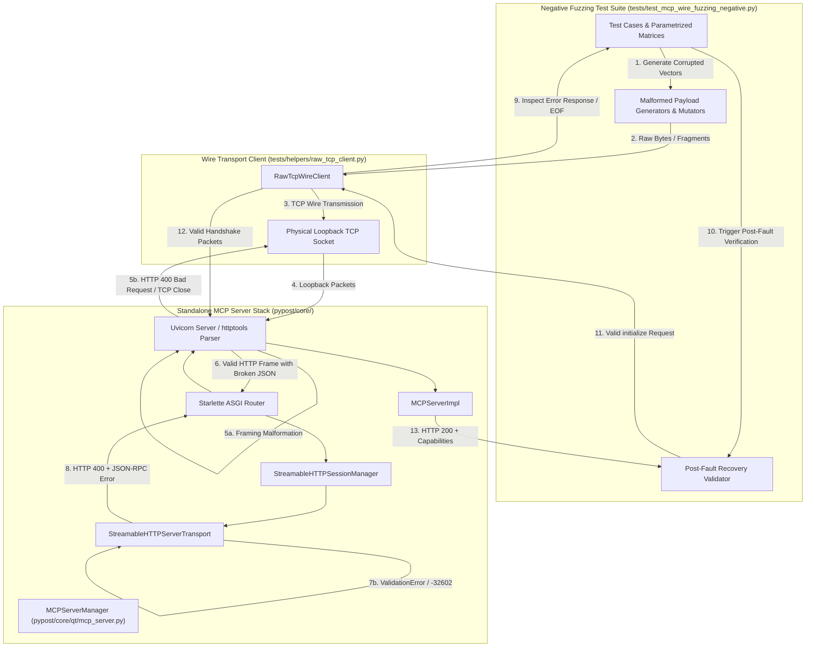

# PYPOST-1430: Implement Malformed JSON-RPC and Wire Framing Fuzzing Suite

## Research

### 1. Existing Wire Client and Transport Fixtures

Investigation of existing test helpers and MCP server implementation reveals the following infrastructure:

- **`tests/helpers/raw_tcp_client.py` (`RawTcpWireClient`)**:
  - Implements a low-level physical TCP socket client over `socket.socket(socket.AF_INET, socket.SOCK_STREAM)`.
  - Supports connection context management (`__enter__`, `__exit__`), explicit connection teardown (`close()`), configurable timeouts, and session header tracking (`mcp-session-id`).
  - Provides transmission primitives: `send_all(data: bytes)` for full byte bursts, and `send_fragmented(data: bytes, chunk_size: int = 7, delay: float = 0.0)` for slicing payloads into micro-chunks across socket writes.
  - Implements `read_http_response() -> tuple[int, dict[str, str], bytes]`, which parses status lines, headers, and bodies (both `Content-Length` bounded and `Transfer-Encoding: chunked`). When the connection is closed prematurely by the peer, it raises `ConnectionResetError`.
  - Provides `parse_jsonrpc_from_response(body_bytes: bytes) -> list[dict[str, Any]]` to extract JSON-RPC messages from both standard JSON bodies and SSE `data:` lines.

- **`tests/test_mcp_standalone_wire_ipc_repro.py`**:
  - Exercises standalone MCP servers over loopback TCP using `RawTcpWireClient`.
  - Validates positive fragmentation (1-byte and 7-byte slices), pipelined burst stress (100 requests), and port re-binding resilience (`test_wire_lifecycle_teardown_and_port_rebind`).
  - Sets up mock request services (`_create_mock_request_service()`), attaches tools via `MCPServerManager`, binds to dynamic ephemeral ports allocated via `allocate_tcp_port("127.0.0.1")`, and enforces `@pytest.mark.timeout(30)`.

- **`pypost/core/qt/mcp_server.py` (`MCPServerManager`)**:
  - Manages standalone `uvicorn.Server` running inside a dedicated background worker thread (`_run_uvicorn`).
  - Integrates with `pypost/core/mcp_server_impl.py` (`MCPServerImpl`) which configures Starlette application routing:
    - Route `POST /mcp` handled by `StreamableHTTPASGIApp(session_manager)` (`StreamableHTTPSessionManager` from `mcp.server.streamable_http_manager`).
    - Mount `/sse` for legacy SSE compatibility.
  - Uvicorn server configuration: `loop="asyncio"`, `log_level="warning"`, signal handlers suppressed for thread safety, and startup notification via `startup_with_notify`.

### 2. Protocol and Parser Fault Handling Behavior

Analysis of the underlying stack (Uvicorn HTTP parser, Starlette ASGI layer, and SDK `StreamableHTTPSessionManager` / `StreamableHTTPServerTransport`) establishes how faults are processed:

1. **HTTP Wire Framing Layer (Uvicorn / `httptools`)**:
   - **Corrupted Headers / Non-Numeric `Content-Length`**: If a request contains invalid HTTP syntax (e.g. `Content-Length: -5`, `Content-Length: abc`, malformed header lines without colons, or missing CRLF delimiters), the low-level HTTP parser rejects the request, generating an `HTTP/1.1 400 Bad Request` response with `Connection: close` and terminating the socket.
   - **Premature Connection Drop / Truncated Headers**: If a client transmits partial headers and abruptly closes or resets the socket, Uvicorn catches the disconnect event, terminates the ASGI connection task cleanly, and frees the socket descriptor without raising an unhandled process exception.
   - **Chunked Transfer Framing Violations**: An invalid hex chunk size (e.g. `ZZ\r\n`) or EOF inside a declared chunk payload triggers a parsing error or client disconnect; Uvicorn closes the connection cleanly or responds with `400 Bad Request`.
   - **Non-UTF-8 Binary Garbage over Wire**: Raw binary noise injected directly into the socket is rejected at the HTTP request-line parser, resulting in `400 Bad Request` or an immediate socket reset.

2. **JSON-RPC Protocol Layer (`StreamableHTTPServerTransport`)**:
   - Inspection of `.venv/lib/python3.13/site-packages/mcp/server/streamable_http.py` (`_handle_post_request`):
     - **Malformed JSON Syntax / Truncated JSON**: When `request.body()` is read and passed to `json.loads(body)`, a `json.JSONDecodeError` triggers:
       ```python
       response = self._create_error_response(
           f"Parse error: {str(e)}",
           HTTPStatus.BAD_REQUEST,  # 400
           PARSE_ERROR,             # -32700
       )
       ```
       The server returns `HTTP 400 Bad Request` with Content-Type `application/json` containing a valid JSON-RPC 2.0 error object:
       `{"jsonrpc": "2.0", "id": "server-error", "error": {"code": -32700, "message": "Parse error: ..."}}`.
     - **Invalid JSON-RPC Schema Envelopes**: When `raw_message` is not a valid JSON-RPC message (e.g. non-object root, missing `jsonrpc: "2.0"`, missing `method` for request, or invalid identifier type), Pydantic raises a `ValidationError`:
       ```python
       response = self._create_error_response(
           f"Validation error: {str(e)}",
           HTTPStatus.BAD_REQUEST,  # 400
           INVALID_PARAMS,          # -32602
       )
       ```
       The server returns `HTTP 400 Bad Request` containing:
       `{"jsonrpc": "2.0", "id": "server-error", "error": {"code": -32602, "message": "Validation error: ..."}}`.
     - **Non-UTF-8 in JSON Body**: If Content-Type is `application/json` but the body contains invalid UTF-8 bytes, `json.loads` or Starlette's body reader raises a decoding error, resulting in a Parse Error response (`-32700`).

3. **Post-Fault Recovery Guarantee**:
   - Because each HTTP request is dispatched in an isolated task within Starlette/Uvicorn, neither wire framing errors nor JSON-RPC parse exceptions corrupt the server loop or the underlying `MCPServerImpl`.
   - A subsequent connection opening a fresh socket to the same port can immediately execute `initialize` and `tools/list` successfully.

---

## Implementation Plan

### High-Level Plan

Create a dedicated automated negative fuzzing and resilience test suite in `tests/test_mcp_wire_fuzzing_negative.py`:

1. **Step 3 (Failing Repro)**:
   - Establish `tests/test_mcp_wire_fuzzing_negative.py` containing an initial red test asserting negative fuzzing resilience and post-fault recovery contracts.
   - Run the test via `make test` to verify execution and failure/baseline status.

2. **Step 4 (Comprehensive Fuzzing Suite Development)**:
   - Implement the complete suite of parameterized negative test cases in `tests/test_mcp_wire_fuzzing_negative.py`:
     - **Group 1: Wire Framing & HTTP Malformations**:
       - Non-numeric and negative `Content-Length` headers (`Content-Length: -1`, `Content-Length: abc`).
       - Mismatched `Content-Length` where actual payload is shorter than declared, followed by socket closure.
       - Corrupted chunked transfer encoding (invalid hex sizes `ZZ\r\n`, missing CRLF terminators, premature EOF inside chunk data).
       - Unterminated or truncated HTTP headers cut off mid-name or mid-value.
     - **Group 2: Truncated JSON Payloads**:
       - Payloads truncated mid-key: `b'{"jsonrpc": "2.0", "metho'`
       - Payloads truncated mid-value string: `b'{"jsonrpc": "2.0", "method": "tools/ca'`
       - Payloads truncated mid-number or mid-object: `b'{"jsonrpc": "2.0", "id": 12, "params": {"a": '`
       - Unclosed brackets and braces: `b'{"jsonrpc": "2.0", "id": 1, "method": "initialize"'`
     - **Group 3: Syntactically Corrupted JSON & Token Anomalies**:
       - Unescaped control characters in JSON strings (`\x00`, `\x07`, `\x1b`).
       - Malformed Unicode escapes (`\u123z`, `\uGGGG`, truncated `\u00`).
       - Invalid primitive literals (`True` instead of `true`, `None` instead of `null`, unquoted identifiers).
       - Split tokens across fragmented wire packets.
     - **Group 4: JSON-RPC 2.0 Contract & Envelope Violations**:
       - Non-object root elements (top-level JSON arrays `[1, 2, 3]`, primitive strings `"hello"`, numbers `42`).
       - Unsupported or missing `jsonrpc` protocol version (e.g. `"jsonrpc": "1.0"`, `"jsonrpc": 2.0`, or omitted field).
       - Request payloads missing the required `method` property.
       - Invalid request identifier types (e.g. object `id: {"sub": 1}` or boolean `id: true`).
     - **Group 5: Raw Wire Binary Noise & Non-UTF-8 Stream Injection**:
       - Raw non-UTF-8 byte sequences sent directly over TCP (`b"\xff\xfe\xfd\x80\x81\x82\x00\x01"`).
       - Mixed binary garbage injected into headers and request bodies.
     - **Group 6: Interleaved Stress & Post-Fault Recovery**:
       - Rapidly alternating bursts: sending 20 malformed payloads immediately followed by a valid `initialize` and `tools/call` sequence over a clean connection.
       - Verifying that server memory, socket listeners, and thread states remain healthy and functional.
   - Enhance wire helpers if necessary in `tests/helpers/raw_tcp_client.py` or local test fixtures (e.g. safe response reading that accommodates connection resets without hanging).

3. **Step 5 (Code Cleanup)**:
   - Run `make lint` and `make typecheck`, clean up test utilities, ensure typing annotations and docstrings conform to repository standards.

4. **Step 6 (Observability)**:
   - Document logging, error metrics, and operational signals emitted during fuzzing in `50-observability.md`.

5. **Step 7 (Technical Debt Analysis)**:
   - Assess limitations, upstream dependencies, and record follow-ups in `60-tech-debt.md`.

6. **Step 8 (Dev Docs)**:
   - Update developer documentation under `doc/dev/` covering negative fuzzing test methodology and resilience contracts.

### Mandatory — Failing Repro (next Step 3)

- **Test Target**: `tests/test_mcp_wire_fuzzing_negative.py::test_negative_wire_fuzzing_initial_repro`.
- **Desired Contract Asserted**:
  1. A standalone PyPost MCP server is launched on an ephemeral TCP port.
  2. The test connects via `RawTcpWireClient` and injects malformed wire payloads:
     - Truncated JSON payload (`{"jsonrpc": "2.0", "method": "tools/`).
     - Corrupted `Content-Length` (`Content-Length: not-a-number`).
     - Raw non-UTF-8 binary bytes directly to the socket.
  3. The test asserts:
     - The server rejects the malformed inputs gracefully (either returning `HTTP 400 Bad Request` with JSON-RPC Parse Error `-32700` / `-32602`, or closing the socket cleanly).
     - The server process and listener thread never crash or terminate.
     - A subsequent fresh TCP connection immediately performs a valid `initialize` handshake and receives HTTP 200 with server capabilities.
- **Where It Lives**: `tests/test_mcp_wire_fuzzing_negative.py`.
- **Failure Mode in Step 3**:
  Before creating the full test file and running the repro, the test suite does not exist. In Step 3, the initial repro test will be created to establish the negative fuzzing harness and assert the negative wire contracts.
- **Sequencing**:
  1. Step 2: Architecture design (this document) approved.
  2. Step 3: Implement initial repro test in `tests/test_mcp_wire_fuzzing_negative.py`, execute via `make test PYTEST_ARGS="tests/test_mcp_wire_fuzzing_negative.py"` to verify runner behavior.
  3. Step 4: Expand suite with the complete parameter matrix (Groups 1–6).

---

## Architecture

### Module Diagram



### Module Responsibilities

| Component | File Path | Responsibilities |
| --- | --- | --- |
| **Fuzzing Test Suite** | `tests/test_mcp_wire_fuzzing_negative.py` | Orchestrates negative test scenarios across 6 fault groups; enforces bounded timeouts (`@pytest.mark.timeout(30)`); asserts protocol error codes, socket closures, non-crash guarantees, and post-fault recovery. |
| **Payload Generators & Mutators** | `tests/test_mcp_wire_fuzzing_negative.py` | Constructs raw byte streams containing specific framing and protocol corruptions: corrupted `Content-Length`, invalid chunk headers, truncated JSON, invalid JSON-RPC envelopes, and non-UTF-8 noise. |
| **Post-Fault Recovery Validator** | `tests/test_mcp_wire_fuzzing_negative.py` | Reusable assertion helper that connects to the server port via a fresh socket immediately after fault injection, sends an `initialize` request, and verifies healthy HTTP 200 and JSON-RPC capabilities response. |
| **Raw TCP Wire Client** | `tests/helpers/raw_tcp_client.py` | Manages raw OS TCP socket connections; injects byte bursts or fragmented slices; handles HTTP status and header parsing; handles graceful EOF and `ConnectionResetError`. |
| **MCP Server Manager** | `pypost/core/qt/mcp_server.py` | Controls standalone server lifecycle on ephemeral ports; runs Uvicorn in background thread; handles thread shutdown and port release. |
| **Streamable HTTP Transport** | SDK / `pypost/core/mcp_streamable_http.py` | Catches JSON decode errors (`-32700`) and schema validation errors (`-32602`), formatting them into standardized JSON-RPC error responses with HTTP 400. |

### Fault Injection Vectors

The test suite covers five primary categories of fault injection vectors:

1. **HTTP Wire Framing Corruptions**:
   - `CORRUPTED_CONTENT_LENGTH_NON_NUMERIC`: `POST /mcp HTTP/1.1\r\nContent-Length: bad_length\r\n...`
   - `CORRUPTED_CONTENT_LENGTH_NEGATIVE`: `POST /mcp HTTP/1.1\r\nContent-Length: -42\r\n...`
   - `MISMATCHED_CONTENT_LENGTH_SHORT`: Declares `Content-Length: 500` but sends only 20 bytes and closes connection.
   - `INVALID_CHUNK_SIZE_HEX`: `Transfer-Encoding: chunked\r\n\r\nXYZ\r\n` (non-hex chunk size).
   - `TRUNCATED_CHUNK_BODY`: Declares chunk size `10\r\n` but sends only 3 bytes before closing socket.
   - `UNTERMINATED_HEADERS`: Sends `POST /mcp HTTP/1.1\r\nHost: 127.0.0.1\r\nX-Custom:` and closes socket without `\r\n\r\n`.

2. **Truncated JSON Payloads**:
   - `TRUNCATED_MID_KEY`: `b'{"jsonrpc": "2.0", "meth'`
   - `TRUNCATED_MID_STRING`: `b'{"jsonrpc": "2.0", "method": "tools/li'`
   - `TRUNCATED_MID_OBJECT`: `b'{"jsonrpc": "2.0", "method": "tools/list", "params": {'`
   - `UNCLOSED_BRACKET`: `b'{"jsonrpc": "2.0", "id": 1, "method": "tools/list"'`

3. **Syntactically Invalid JSON & Token Malformations**:
   - `UNESCAPED_CONTROL_CHARS`: `b'{"jsonrpc": "2.0", "method": "tools/\x00\x01\x1b"}'`
   - `INVALID_UNICODE_ESCAPE`: `b'{"jsonrpc": "2.0", "id": 1, "method": "tools/\\uXXXX"}'`
   - `PYTHON_LITERALS`: `b'{"jsonrpc": "2.0", "id": None, "params": True}'` (Python literals instead of JSON).
   - `UNQUOTED_IDENTIFIER`: `b'{jsonrpc: "2.0", id: 1, method: "tools/list"}'`

4. **JSON-RPC 2.0 Contract & Schema Violations**:
   - `NON_OBJECT_ARRAY_ROOT`: `b'["not", "a", "jsonrpc", "object"]'`
   - `NON_OBJECT_PRIMITIVE_ROOT`: `b'"primitive-string-payload"'` or `b'9999'`
   - `INVALID_JSONRPC_VERSION`: `b'{"jsonrpc": "1.0", "id": 1, "method": "tools/list"}'`
   - `MISSING_METHOD_FIELD`: `b'{"jsonrpc": "2.0", "id": 1, "params": {}}'`
   - `INVALID_ID_TYPE_OBJECT`: `b'{"jsonrpc": "2.0", "id": {"nested": "id"}, "method": "tools/list"}'`
   - `INVALID_ID_TYPE_BOOLEAN`: `b'{"jsonrpc": "2.0", "id": true, "method": "tools/list"}'`

5. **Raw Binary Noise & Illegal Bytes**:
   - `NON_UTF8_BINARY_BURST`: Direct transmission of arbitrary high-byte sequences `bytes(range(128, 256))` without HTTP framing.
   - `NON_UTF8_IN_BODY`: Valid HTTP headers with `Content-Type: application/json` followed by raw non-UTF-8 bytes `b'\x80\x81\xfe\xff'`.

### Post-Fault Recovery Assertion Pattern

To verify the resilience contract (that prior malformed inputs do not contaminate server state, leak file descriptors, or kill the listener thread), tests execute the following pattern:

```python
def assert_post_fault_recovery(port: int) -> None:
    """Verify standalone MCP server accepts valid traffic after fault injection."""
    with RawTcpWireClient("127.0.0.1", port, timeout=5.0) as client:
        init_req = client.build_post_request(
            {
                "jsonrpc": "2.0",
                "id": "recovery-init",
                "method": "initialize",
                "params": {
                    "protocolVersion": "2024-11-05",
                    "capabilities": {},
                    "clientInfo": {"name": "recovery-tester", "version": "1.0"},
                },
            }
        )
        client.send_all(init_req)
        status, headers, body = client.read_http_response()
        assert status == 200, f"Expected 200 OK after fault, got {status}"
        assert client.session_id is not None
        msgs = parse_jsonrpc_from_response(body)
        assert any(m.get("id") == "recovery-init" for m in msgs)
        init_res = next(m for m in msgs if m.get("id") == "recovery-init")
        assert "capabilities" in init_res.get("result", {})
```

### Dependencies & Interfaces

- **`RawTcpWireClient` Interface**:
  - `send_all(data: bytes)`
  - `send_fragmented(data: bytes, chunk_size: int, delay: float)`
  - `read_http_response() -> tuple[int, dict[str, str], bytes]`
  - Exception handling contract: catches `(ConnectionResetError, BrokenPipeError, socket.timeout)` when server closes connection on malformed frames.
- **Server Lifecycle Interface**:
  - `MCPServerManager.start_server(port, tools, host="127.0.0.1")`
  - `MCPServerManager.is_listening: bool`
  - `MCPServerManager.stop_server()`

---

## Q&A

**Q: Why use `RawTcpWireClient` over physical loopback TCP sockets instead of Starlette `TestClient` or `httpx`?**  
A: `TestClient` bypasses the physical operating system network stack, running directly through ASGI in-process memory. It cannot test TCP socket framing errors, kernel socket resets, truncated wire chunks, half-open TCP states, or raw binary noise injected directly into the transport socket. `RawTcpWireClient` transmits actual Ethernet/loopback frames over OS socket descriptors, exercising the full Uvicorn socket reader, parser, and error-handling path.

**Q: How does the test distinguish between an expected HTTP 400 response and an expected connection reset?**  
A: Both behaviors are valid depending on the layer of malformation:
1. When the HTTP request line and headers are parseable (e.g. valid HTTP POST headers with a truncated JSON body or invalid JSON-RPC schema), the server answers with `HTTP 400 Bad Request` containing a JSON-RPC error payload (`-32700` or `-32602`).
2. When the wire framing itself is corrupted (e.g. non-numeric `Content-Length`, invalid chunk hex, raw non-UTF-8 binary noise without HTTP headers), the server cannot construct a protocol response and either returns an HTTP-level `400 Bad Request` or cleanly closes the socket.
The test helpers accommodate both outcomes and verify the non-crash and post-fault recovery invariants.

**Q: How does the test suite guarantee zero lingering port bindings and no cross-test interference?**  
A: Each test uses `allocate_tcp_port("127.0.0.1")` to dynamically assign an ephemeral OS port. Test teardown occurs in `try... finally` blocks that call `manager.stop_server()` and close all socket instances. Furthermore, tests use `@pytest.mark.timeout(30)` to strictly prevent hanging runs.

**Q: How is post-fault recovery validated during continuous fuzzing?**  
A: After executing each parameterized batch of malformed frames, the test suite opens a fresh TCP connection to the active server instance and performs a complete MCP `initialize` handshake. If the previous fault had killed the worker thread, corrupted ASGI session state, or locked the socket reader, the handshake would fail or time out. A successful handshake guarantees operational continuity.
