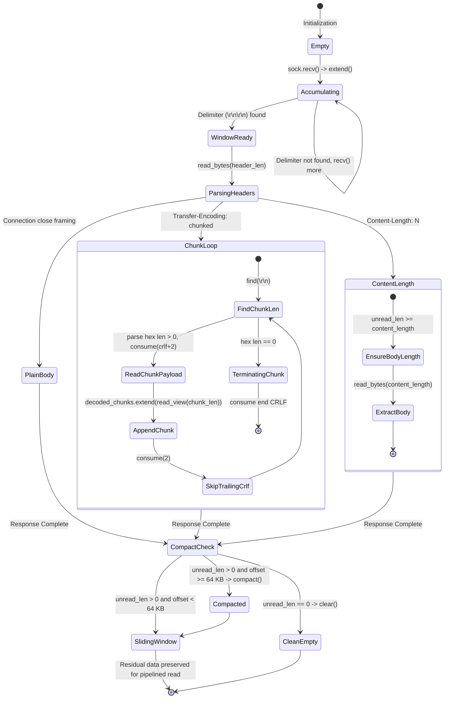

# PYPOST-1432: Zero-Copy Memory Optimization for RawTcpWireClient

## Research

### Current State Analysis

In [PYPOST-1428](file:///home/src/ai-tasks/PYPOST-1428/20-architecture.md), [`RawTcpWireClient`](file:///home/src/tests/helpers/raw_tcp_client.py#L20-L291) was extracted to `tests/helpers/raw_tcp_client.py` as a shared test utility for wire-level HTTP/1.1 and MCP streamable transport testing. It simulates physical TCP transport, packet fragmentation, pipelined requests, and keep-alive response consumption.

Analysis of the response reading loop in [`RawTcpWireClient.read_http_response()`](file:///home/src/tests/helpers/raw_tcp_client.py#L185-L290) reveals significant memory allocation churn and repetitive buffer copying:

```python
# tests/helpers/raw_tcp_client.py (lines 204-289)
buf = self._unread_buffer

while b"\r\n\r\n" not in buf:
    chunk = self.sock.recv(4096)
    ...
    buf.extend(chunk)

header_part, _, body_prefix = buf.partition(b"\r\n\r\n")  # Copies remaining buffer into body_prefix
...
body = bytearray(body_prefix)  # Second full copy of remaining buffer

if "chunked" in transfer_encoding:
    decoded_chunks = bytearray()
    while True:
        ...
        chunk_content = body[crlf + 2:crlf + 2 + chunk_len]  # Slice copy
        decoded_chunks.extend(chunk_content)
        body = body[crlf + 2 + chunk_len + 2:]  # Re-allocates & copies ENTIRE remaining body!
    return status_code, headers, bytes(decoded_chunks)

elif content_length_str is not None:
    ...
    self._unread_buffer = body[content_length:]  # Slice copy of trailing bytes
    return status_code, headers, bytes(body[:content_length])
```

#### The $O(N^2)$ Slicing Bottleneck

1. **Header Splitting**: `buf.partition(b"\r\n\r\n")` constructs three new byte objects: the header bytes, delimiter, and `body_prefix`. Immediately afterward, `body = bytearray(body_prefix)` creates another duplicate in memory.
2. **Iterative Chunk Slicing**: In HTTP/1.1 `Transfer-Encoding: chunked` streams, each chunk iteration executes `body = body[crlf + 2 + chunk_len + 2:]`.
   - If a stream contains $M$ chunks over total length $N$, every single chunk re-slices and copies the entire remaining byte array.
   - For an average chunk size $C$, iteration $k$ copies $(M - k) \times C$ bytes.
   - Total memory copied across all iterations:
     $$\sum_{k=1}^M (M - k) \times C \approx \frac{M^2 \times C}{2} = \frac{M \times N}{2} \in O(M \cdot N)$$
   - In high-throughput fuzzing or multi-megabyte burst test suites (e.g., 10,000 chunks of 100 bytes = 1 MB payload), this copies $\approx 5\text{ GB}$ of transient memory allocations, triggering severe Garbage Collection (GC) pressure, thread stalls, and false-positive test timeouts.
3. **Pipelining Trailing Buffer Slicing**: When responses are pipelined on a persistent TCP connection, `self._unread_buffer = body[content_length:]` creates an additional allocation and copy of all trailing response bytes.

### Python `memoryview` Constraints & Invariants

Python's built-in `memoryview` enables non-copying slice windows over objects supporting the Python Buffer Protocol (`bytes`, `bytearray`). However, `bytearray` exhibits specific runtime constraints when exported via `memoryview`:

1. **Buffer Export Lock (`BufferError`)**:
   - When `memoryview(bytearray)` is created, CPython sets the internal export counter (`ob_exports > 0`).
   - Any mutating operation that resizes the underlying buffer (`extend`, `append`, `del`, `clear`, slice assignment) fails immediately with:
     ```
     BufferError: Existing exports of data: object cannot be re-sized
     ```
   - Therefore, a long-lived `memoryview` cannot remain bound to the `bytearray` while network socket reads (`sock.recv()`) append newly arrived bytes into that same `bytearray`.
2. **Buffer Release Lifecycle**:
   - Calling `view.release()` (or using `with memoryview(...) as view:`) decrements `ob_exports`. Once `ob_exports == 0`, the `bytearray` can be extended, truncated, or resized freely.
3. **Slicing Memoryviews**:
   - Slicing a `memoryview` (`view[start:end]`) produces a new `memoryview` pointing directly to the existing buffer memory in $O(1)$ time with 0 byte copying.
   - Slices can be passed to functions accepting buffer-compatible arguments, such as `bytearray.extend(view_slice)` or `bytes(view_slice)`.

### Architectural Alternatives

Two zero-copy architectures were evaluated:

| Criterion | Option A: Offset Pointer Windowing directly in `RawTcpWireClient` | Option B: Dedicated `ZeroCopyStreamBuffer` Class (Selected) |
| --- | --- | --- |
| **Encapsulation** | Low: Exposes offset state, compaction flags, and view tracking directly inside client network methods. | High: Buffer accumulation, sliding offset, zero-copy slicing, and compaction are isolated in a reusable, self-contained component. |
| **BufferError Safety** | Error-prone: Sockets reading into `self._unread_buffer` must manually ensure no local `memoryview` variables are active. | Guaranteed: `ZeroCopyStreamBuffer` encapsulates all buffer mutations (`extend`, `compact`, `consume`), ensuring views are never held during resizes. |
| **Compaction Policy** | Ad-hoc: Compaction logic mixed into HTTP status and chunk parsing loops. | Deterministic: Configurable compaction threshold (e.g. 64 KB) amortizes memory cleanup with $O(1)$ sliding window advancement. |
| **Backward Compatibility** | Direct access to `self._unread_buffer` might expose full buffer including consumed bytes. | Complete: A `@property` for `_unread_buffer` presents the exact unconsumed byte slice as a `bytearray`, preserving all existing test assertions. |
| **Unit Testability (Step 3)** | Harder to test in isolation: Requires mocking sockets or HTTP responses to verify buffer allocation behavior. | Clean & Targeted: `ZeroCopyStreamBuffer` can be tested independently for zero-copy slicing, allocation avoidance, and compaction metrics. |

**Selected Architecture**: **Option B** — Encapsulate buffer management in a dedicated `ZeroCopyStreamBuffer` class inside `tests/helpers/raw_tcp_client.py`, and integrate it cleanly into [`RawTcpWireClient`](file:///home/src/tests/helpers/raw_tcp_client.py#L20-L291).

### Caller & Test Suite Analysis

Inspection of callers across the codebase:
- [`tests/test_raw_tcp_client_helper.py`](file:///home/src/tests/test_raw_tcp_client_helper.py#L58): Directly asserts `client._unread_buffer == bytearray()` and `client._unread_buffer == bytearray(b"EXTRA_BUFFER")`. The `@property _unread_buffer` ensures 100% backward compatibility for these assertions.
- [`tests/test_mcp_standalone_wire_ipc_repro.py`](file:///home/src/tests/test_mcp_standalone_wire_ipc_repro.py): Consumes `client.read_http_response() -> tuple[int, dict[str, str], bytes]`. No internal buffer inspection.
- [`tests/test_mcp_wire_fuzzing_negative.py`](file:///home/src/tests/test_mcp_wire_fuzzing_negative.py): High-frequency fragmented and corrupted stream injection. Requires strict delimiter detection and error resilience.
- [`tests/test_mcp_standalone_wire_ipv6.py`](file:///home/src/tests/test_mcp_standalone_wire_ipv6.py): Validates IPv6 loopback socket binding and request framing.

---

## Implementation Plan

### High-Level Sequencing

```
Step 1: Requirements Gathering (Complete)
   │
Step 2: High-Level Architecture Design (Current Step)
   │
Step 3: Automated Failing Repro Test (Red)
   │   └─ Create tests/test_raw_tcp_client_zerocopy.py
   │   └─ Assert zero-copy windowing invariants, memory allocation avoidance, and BufferError safety
   │   └─ Verify red test failure before implementation
   │
Step 4: Development (Green)
   │   ├─ Implement ZeroCopyStreamBuffer in tests/helpers/raw_tcp_client.py
   │   ├─ Refactor RawTcpWireClient to use ZeroCopyStreamBuffer
   │   ├─ Expose backward-compatible _unread_buffer property
   │   └─ Verify green state across test_raw_tcp_client_zerocopy.py and all existing test suites
   │
Step 5: Code Cleanup
   │   └─ Run make lint, check flake8 compliance, verify docstrings
   │
Step 6: Observability
   │   └─ Document buffer compaction diagnostics and window tracking metrics
   │
Step 7: Technical Debt Analysis
   │   └─ Analyze memory efficiency and record in 60-tech-debt.md
   │
Step 8: Dev Docs & Commit
   │   └─ Document zero-copy stream buffer architecture in doc/dev/
```

### Mandatory — Failing Repro (next Step 3)

- **Test File**: `tests/test_raw_tcp_client_zerocopy.py`
- **What it Asserts**:
  1. **Zero-Copy Chunk Parsing**: Verifies that parsing a large chunked response (e.g. 1,000 chunks) does not create intermediate sliced bytearray reallocations for remaining unconsumed data.
  2. **Offset Window Tracking**: Verifies that `ZeroCopyStreamBuffer` advances its read offset in $O(1)$ time without shifting or duplicating the unread buffer.
  3. **Amortized Buffer Compaction**: Verifies that when `read_offset` exceeds the compaction threshold (64 KB) and all active views are cleared, memory is compacted and old consumed bytes are freed.
  4. **`BufferError` Resilience**: Verifies that interleaved socket reads (`extend()`) and slice extraction do not trigger `BufferError: Existing exports of data: object cannot be re-sized`.
  5. **Pipelined Stream Residual Integrity**: Verifies that multiple HTTP responses on the same stream preserve residual bytes seamlessly across consecutive `read_http_response()` calls.
  6. **Backward Compatibility**: Verifies that `client._unread_buffer` matches `bytearray` content as expected by existing helper tests.
- **Forced Failure Mechanism**: In Step 3, importing `ZeroCopyStreamBuffer` from `tests.helpers.raw_tcp_client` or asserting zero-copy window properties on `RawTcpWireClient` before implementation will fail with `ImportError` / `AttributeError`.
- **Isolation**: Runs fully in-memory using mocked sockets or synthetic byte streams, requiring zero live network services.

---

## Architecture

### System Module Diagram

```mermaid
flowchart TD
    subgraph Socket Layer
        Sock["socket.socket (TCP Wire Stream)"]
    end

    subgraph RawTcpWireClient
        Client["RawTcpWireClient"]
        Prop["@property _unread_buffer<br/>(Backward Compatibility)"]
    end

    subgraph ZeroCopyStreamBuffer
        Buffer["ZeroCopyStreamBuffer"]
        Raw["_raw: bytearray<br/>(Underlying Contiguous Buffer)"]
        Offset["_read_offset: int<br/>(Current Window Head Pointer)"]
        Threshold["_compact_threshold: int<br/>(Default: 64 KB)"]
        
        DelimFind["find(sub, start)<br/>Searches _raw from _read_offset"]
        SliceView["read_view(length)<br/>Produces scoped memoryview"]
        SliceBytes["read_bytes(length)<br/>Copies payload slice"]
        Advance["consume(length)<br/>Advances _read_offset by length"]
        Extend["extend(chunk)<br/>Appends socket bytes to _raw"]
        Compact["compact()<br/>del _raw[:_read_offset] when threshold exceeded"]
    end

    subgraph HTTP Decoding Engine
        HeaderParse["read_http_response()<br/>Header Delimiter Search (\r\n\r\n)"]
        ChunkParse["Chunked Decoding Loop<br/>Hex size search & zero-copy extraction"]
        CLParse["Content-Length Decoding<br/>Single-slice payload extraction"]
        Residual["Residual Stream Preservation<br/>Window Head preserved for next call"]
    end

    Sock -->|recv(4096)| Extend
    Extend --> Raw
    Client --> Buffer
    Client --> Prop
    Prop -.->|returns bytearray view| Raw

    HeaderParse --> DelimFind
    HeaderParse --> SliceBytes
    ChunkParse --> DelimFind
    ChunkParse --> SliceView
    ChunkParse --> Advance
    CLParse --> SliceBytes
    CLParse --> Advance

    Advance --> Offset
    Offset -.->|Offset > 64 KB| Compact
    Compact --> Raw
    Residual --> Offset
```

### Module & Component Responsibilities

| Component | Responsibility |
| --- | --- |
| **`ZeroCopyStreamBuffer`** | Encapsulates the contiguous byte stream, sliding window read offset, delimiter search operations, non-copying slice extraction, and safe compaction. Guarantees that internal buffer expansions and compactions never trigger `BufferError`. |
| **`RawTcpWireClient`** | Manages socket connection lifecycle, HTTP request serialization, fragmented transmission, and delegates all stream accumulation and framing consumption to `ZeroCopyStreamBuffer`. |
| **`@property _unread_buffer`** | Provides backward compatibility for legacy test assertions, returning the unconsumed buffer window as a `bytearray`. |
| **`read_http_response()`** | Parses HTTP/1.1 response status, headers, and bodies (chunked and Content-Length) by querying `ZeroCopyStreamBuffer` window slices without duplicating remaining stream bytes. |

### Component Interface Specifications

#### 1. `ZeroCopyStreamBuffer` Interface

```python
class ZeroCopyStreamBuffer:
    """Zero-copy stream buffer with sliding read window and amortized compaction.

    Avoids O(N^2) memory copying during iterative stream framing and chunked payload parsing.
    """

    def __init__(
        self,
        initial: bytes | bytearray | None = None,
        compact_threshold: int = 65536,
    ) -> None:
        """Initialize buffer with optional initial content and compaction threshold.

        Args:
            initial: Optional initial byte sequence.
            compact_threshold: Number of consumed bytes before buffer compaction is triggered (default 64 KB).
        """
        ...

    @property
    def unread_len(self) -> int:
        """Return number of unconsumed bytes remaining in the active window."""
        ...

    @property
    def read_offset(self) -> int:
        """Return the current read window head offset."""
        ...

    def extend(self, data: bytes | bytearray | memoryview) -> None:
        """Append newly received socket bytes to the underlying buffer.

        Args:
            data: Incoming byte sequence from socket read.
        """
        ...

    def find(self, sub: bytes, start: int = 0) -> int:
        """Search for byte sequence starting from the current read offset.

        Args:
            sub: Target delimiter sequence to locate.
            start: Offset relative to the active window head (default 0).

        Returns:
            Index of the first match relative to active window head, or -1 if not found.
        """
        ...

    def read_bytes(self, length: int) -> bytes:
        """Extract a slice of bytes from the window and advance the read offset.

        Args:
            length: Number of bytes to consume and return.

        Returns:
            Extracted bytes object.
        """
        ...

    def read_view(self, length: int) -> memoryview:
        """Return a non-copying memoryview slice and advance the read offset.

        Args:
            length: Number of bytes to slice.

        Returns:
            memoryview slice over the active window.
        """
        ...

    def consume(self, length: int) -> None:
        """Advance read offset without returning data (e.g. skipping CRLF delimiters).

        Args:
            length: Number of bytes to skip.
        """
        ...

    def compact(self, force: bool = False) -> None:
        """Discard consumed bytes preceding read offset when threshold is exceeded.

        Args:
            force: If True, compacts immediately regardless of threshold.
        """
        ...

    def clear(self) -> None:
        """Reset buffer and read offset to empty state."""
        ...

    def unread_bytes(self) -> bytes:
        """Return all remaining unconsumed bytes as an immutable bytes object."""
        ...

    def unread_bytearray(self) -> bytearray:
        """Return all remaining unconsumed bytes as a bytearray for backward compatibility."""
        ...
```

#### 2. `RawTcpWireClient` Updates

```python
class RawTcpWireClient:
    def __init__(
        self,
        host: str,
        port: int,
        timeout: float = 10.0,
        family: socket.AddressFamily | None = None,
    ) -> None:
        ...
        self._stream_buffer = ZeroCopyStreamBuffer()

    @property
    def _unread_buffer(self) -> bytearray:
        """Backward-compatible access to unconsumed stream buffer."""
        return self._stream_buffer.unread_bytearray()

    @_unread_buffer.setter
    def _unread_buffer(self, data: bytes | bytearray) -> None:
        """Backward-compatible setter for unconsumed stream buffer."""
        self._stream_buffer = ZeroCopyStreamBuffer(data)

    def read_http_response(self) -> tuple[int, dict[str, str], bytes]:
        """Read a single complete HTTP/1.1 response using zero-copy stream buffer windowing."""
        ...
```

### Buffer Lifecycle State Machine



### Complexity Comparison

| Operation | Previous Implementation (`bytearray` Slicing) | Optimized Implementation (`ZeroCopyStreamBuffer`) |
| --- | --- | --- |
| Header extraction | $O(N)$ allocation & partition + $O(N)$ copy to `body` | $O(1)$ window slice, 1 copy only for decoded header string |
| Chunk iteration slicing | $O(N - k)$ full array copy per chunk $\to O(M \cdot N)$ total | $O(1)$ read pointer advancement $\to O(N)$ linear payload copy |
| Trailing buffer slicing | $O(R)$ bytearray copy for $R$ residual bytes | $O(1)$ window pointer retention, 0 memory copies |
| Memory compaction | Implicit $O(N)$ on every slice | Amortized $O(1)$, executes only once after 64 KB consumed |
| Peak memory overhead | Up to $3\times$ to $5\times$ total response size | $\approx 1\times$ response size (payload buffer + socket chunk) |

---

## Q&A

**Q: Why use an offset pointer window instead of slicing `bytearray` directly?**  
A: In Python, slicing a `bytearray` (`buf[offset:]`) allocates a completely new `bytearray` object and copies all elements. Advancing an integer offset pointer (`self._read_offset += count`) takes $O(1)$ time and allocates 0 bytes.

**Q: Why encapsulate buffer operations in `ZeroCopyStreamBuffer` rather than keeping raw offset integers in `RawTcpWireClient`?**  
A: Encapsulating buffer mechanics into `ZeroCopyStreamBuffer` separates wire transport concerns (socket connections, timeouts, HTTP framing) from low-level memory layout. It also allows `ZeroCopyStreamBuffer` to safely manage the `BufferError` invariant when mutating `bytearray` and enables isolated unit testing of zero-copy invariants in Step 3.

**Q: How does the architecture avoid Python's `BufferError: Existing exports of data: object cannot be re-sized`?**  
A: Slices extracted via `read_view()` are used locally within synchronous chunk decoding scopes and immediately appended to `decoded_chunks`. No long-lived `memoryview` instances are stored across `sock.recv()` socket reads or `compact()` calls. Furthermore, `extend()` and `compact()` operate only when no active views are exported.

**Q: How does compaction prevent unbounded memory growth during long keep-alive sessions?**  
A: If a persistent client receives hundreds of pipelined responses, the consumed prefix before `_read_offset` would otherwise remain allocated in memory. `compact()` shifts the unconsumed bytes to index 0 via `del self._raw[:self._read_offset]` and resets `_read_offset = 0` whenever `_read_offset >= compact_threshold` (64 KB), ensuring bounded memory retention.

**Q: Will this break tests that directly assert `client._unread_buffer == bytearray(...)`?**  
A: No. `RawTcpWireClient._unread_buffer` is exposed as a Python `@property` returning `self._stream_buffer.unread_bytearray()`. Legacy tests inspecting `_unread_buffer` continue to receive the exact unconsumed byte slice as a standard `bytearray`.
