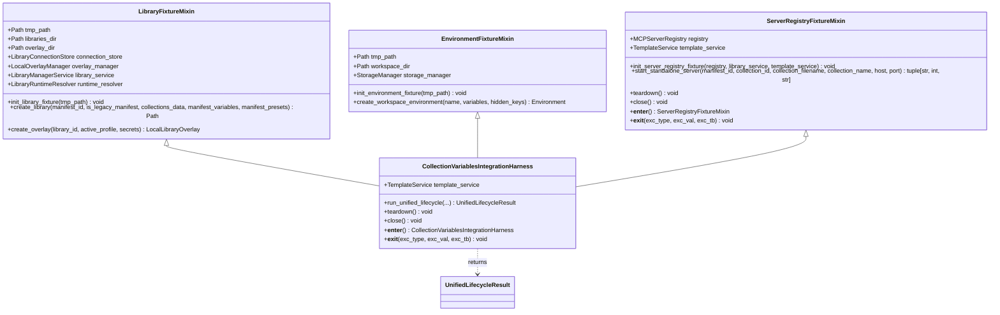

# PYPOST-1433: Modular Harness Architecture and Mixin Decomposition

## Research

### Existing Monolithic Architecture Analysis

The existing integration harness in [tests/helpers/collection_integration_harness.py](file:///home/src/tests/helpers/collection_integration_harness.py) (established in [PYPOST-1417](https://pypost.atlassian.net/browse/PYPOST-1417)) encapsulates test infrastructure spanning 416 lines of code. It provides an all-in-one testing harness [`CollectionVariablesIntegrationHarness`](file:///home/src/tests/helpers/collection_integration_harness.py#L54-L382) that initializes three distinct directory trees and five interconnected subsystem services in its constructor:

```python
self.libraries_dir = tmp_path / "libraries"
self.workspace_dir = tmp_path / "workspace"
self.overlay_dir = tmp_path / "libraries_data"

self.storage_manager = StorageManager(data_dir=self.workspace_dir)
self.connection_store = LibraryConnectionStore(self.tmp_path / "connections.json")
self.overlay_manager = LocalOverlayManager(self.overlay_dir)
self.template_service = TemplateService()
self.library_service = LibraryManagerService(...)
self.runtime_resolver = LibraryRuntimeResolver(...)
self.registry = MCPServerRegistry(...)
```

Downstream consumers of this harness include:
1. [tests/test_collection_integration_harness_repro.py](file:///home/src/tests/test_collection_integration_harness_repro.py): Verifies harness importability, directory creation, context manager teardown, pytest fixture lifecycle, end-to-end multi-subsystem workflow orchestration, and structured log message emissions.
2. [tests/test_collection_scoped_variables_integration.py](file:///home/src/tests/test_collection_scoped_variables_integration.py): Uses the harness to construct 4-quadrant compatibility matrices (legacy v1 vs modern v2 catalogs and collections), testing variable resolution, preset overlays, and template rendering.
3. [tests/test_mcp_concurrent_multiserver_repro.py](file:///home/src/tests/test_mcp_concurrent_multiserver_repro.py): Uses the harness to spin up multiple standalone MCP servers concurrently, asserting port collision avoidance, TCP readiness polling, and process lifecycle teardown.

### Identified Coupling and Domain Boundaries

The existing harness tightly couples three fundamentally distinct concerns:
1. **Library & Manifest Management (`LibraryFixtureMixin`)**:
   - Manages `libraries_dir` and `overlay_dir`.
   - Owns `connection_store`, `overlay_manager`, `library_service`, and `runtime_resolver`.
   - Builds library catalog manifests (legacy v1 format with inline variables/presets or modern v2 catalog manifests), collection JSON files, and overlay records (`LocalLibraryOverlay`).
2. **Environment & Storage Management (`EnvironmentFixtureMixin`)**:
   - Manages `workspace_dir` and the underlying `storage_manager`.
   - Creates, configures, and saves isolated `Environment` entities with variables and hidden keys.
3. **Server Registry & Lifecycle Management (`ServerRegistryFixtureMixin`)**:
   - Manages `registry` (`MCPServerRegistry`).
   - Handles dynamic port allocation via [`allocate_tcp_port`](file:///home/src/tests/helpers/port_allocation.py#L25-L60), configuration construction (`McpServerConfiguration`), candidate registration, process startup, readiness polling, and idempotent server shutdown (`teardown`, `close`).

### Inheritance and Composition Model

To guarantee 100% backward compatibility with all existing tests without breaking changes:
- `CollectionVariablesIntegrationHarness` will inherit from `LibraryFixtureMixin`, `EnvironmentFixtureMixin`, and `ServerRegistryFixtureMixin`.
- In addition to standard cooperative multiple inheritance `__init__(**kwargs)`, each mixin will provide an explicit initializer method (`init_library_fixture`, `init_environment_fixture`, `init_server_registry_fixture`). This allows mixins to be initialized cooperatively in subclasses while also enabling standalone instantiation without requiring the other mixins.
- All existing public attributes (`tmp_path`, `libraries_dir`, `workspace_dir`, `overlay_dir`, `storage_manager`, `connection_store`, `overlay_manager`, `template_service`, `library_service`, `runtime_resolver`, `registry`) and methods (`create_library`, `create_workspace_environment`, `create_overlay`, `start_standalone_server`, `run_unified_lifecycle`, `teardown`, `close`, `__enter__`, `__exit__`) are preserved on the composite class with identical signatures and log contracts.

### Standalone Mixin Usage

Test authors will be able to instantiate and use any mixin individually or in partial combinations:
- **`LibraryFixtureMixin(tmp_path)`**: Used in isolated manifest parsing or overlay serialization tests. It creates only `libraries_dir` and `overlay_dir`, without creating `workspace_dir` or starting an MCP registry.
- **`EnvironmentFixtureMixin(tmp_path)`**: Used in storage and variable persistence tests. It creates only `workspace_dir` and `storage_manager`, without touching library catalogs or MCP servers.
- **`ServerRegistryFixtureMixin(tmp_path=..., library_service=..., template_service=...)`**: Used in registry process lifecycle or port conflict tests. It manages `registry`, process startup, and automatic teardown without requiring catalog files on disk.

## Implementation Plan

1. **Step 3: Failing Repro Test (`tests/test_collection_harness_mixins.py`)**:
   - Create an automated test suite asserting the importability and standalone functionality of `LibraryFixtureMixin`, `EnvironmentFixtureMixin`, and `ServerRegistryFixtureMixin`, as well as their inheritance hierarchy under `CollectionVariablesIntegrationHarness`.
   - Fails before Step 4 with `ImportError: cannot import name 'LibraryFixtureMixin' from 'tests.helpers.collection_integration_harness'`.
2. **Step 4: Mixin Decomposition and Integration**:
   - Define `LibraryFixtureMixin` in [tests/helpers/collection_integration_harness.py](file:///home/src/tests/helpers/collection_integration_harness.py) with isolated catalog, collection, and overlay management.
   - Define `EnvironmentFixtureMixin` in [tests/helpers/collection_integration_harness.py](file:///home/src/tests/helpers/collection_integration_harness.py) with isolated workspace environment storage.
   - Define `ServerRegistryFixtureMixin` in [tests/helpers/collection_integration_harness.py](file:///home/src/tests/helpers/collection_integration_harness.py) with MCP server candidate startup, readiness polling, context manager, and teardown.
   - Refactor `CollectionVariablesIntegrationHarness` to inherit from all three mixins, providing `run_unified_lifecycle` and composite context management while preserving all existing log messages and attributes.
   - Update `__all__` to export `LibraryFixtureMixin`, `EnvironmentFixtureMixin`, `ServerRegistryFixtureMixin`, `CollectionVariablesIntegrationHarness`, `UnifiedLifecycleResult`, `collection_harness`, and `collection_integration_harness`.
3. **Verification**:
   - Run red repro test in Step 3 to confirm expected failure.
   - Run green repro test and existing consumer test suites in Step 4 via `make test`.
   - Validate static quality gates via `make lint`, `make typecheck`, and `make verify-ai-tasks`.

**Mandatory — Failing Repro (next Step 3):**
- **Test file**: `tests/test_collection_harness_mixins.py`
- **What it asserts**:
  1. `test_standalone_library_fixture_mixin`: Imports and instantiates `LibraryFixtureMixin(tmp_path)` standalone. Asserts `libraries_dir` and `overlay_dir` exist, `create_library` creates valid manifests and collections, and `create_overlay` creates persistent overlay records, without initializing `storage_manager` or `registry`.
  2. `test_standalone_environment_fixture_mixin`: Imports and instantiates `EnvironmentFixtureMixin(tmp_path)` standalone. Asserts `workspace_dir` exists and `create_workspace_environment` creates and loads persistent environments, without creating `libraries_dir` or `registry`.
  3. `test_standalone_server_registry_fixture_mixin`: Imports and instantiates `ServerRegistryFixtureMixin()` standalone with context management. Asserts `registry` is initialized, context manager enters and exits cleanly, and `teardown()` executes idempotently.
  4. `test_composite_harness_inheritance_and_backward_compatibility`: Asserts `issubclass(CollectionVariablesIntegrationHarness, (LibraryFixtureMixin, EnvironmentFixtureMixin, ServerRegistryFixtureMixin))`, and validates that all legacy attributes, methods, context managers, and log signatures remain intact.
  5. `test_partial_custom_composition`: Asserts that a custom fixture class can compose `LibraryFixtureMixin` and `EnvironmentFixtureMixin` without `ServerRegistryFixtureMixin`.
- **Failure mechanism**: Fails immediately upon import with `ImportError: cannot import name 'LibraryFixtureMixin' from 'tests.helpers.collection_integration_harness'`, as these mixin classes do not yet exist in the codebase.
- **Sequencing**: Write red repro test in Step 3 -> observe `ImportError` -> implement mixins in Step 4 -> verify green across all unit and integration suites.

## Architecture

### System Module Diagram



### Module Responsibilities Breakdown

#### 1. `LibraryFixtureMixin`
- **File**: [tests/helpers/collection_integration_harness.py](file:///home/src/tests/helpers/collection_integration_harness.py)
- **Primary Responsibility**: Isolated filesystem catalog, collection, and overlay management.
- **State Managed**:
  - `libraries_dir: Path` — Directory storing library folders and collection JSON definitions.
  - `overlay_dir: Path` — Directory storing local overlay configuration and secret data.
  - `connection_store: LibraryConnectionStore` — Connection metadata store.
  - `overlay_manager: LocalOverlayManager` — Local overlay persistence manager.
  - `library_service: LibraryManagerService` — Service coordinating library discovery and local connection bindings.
  - `runtime_resolver: LibraryRuntimeResolver` — Resolver mapping library collections to runtime variables.
- **Methods**:
  - `init_library_fixture(self, tmp_path: Path) -> None`: Prepares library directories and initializes library services.
  - `create_library(...) -> Path`: Writes catalog manifest (v1 or v2) and collection JSON files, registering them with `library_service`.
  - `create_overlay(...) -> LocalLibraryOverlay`: Saves active profile and secret mappings in `overlay_manager`.

#### 2. `EnvironmentFixtureMixin`
- **File**: [tests/helpers/collection_integration_harness.py](file:///home/src/tests/helpers/collection_integration_harness.py)
- **Primary Responsibility**: Isolated workspace environment creation and variable storage.
- **State Managed**:
  - `workspace_dir: Path` — Directory storing persistent environment JSON files.
  - `storage_manager: StorageManager` — Low-level storage manager writing workspace environments to disk.
- **Methods**:
  - `init_environment_fixture(self, tmp_path: Path) -> None`: Prepares workspace directory and initializes `storage_manager`.
  - `create_workspace_environment(name: str = "Test Env", variables: dict[str, str] | None = None, hidden_keys: set[str] | None = None) -> Environment`: Constructs, validates, and persists an `Environment` entity.

#### 3. `ServerRegistryFixtureMixin`
- **File**: [tests/helpers/collection_integration_harness.py](file:///home/src/tests/helpers/collection_integration_harness.py)
- **Primary Responsibility**: Standalone MCP server configuration, network port binding, process startup, readiness verification, and guaranteed teardown.
- **State Managed**:
  - `registry: MCPServerRegistry` — Central MCP server lifecycle and state registry.
  - `template_service: TemplateService` — Optional template rendering service used during candidate resolution.
- **Methods**:
  - `init_server_registry_fixture(registry: MCPServerRegistry | None = None, library_service: Any = None, template_service: TemplateService | None = None) -> None`: Initializes or binds `registry`.
  - `start_standalone_server(...) -> tuple[str, int, str]`: Generates unique server ID, dynamically allocates an available TCP port, registers candidate in `registry`, starts process, and polls readiness state up to 5 seconds.
  - `teardown() -> None`: Idempotently stops all running servers via `self.registry.stop_all()`.
  - `close() -> None`: Alias for `teardown()`.
  - `__enter__()` / `__exit__()`: Context management ensuring guaranteed resource release.

#### 4. `CollectionVariablesIntegrationHarness` (Composite Class)
- **File**: [tests/helpers/collection_integration_harness.py](file:///home/src/tests/helpers/collection_integration_harness.py)
- **Primary Responsibility**: High-level test fixture aggregating all mixin capabilities and orchestrating end-to-end multi-subsystem workflows.
- **Inheritance**: `class CollectionVariablesIntegrationHarness(LibraryFixtureMixin, EnvironmentFixtureMixin, ServerRegistryFixtureMixin):`
- **Methods**:
  - `__init__(tmp_path: Path) -> None`: Sequentially initializes `LibraryFixtureMixin`, `EnvironmentFixtureMixin`, and `ServerRegistryFixtureMixin`, preserving exact logging: `"Initialized CollectionVariablesIntegrationHarness at root=%s"`.
  - `run_unified_lifecycle(...) -> UnifiedLifecycleResult`: Drives end-to-end multi-subsystem workflow across catalog discovery, standalone server startup, collection reading, environment import, and template rendering.
  - `teardown() -> None`: Logs `"Tearing down harness and stopping all registered servers"` and calls `super().teardown()`.
  - `close() -> None`: Delegates to `teardown()`.
  - `__enter__()` / `__exit__()`: Preserves harness-level context logging and exception handling.

### Detailed Interface Definitions

```python
class LibraryFixtureMixin:
    """Mixin providing isolated catalog manifest, collection, and overlay management."""

    tmp_path: Path
    libraries_dir: Path
    overlay_dir: Path
    connection_store: LibraryConnectionStore
    overlay_manager: LocalOverlayManager
    library_service: LibraryManagerService
    runtime_resolver: LibraryRuntimeResolver

    def __init__(self, tmp_path: Path | None = None, **kwargs: Any) -> None: ...
    def init_library_fixture(self, tmp_path: Path) -> None: ...
    def create_library(
        self,
        manifest_id: str,
        is_legacy_manifest: bool = False,
        collections_data: dict[str, dict[str, Any]] | None = None,
        manifest_variables: list[CollectionVariable] | None = None,
        manifest_presets: dict[str, dict[str, Any]] | None = None,
    ) -> Path: ...
    def create_overlay(
        self,
        library_id: str,
        active_profile: str = "",
        secrets: dict[str, str] | None = None,
    ) -> LocalLibraryOverlay: ...


class EnvironmentFixtureMixin:
    """Mixin providing isolated workspace environment creation and storage management."""

    tmp_path: Path
    workspace_dir: Path
    storage_manager: StorageManager

    def __init__(self, tmp_path: Path | None = None, **kwargs: Any) -> None: ...
    def init_environment_fixture(self, tmp_path: Path) -> None: ...
    def create_workspace_environment(
        self,
        name: str = "Test Env",
        variables: dict[str, str] | None = None,
        hidden_keys: set[str] | None = None,
    ) -> Environment: ...


class ServerRegistryFixtureMixin:
    """Mixin providing standalone MCP server candidate startup, readiness polling, and teardown."""

    registry: MCPServerRegistry
    template_service: TemplateService

    def __init__(
        self,
        *,
        registry: MCPServerRegistry | None = None,
        library_service: Any = None,
        template_service: TemplateService | None = None,
        tmp_path: Path | None = None,
        **kwargs: Any,
    ) -> None: ...
    def init_server_registry_fixture(
        self,
        *,
        registry: MCPServerRegistry | None = None,
        library_service: Any = None,
        template_service: TemplateService | None = None,
    ) -> None: ...
    def start_standalone_server(
        self,
        manifest_id: str,
        collection_id: str,
        collection_filename: str | None = None,
        collection_name: str | None = None,
        host: str = "127.0.0.1",
        port: int | None = None,
    ) -> tuple[str, int, str]: ...
    def teardown(self) -> None: ...
    def close(self) -> None: ...
    def __enter__(self) -> ServerRegistryFixtureMixin: ...
    def __exit__(
        self,
        exc_type: type[BaseException] | None,
        exc_val: BaseException | None,
        exc_tb: types.TracebackType | None,
    ) -> None: ...


class CollectionVariablesIntegrationHarness(
    LibraryFixtureMixin,
    EnvironmentFixtureMixin,
    ServerRegistryFixtureMixin,
):
    """Composite multi-subsystem integration harness combining library, environment,

    and server registry fixtures with end-to-end workflow orchestration.
    """

    tmp_path: Path
    template_service: TemplateService

    def __init__(self, tmp_path: Path) -> None: ...
    def run_unified_lifecycle(
        self,
        *,
        manifest_id: str,
        collection_data: dict[str, Any],
        active_profile: str,
        overlay_secrets: dict[str, str],
        workspace_env_name: str,
        conflict_strategy: ConflictStrategy,
    ) -> UnifiedLifecycleResult: ...
    def teardown(self) -> None: ...
    def close(self) -> None: ...
    def __enter__(self) -> CollectionVariablesIntegrationHarness: ...
    def __exit__(
        self,
        exc_type: type[BaseException] | None,
        exc_val: BaseException | None,
        exc_tb: types.TracebackType | None,
    ) -> None: ...
```

## Q&A

- **Q: Why use multiple inheritance mixins rather than pure composition (delegating via attributes)?**
  A: Existing test suites across [tests/test_collection_integration_harness_repro.py](file:///home/src/tests/test_collection_integration_harness_repro.py), [tests/test_collection_scoped_variables_integration.py](file:///home/src/tests/test_collection_scoped_variables_integration.py), and [tests/test_mcp_concurrent_multiserver_repro.py](file:///home/src/tests/test_mcp_concurrent_multiserver_repro.py) access methods and attributes directly on the harness instance (`harness.create_library`, `harness.create_workspace_environment`, `harness.start_standalone_server`, `harness.storage_manager`, `harness.registry`, etc.). Python multiple inheritance mixins satisfy 100% backward compatibility without requiring dozens of boilerplate forwarding properties or breaking caller expectations.

- **Q: Can `ServerRegistryFixtureMixin` run standalone without library catalog files on disk?**
  A: Yes. `ServerRegistryFixtureMixin` defaults to creating a standalone `MCPServerRegistry` and `TemplateService` if not provided. When used standalone, tests can test generic MCP server candidates, dynamic port allocation, and process lifecycle without writing any manifest or catalog files to disk. When composed with `LibraryFixtureMixin`, it automatically connects to `self.library_service`.

- **Q: How does the mixin design ensure deterministic teardown safety?**
  A: `ServerRegistryFixtureMixin` implements `teardown()` and context manager hooks (`__enter__`/`__exit__`). If a test author uses `ServerRegistryFixtureMixin` standalone (e.g. `with ServerRegistryFixtureMixin() as server_fix:`), all started background servers are stopped upon context exit. When composed inside `CollectionVariablesIntegrationHarness`, the composite class's `teardown()` and context manager delegate to `ServerRegistryFixtureMixin.teardown()`, ensuring backward-compatible log messages and guaranteed process cleanup.

- **Q: How will the failing repro test in Step 3 ensure the implementation is verified before and after?**
  A: The red test file `tests/test_collection_harness_mixins.py` will explicitly import `LibraryFixtureMixin`, `EnvironmentFixtureMixin`, and `ServerRegistryFixtureMixin` from `tests.helpers.collection_integration_harness`. Before Step 4 is implemented, the module only exports `CollectionVariablesIntegrationHarness`, `UnifiedLifecycleResult`, `collection_harness`, and `collection_integration_harness`, causing `ImportError` on import. In Step 4, implementing and exporting the mixins turns the test green.
