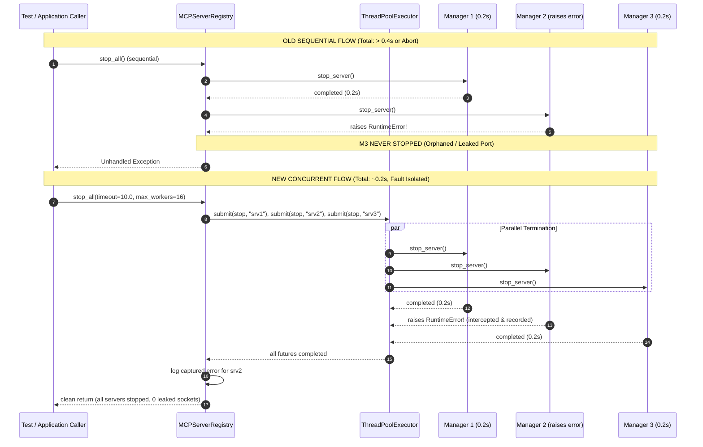

# PYPOST-1434: Concurrent Server Teardown and Parallel Cleanup Support

## Research

### 1. Current Teardown Mechanisms & Bottlenecks

#### `MCPServerRegistry.stop_all()` and `stop()`
In [pypost/core/mcp_server_registry.py](file:///home/src/pypost/core/mcp_server_registry.py#L205-L227), server shutdown is currently implemented as:

```python
def stop(self, instance_id: str) -> None:
    configuration = self._configuration(instance_id)
    logger.info(
        "mcp_registry_stop_requested instance_id=%s port=%d",
        instance_id,
        configuration.port,
    )
    with self._reconfiguration_lock:
        pending = self._pending_reconfigurations.pop(instance_id, None)
        if pending is not None:
            pending.candidate_manager.stop_server()
        manager = self._managers.get(instance_id)
        if manager is not None:
            manager.stop_server()
        self._set_status(instance_id, "stopped")

def stop_all(self) -> None:
    for instance_id in tuple(self._managers):
        self.stop(instance_id)
```

Two critical architectural issues exist in this implementation:
1. **Sequential Iteration Bottleneck ($O(N)$)**:
   `stop_all()` sequentially iterates through `self._managers`. When an `MCPServerManager` stops, it sets `uvicorn.Server.should_exit = True` and calls `self._server_thread.join(timeout=2.0)`. Even in normal conditions where each uvicorn worker drains its event loop in 200–500ms, terminating 5 servers takes 1.0 to 2.5 seconds sequentially. If worker threads take close to their 2.0s join deadline, 5 servers take up to 10.0 seconds. Across a test matrix with dozens of test methods, this accumulates significant dead wait time.
2. **Lock Serialization Hazard (`_reconfiguration_lock`)**:
   `stop()` acquires `self._reconfiguration_lock` (an instance-wide `threading.RLock`) for the entire duration of the method, including the blocking calls to `pending.candidate_manager.stop_server()` and `manager.stop_server()`. If multiple threads invoke `stop()` concurrently across different server instances, all worker threads serialize on `self._reconfiguration_lock`. Simply running `self.stop(instance_id)` in parallel would fail to achieve concurrency because each worker thread would wait for the lock.
   - *Architectural Resolution*: The lock window in `stop()` must be strictly narrowed: acquire `self._reconfiguration_lock` only to atomically extract and remove `pending = self._pending_reconfigurations.pop(instance_id, None)`, read `manager = self._managers.get(instance_id)`, and update `self._set_status(instance_id, "stopped")`. The subsequent calls to `pending.candidate_manager.stop_server()` and `manager.stop_server()` are performed **outside** the lock, allowing parallel thread join and socket release across all instances simultaneously.

#### `ServerRegistryFixtureMixin.teardown()`
In [tests/helpers/collection_integration_harness.py](file:///home/src/tests/helpers/collection_integration_harness.py#L317-L326):

```python
def teardown(self) -> None:
    """Stop all running servers in registry and release active resources."""
    logger.info("Tearing down harness and stopping all registered servers")
    try:
        if hasattr(self, "registry") and self.registry is not None:
            self.registry.stop_all()
        logger.debug("Harness teardown completed successfully")
    except Exception as exc:
        logger.warning("Error stopping servers during harness teardown: %s", exc)
```

In complex test scenarios, test harnesses may provision standalone server managers or candidate instances that are not registered in `self.registry` (e.g. standalone probe servers or candidate managers tested prior to registry commit). Currently, `ServerRegistryFixtureMixin` lacks a tracking structure for standalone candidate managers, risking orphaned servers if a test fails before registration completes.
- *Architectural Resolution*: Introduce `self._server_candidates: list[MCPServerManager]` initialized in `init_server_registry_fixture()`. Update `ServerRegistryFixtureMixin.teardown()` to concurrently terminate both active registry servers (via `self.registry.stop_all()`) and any standalone candidates tracked in `self._server_candidates`.

### 2. Concurrency Model Evaluation

| Model | Pros | Cons | Decision |
| --- | --- | --- | --- |
| **`concurrent.futures.ThreadPoolExecutor`** | Standard library; explicit bounded worker count (`max_workers = min(len(targets), 16)`); built-in future management; deterministic `wait(timeout=...)`; clean context manager cleanup. | Slight worker allocation overhead (~1-2ms per pool). | **Selected**: Best fit for I/O thread join coordination without adding external dependencies. |
| **Custom Worker Threads (`threading.Thread`)** | No pool abstractions; direct thread instantiation. | Manual error aggregation; unbounded thread creation if target count is large; boilerplate join loops. | Rejected: Reinvents `concurrent.futures`. |
| **`asyncio.gather()` / Async Task Pool** | Highly concurrent. | `MCPServerRegistry.stop_all()` and test harness `teardown()` are synchronous contracts called from synchronous Qt and pytest fixtures. Bridging to asyncio event loops in synchronous contexts introduces event loop collisions and complexity. | Rejected: Incompatible with synchronous API contract. |

### 3. Join & Drain Timeout Architecture

The concurrent teardown architecture employs a two-tier bounded timeout model:
1. **Per-Worker Thread Join Timeout (2.0s)**:
   Defined in `MCPServerManager.stop_server()`, bounding the time waited for uvicorn's server thread to exit gracefully.
2. **Batch Teardown Timeout (Default 10.0s, configurable)**:
   `MCPServerRegistry.stop_all(*, timeout: float = 10.0, max_workers: int | None = None)` bounds the overall execution of the parallel teardown operation.
   - If a misbehaving server worker thread hangs indefinitely, `concurrent.futures.wait(futures, timeout=timeout)` returns once the timeout elapses.
   - Any futures still pending are logged with `WARNING` / `ERROR`, and the coordinator proceeds without indefinitely blocking test runners or shutdown sequences.

### 4. Error Aggregation & Fault Isolation

In sequential teardown, an uncaught exception during `self.stop(instance_1)` immediately terminates the loop, leaving `instance_2`, `instance_3`, ..., `instance_N` running and leaking sockets.

Under the concurrent teardown architecture:
1. Each target server termination task is wrapped in an isolated exception handler.
2. If `stop(instance_id)` or `manager.stop_server()` raises an exception, the exception is intercepted, associated with the instance ID, and recorded in a thread-safe collector.
3. Remaining worker threads continue executing unimpeded.
4. When all futures finish (or timeout expires), all captured errors are logged with complete diagnostic context (instance ID, error message, stack trace).
5. `stop_all()` guarantees that failure in one server cannot abort or prevent cleanup of remaining servers.

### 5. Thread Safety, Socket Hygiene & Idempotence

1. **Idempotent Double-Teardown**:
   Calling `stop_all()` twice in succession is completely safe:
   - On the first call, all instances are transitioned to `"stopped"` state and managers are stopped.
   - On the second call, instances are already stopped, `manager.stop_server()` detects `self._server_thread is None` and returns immediately.
2. **Socket Release & Rebind**:
   Uvicorn server shutdown frees the bound TCP port. When `stop_server()` returns, the OS socket descriptor is closed, allowing immediate socket rebinding without `EADDRINUSE`.
3. **Thread Safety**:
   Narrowing `self._reconfiguration_lock` to registry dictionary reads and mutations guarantees atomic state changes while allowing parallel I/O and thread joining.

---

## Implementation Plan

### High-Level Execution Steps

1. **Step 3 (Next Step) — Failing Repro Test**:
   Create `tests/test_mcp_concurrent_teardown.py` verifying:
   - **Parallel Speedup**: 5 mock servers with 0.2s shutdown latency complete `stop_all()` in `< 0.45s` (whereas sequential shutdown takes $\ge 1.0\text{s}$).
   - **Error Isolation**: When 1 of 5 servers raises `RuntimeError("stop failure")`, the other 4 servers are still cleanly stopped, and all errors are isolated without unhandled crashes.
   - **Harness Candidate Teardown**: `ServerRegistryFixtureMixin.teardown()` stops both active registry servers and `_server_candidates` concurrently.
   - **Idempotence**: Successive calls to `stop_all()` and `teardown()` succeed cleanly with zero errors.

2. **Step 4 — Core Development**:
   - **Narrow Lock Scope in `MCPServerRegistry.stop()`**:
     Refactor `MCPServerRegistry.stop(instance_id)` so that `self._reconfiguration_lock` is only held while mutating `self._pending_reconfigurations`, querying `self._managers`, and updating status. Move `candidate_manager.stop_server()` and `manager.stop_server()` outside the lock.
   - **Upgrade `MCPServerRegistry.stop_all()`**:
     Implement concurrent shutdown in `MCPServerRegistry.stop_all(*, timeout: float = 10.0, max_workers: int | None = None)`.
     - Collect all target instance IDs from `self._managers`, `self._configurations`, and `self._pending_reconfigurations`.
     - Determine worker count: `workers = max(1, min(len(targets), max_workers or 16))`.
     - Dispatch `self.stop(instance_id)` via `ThreadPoolExecutor(max_workers=workers)`.
     - Wait for completion with `concurrent.futures.wait(futures, timeout=timeout)`.
     - Aggregate and log any exceptions encountered.
   - **Upgrade `ServerRegistryFixtureMixin`**:
     - Add `self._server_candidates: list[MCPServerManager] = []` in `init_server_registry_fixture()`.
     - Update `teardown(*, timeout: float = 10.0, max_workers: int | None = None)` to execute concurrent termination of both `self.registry.stop_all(...)` and `self._server_candidates`.
     - Ensure `self._server_candidates.clear()` occurs after cleanup.

3. **Step 5 — Code Cleanup**:
   Remove dead code, verify PEP 8 compliance, format docstrings, and record cleanup artifact in `ai-tasks/PYPOST-1434/40-code-cleanup.md`.

4. **Step 6 — Observability**:
   Document structured log events (`mcp_registry_concurrent_teardown_started`, `mcp_registry_concurrent_teardown_finished`, `mcp_registry_concurrent_teardown_error`) in `ai-tasks/PYPOST-1434/50-observability.md`.

5. **Step 7 — Technical Debt Analysis**:
   Evaluate remaining technical debt, edge cases, and record findings in `ai-tasks/PYPOST-1434/60-tech-debt.md`.

6. **Step 8 — Developer Documentation**:
   Update developer documentation in `doc/dev/mcp_server_registry.md` and `doc/dev/collection_integration_harness.md`.

### Mandatory — Failing Repro (next Step 3)

- **Test File**: `tests/test_mcp_concurrent_teardown.py`
- **What It Asserts**:
  1. *Parallel Speedup Verification*: Registers 5 mock server managers into `MCPServerRegistry`. Each mock manager's `stop_server()` sleeps for 0.2 seconds simulating network drain and thread join. Under concurrent teardown, `registry.stop_all()` must complete in `< 0.45` seconds. Under sequential execution, this test fails because $5 \times 0.2\text{s} = 1.0\text{s} > 0.45\text{s}$.
  2. *Fault Isolation Verification*: 5 mock server managers are registered, where manager #2 raises `RuntimeError("Simulated server teardown crash")`. The test asserts that:
     - `registry.stop_all()` completes without raising an uncaught exception.
     - Managers #0, #1, #3, and #4 are all stopped (`stop_server()` invoked).
     - Manager #2's failure is logged.
  3. *Harness Teardown Integration*: Sets up a test harness utilizing `ServerRegistryFixtureMixin` with 3 active registry servers and 2 standalone candidates in `_server_candidates`. Invoking `harness.teardown()` concurrently shuts down all 5 entities.
  4. *Idempotent Double-Teardown*: Multiple consecutive invocations of `registry.stop_all()` and `harness.teardown()` complete in $< 0.05\text{s}$ with zero errors.
- **Why It Fails Before Fix**:
  The existing `MCPServerRegistry.stop_all()` uses a synchronous `for instance_id in tuple(self._managers): self.stop(instance_id)` loop while holding `_reconfiguration_lock` throughout `stop()`. It takes $\ge 1.0\text{s}$ on 5 servers with 0.2s delay and aborts immediately on an unhandled exception in `self.stop()`.
- **Sequencing**:
  Research (completed in Step 2) $\to$ Automated red test in `tests/test_mcp_concurrent_teardown.py` (Step 3) $\to$ Production implementation in `mcp_server_registry.py` and `collection_integration_harness.py` until all tests pass (Step 4).

---

## Architecture

### System Module Diagram

```mermaid
flowchart TD
    subgraph Test_Or_Runtime["Caller / Runtime / Test Fixture"]
        CALLER["Test Case / Pytest Fixture / DaemonRuntime"]
    end

    subgraph Harness["Test Harness (tests/helpers/collection_integration_harness.py)"]
        SRFM["ServerRegistryFixtureMixin"]
        CANDIDATES["_server_candidates: list[MCPServerManager]"]
        SRFM --> CANDIDATES
    end

    subgraph Registry["Registry Lifecycle (pypost/core/mcp_server_registry.py)"]
        REGISTRY["MCPServerRegistry"]
        LOCK["self._reconfiguration_lock: RLock\n(narrowed atomic scope)"]
        CONFIGS["self._configurations: dict"]
        MANAGERS["self._managers: dict[str, MCPServerManager]"]
        PENDING["self._pending_reconfigurations: dict"]
        STATUSES["self._statuses: dict[str, McpServerStatus]"]
        
        REGISTRY --> LOCK
        REGISTRY --> CONFIGS
        REGISTRY --> MANAGERS
        REGISTRY --> PENDING
        REGISTRY --> STATUSES
    end

    subgraph Concurrency["Concurrent Teardown Engine"]
        TPE["concurrent.futures.ThreadPoolExecutor\n(max_workers = min(N, 16))"]
        WORKER1["Worker Thread 1\nstop(instance_1)"]
        WORKER2["Worker Thread 2\nstop(instance_2)"]
        WORKER_N["Worker Thread N\nstop(instance_N)"]
        
        TPE --> WORKER1
        TPE --> WORKER2
        TPE --> WORKER_N
    end

    subgraph Servers["Server Instances (pypost/core/qt/mcp_server.py)"]
        M1["MCPServerManager 1\nstop_server() -> join(2.0)"]
        M2["MCPServerManager 2\nstop_server() -> join(2.0)"]
        MN["MCPServerManager N\nstop_server() -> join(2.0)"]
        
        WORKER1 --> M1
        WORKER2 --> M2
        WORKER_N --> MN
    end

    subgraph Diagnostics["Fault Isolation & Diagnostics"]
        ERR_MAP["Error Collector\n(instance_id -> Exception)"]
        LOG["Structured Diagnostics\n(logger.warning / logger.error)"]
        WORKER1 -.->|on error| ERR_MAP
        WORKER2 -.->|on error| ERR_MAP
        WORKER_N -.->|on error| ERR_MAP
        ERR_MAP --> LOG
    end

    CALLER -->|teardown()| SRFM
    CALLER -->|stop_all()| REGISTRY
    SRFM -->|stop_all()| REGISTRY
    SRFM -->|concurrent stop| CANDIDATES
    REGISTRY -->|dispatch parallel| TPE
```

### Concurrent vs Sequential Teardown Sequence



### Module Responsibilities

| Component | Responsibility |
| --- | --- |
| `MCPServerRegistry.stop(instance_id)` | Narrows lock scope to atomic dictionary mutation and status setting. Executes `stop_server()` on candidate and manager outside `_reconfiguration_lock` to avoid blocking other concurrent stops. |
| `MCPServerRegistry.stop_all(timeout=10.0, max_workers=None)` | Coordinates parallel termination across all registered instances and pending candidate managers using a bounded `ThreadPoolExecutor`. Enforces bounded batch join timeout and isolates per-instance exceptions. |
| `ServerRegistryFixtureMixin.teardown(timeout=10.0, max_workers=None)` | Test fixture teardown hook. Initiates concurrent stop on `self.registry.stop_all()` and all standalone candidates tracked in `self._server_candidates`. Clears candidate list upon completion. |
| `MCPServerManager.stop_server()` | Cooperatively signals `uvicorn.Server.should_exit = True`, joins worker thread with a 2.0s bounded timeout, and closes sockets. Idempotent across multiple invocations. |

### Interface Definitions

#### `MCPServerRegistry` Interface Updates

```python
class MCPServerRegistry(QObject):
    # Existing signals and methods preserved...

    def stop(self, instance_id: str) -> None:
        """Stop an individual MCP server instance.
        
        Narrows lock scope to dictionary mutation and status transition,
        performing manager.stop_server() outside the lock for concurrency.
        """
        ...

    def stop_all(
        self,
        *,
        timeout: float = 10.0,
        max_workers: int | None = None,
    ) -> None:
        """Concurrently stop all registered and pending MCP server instances.
        
        Args:
            timeout: Maximum aggregate seconds to await worker thread joins.
            max_workers: Maximum parallel worker threads. Defaults to
                min(len(instances), 16).
        """
        ...
```

#### `ServerRegistryFixtureMixin` Interface Updates

```python
class ServerRegistryFixtureMixin:
    registry: MCPServerRegistry
    template_service: TemplateService
    _server_candidates: list[MCPServerManager]

    def init_server_registry_fixture(
        self,
        *,
        registry: MCPServerRegistry | None = None,
        library_service: Any = None,
        template_service: TemplateService | None = None,
    ) -> None:
        ...
        self._server_candidates = []

    def teardown(
        self,
        *,
        timeout: float = 10.0,
        max_workers: int | None = None,
    ) -> None:
        """Stop all running servers in registry and candidate list concurrently."""
        ...

    def close(self) -> None:
        """Alias for teardown() supporting explicit resource close semantics."""
        self.teardown()
```

---

## Q&A

- **Q: Why was `self._reconfiguration_lock` narrowed in `MCPServerRegistry.stop()`?**  
  A: `self._reconfiguration_lock` is an instance-wide `threading.RLock`. If `manager.stop_server()` runs inside `with self._reconfiguration_lock:`, every concurrent worker attempting to stop a different server blocks waiting for that single lock. Narrowing the lock to dictionary pops and status updates ensures the lock is held for microseconds, while the relatively slow thread join (200ms–2000ms) runs in parallel across all workers without contention.

- **Q: Why use `ThreadPoolExecutor` instead of spawning unbounded threads or using `asyncio`?**  
  A: `ThreadPoolExecutor` provides bounded concurrency (`min(len(targets), 16)`), preventing system thread exhaustion if a large test suite creates dozens of servers. Furthermore, `MCPServerRegistry.stop_all()` and fixture `teardown()` have synchronous public signatures. Using `asyncio` would require event loop manipulation in threads where Qt or pytest may or may not have a running event loop, creating brittle cross-thread synchronization issues.

- **Q: What happens if one server raises an exception during parallel teardown?**  
  A: The exception is trapped by the worker wrapper and recorded in an error map. Other worker threads continue stopping their designated servers. After all futures complete, the coordinator logs all collected errors with diagnostic details. The method finishes cleanly, guaranteeing that a single failing server never prevents other servers from releasing their ports and threads.

- **Q: What happens if a server worker thread hangs indefinitely?**  
  A: The coordinator enforces a bounded batch timeout (`timeout=10.0s`). If any server fails to stop within the deadline, `concurrent.futures.wait()` returns all uncompleted futures. A warning/error log is emitted identifying the non-terminating server, and the teardown call returns rather than stalling the CI pipeline indefinitely.

- **Q: How does this change affect existing tests and fixtures?**  
  A: It is 100% backward compatible. All existing call sites calling `registry.stop_all()` or `harness.teardown()` with no arguments continue to work seamlessly with the optimal default parameters (`timeout=10.0`, `max_workers=min(len(targets), 16)`).
