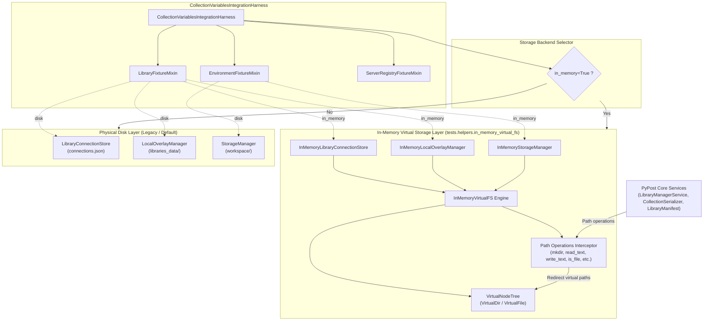
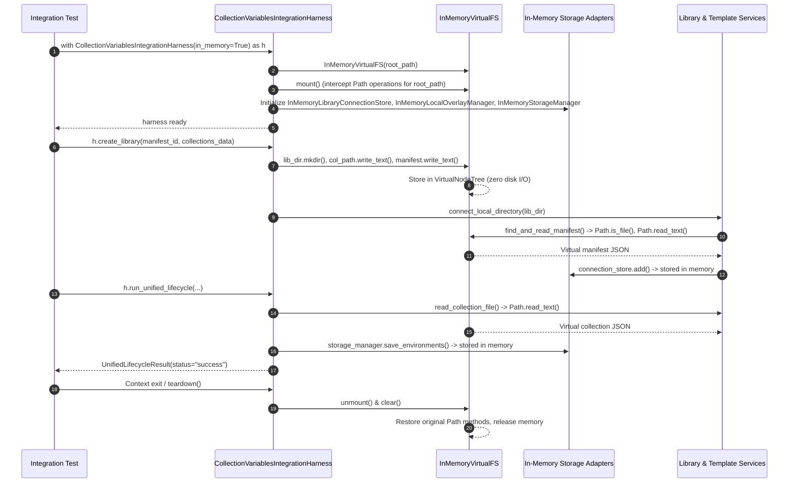

# PYPOST-1435: In-Memory Virtual Filesystem Backend for Integration Test Harness

## Research

### Existing Test Harness Filesystem Operations

An inspection of [`tests/helpers/collection_integration_harness.py`](file:///home/src/tests/helpers/collection_integration_harness.py) reveals how [`CollectionVariablesIntegrationHarness`](file:///home/src/tests/helpers/collection_integration_harness.py#L410) and its constituent mixins interact with the host filesystem:

1. **`LibraryFixtureMixin`**:
   - Receives a `tmp_path: Path` argument during initialization.
   - Creates directory hierarchies via `mkdir(parents=True, exist_ok=True)` for `self.libraries_dir` (`tmp_path / "libraries"`) and `self.overlay_dir` (`tmp_path / "libraries_data"`).
   - Instantiates [`LibraryConnectionStore`](file:///home/src/pypost/core/library_connection_store.py#L15) targeting `tmp_path / "connections.json"`.
   - Instantiates [`LocalOverlayManager`](file:///home/src/pypost/core/local_overlay_manager.py#L26) targeting `self.overlay_dir`.
   - In `create_library()`:
     - Creates library directory `lib_dir = self.libraries_dir / manifest_id` and collection subdirectory `collections_dir = lib_dir / "collections"` via `mkdir()`.
     - Writes collection JSON documents using `col_path.write_text(json.dumps(...), encoding="utf-8")`.
     - Writes manifest JSON using `manifest_file.write_text(json.dumps(...), encoding="utf-8")`.
     - Registers the directory with [`LibraryManagerService.connect_local_directory(lib_dir)`](file:///home/src/pypost/core/library_manager_service.py#L251).
   - In `create_overlay()`:
     - Delegates to [`LocalOverlayManager.save_overlay(overlay)`](file:///home/src/pypost/core/local_overlay_manager.py#L119).

2. **`EnvironmentFixtureMixin`**:
   - Receives a `tmp_path: Path` argument during initialization.
   - Creates `self.workspace_dir` (`tmp_path / "workspace"`) via `mkdir(parents=True, exist_ok=True)`.
   - Instantiates [`StorageManager`](file:///home/src/pypost/core/storage.py#L45) targeting `data_dir=self.workspace_dir`.
   - In `create_workspace_environment()`:
     - Persists environment records using [`StorageManager.save_environments([env])`](file:///home/src/pypost/core/storage.py#L182).

3. **`ServerRegistryFixtureMixin` & Multi-Subsystem Lifecycles**:
   - In `run_unified_lifecycle()`:
     - Resolves collection file paths `col_file_path = lib_dir / "collections" / col_filename` and reads them via [`read_collection_file(col_file_path)`](file:///home/src/pypost/core/collection_serializer.py#L117).
     - Starts standalone MCP servers via [`MCPServerRegistry.start()`](file:///home/src/pypost/core/mcp_server_registry.py#L181), which invokes [`LibraryRuntimeResolver.resolve()`](file:///home/src/pypost/core/library_runtime_resolver.py) -> [`LibraryManagerService.list_manifest_collections()`](file:///home/src/pypost/core/library_manager_service.py#L92) -> [`read_collection_file()`](file:///home/src/pypost/core/collection_serializer.py#L117).
     - Imports variables into workspace environments via [`StorageManager`](file:///home/src/pypost/core/storage.py#L45).

### Analysis of Filesystem Operations and System Call Dependencies

A detailed audit of file operations across the harness and connected services identifies two categories of operations:

1. **Standard `pathlib.Path` Operations**:
   - Directory creation: `path.mkdir(parents=True, exist_ok=True)`
   - Text I/O: `path.write_text(content, encoding="utf-8")`, `path.read_text(encoding="utf-8")`
   - File queries: `path.exists()`, `path.is_file()`, `path.is_dir()`, `path.stat()`
   - Path traversal: `path.iterdir()`, `path.glob()`, `path.rglob()`
   - Removal: `path.unlink(missing_ok=True)`
   - Deserialization and validation functions like [`find_and_read_manifest()`](file:///home/src/pypost/core/library_manifest.py#L356), [`validate_manifest_collections()`](file:///home/src/pypost/core/library_manifest.py#L389), and [`read_collection_file()`](file:///home/src/pypost/core/collection_serializer.py#L117) receive paths and wrap them with `Path(p)`.

2. **Low-Level Operating System Calls in Core Managers**:
   - [`LibraryConnectionStore.save()`](file:///home/src/pypost/core/library_connection_store.py#L107): Uses `tempfile.mkstemp(prefix=..., dir=...)`, `os.fdopen()`, `json.dump()`, and atomic rename via `os.replace(temporary, self.path)`.
   - [`LocalOverlayManager.save_overlay()`](file:///home/src/pypost/core/local_overlay_manager.py#L119): Uses `os.open(tmp_file, flags, 0o600)`, `open(fd, "w")`, `os.fsync()`, `os.chmod()`, and `os.replace(tmp_file, target_file)`.
   - [`StorageManager.save_environments()`](file:///home/src/pypost/core/storage.py#L182): Writes to `tmp_file` via built-in `open()`, followed by `os.replace(tmp_file, self.environments_file)`.

### Python 3.13 Subclassing Constraint & Discovery

When evaluating virtual path object designs, testing under Python 3.13 demonstrated that wrapping or casting a custom `Path` subclass with `pathlib.Path(virtual_path)` returns a native `pathlib._local.PosixPath`. Because core library utilities (e.g. `read_collection_file(path)` and `find_and_read_manifest(dir)`) explicitly invoke `file_path = Path(path)` and `dir_path = Path(directory)`, a naive `Path` subclass degrades to a standard `PosixPath` that issues physical kernel `stat()` and `open()` system calls.

Therefore, an effective in-memory virtual filesystem must:
1. Provide a virtual filesystem engine (`InMemoryVirtualFS`) that manages an in-memory node tree.
2. Intercept `pathlib.Path` operations (`mkdir`, `read_text`, `write_text`, `exists`, `is_file`, `is_dir`, `iterdir`, `glob`, `rglob`, `unlink`, `stat`) for paths belonging to the designated virtual filesystem root.
3. Provide dedicated in-memory storage adapters (`InMemoryStorageManager`, `InMemoryLocalOverlayManager`, `InMemoryLibraryConnectionStore`) that fulfill the manager interfaces in volatile memory, completely bypassing low-level OS operations (`os.replace`, `tempfile.mkstemp`, `os.chmod`, `os.fsync`).

### Analysis of Virtual Storage Options

- **Option 1: Custom `InMemoryVirtualFS` with Path Interception**:
  - Implements an in-memory dictionary-backed tree of directory and file nodes (`VirtualDir`, `VirtualFile`).
  - Context-managed interception hooks `pathlib.Path` methods during harness execution, filtering on path prefixes rooted at `/virtual_harness_<uuid>/`.
  - Guarantees that functions calling `Path(p).read_text()` or `Path(p).is_file()` transparently resolve to the in-memory tree without touching physical disk.
- **Option 2: Pluggable Storage Adapters**:
  - Provides lightweight in-memory implementations for `StorageManager`, `LocalOverlayManager`, and `LibraryConnectionStore`.
  - Eliminates OS-level file locking, atomic tempfile creation, and filesystem permission calls.
- **Synthesized Architecture (Combined Approach)**:
  - Combining Option 1 and Option 2 provides a complete, robust, zero-I/O architecture. The harness mounts an `InMemoryVirtualFS` engine to virtualize file reading and writing (for library manifests and collection files) and injects in-memory storage adapters for workspace environments, local overlays, and connection registries.

### Review of Existing Harness Tests

- [`tests/test_collection_harness_mixins.py`](file:///home/src/tests/test_collection_harness_mixins.py): Validates mixin decomposition, standalone mixin initialization, custom mixin composition, and composite backward compatibility.
- [`tests/test_collection_integration_harness_repro.py`](file:///home/src/tests/test_collection_integration_harness_repro.py): Validates end-to-end multi-subsystem workflows, standalone server candidate lifecycle, and context manager cleanup.

Both test suites rely on passing physical `tmp_path` fixtures, confirming that physical disk operation is the baseline that must remain 100% backward-compatible.

---

## Implementation Plan

### High-Level Implementation Steps

1. **Implement In-Memory Virtual Filesystem Module (`tests/helpers/in_memory_virtual_fs.py`)**:
   - `VirtualNode`: Base class representing in-memory filesystem nodes with path, metadata, and timestamps.
   - `VirtualFile`: Node storing in-memory text/bytes content with `read_text`, `write_text`, `read_bytes`, `write_bytes`.
   - `VirtualDir`: Node storing children dictionary `dict[str, VirtualNode]`, supporting nested directory creation, child enumeration, and glob matching.
   - `InMemoryVirtualFS`: Core virtual storage driver providing node lifecycle management, thread-safe locking (`threading.RLock`), path normalization, and dynamic context-managed interception of `pathlib.Path` methods for registered virtual roots.
   - In-Memory Service Adapters:
     - `InMemoryLibraryConnectionStore`: Subclasses [`LibraryConnectionStore`](file:///home/src/pypost/core/library_connection_store.py#L15), persisting connection records in memory and mirroring state to `InMemoryVirtualFS`.
     - `InMemoryLocalOverlayManager`: Subclasses [`LocalOverlayManager`](file:///home/src/pypost/core/local_overlay_manager.py#L26), managing overlay models in memory without `os.open` or `os.chmod`.
     - `InMemoryStorageManager`: Subclasses [`StorageManager`](file:///home/src/pypost/core/storage.py#L45), serializing and loading environments in memory without temporary files or `os.replace`.

2. **Enhance Integration Test Harness (`tests/helpers/collection_integration_harness.py`)**:
   - Update [`CollectionVariablesIntegrationHarness.__init__`](file:///home/src/tests/helpers/collection_integration_harness.py#L420) signature to:
     ```python
     def __init__(
         self,
         tmp_path: Path | None = None,
         *,
         in_memory: bool = False,
         backend: InMemoryVirtualFS | None = None,
     ) -> None:
     ```
   - If `in_memory=True` or `backend is not None`:
     - Assign unique ephemeral virtual root `Path(f"/virtual_pypost_harness_{uuid.uuid4().hex}")`.
     - Instantiate or attach `InMemoryVirtualFS` and activate its mount context.
     - Initialize `LibraryFixtureMixin` using `InMemoryLibraryConnectionStore` and `InMemoryLocalOverlayManager`.
     - Initialize `EnvironmentFixtureMixin` using `InMemoryStorageManager`.
   - If `in_memory=False` and `tmp_path` is provided:
     - Execute standard physical disk initialization (100% backward compatible).
   - Update `teardown()` and `__exit__()`:
     - Cleanly unmount `InMemoryVirtualFS`, restore original `Path` methods, and clear in-memory nodes.
   - Add new pytest fixture `in_memory_collection_harness` alongside existing `collection_integration_harness`.

3. **Verification and Quality Gates**:
   - Execute `make check` (lint, fast tests, verify-ai-tasks).
   - Execute `make typecheck` to verify mypy compliance.

---

### Mandatory — Failing Repro (next Step 3)

- **Test File**: `tests/test_in_memory_virtual_fs.py`
- **Desired Behavior Asserted**:
  1. **`test_in_memory_virtual_fs_tree_and_interception`**:
     - Asserts that `InMemoryVirtualFS` provisions virtual directory trees, writes/reads files via `Path` methods (`write_text`, `read_text`, `exists`, `is_file`, `is_dir`, `iterdir`, `glob`, `rglob`, `unlink`), and verifies that ZERO files or directories are created on the host OS filesystem.
  2. **`test_in_memory_virtual_storage_adapters`**:
     - Asserts that `InMemoryStorageManager`, `InMemoryLocalOverlayManager`, and `InMemoryLibraryConnectionStore` save and load entities correctly in volatile memory without invoking `open()`, `os.replace()`, `os.chmod()`, or `tempfile.mkstemp()`.
  3. **`test_collection_harness_in_memory_mode`**:
     - Asserts that `CollectionVariablesIntegrationHarness(in_memory=True)` instantiates without a physical `tmp_path`.
     - Asserts that `create_library()`, `create_overlay()`, and `create_workspace_environment()` succeed in memory.
     - Asserts that `run_unified_lifecycle()` completes end-to-end (catalog discovery, manifest parsing, collection deserialization, variable import, and template rendering) with status `"success"`.
  4. **`test_in_memory_zero_disk_io_verification`**:
     - Asserts that during and after in-memory harness execution, no physical directories or files exist at the virtual root or under `/tmp/virtual_pypost_harness_*`.
- **Failure Trigger Prior to Implementation**:
  - `CollectionVariablesIntegrationHarness` currently requires a non-optional `tmp_path: Path` positional argument and does not accept `in_memory` or `backend` parameters.
  - Calling `CollectionVariablesIntegrationHarness(in_memory=True)` raises `TypeError: __init__() missing 1 required positional argument: 'tmp_path'`.
  - `InMemoryVirtualFS`, `InMemoryStorageManager`, `InMemoryLocalOverlayManager`, and `InMemoryLibraryConnectionStore` do not yet exist, triggering `ImportError`.
- **Sequencing**:
  - Step 2: High-Level Architecture Design (this document).
  - Step 3: Implement automated failing repro in `tests/test_in_memory_virtual_fs.py` and confirm red failure.
  - Step 4: Implement `InMemoryVirtualFS`, virtual storage adapters, and harness integration until all tests pass green.

---

## Architecture

### System Module Diagram



### Component Interaction and Lifecycle Scheme



### Interface and Class Definitions

#### 1. In-Memory Virtual Filesystem Nodes and Engine

```python
class VirtualNode:
    """Base node in virtual filesystem tree."""
    name: str
    parent: Optional[VirtualDir]
    created_at: float
    modified_at: float

class VirtualFile(VirtualNode):
    """Leaf node representing an in-memory file."""
    content: bytes

    def read_text(self, encoding: str = "utf-8") -> str: ...
    def write_text(self, data: str, encoding: str = "utf-8") -> int: ...
    def read_bytes(self) -> bytes: ...
    def write_bytes(self, data: bytes) -> int: ...

class VirtualDir(VirtualNode):
    """Interior node representing an in-memory directory."""
    children: dict[str, VirtualNode]

    def get_child(self, name: str) -> Optional[VirtualNode]: ...
    def add_child(self, node: VirtualNode) -> VirtualNode: ...
    def remove_child(self, name: str) -> Optional[VirtualNode]: ...

class InMemoryVirtualFS:
    """In-memory virtual filesystem engine with Path interception."""

    def __init__(self, root_path: Path | str | None = None) -> None:
        self.root_path = Path(root_path or f"/virtual_pypost_harness_{uuid.uuid4().hex}").resolve()
        self._root_node = VirtualDir(name="", parent=None)
        self._lock = threading.RLock()
        self._is_mounted = False

    def mount(self) -> InMemoryVirtualFS:
        """Activate Path method interception for paths under root_path."""
        ...

    def unmount(self) -> None:
        """Deactivate interception and restore standard Path methods."""
        ...

    def clear(self) -> None:
        """Release all in-memory nodes and reclaim memory."""
        ...

    def __enter__(self) -> InMemoryVirtualFS:
        return self.mount()

    def __exit__(self, *args: Any) -> None:
        self.unmount()
        self.clear()

    # Core VFS node operations:
    def mkdir(self, path: Path | str, parents: bool = False, exist_ok: bool = False) -> None: ...
    def write_text(self, path: Path | str, text: str, encoding: str = "utf-8") -> int: ...
    def read_text(self, path: Path | str, encoding: str = "utf-8") -> str: ...
    def exists(self, path: Path | str) -> bool: ...
    def is_file(self, path: Path | str) -> bool: ...
    def is_dir(self, path: Path | str) -> bool: ...
    def unlink(self, path: Path | str, missing_ok: bool = False) -> None: ...
    def iterdir(self, path: Path | str) -> Iterator[Path]: ...
    def glob(self, path: Path | str, pattern: str) -> Iterator[Path]: ...
    def rglob(self, path: Path | str, pattern: str) -> Iterator[Path]: ...
```

#### 2. Virtual Storage Adapters

```python
class InMemoryLibraryConnectionStore(LibraryConnectionStore):
    """In-memory adapter for LibraryConnectionStore."""

    def __init__(self, vfs: InMemoryVirtualFS, path: Path) -> None:
        super().__init__(path=path)
        self.vfs = vfs
        self._records: list[LibraryConnectionRecord] = []

    def load(self, legacy_base_dir: Optional[Path | str] = None) -> list[LibraryConnectionRecord]: ...
    def save(self, records: list[LibraryConnectionRecord]) -> None: ...
    def add(self, record: LibraryConnectionRecord) -> LibraryConnectionRecord: ...

class InMemoryLocalOverlayManager(LocalOverlayManager):
    """In-memory adapter for LocalOverlayManager."""

    def __init__(self, vfs: InMemoryVirtualFS, base_dir: Path) -> None:
        super().__init__(base_dir=base_dir)
        self.vfs = vfs
        self._overlays: dict[str, LocalLibraryOverlay] = {}

    def get_overlay(self, library_id: str) -> LocalLibraryOverlay: ...
    def save_overlay(self, overlay: LocalLibraryOverlay) -> Path: ...

class InMemoryStorageManager(StorageManager):
    """In-memory adapter for StorageManager."""

    def __init__(self, vfs: InMemoryVirtualFS, data_dir: Path) -> None:
        super().__init__(data_dir=data_dir)
        self.vfs = vfs
        self._environments: list[Environment] = []

    def load_environments(self) -> list[Environment]: ...
    def save_environments(self, environments: list[Environment]) -> EnvironmentSerializeStats: ...
```

#### 3. Composite Harness Integration

```python
class CollectionVariablesIntegrationHarness(
    LibraryFixtureMixin,
    EnvironmentFixtureMixin,
    ServerRegistryFixtureMixin,
):
    """Enhanced integration harness supporting optional in-memory VFS."""

    virtual_fs: Optional[InMemoryVirtualFS]

    def __init__(
        self,
        tmp_path: Path | None = None,
        *,
        in_memory: bool = False,
        backend: InMemoryVirtualFS | None = None,
    ) -> None:
        self.in_memory = in_memory or (backend is not None)
        if self.in_memory:
            self.virtual_fs = backend or InMemoryVirtualFS()
            self.virtual_fs.mount()
            self.tmp_path = self.virtual_fs.root_path
        else:
            if tmp_path is None:
                raise ValueError("tmp_path is required when in_memory is False")
            self.virtual_fs = None
            self.tmp_path = tmp_path

        self.init_library_fixture(self.tmp_path, in_memory=self.in_memory, vfs=self.virtual_fs)
        self.init_environment_fixture(self.tmp_path, in_memory=self.in_memory, vfs=self.virtual_fs)
        self.template_service = TemplateService()
        self.init_server_registry_fixture(
            library_service=self.library_service,
            template_service=self.template_service,
        )

    def teardown(self, *, timeout: float = 10.0, max_workers: int | None = None) -> None:
        try:
            super().teardown(timeout=timeout, max_workers=max_workers)
        finally:
            if self.virtual_fs is not None:
                self.virtual_fs.unmount()
                self.virtual_fs.clear()
```

---

## Q&A

- **Q: Why combine path interception (`InMemoryVirtualFS`) with domain storage adapters (`InMemoryStorageManager`, etc.)?**
  - A: Core serialization utilities like `read_collection_file()`, `find_and_read_manifest()`, and `validate_manifest_collections()` receive `Path` objects and call `.is_file()` or `.read_text()`. Path interception guarantees these work seamlessly with zero disk I/O. Concurrently, managers like `StorageManager`, `LocalOverlayManager`, and `LibraryConnectionStore` use OS-level operations (`os.open`, `open(..., "w")`, `os.replace`, `tempfile.mkstemp`, `os.chmod`). Dedicated in-memory adapters bypass these OS calls completely, making execution faster, lock-free, and resilient across operating systems.
- **Q: Why intercept `Path` methods dynamically rather than creating a `VirtualPath` class?**
  - A: In Python 3.12 and 3.13, passing a custom `Path` subclass instance to standard library or external code that runs `Path(arg)` strips the subclass and returns a native `PosixPath`. Native `PosixPath` instances immediately invoke OS kernel system calls (`stat`, `open`), which fail if files only exist in a custom subclass. Intercepting `Path` methods for paths matching the harness's registered virtual root guarantees 100% transparent behavior regardless of how many times `Path()` is invoked.
- **Q: How does this guarantee 100% backward compatibility?**
  - A: When instantiated with `CollectionVariablesIntegrationHarness(tmp_path)` (the current usage in all existing tests), `in_memory` defaults to `False`. The harness executes against the physical filesystem using standard disk managers and standard `Path` operations, exactly as it does today.
- **Q: How will zero physical disk I/O be verified in the automated red repro test (Step 3)?**
  - A: The test will run the entire harness workflow (`create_library`, `create_overlay`, `create_workspace_environment`, `run_unified_lifecycle`) under `in_memory=True`. It will assert that:
    1. The virtual root path does not exist on physical disk (`os.path.exists(str(harness.tmp_path)) is False`).
    2. No files matching the library manifest, collection JSON, or overlay JSON exist on the host filesystem.
    3. All integration assertions, variable imports, and template substitution checks succeed with full fidelity.
- **Q: How is concurrency and parallel test isolation maintained under `pytest-xdist`?**
  - A: In multi-worker test runs (`pytest -n auto`), each worker runs in an independent OS process with its own separate memory heap, guaranteeing total isolation. Within a single process or multi-threaded scenarios, each `InMemoryVirtualFS` generates a unique UUID-based root prefix (e.g. `/virtual_pypost_harness_<uuid>/`) and protects its internal node tree with a re-entrant lock (`threading.RLock`).
- **Q: How does resource cleanup prevent memory leaks during long matrix runs?**
  - A: During `harness.teardown()` or context manager exit, `virtual_fs.unmount()` restores the original `Path` methods, and `virtual_fs.clear()` empties the virtual node tree and drops references. The garbage collector immediately reclaims all memory without leaving temporary files on disk.
