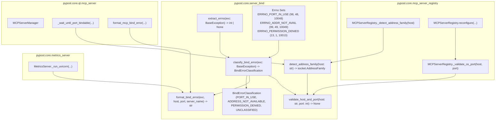

# PYPOST-1436: Formalize Structured Errno Mapping and OS Port Preflight Error Classification

## Research

### 1. Existing Server Bind Error Formatting and Fragile Substring Checks

Inspection of `pypost/core/server_bind.py`:
```python
def format_bind_error(exc: OSError, host: str, port: int, server_name: str) -> str:
    """Return an operator-facing message for server bind failures."""
    if (
        exc.errno in (errno.EADDRINUSE, errno.EADDRNOTAVAIL, 48, 49, 10048, 10013)
        or "address already in use" in str(exc).lower()
    ):
        return (
            f"Cannot start {server_name} on {host}:{port}: port is busy or unavailable. "
            "Choose another port in Settings or stop the process using this port."
        )
    return f"Cannot start {server_name} on {host}:{port}: {exc.strerror or exc}"
```

Key defects identified:
1. **Locale-Dependent Substring Matching**: `"address already in use" in str(exc).lower()` completely fails on localized non-English operating systems. On German (`de_DE`), French (`fr_FR`), Spanish (`es_ES`), Russian (`ru_RU`), Japanese (`ja_JP`), or Chinese (`zh_CN`) systems, `str(exc)` or `exc.strerror` contains localized text such as `"Die Adresse wird bereits verwendet"` or `"Adresse déjà utilisée"`. If `exc.errno` is not present (or wrapped in `args`), the check falls through to generic formatting without actionable remediation advice.
2. **Conflated Error Types in a Single Tuple**: The tuple `(errno.EADDRINUSE, errno.EADDRNOTAVAIL, 48, 49, 10048, 10013)` conflates three fundamentally different networking failure modes:
   - Port conflict (`EADDRINUSE`, WSA 10048)
   - Unroutable / invalid interface address (`EADDRNOTAVAIL`, WSA 10049 — which was omitted!)
   - Access / permission denied (`EACCES`, WSA 10013)
   All three produced identical "port is busy or unavailable" messaging, misleading operators when the real cause was lack of root/administrator privileges or an invalid IP binding.
3. **Missing POSIX Permission and Address Unavailable Constants**: Linux `EACCES` (13) and `EPERM` (1) were omitted from structured classification. Windows `WSAEADDRNOTAVAIL` (10049) was also omitted.

### 2. Existing OS Port Preflight Probing in `MCPServerRegistry`

Inspection of `pypost/core/mcp_server_registry.py` (lines 943-952):
```python
    @staticmethod
    def _validate_os_port(host: str, port: int) -> None:
        """Preflight an external bind conflict before stopping a live endpoint."""
        try:
            with socket.socket(socket.AF_INET, socket.SOCK_STREAM) as probe:
                probe.setsockopt(socket.SOL_SOCKET, socket.SO_REUSEADDR, 1)
                probe.bind((host, port))
        except OSError as exc:
            raise ValueError(f"MCP server port {port} is unavailable: {exc}") from exc
```

Key defects identified:
1. **Hardcoded IPv4 (`socket.AF_INET`)**: Attempting to preflight an IPv6 host address (e.g. `::1`, `::`, or link-local IPv6) raises an `OSError` (e.g. `[Errno 97] Address family not supported by protocol` or `[Errno 22] Invalid argument`) or `socket.gaierror`, causing false validation failures even when the port is free.
2. **Missing Structured Diagnostic Explanation**: `ValueError(f"MCP server port {port} is unavailable: {exc}")` includes raw `exc`, which on non-English systems displays untranslated or localized system strings without classifying whether the port is busy, the address is invalid, or permissions were denied.
3. **Hardcoded IPv4 in Manager Port Release Polling**: In `pypost/core/qt/mcp_server.py` (`_wait_until_port_bindable`), the probe socket is also hardcoded to `socket.AF_INET`.

### 3. POSIX vs Windows Winsock (WSA) Error Codes Research

Networking socket exceptions in Python surface numeric error codes across POSIX and Windows as follows:

| Functional Category | POSIX / Linux | BSD / macOS / Darwin | Windows Winsock (WSA) | Code Constants |
| --- | --- | --- | --- | --- |
| **Port In Use / Busy** | `errno.EADDRINUSE` (98) | `errno.EADDRINUSE` (48) | `WSAEADDRINUSE` (10048) | `98, 48, 10048` |
| **Address Not Available** | `errno.EADDRNOTAVAIL` (99) | `errno.EADDRNOTAVAIL` (49) | `WSAEADDRNOTAVAIL` (10049) | `99, 49, 10049` |
| **Permission Denied** | `errno.EACCES` (13), `errno.EPERM` (1) | `errno.EACCES` (13), `errno.EPERM` (1) | `WSAEACCES` (10013) | `13, 1, 10013` |

### 4. Robust Errno Extraction Research

In Python, `OSError` and its subclasses (`socket.error`, `socket.herror`, `socket.gaierror`) can present numeric error codes in different attributes depending on how the exception was raised:
1. `exc.errno`: standard integer attribute populated by CPython when an OS error number is present.
2. `getattr(exc, 'winerror', None)`: on Windows platforms, CPython sets `winerror` to the underlying Windows API or Winsock error code.
3. `exc.args`:
   - `OSError(errno, strerror)` -> `args = (errno, strerror)` where `args[0]` is `int`.
   - `socket.error((errno, strerror))` -> `args = ((errno, strerror),)` where `args[0]` is a tuple with `args[0][0]` as `int`.
   - `OSError("message string")` -> `args = ("message string",)` where `args[0]` is `str` (no numeric errno).

An extraction helper `extract_errno(exc: BaseException) -> int | None` must check `exc.errno`, `winerror`, and `exc.args` in order, returning `None` if no integer error code exists.

### 5. Multi-Family (IPv4 / IPv6) Address Detection Research

To support both IPv4 and IPv6 without external libraries:
1. `ipaddress.ip_address(host.strip("[]"))`:
   - Returns `IPv4Address` (`version == 4`) -> `socket.AF_INET`
   - Returns `IPv6Address` (`version == 6`) -> `socket.AF_INET6`
   - Handles bracketed IPv6 notation (e.g. `"[::1]"`).
2. Hostnames (e.g. `"localhost"`, `"example.local"`):
   - `ipaddress.ip_address` raises `ValueError`.
   - If `":" in host`, classify as `socket.AF_INET6`.
   - Otherwise default to `socket.AF_INET`.
3. Socket bind behavior:
   - In Python, `probe.bind((host, port))` works for both `AF_INET` (2-tuple `(host, port)`) and `AF_INET6` (accepts 2-tuple `(host, port)` or 4-tuple `(host, port, flowinfo, scopeid)`).
   - Socket options: `probe.setsockopt(socket.SOL_SOCKET, socket.SO_REUSEADDR, 1)` ensures the probe does not leave the port stuck in `TIME_WAIT`.

---

## Implementation Plan

### High-Level Phases

1. **Step 3: Automated Failing Repro (`tests/test_server_bind_errno.py`)**:
   - Write comprehensive red test suite asserting:
     - Localization independence: non-English `strerror` (German, French, Japanese, Russian) with `errno.EADDRINUSE` correctly classifies as `PORT_IN_USE` and formats actionable port-busy message without string matching.
     - Windows Winsock WSA codes: 10048 (`WSAEADDRINUSE`), 10013 (`WSAEACCES`), 10049 (`WSAEADDRNOTAVAIL`).
     - BSD / macOS numeric errno constants (48, 49).
     - Multi-structure errno extraction (`errno`, `winerror`, `args` tuple/int).
     - Multi-family address detection (`AF_INET` vs `AF_INET6`) for `127.0.0.1`, `::1`, `::`, `[::1]`, `localhost`.
     - IPv6 preflight socket probing on `::1` (verifying free port passes, occupied port raises structured `ValueError`).
   - Run via `make test PYTEST_ARGS="tests/test_server_bind_errno.py"` to verify failure prior to implementation.

2. **Step 4: Development**:
   - Implement `BindErrorClassification` enum in `pypost/core/server_bind.py`.
   - Implement frozen code sets `ERRNO_PORT_IN_USE`, `ERRNO_ADDR_NOT_AVAIL`, `ERRNO_PERMISSION_DENIED`.
   - Implement `extract_errno(exc: BaseException) -> int | None`.
   - Implement `classify_bind_error(exc: BaseException) -> BindErrorClassification`.
   - Implement `detect_address_family(host: str) -> socket.AddressFamily`.
   - Implement `validate_host_and_port(host: str, port: int) -> None`.
   - Update `format_bind_error(exc: BaseException, host: str, port: int, server_name: str = "server") -> str`:
     - Eliminate all substring checks (`"address already in use"`).
     - Dispatch to structured messages based on `classify_bind_error(exc)`:
       - `PORT_IN_USE`: `"Cannot start {server_name} on {host}:{port}: port is busy or unavailable. Choose another port in Settings or stop the process using this port."`
       - `PERMISSION_DENIED`: `"Cannot start {server_name} on {host}:{port}: permission denied (insufficient privileges or restricted port). {details}"`
       - `ADDRESS_NOT_AVAILABLE`: `"Cannot start {server_name} on {host}:{port}: address not available. The requested host interface cannot be bound on this system. {details}"`
       - `UNCLASSIFIED`: `"Cannot start {server_name} on {host}:{port}: {details}"`
     - Provide dual-order argument fallback if called as `format_bind_error(host, port, exc)` or `format_bind_error(exc, host, port, server_name)`.
   - Update `MCPServerRegistry._validate_os_port` and `_detect_address_family` in `pypost/core/mcp_server_registry.py` to use `detect_address_family` and `validate_host_and_port`.
   - Update `MCPServerManager._wait_until_port_bindable` in `pypost/core/qt/mcp_server.py` to use `detect_address_family(self._current_host)`.

3. **Verification**:
   - Run `make test PYTEST_ARGS="tests/test_server_bind_errno.py tests/test_server_bind.py tests/test_mcp_server_registry.py"` to verify green status.
   - Run full `make check` and `make verify-ai-tasks`.

### Mandatory — Failing Repro (next Step 3)

- **Test Path**: `tests/test_server_bind_errno.py`.
- **Target Assertions**:
  1. `test_classify_bind_error_localized_strerror_eaddrinuse`: creates `OSError(errno.EADDRINUSE, "Die Adresse wird bereits verwendet")` and verifies `classify_bind_error(exc) == BindErrorClassification.PORT_IN_USE`.
  2. `test_format_bind_error_localized_german_french_japanese`: verifies `format_bind_error(exc, "127.0.0.1", 8080, "test_server")` contains `"port is busy or unavailable"` regardless of foreign `strerror` text.
  3. `test_windows_wsa_error_codes`: verifies `10048` -> `PORT_IN_USE`, `10013` -> `PERMISSION_DENIED`, `10049` -> `ADDRESS_NOT_AVAILABLE` across `errno` and `winerror` attributes.
  4. `test_detect_address_family_ipv4_and_ipv6`: verifies address family detection for `127.0.0.1`, `0.0.0.0`, `::1`, `::`, `[::1]`, and `"localhost"`.
  5. `test_validate_os_port_ipv6_loopback`: verifies `_validate_os_port("::1", port)` successfully binds on a free port and raises `ValueError` with structured classification when the IPv6 port is occupied by a listening `AF_INET6` socket.
- **Forcing Failure**:
  - The test will fail immediately before Step 4 with `ImportError: cannot import name 'classify_bind_error'` and `NameError`, and calling `_validate_os_port` with `::1` fails with address family mismatch or gaierror against the unpatched `AF_INET` socket probe.
- **Sequencing**: Step 2 (Design) -> Step 3 (Commit red test asserting desired behavior) -> Step 4 (Implement and make green).

---

## Architecture

### System Module Diagram



### Module Responsibilities

1. **`pypost/core/server_bind.py`**:
   - **`BindErrorClassification`**: String-compatible `Enum` defining normalized failure categories (`PORT_IN_USE`, `ADDRESS_NOT_AVAILABLE`, `PERMISSION_DENIED`, `UNCLASSIFIED`).
   - **`ERRNO_PORT_IN_USE` / `ERRNO_ADDR_NOT_AVAIL` / `ERRNO_PERMISSION_DENIED`**: Normalized frozen sets combining POSIX `errno`, BSD/Darwin numbers, and Windows Winsock WSA codes.
   - **`extract_errno(exc: BaseException) -> int | None`**: Pure helper inspecting `errno`, `winerror`, and `args` to find a numeric error code.
   - **`classify_bind_error(exc: BaseException) -> BindErrorClassification`**: Determines the functional classification from the extracted errno.
   - **`detect_address_family(host: str) -> socket.AddressFamily`**: Resolves `socket.AF_INET` or `socket.AF_INET6` using `ipaddress` parsing and IPv6 literal detection.
   - **`validate_host_and_port(host: str, port: int) -> None`**: Performs a safe preflight socket probe with `SO_REUSEADDR`, proper family selection, immediate cleanup, and structured `ValueError` raising on bind conflict.
   - **`format_bind_error(...)`**: Formats locale-independent, operator-friendly diagnostic error strings.

2. **`pypost/core/mcp_server_registry.py`**:
   - Updates `_validate_os_port` to delegate to `validate_host_and_port` (or utilize `detect_address_family`).
   - Retains the method signature on `MCPServerRegistry` to maintain 100% backward compatibility with existing tests and callers.

3. **`pypost/core/qt/mcp_server.py`**:
   - `format_mcp_bind_error` delegates to `format_bind_error`.
   - `_wait_until_port_bindable` uses `detect_address_family` when creating its polling socket probe.

4. **`pypost/core/metrics_server.py`**:
   - Uses `format_bind_error` during uvicorn startup exception handling.

### Architectural Patterns

- **Error Classification / Normalization Pattern**: Separates low-level OS/platform differences from application-level business logic.
- **Adapter / Facade Pattern**: Provides a single unified API (`classify_bind_error`, `validate_host_and_port`) encapsulating multi-platform socket quirks.
- **Probe Hygiene Pattern**: Context manager (`with socket.socket(...)`) ensuring sockets are closed immediately after bind test, avoiding `TIME_WAIT` lockouts or socket descriptor leaks.

### Main Interfaces and Signatures

```python
import enum
import socket

class BindErrorClassification(str, enum.Enum):
    PORT_IN_USE = "port_in_use"
    ADDRESS_NOT_AVAILABLE = "address_not_available"
    PERMISSION_DENIED = "permission_denied"
    UNCLASSIFIED = "unclassified"


ERRNO_PORT_IN_USE: frozenset[int] = frozenset({
    getattr(errno, "EADDRINUSE", 98),
    48,       # macOS / BSD EADDRINUSE
    10048,    # Windows WSAEADDRINUSE
})

ERRNO_ADDR_NOT_AVAIL: frozenset[int] = frozenset({
    getattr(errno, "EADDRNOTAVAIL", 99),
    49,       # macOS / BSD EADDRNOTAVAIL
    10049,    # Windows WSAEADDRNOTAVAIL
})

ERRNO_PERMISSION_DENIED: frozenset[int] = frozenset({
    getattr(errno, "EACCES", 13),
    getattr(errno, "EPERM", 1),
    10013,    # Windows WSAEACCES
})


def extract_errno(exc: BaseException) -> int | None:
    """Extract numeric OS error code from an exception."""
    ...


def classify_bind_error(exc: BaseException) -> BindErrorClassification:
    """Classify an OS networking exception into a structured category."""
    ...


def detect_address_family(host: str) -> socket.AddressFamily:
    """Detect whether host string requires AF_INET or AF_INET6."""
    ...


def validate_host_and_port(host: str, port: int) -> None:
    """Preflight socket bind on host:port, raising ValueError with structured classification."""
    ...


def format_bind_error(
    exc: BaseException | str,
    host: str | int,
    port: int | BaseException,
    server_name: str = "server",
) -> str:
    """Return an operator-facing message for server bind failures without substring matching."""
    ...
```

---

## Q&A

### Q1: Why should string matching on `str(exc)` be completely eliminated?
A: In standard CPython on non-English operating systems (e.g. Linux with `LANG=de_DE.UTF-8` or Windows with a German display language), the standard C library or Windows networking stack translates system error strings into the local language (e.g. `"Die Adresse wird bereits verwendet"` instead of `"Address already in use"`). Textual matching fails silently, misclassifying critical port collisions as generic errors. Numeric error codes (`errno` / `winerror`) are universal, immutable, and 100% deterministic across all languages and operating system versions.

### Q2: Why are both `EACCES` (13) and `WSAEACCES` (10013) included?
A: Binding to privileged ports (< 1024) without elevated privileges raises `EACCES` on Linux/macOS. Furthermore, on Windows, attempting to bind to a port that is already in use by another process without `SO_REUSEADDR` or under specific security policies frequently surfaces as `WSAEACCES` (10013) rather than `WSAEADDRINUSE` (10048). Including both ensures seamless cross-platform classification.

### Q3: How is IPv6 address format parsing handled safely?
A: `detect_address_family` uses the standard library `ipaddress.ip_address` on the stripped host string (removing any enclosing brackets `[` / `]`). If `ip_address` recognizes it as an IPv6 address, it selects `socket.AF_INET6`. For hostnames (like `"localhost"` or custom DNS names) where `ipaddress` raises `ValueError`, if the string contains `:` it defaults to `AF_INET6`, otherwise defaulting to `socket.AF_INET`.

### Q4: Does preflight probing cause port lockouts or races with the real server startup?
A: No. The probe socket sets `SO_REUSEADDR` and is immediately closed within a `with` statement before returning. This releases the socket handle immediately. In `MCPServerRegistry.reconfigure`, this preflight check ensures that if an external program already occupies the candidate port, the registry rejects the reconfiguration immediately without stopping or tearing down the existing running server manager.
