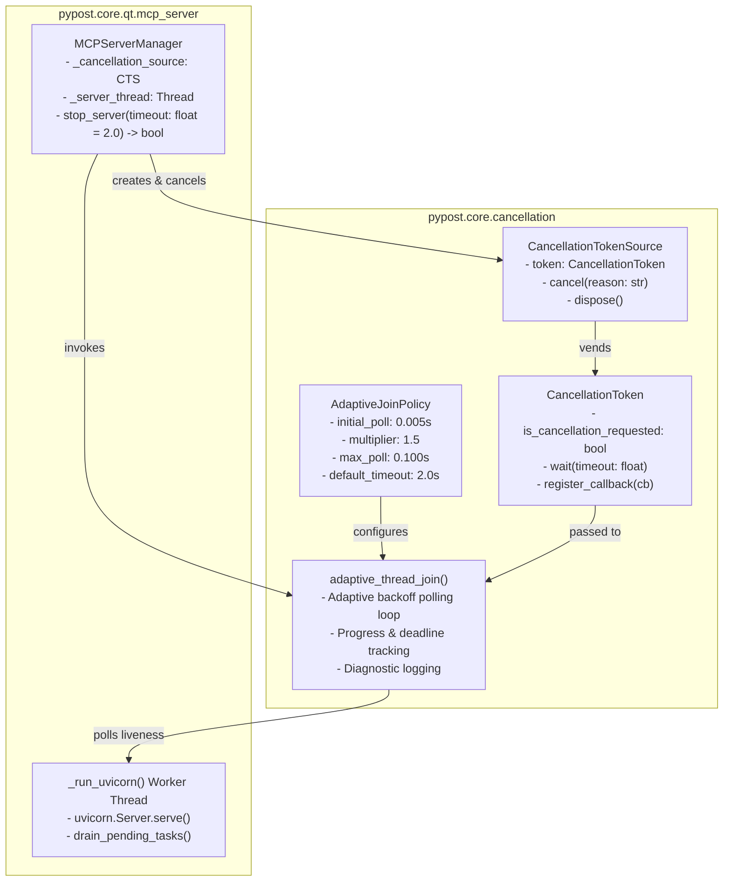
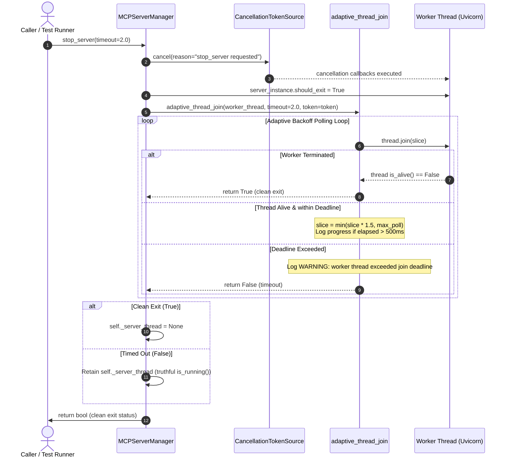

# PYPOST-1437: High-Level Architecture Design — Adaptive Backoff Thread Join and Cancellation Tokens

## Research

### 1. Existing Thread Termination and Uvicorn Lifecycle in `MCPServerManager`
In [`pypost/core/qt/mcp_server.py`](file:///home/src/pypost/core/qt/mcp_server.py), standalone MCP servers run an ASGI web service stack (`uvicorn.Server`) inside a dedicated background daemon thread:
```python
self._server_thread = threading.Thread(target=self._run_uvicorn, daemon=True)
self._server_thread.start()
```

In `_run_uvicorn()`, Uvicorn executes its event loop:
```python
loop = asyncio.new_event_loop()
asyncio.set_event_loop(loop)
...
loop.run_until_complete(self._server_instance.serve())
...
finally:
    uninstall_thread_exit()
    drain_pending_tasks(loop)
    loop.close()
```

When an operator, tool reconfiguration (`update_tools()`), or test teardown requests termination, `stop_server()` is invoked:
```python
def stop_server(self):
    if not self.is_running():
        return

    self._stop_event.set()
    if self._server_instance:
        self._server_instance.should_exit = True

    if self._server_thread:
        self._server_thread.join(timeout=2.0)
        if not self._server_thread.is_alive():
            self._server_thread = None

    self._server_instance = None
    logger.info("MCP server stopped")
    self.status_changed.emit(False)
```

### 2. Interaction with Uvicorn `should_exit = True` and Worker Task Draining
When `server_instance.should_exit = True` is set:
1. Uvicorn's main loop detects the flag and stops accepting new incoming socket connections.
2. Existing active requests and keep-alive HTTP connections enter a drain phase (governed by Uvicorn's internal graceful shutdown settings).
3. SSE (Server-Sent Events) and streaming connections (e.g., `sse_starlette`) continue running until their generators terminate or connection cancel signals are handled.
4. Once `serve()` finishes, control transfers to the `finally` block:
   - `drain_pending_tasks(loop)` ([`pypost/core/server_bind.py`](file:///home/src/pypost/core/server_bind.py)) inspects `asyncio.all_tasks(loop)`, cancels pending tasks, and waits for them to resolve (`asyncio.gather(*pending, return_exceptions=True)`).
   - Only after all background tasks unwind does `loop.close()` complete and the thread function exit.

### 3. Limitations of the Fixed 2.0s Thread Join Timeout
The current hardcoded `self._server_thread.join(timeout=2.0)` creates critical problems:
1. **Premature Timeout Under Contention**: On busy CI runners, virtualized containers, or under slow socket flushes, worker threads often require slightly longer than 2.0s (e.g. 2.2s - 3.0s) to unwind. The fixed 2.0s wait expires prematurely, leaving an orphaned worker thread still executing and holding port bindings.
2. **Black Box Waiting and Lack of Observability**: A single `join(2.0)` call provides no diagnostic feedback on whether the thread is making progress, how long the drain is taking, or what phase of shutdown the system is currently in.
3. **Absence of Cooperative Cancellation Tokens**: While `_stop_event` is signaled, there is no structured token abstraction allowing subcomponents, background tasks, or external supervisors to monitor cancellation states (`active`, `cancel_requested`, `completed`), attach cancellation callbacks, or supply diagnostic reasons for termination.

### 4. Cooperative Cancellation Token Patterns in Python
Borrowing proven architectural patterns from modern concurrent runtimes (.NET `CancellationTokenSource`, Go `context.Context`):
- `CancellationTokenSource`: The owner of the cancellation lifecycle. Responsible for initiating cancellation (`cancel(reason=...)`), holding a thread-safe registry of cancellation callbacks, and vending a read-only `CancellationToken`.
- `CancellationToken`: A lightweight, thread-safe value object passed to workers and join helpers. Exposes `is_cancellation_requested`, `cancellation_reason`, `wait(timeout)`, and callback registration (`register_callback(cb)`).
- Safe callback invocation: When cancellation is triggered, callbacks execute with exception isolation so a failing callback never suppresses shutdown notifications.

### 5. Adaptive Backoff Polling Strategy
Rather than sleeping for a static duration, adaptive polling checks thread completion progressively:
- **Initial Slice**: `initial_poll = 0.005s` (5ms). Normal idle threads exit in 5–15ms; the first or second check detects exit immediately without idle delay.
- **Backoff Multiplier**: `multiplier = 1.5x`. Each subsequent check gradually increases the wait window (5ms -> 7.5ms -> 11.2ms -> 16.8ms -> 25.3ms -> 38ms -> 57ms -> 85ms -> 100ms).
- **Max Slice Cap**: `max_poll = 0.100s` (100ms). Ensures the loop never blocks longer than 100ms per iteration, maintaining responsiveness.
- **Bounded Total Deadline**: `default_timeout = 2.0s` (customizable via `timeout` parameter).
- **Observability**: Emits structured logs on start, logs periodic drain progress if slow (>500ms), and logs a structured warning if the thread fails to exit within the deadline.
- **Truthful State Preservation**: If the deadline expires and the thread remains alive, the thread reference is preserved (honoring the fix in PYPOST-1196), preventing immediate port rebind collisions.

### 6. Caller Inspection and Backward Compatibility
Callers of `stop_server()` across the codebase:
- [`pypost/core/mcp_server_registry.py`](file:///home/src/pypost/core/mcp_server_registry.py): `candidate.stop_server()`, `previous_manager.stop_server()`, `manager.stop_server()`.
- [`pypost/ui/presenters/mcp_controls_presenter.py`](file:///home/src/pypost/ui/presenters/mcp_controls_presenter.py): `self._mcp_manager.stop_server()`.
- Test suites: [`tests/test_mcp_server_manager.py`](file:///home/src/tests/test_mcp_server_manager.py), [`tests/test_mcp_server_registry.py`](file:///home/src/tests/test_mcp_server_registry.py), [`tests/test_mcp_standalone_wire_ipc_repro.py`](file:///home/src/tests/test_mcp_standalone_wire_ipc_repro.py).

All callers invoke `stop_server()` synchronously without arguments. Therefore, modifying the signature to:
```python
def stop_server(self, timeout: float = 2.0) -> bool:
```
provides 100% backward compatibility for existing zero-argument callers while returning a boolean status (`True` if joined cleanly, `False` if timed out) and allowing callers with custom timing requirements to specify custom deadlines.

---

## Implementation Plan

### High-Level Implementation Steps
1. **Create [`pypost/core/cancellation.py`](file:///home/src/pypost/core/cancellation.py)**:
   - Define `CancellationState` enum (`ACTIVE`, `CANCEL_REQUESTED`, `COMPLETED`).
   - Implement `CancellationToken` with thread-safe `is_cancellation_requested`, `cancellation_reason`, `wait()`, `register_callback()`, and `throw_if_cancellation_requested()`.
   - Implement `CancellationTokenSource` with `token`, `cancel(reason=...)`, `dispose()`, and context manager support.
   - Define `AdaptiveJoinPolicy` configuration dataclass (`initial_poll`, `multiplier`, `max_poll`, `default_timeout`).
   - Implement `adaptive_thread_join(thread, timeout=..., policy=..., token=..., thread_name=...)` with geometric backoff, drain logging, and deadline enforcement.
2. **Integrate into [`pypost/core/qt/mcp_server.py`](file:///home/src/pypost/core/qt/mcp_server.py)**:
   - In `MCPServerManager.__init__`, initialize `self._cancellation_source: CancellationTokenSource | None = None`.
   - In `start_server()` and `start_proxy_server()`, instantiate a fresh `CancellationTokenSource`.
   - In `stop_server(timeout: float = 2.0) -> bool`:
     - Request cancellation on `_cancellation_source`.
     - Signal `_stop_event.set()` and `_server_instance.should_exit = True`.
     - Delegate thread termination to `adaptive_thread_join(self._server_thread, timeout=timeout, token=token, thread_name="mcp_server")`.
     - If joined cleanly: clear `self._server_thread = None` and emit `status_changed(False)`.
     - If timed out: retain `self._server_thread` (truthful `is_running()` state), log diagnostic warning, and emit `status_changed(False)`.
3. **Execute Verification**:
   - Run unit and integration tests via `make check` and `make verify-ai-tasks`.

---

### Mandatory — Failing Repro (next Step 3)

- **Test Suite Location**: `tests/test_mcp_server_adaptive_join.py`
- **What It Asserts (Desired Behavior)**:
  1. **Cooperative Cancellation Token Contract**:
     - `CancellationTokenSource.cancel()` sets `token.is_cancellation_requested == True` and records cancellation reason.
     - Registered callbacks execute upon cancellation; late-registered callbacks execute immediately.
     - Exceptions in callbacks are isolated and do not prevent other callbacks or cancellation signaling.
  2. **Adaptive Join Latency (Fast Exit)**:
     - For a worker thread that finishes in 5ms, `adaptive_thread_join(thread, timeout=2.0)` returns `True` promptly (assert total wait duration < 0.08s, far below 2.0s).
  3. **Adaptive Join Bounded Deadline & State Retention (Uncooperative Worker)**:
     - For a worker thread that intentionally blocks (e.g. sleeps 5.0s), calling `adaptive_thread_join(thread, timeout=0.15)` stops polling after ~0.15s, returns `False`, and logs a structured warning.
     - The worker thread reference is preserved by caller to keep `is_running() == True`.
  4. **Integration with `MCPServerManager.stop_server`**:
     - `stop_server(timeout=...)` activates the cancellation token, performs adaptive backoff, clears `_server_thread` on clean exit, or retains `_server_thread` when join deadline expires.
- **How to Force Failure Without Live External Deps**:
  - Tests use lightweight synthetic `threading.Thread` instances and dummy target functions with controllable sleep/event triggers. No live external network sockets or running Uvicorn instances are required for unit testing the backoff and cancellation logic.
- **Sequencing**:
  1. Write red failing test in `tests/test_mcp_server_adaptive_join.py` asserting the existence and behavior of `CancellationTokenSource`, `CancellationToken`, `adaptive_thread_join`, and `stop_server(timeout=...)`.
  2. Verify that the test suite fails (Step 3).
  3. Implement `pypost/core/cancellation.py` and update `pypost/core/qt/mcp_server.py` in Step 4 until all tests pass green.

---

## Architecture

### System Module Diagram



### Shutdown Sequence Diagram



---

### Interface Definitions

#### Module: `pypost/core/cancellation.py`

```python
"""Cooperative cancellation tokens and adaptive backoff thread join helpers."""
from __future__ import annotations

import enum
import logging
import threading
import time
from collections.abc import Callable
from dataclasses import dataclass
from typing import Final

logger = logging.getLogger(__name__)


class CancellationState(str, enum.Enum):
    """Lifecycle states of a cooperative cancellation token."""
    ACTIVE = "active"
    CANCEL_REQUESTED = "cancel_requested"
    COMPLETED = "completed"


class OperationCancelledError(RuntimeError):
    """Raised when an operation is cancelled via a CancellationToken."""


class CancellationToken:
    """Thread-safe read-only token monitoring cancellation requests."""

    def __init__(self, source: CancellationTokenSource) -> None:
        self._source = source

    @property
    def is_cancellation_requested(self) -> bool:
        """True if cancellation has been requested on the parent source."""
        return self._source.is_cancellation_requested

    @property
    def cancellation_reason(self) -> str | None:
        """Diagnostic description supplied when cancellation was initiated."""
        return self._source.cancellation_reason

    def wait(self, timeout: float | None = None) -> bool:
        """Wait until cancellation is requested or timeout expires. Returns True if cancelled."""
        return self._source.wait(timeout)

    def register_callback(self, callback: Callable[[], None]) -> Callable[[], None]:
        """Register a callback to run upon cancellation. Returns an unregister callable."""
        return self._source.register_callback(callback)

    def throw_if_cancellation_requested(self) -> None:
        """Raise OperationCancelledError if cancellation has been requested."""
        if self.is_cancellation_requested:
            raise OperationCancelledError(
                self.cancellation_reason or "Operation was cancelled"
            )


class CancellationTokenSource:
    """Lifecycle manager and trigger for cooperative cancellation."""

    def __init__(self) -> None:
        self._lock = threading.Lock()
        self._event = threading.Event()
        self._reason: str | None = None
        self._callbacks: list[Callable[[], None]] = []
        self._token = CancellationToken(self)
        self._disposed = False

    @property
    def token(self) -> CancellationToken:
        """Return the CancellationToken associated with this source."""
        return self._token

    @property
    def is_cancellation_requested(self) -> bool:
        """Whether cancel() has been invoked."""
        return self._event.is_set()

    @property
    def cancellation_reason(self) -> str | None:
        """Reason provided during cancellation."""
        with self._lock:
            return self._reason

    def cancel(self, reason: str | None = None) -> None:
        """Request cancellation and invoke registered callbacks."""
        callbacks_to_run: list[Callable[[], None]] = []
        with self._lock:
            if self._disposed or self._event.is_set():
                return
            self._reason = reason or "Cancellation requested"
            self._event.set()
            callbacks_to_run = list(self._callbacks)
            self._callbacks.clear()

        for cb in callbacks_to_run:
            try:
                cb()
            except Exception:
                logger.exception("Error executing cancellation callback")

    def register_callback(self, callback: Callable[[], None]) -> Callable[[], None]:
        """Register a callback to run on cancellation, or invoke immediately if already cancelled."""
        with self._lock:
            if not self._event.is_set() and not self._disposed:
                self._callbacks.append(callback)

                def unregister() -> None:
                    with self._lock:
                        if callback in self._callbacks:
                            self._callbacks.remove(callback)

                return unregister

        # Already cancelled or disposed
        if self._event.is_set():
            try:
                callback()
            except Exception:
                logger.exception("Error executing immediate cancellation callback")
        return lambda: None

    def wait(self, timeout: float | None = None) -> bool:
        """Block until cancellation is requested or timeout expires."""
        return self._event.wait(timeout)

    def dispose(self) -> None:
        """Release callback references and mark source as disposed."""
        with self._lock:
            self._disposed = True
            self._callbacks.clear()

    def __enter__(self) -> CancellationTokenSource:
        return self

    def __exit__(self, exc_type: object, exc_val: object, exc_tb: object) -> None:
        self.dispose()


@dataclass(frozen=True)
class AdaptiveJoinPolicy:
    """Configuration governing adaptive backoff polling during thread join."""
    initial_poll: float = 0.005
    multiplier: float = 1.5
    max_poll: float = 0.100
    default_timeout: float = 2.0


def adaptive_thread_join(
    thread: threading.Thread | None,
    timeout: float | None = None,
    *,
    policy: AdaptiveJoinPolicy | None = None,
    token: CancellationToken | None = None,
    thread_name: str | None = None,
) -> bool:
    """Join a thread with adaptive exponential backoff polling and deadline enforcement.

    Args:
        thread: The background thread to join. If None or not alive, returns True immediately.
        timeout: Maximum bounded duration in seconds to wait before giving up.
        policy: Backoff policy configuring initial slice, multiplier, and max slice.
        token: Optional cooperative cancellation token to monitor.
        thread_name: Human-readable identifier for diagnostic logging.

    Returns:
        True if the thread joined cleanly, False if the deadline expired.
    """
```

---

## Q&A

**Q: Why introduce a dedicated `pypost/core/cancellation.py` module rather than inlining into `mcp_server.py`?**  
A: Cancellation and bounded thread joining are fundamental concurrency patterns required not just by `MCPServerManager`, but across background registry monitors, metrics servers, and daemon runtimes. Placing them in `pypost/core/cancellation.py` provides clean unit-testability, zero GUI/Qt coupling, and immediate reusability across the application.

**Q: How does `adaptive_thread_join` balance low latency and CPU efficiency?**  
A: By calling `thread.join(timeout=current_slice)` rather than sleeping and polling, the function immediately wakes up the moment the thread terminates. Starting with a 5ms slice guarantees sub-10ms response times for fast shutdown, while expanding by 1.5x up to 100ms prevents busy-waiting and keeps CPU usage virtually imperceptible during prolonged ASGI connection drains.

**Q: How is backward compatibility preserved for existing `stop_server` callers?**  
A: Existing callers invoke `stop_server()` without arguments. The new signature `def stop_server(self, timeout: float = 2.0) -> bool:` defaults to the existing 2.0s boundary and returns a boolean status. All existing callers continue to function without any changes, while callers requiring longer drain limits or exit status verification can pass `timeout=...` and inspect the returned boolean.

**Q: How does this interact with the socket release fix from PYPOST-1196?**  
A: In PYPOST-1196, if a thread failed to exit within the join timeout, the reference `self._server_thread` was intentionally retained so that `is_running()` remained `True` until the thread truly terminated, preventing premature port reuse. The adaptive join architecture strictly preserves this invariant: `self._server_thread` is set to `None` only when `adaptive_thread_join()` returns `True`. If `adaptive_thread_join()` returns `False` (deadline exceeded), the thread reference remains intact and an actionable warning diagnostic is logged.
