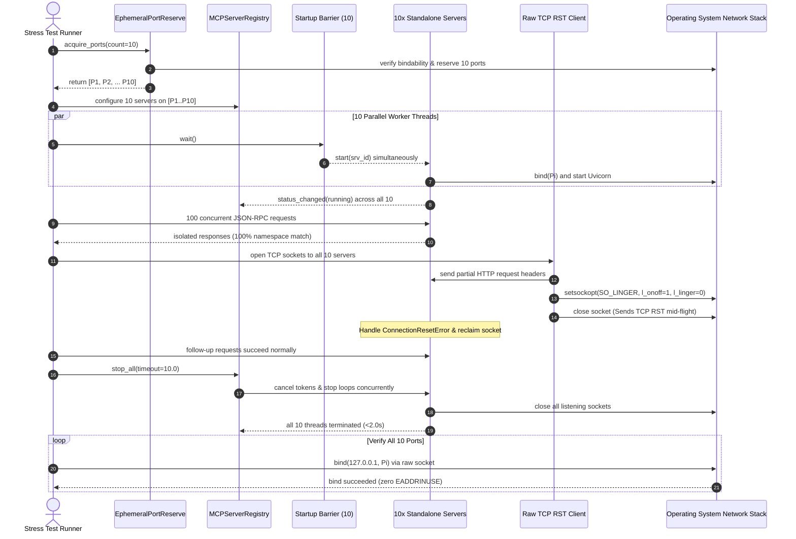

# PYPOST-1438: Multi-Process Supervisor Isolation Evaluation and 10+ Server Stress Testing

## Research

### 1. Existing Server Architecture Analysis

PyPost hosts Model Context Protocol (MCP) servers using an ASGI web stack (`uvicorn.Server`) over
`asyncio`. Analyzing the core components:

- [`pypost/core/qt/mcp_server.py`](file:///home/src/pypost/core/qt/mcp_server.py):
  - `MCPServerManager` acts as the lifecycle owner for a single MCP endpoint.
  - In `start_server()` and `start_proxy_server()`, it starts a background daemon thread:
    `self._server_thread = threading.Thread(target=self._run_uvicorn, daemon=True)`.
  - In `_run_uvicorn()`, it binds a new `asyncio` event loop to the thread, initializes Uvicorn
    with `uvicorn.Config(...)`, and overrides `install_signal_handlers = lambda: None` to prevent
    signal registration conflicts outside the Python main thread.
  - Uses `install_thread_exit()` to intercept `sys.exit(code)` from Uvicorn during bind failures and
    convert non-zero exit codes into `OSError(errno.EADDRINUSE)`.
  - Emits Qt signals: `status_changed(bool)`, `start_failed(str)`, and `activity_recorded(object)`.
  - In `stop_server()`, it activates cooperative cancellation (`CancellationTokenSource.cancel()`),
    sets `_server_instance.should_exit = True`, sets `_stop_event`, and calls
    `adaptive_thread_join()`. If the worker thread exits within the deadline, `_server_thread` is
    cleared; otherwise the reference is retained to keep `is_running() == True` truthful.

- [`pypost/core/mcp_server_registry.py`](file:///home/src/pypost/core/mcp_server_registry.py):
  - Coordinates multiple `MCPServerManager` instances keyed by `instance_id`.
  - Maintains `_configurations: dict[str, McpServerConfiguration]`, `_managers`, and `_statuses`.
  - Employs `_reconfiguration_lock = threading.RLock()` to synchronize lifecycle transitions.
  - Enforces port uniqueness in memory via `_validate_available_port()` and probes OS availability
    via `_validate_os_port()`.
  - Performs concurrent multi-server teardown in `stop_all()` via `ThreadPoolExecutor`
    (capped at 16 workers) with bounded wait timeout.

- [`pypost/core/cancellation.py`](file:///home/src/pypost/core/cancellation.py):
  - Vends `CancellationTokenSource` and read-only `CancellationToken`.
  - Implements `adaptive_thread_join()` with geometric polling slices (initial 5ms, 1.5x backoff,
    100ms cap, periodic progress logs every 500ms).

- [`tests/test_mcp_concurrent_multiserver_repro.py`][repro-multiserver]:
  - Validates basic multi-server concurrency with 3 instances: parallel startup via
    `threading.Barrier(3)`, variable isolation across overlapping keys, live hot reload under
    continuous load, port contention recovery, and concurrent teardown with immediate socket rebind.
  - However, existing tests do not exercise high-density concurrency (10+ servers), mid-stream
    abrupt socket terminations (TCP RST), or socket descriptor leaks under stress.

[repro-multiserver]: file:///home/src/tests/test_mcp_concurrent_multiserver_repro.py

### 2. Multi-Process Supervisor Isolation Evaluation

Enterprise multi-tool workflows increasingly configure high-density server clusters (10 or more
concurrent servers). At this scale, in-process daemon thread execution exhibits fundamental limits:

1. **Crash Containment**:
   - *Daemon Threads*: Threads share a single virtual memory space and CPython heap. If a native
     dependency (e.g., C-extension, parser segfault, or OS OOM killer) faults in any server thread,
     the entire PyPost host application aborts immediately.
   - *Process Supervisor*: Each server runs in an isolated OS process. A fatal segfault or abort in
     child process $K$ is contained by the kernel. The supervisor detects the process exit code,
     records the failure, and all other servers and the host GUI continue uninterrupted.

2. **Python GIL Saturation**:
   - *Daemon Threads*: All 10+ server loops share a single Global Interpreter Lock (GIL). Heavy
     JSON-RPC serialization, templating, and schema parsing serialize on the GIL, causing latency
     spikes and GUI stutter.
   - *Process Supervisor*: Each child process has its own Python interpreter and GIL, distributing
     computation linearly across multiple CPU cores.

3. **Per-Server Resource Overhead**:
   - *Daemon Threads*: Extremely lightweight (~5–10 MB virtual memory per server). 10 servers add
     ~50–100 MB aggregate heap.
   - *Process Supervisor*: Each process incurs the baseline cost of the Python runtime (~30–50 MB
     for a headless worker without Qt). 10 servers require ~350–500 MB RAM.

4. **IPC and Variable Synchronization**:
   - *Daemon Threads*: Zero-copy closures (`Callable[[], dict[str, str]]`) dynamically supply
     variable updates without serialization.
   - *Process Supervisor*: Requires inter-process communication (pipes, domain sockets, or shared
     memory) to transmit configuration updates and dynamic variables.

5. **OS Portability and Spawning Model**:
   - *Daemon Threads*: Identical behavior on POSIX and Windows via `threading.Thread`.
   - *Process Supervisor*: Multi-threaded applications using Qt or macOS CoreFoundation cannot
     safely use POSIX `fork()` due to allocator deadlocks. Spawning via `spawn` is mandatory across
     all platforms (Linux, macOS, Windows). `spawn` adds ~150–350 ms startup latency per process.

6. **Lifecycle Supervision and Watchdog**:
   - *Daemon Threads*: Cannot safely force-kill a runaway or deadlocked thread.
   - *Process Supervisor*: Complete OS-level supervision. The supervisor monitors PIDs, detects
     crashes, issues graceful `SIGTERM`, and falls back to `SIGKILL` (`TerminateProcess` on Windows)
     after a bounded deadline.

### 3. Trade-Off Matrix

| Dimension | Thread-Based Daemon Workers | Dedicated Multi-Process Supervisor |
| :--- | :--- | :--- |
| **Crash Isolation** | None (1 crash terminates host) | Complete (OS-level process containment) |
| **GIL Bypass** | No (Shared single GIL) | Yes (Independent GIL per process) |
| **Memory per Server** | Low (~5–10 MB delta) | Moderate (~30–50 MB per process) |
| **Startup Latency** | Fast (<50 ms) | Moderate (~150–350 ms via `spawn`) |
| **IPC Complexity** | Low (In-memory closures) | Moderate (Pipes / JSON-RPC / Sockets) |
| **Force Termination** | Unsafe / Not supported | Reliable (`SIGTERM` -> `SIGKILL`) |
| **OS Portability** | Universal via `threading` | Universal via `spawn` context |
| **Core Scalability** | GIL-bound | Linear multi-core scaling |

### 4. High-Density 10+ Server Stress & Socket Reclamation Mechanics

High-density configurations (10+ servers) introduce distinct OS-level hazards:
- **Port Exhaustion & Collisions**: Allocating 10+ consecutive ports concurrently risks race
  conditions between test workers. A dedicated `EphemeralPortReserve` context manager is required to
  safely allocate and hold a batch of verified free ports.
- **Abrupt Client Disconnections (TCP RST)**: When client connections terminate mid-flight (e.g.,
  unannounced socket close with `SO_LINGER` set to 0 seconds, or dropped network interfaces),
  ASGI servers must catch connection resets without leaking file descriptors or getting stuck in
  `CLOSE_WAIT`.
- **Immediate Socket Rebinding**: Following concurrent teardown of 10+ servers, all operating
  system network ports must be released immediately so that raw TCP sockets can bind to the exact
  same ports with zero `EADDRINUSE` errors.

---

## Implementation Plan

### High-Level Implementation Steps

1. **Step 2 (Architecture Design — Current Step)**:
   - Deliver architecture specification in `ai-tasks/PYPOST-1438/20-architecture.md`.
   - Deliver multi-process supervisor evaluation and blueprint in
     [`doc/dev/mcp_process_supervisor_evaluation.md`][doc-supervisor-eval].
   - Design `EphemeralPortReserve` and automated 10+ server stress test harness.
2. **Step 3 (Failing Repro Test)**:
   - Implement `tests/test_mcp_multiserver_stress_10x.py` specifying the 10+ server stress tests
     (barrier startup, namespace isolation under load, abrupt client drops, socket reclamation).
3. **Step 4 (Development)**:
   - Implement `EphemeralPortReserve` in `tests/helpers/port_allocation.py` or test helper suite.
   - Run 10+ server stress tests, validating concurrent execution, descriptor cleanup, and socket
     reclamation under high load.
4. **Step 5 (Code Cleanup)**:
   - Ensure flake8, mypy, and task artifact verification pass cleanly via `make check`.
5. **Step 6 (Observability)**:
   - Validate metric tracking under 10+ server transitions (`mcp_server_instance_counts`).
6. **Step 7 (Technical Debt Analysis)**:
   - Document any performance bottlenecks or memory scaling limits in `60-tech-debt.md`.
7. **Step 8 (Dev Docs)**:
   - Verify developer documentation under `doc/dev/`.

---

### Mandatory — Failing Repro (next Step 3)

- **Test Suite Location**:
  [`tests/test_mcp_multiserver_stress_10x.py`][test-stress-10x]
- **What It Asserts (Desired Behavior)**:
  1. `test_concurrent_multiserver_10x_barrier_startup`:
     - Allocates 10 distinct TCP ports using `EphemeralPortReserve`.
     - Deploys 10 independent standalone MCP servers in `CollectionVariablesIntegrationHarness`.
     - Synchronizes startup across 10 threads using `threading.Barrier(10)`.
     - Asserts all 10 servers transition to `running`, report `is_listening == True`, and respond
       to concurrent `tools/list` JSON-RPC requests within 15.0s.
  2. `test_concurrent_multiserver_10x_namespace_isolation_under_load`:
     - 10 servers configured with distinct variable values (`server_index=1..10`, `secret_key=...`).
     - Simultaneously executes 100 concurrent JSON-RPC tool invocations across all 10 servers.
     - Asserts each server returns its exact isolated variables with zero cross-talk or leakage.
  3. `test_concurrent_multiserver_10x_abrupt_client_drops`:
     - Establishes raw TCP connections to all 10 running servers.
     - Transmits partial HTTP requests or begins SSE streaming, then abruptly aborts connections
       via TCP RST (`setsockopt(socket.SOL_SOCKET, socket.SO_LINGER, struct.pack('ii', 1, 0))` and
       immediate close).
     - Asserts that none of the 10 servers crash or leak unhandled exceptions, and subsequent client
       requests on all 10 servers succeed immediately.
  4. `test_concurrent_multiserver_10x_teardown_and_socket_reclamation`:
     - Concurrently terminates all 10 servers via `registry.stop_all()`.
     - Asserts all 10 worker threads terminate within bounded timeout (<2.0s).
     - Asserts all 10 OS ports can be immediately rebound by raw TCP sockets (`SO_REUSEADDR`)
       without `EADDRINUSE`.
- **How to Force Failure Without Live External Deps**:
  - `EphemeralPortReserve` does not currently exist, forcing an `ImportError` or `AttributeError`
    before Step 4 implementation.
  - Stressing 10+ concurrent servers with simulated TCP RST validates descriptor hygiene and
    prevents silent socket leaks under high density.
- **Sequencing**:
  - Step 3: Create red test suite `tests/test_mcp_multiserver_stress_10x.py` asserting all 4
    stress test contracts.
  - Step 4: Implement `EphemeralPortReserve` and refine multi-server concurrency handling until
    all tests pass green.

---

## Architecture

### System Module Diagram

```mermaid
flowchart TD
    subgraph TestHarness["10+ Server Integration Harness"]
        Harness["CollectionVariablesIntegrationHarness"]
        PortReserve["EphemeralPortReserve<br/>(Batch Reservation of 10+ Ports)"]
        Registry["MCPServerRegistry<br/>(Lock: _reconfiguration_lock)"]
        Barrier["threading.Barrier(10)<br/>(Synchronized Startup)"]
        Harness --> PortReserve
        Harness --> Registry
    end

    subgraph ServerCluster["10+ Standalone MCP Servers"]
        Srv1["Server 1 (Port P1)<br/>MCPServerManager 1"]
        Srv2["Server 2 (Port P2)<br/>MCPServerManager 2"]
        SrvDots["... Servers 3 through 9 ..."]
        Srv10["Server 10 (Port P10)<br/>MCPServerManager 10"]
        Registry --> Srv1
        Registry --> Srv2
        Registry --> SrvDots
        Registry --> Srv10
    end

    subgraph StressLoad["Stress Load & Disconnection Injection"]
        LoadPool["ThreadPoolExecutor(20)<br/>(Concurrent JSON-RPC Requests)"]
        RstInjector["Abortive TCP RST Injector<br/>(SO_LINGER=0 Mid-Flight Abort)"]
        LoadPool --> Srv1
        LoadPool --> Srv10
        RstInjector --> Srv1
        RstInjector --> Srv10
    end

    subgraph SocketReclamation["OS Resource Verification"]
        RebindProbe["Raw TCP Rebind Probes<br/>(Assert Immediate Socket Availability)"]
        Registry -->|stop_all()| RebindProbe
    end
```

### High-Density Lifecycle Sequence Diagram



---

### Architectural Blueprint for Future Process Supervisor

For future process isolation (Phase 2), PyPost will introduce `McpProcessSupervisor`:
1. **Spawning Mechanism**: Uses `multiprocessing.get_context("spawn")` to guarantee process
   safety in multi-threaded Qt applications across Linux, macOS, and Windows.
2. **Headless Worker Runtime**: A dedicated entry point (`pypost.core.mcp_worker_process`) that
   omits PySide6 GUI imports to minimize per-process memory consumption to ~30 MB.
3. **IPC Control Protocol**: Bidirectional pipe or local Unix domain socket exchanging:
   - `START(port, host, config)`
   - `UPDATE_VARIABLES(variables, hidden_keys, overridable_keys)`
   - `HEARTBEAT_PING` / `HEARTBEAT_PONG`
   - `STOP(timeout)`
4. **Supervision & Auto-Restart**: Non-blocking monitoring of child process exit codes. If an
   isolated worker terminates due to a native crash, the supervisor updates status to `failed`,
   records crash diagnostics, and optionally triggers a bounded restart backoff.
5. **Forced Reclamation**: Orderly `SIGTERM` followed by a hard `SIGKILL` if child fails to exit
   within 2.0s, guaranteeing unblocked socket release.

---

### Interface Definitions

#### `tests/helpers/port_allocation.py` (or test helper module)

```python
"""Ephemeral port reservation helper for high-density multi-server tests."""
from __future__ import annotations

import socket
from collections.abc import Iterator
from contextlib import contextmanager
from typing import Sequence

from tests.helpers.port_allocation import allocate_tcp_port


class EphemeralPortReserve:
    """Manages batch allocation and reservation of distinct ephemeral ports."""

    def __init__(self, count: int, host: str = "127.0.0.1") -> None:
        self.count = count
        self.host = host
        self.ports: list[int] = []

    def allocate(self) -> list[int]:
        """Allocate 'count' distinct, verified bindable ports atomically."""
        allocated: set[int] = set()
        while len(allocated) < self.count:
            port = allocate_tcp_port(self.host)
            allocated.add(port)
        self.ports = sorted(allocated)
        return list(self.ports)

    def verify_all_rebound(self, timeout: float = 2.0) -> bool:
        """Verify that every reserved port can be immediately bound by a raw socket."""
        for port in self.ports:
            with socket.socket(socket.AF_INET, socket.SOCK_STREAM) as sock:
                sock.setsockopt(socket.SOL_SOCKET, socket.SO_REUSEADDR, 1)
                sock.bind((self.host, port))
        return True


@contextmanager
def reserve_ephemeral_ports(
    count: int, host: str = "127.0.0.1"
) -> Iterator[list[int]]:
    """Context manager allocating and managing a batch of ephemeral ports."""
    reserve = EphemeralPortReserve(count, host)
    ports = reserve.allocate()
    try:
        yield ports
    finally:
        pass
```

---

## Q&A

**Q: Why is testing 10+ concurrent servers essential when users typically run 1–3?**  
A: Enterprise workflows frequently combine multiple API tools (Jira, GitHub, Slack, databases,
staging environments). Testing with 10+ servers surfaces file descriptor limits, GIL contention,
port allocation collisions, and thread join bottlenecks that are invisible at lower scale.

**Q: Why evaluate a multi-process supervisor instead of immediately replacing threads?**  
A: Transitioning from daemon threads to child processes involves significant architectural
trade-offs: memory consumption increases from ~5–10 MB to ~30–50 MB per server, dynamic
closure-based variable suppliers require IPC serialization, and process startup latency rises
from <50ms to ~200ms. Evaluating the architecture and proving current thread runtime limits
under 10+ servers ensures that future process isolation is built on empirical data.

**Q: How do abrupt connection drops (TCP RST) differ from standard HTTP disconnects?**  
A: Standard HTTP client disconnects send a TCP FIN packet, initiating an orderly four-way TCP
handshake and allowing ASGI servers to clean up cleanly. Abrupt drops (TCP RST via `SO_LINGER=0`)
terminate the connection instantly mid-packet, forcing the server's transport layer to handle
abnormal socket resets without leaking OS descriptors or hanging worker threads.

**Q: Why is `spawn` required instead of `fork` for multi-process supervisor on Linux?**  
A: In Python applications that use multi-threading and link GUI libraries like PySide6 / Qt,
calling `fork()` without `exec()` duplicates locked mutexes and thread states from the parent
process, causing deadlocks in the child process. Using `spawn` starts a completely clean Python
interpreter process, ensuring cross-platform stability on Linux, macOS, and Windows alike.

**Q: How does `EphemeralPortReserve` prevent port contention in parallel CI test runs?**  
A: It integrates with the cross-process file-locked port allocator (`allocate_tcp_port`), acquiring
a batch of unique, probe-verified free ports before servers start, preventing port collision races
among concurrent test workers.

[doc-supervisor-eval]: file:///home/src/doc/dev/mcp_process_supervisor_evaluation.md
[test-stress-10x]: file:///home/src/tests/test_mcp_multiserver_stress_10x.py
