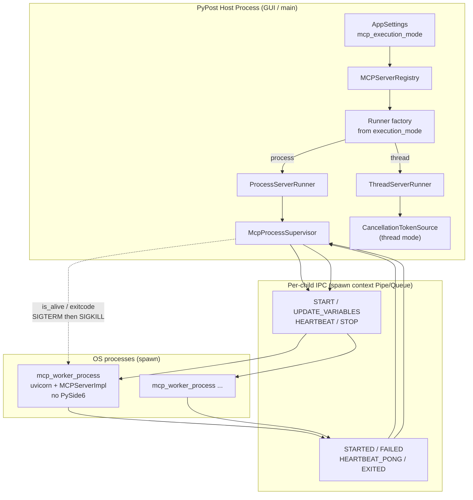

# PYPOST-1439: Isolated Execution for Standalone MCP Servers

## Research

### 1. Phase 1 baseline (PYPOST-1438)

Phase 1 delivered the evaluation and 10+ server stress suite. Sources of truth:

- [`doc/dev/mcp_process_supervisor_evaluation.md`][eval-doc] — trade-off matrix, Phase 2
  blueprint (§4), adoption roadmap (§6).
- [`ai-tasks/PYPOST-1438/20-architecture.md`][arch-1438] — future supervisor section and
  stress-test architecture.
- [`tests/test_mcp_multiserver_stress_10x.py`][stress-10x] — barrier startup, namespace
  isolation under load, abrupt TCP RST, concurrent teardown + socket reclamation.

Empirical thread-mode baselines (10 servers): ~1.2s cluster start, 100% variable isolation
under 100 concurrent calls, adaptive teardown &lt;1.5s, ~65 MB heap delta. Crash containment
and GIL bypass remain unavailable in thread mode.

### 2. Current host lifecycle (what Phase 2 must not break)

- [`MCPServerRegistry`][registry] owns one `MCPServerManager` per `instance_id`, synchronizes
  via `_reconfiguration_lock`, and tears down with `ThreadPoolExecutor` in `stop_all()`.
- [`MCPServerManager`][manager] starts a daemon thread running `uvicorn.Server` on a private
  `asyncio` loop; stop uses `CancellationTokenSource` + `adaptive_thread_join` (default
  ~2.0s). Variable suppliers are live `Callable` closures into the ASGI impl.
- [`AppSettings`][settings] persists `mcp_servers` but has **no** execution-mode field yet.
  Operator choice must be a durable product setting (FR1).
- [`cancellation.py`][cancellation] provides cooperative tokens and adaptive join only; it
  cannot force-kill a stuck thread. Process mode must escalate to OS signals.

Thread mode remains the default and must keep satisfying the PYPOST-1438 stress contracts
(NFR5).

### 3. Why `spawn` (not `fork`) — current Python guidance

Python's multiprocessing docs require an explicit start method via `get_context()` /
`set_start_method()`. **`fork` is unsafe in multi-threaded processes** (Qt / PySide6 host):
child inherits locks and thread state and can deadlock. **`spawn` starts a fresh interpreter**
and is available on POSIX and Windows; it is the portable choice for this GUI host.

References:

- [multiprocessing — Process-based parallelism][py-mp] (start methods: spawn / fork /
  forkserver; Pipe/Queue serialization; `Process.terminate` / `Process.kill`).
- Graceful shutdown patterns: cooperative stop event or IPC STOP, then join with timeout,
  then escalate `terminate()` → `kill()` (peterspython graceful-shutdown article;
  jimmyg 2024 multiprocessing-shutdown notes).

Implication for PyPost: always use `multiprocessing.get_context("spawn")`. Pass picklable
entrypoints and IPC handles created from that same context. Never rely on live closures or
Qt objects crossing the process boundary.

### 4. Existing spawn usage in-repo

[`tests/test_mcp_proxy_live_integration.py`][proxy-live] already uses
`multiprocessing.get_context("spawn")` for an out-of-process helper. Phase 2 should follow
the same context API for production workers.

### 5. Design patterns selected

| Pattern | Role |
| --- | --- |
| **Strategy** | `MCPServerRunnerProtocol` with `ThreadServerRunner` / `ProcessServerRunner` |
| **Supervisor** | `McpProcessSupervisor` owns child PIDs, IPC, and reclamation |
| **Facade** | Registry keeps the same start/stop/status API; runners are an internal detail |
| **Snapshot IPC** | Variable/config updates as serialized dicts/sets, not live callables |
| **Headless worker** | Minimal import surface (`mcp_worker_process`) — no PySide6 |

---

## Implementation Plan

### High-level delivery order (Steps 3–8)

1. **Step 3 — Failing repro**: Add red process-mode acceptance tests (crash isolation,
   variable isolation, bounded stop, thread-mode regression). See Mandatory section below.
2. **Step 4 — Development**:
   - Add `mcp_execution_mode: Literal["thread", "process"] = "thread"` on `AppSettings`
     (persist as product setting; UI/settings dialog wiring as needed for FR1).
   - Extract `MCPServerRunnerProtocol` + `ThreadServerRunner` (wrap today's thread path).
   - Implement `McpProcessSupervisor`, `ProcessServerRunner`, and headless
     `pypost.core.mcp_worker_process`.
   - Wire registry to select runner from execution mode without changing public
     start/stop/status semantics.
   - Drive red tests green; keep thread-mode 10x stress green.
3. **Step 5 — Cleanup**: flake8 / mypy / `make check`.
4. **Step 6 — Observability**: status transitions for unexpected child exit; reuse
   `mcp_server_instance_counts`; structured logs for spawn/stop/kill.
5. **Step 7 — Tech debt**: auto-restart policy, IPC protocol versioning, memory ceilings.
6. **Step 8 — Dev docs**: update evaluation doc Phase 2 status; document execution mode and
   supervisor contracts under `doc/dev/`.

### Module placement (proposed)

| Module | Responsibility |
| --- | --- |
| `pypost/core/mcp_server_runner.py` | Protocol + `ThreadServerRunner` + `ProcessServerRunner` |
| `pypost/core/mcp_process_supervisor.py` | Process table, spawn, monitor, SIGTERM→SIGKILL |
| `pypost/core/mcp_worker_process.py` | Headless worker entrypoint (no PySide6) |
| `pypost/core/mcp_worker_ipc.py` | Message types + encode/decode helpers (optional split) |
| `pypost/models/settings.py` | `mcp_execution_mode` field |
| `pypost/core/mcp_server_registry.py` | Inject/select runner; map child failure → `failed` |
| `pypost/core/qt/mcp_server.py` | Prefer thin facade over runner; minimize dual paths |

Exact file split may adjust in Step 4 as long as responsibilities stay clear and thread mode
behavior is preserved.

### Mandatory — Failing Repro (next Step 3)

Automated red tests **before** production implementation. Preferred location:

`tests/test_mcp_process_isolation_repro.py`

(Reuse helpers from `tests/helpers/port_allocation.py`,
`CollectionVariablesIntegrationHarness`, and patterns from
`tests/test_mcp_multiserver_stress_10x.py`.)

#### Concrete red tests

1. **`test_process_mode_setting_defaults_to_thread_and_accepts_process`**
   - Assert `AppSettings().mcp_execution_mode == "thread"`.
   - Assert `AppSettings(mcp_execution_mode="process")` validates.
   - Reject invalid values via pydantic.
   - *Forces failure*: field does not exist yet → `ValidationError` / `AttributeError`.

2. **`test_process_mode_crash_isolation_peer_servers_survive`**
   - Configure `mcp_execution_mode="process"`.
   - Start ≥2 isolated standalone servers on ephemeral ports.
   - Trigger a **fatal child exit** in server A without killing the host (e.g. worker IPC
     command `DEBUG_ABORT` / `os._exit(1)` / intentional segfault harness — **test-only**,
     gated behind a debug IPC opcode or injectable worker target used only in tests).
   - Assert: host process still alive; server B still `running` and answers `tools/list`;
     server A transitions to `failed` (or equivalent operator-visible failed status) without
     requiring host restart.
   - *Forces failure*: process runner/supervisor absent → start either uses threads (no
     isolation) or cannot start in process mode.

3. **`test_process_mode_variable_isolation_under_concurrent_load`**
   - 10 process-mode servers with distinct secrets (`server_index`, `unique_secret`).
   - 100 concurrent JSON-RPC tool calls across the cluster.
   - Assert every response matches only that server's variables (same contract as 10x
     namespace test, but with `mcp_execution_mode="process"`).
   - *Forces failure*: process path missing, or live closures cannot cross processes → wrong
     / empty variables.

4. **`test_process_mode_bounded_stop_with_unresponsive_worker`**
   - Start a process-mode server whose worker ignores cooperative STOP (test-only
     `DEBUG_HANG` / ignore-STOP flag).
   - Call `registry.stop(instance_id)` or `stop_all()` with a short bound (~2–3s stop budget
     aligned with adaptive join / evaluation §4.1).
   - Assert stop returns within the bound; child is no longer alive; port can be rebound
     (SIGTERM then SIGKILL fallback exercised).
   - *Forces failure*: thread-only stop cannot force-kill; hang exceeds deadline or leaves
     port held.

5. **`test_thread_mode_regression_still_passes_10x_barrier_startup`** (or call into existing
   stress with explicit `mcp_execution_mode="thread"`)
   - Prove NFR5: default/lightweight mode unchanged.
   - *Forces failure* only if Step 4 accidentally breaks thread path while adding runners.

#### How to force failure without live external deps

- No third-party MCP servers required: use `CollectionVariablesIntegrationHarness` + local
  ASGI MCP stack as today.
- Crash / hang behaviors injected via **test-only worker control messages** or a
  `target=` override on spawn used exclusively by tests — never over the public MCP
  JSON-RPC surface.
- Ports via `EphemeralPortReserve` / `reserve_ephemeral_ports`.

#### Sequencing

1. Research complete (this document).
2. Step 3: land red tests (imports / settings / process APIs fail fast).
3. Step 4: implement runners + supervisor + worker until green; keep thread 10x green.

---

## Architecture

### System module diagram



### Lifecycle sequence (process mode)

```mermaid
sequenceDiagram
    autonumber
    actor Op as Operator / Registry
    participant Runner as ProcessServerRunner
    participant Sup as McpProcessSupervisor
    participant Child as mcp_worker_process
    participant OS as OS

    Op->>Runner: start(instance_id, config, vars snapshot, tools)
    Runner->>Sup: spawn_worker(instance_id, ipc ends)
    Sup->>OS: ctx.Process(target=worker_main, spawn)
    OS-->>Child: fresh interpreter
    Sup->>Child: START(host, port, tools, variables, ...)
    Child->>Child: bind uvicorn; private asyncio loop
    Child-->>Sup: STARTED
    Sup-->>Op: status running / is_listening

    Note over Op,Child: Hot variable refresh
    Op->>Sup: UPDATE_VARIABLES(snapshot)
    Sup->>Child: UPDATE_VARIABLES(...)
    Child-->>Sup: ACK

    loop Watchdog
        Sup->>Child: HEARTBEAT
        Child-->>Sup: HEARTBEAT_PONG
        Sup->>OS: process.is_alive() / exitcode
    end

    alt Unexpected child death
        OS-->>Sup: child exited (SIGCHLD / exitcode)
        Sup-->>Op: status failed
    else Operator stop
        Op->>Sup: stop(instance_id, timeout≈2s)
        Sup->>Child: STOP
        alt Exits in time
            Child-->>Sup: EXITED / join ok
        else Unresponsive
            Sup->>OS: terminate() SIGTERM
            Sup->>OS: wait ≤ remaining budget
            Sup->>OS: kill() SIGKILL
            Sup->>OS: join / waitpid reclaim
        end
        Sup-->>Op: status stopped; port free
    end
```

### Component responsibilities

#### `MCPServerRunnerProtocol`

Stable host-facing lifecycle surface used by the registry (names illustrative):

- `start(spec: ServerStartSpec) -> None`
- `stop(timeout: float | None = None) -> bool`
- `is_running() -> bool`
- `is_listening() -> bool`
- `last_start_error -> str | None`
- `update_variables(variables, hidden_keys, overridable_keys) -> None`
- `update_tools(tools) -> bool` (may restart worker; same semantics as today)

`ServerStartSpec` carries picklable / deep-copied payloads: host, port, server type, tool
list (or proxy upstream fields), and the **initial variable snapshot** (dict + key sets).

#### `ThreadServerRunner` (default)

- Adapts existing `MCPServerManager` thread + uvicorn path.
- Keeps live callables for variable suppliers (zero-copy, current behavior).
- Stop: cancellation token + `should_exit` + `adaptive_thread_join` (~2s default).
- Selected when `mcp_execution_mode == "thread"`.

#### `ProcessServerRunner`

- Thin adapter: translates registry lifecycle into supervisor calls.
- Converts supplier updates into **IPC snapshots** (`UPDATE_VARIABLES`).
- Exposes the same running/listening/error observables the registry already consumes
  (signals or callbacks mirrored to `status_changed` / `start_failed` as today).
- Selected when `mcp_execution_mode == "process"`.

#### `McpProcessSupervisor`

- `ctx = multiprocessing.get_context("spawn")`.
- Process table: `instance_id → {process, pid, parent_conn, state, ...}`.
- Spawn: create duplex `Pipe` (or pair of Queues) from `ctx`, start
  `Process(target=mcp_worker_process.main, args=(child_conn, ...), daemon=False)`.
  Prefer non-daemon children so the supervisor can always join/kill explicitly on host
  shutdown.
- Monitor: background poll of `process.is_alive()` and `exitcode` (portable stand-in for
  SIGCHLD/`waitpid`; on POSIX, optional `SIGCHLD` handler may wake the poller but must not
  replace the portable path). Unexpected exit → notify runner → registry `failed`.
- Stop protocol (evaluation §4.1 / NFR2):
  1. Send IPC `STOP`.
  2. Join / poll until deadline (~2.0s total stop budget for a single stuck child).
  3. `process.terminate()` (SIGTERM / Windows terminate).
  4. Brief wait; if still alive, `process.kill()` (SIGKILL / TerminateProcess).
  5. Final join; close IPC; remove table entry.
- Auto-restart with backoff is **optional** in this task; minimum DoD is detect + `failed`
  + operator-visible state (FR6). Document restart as tech-debt if deferred.

#### `pypost.core.mcp_worker_process` (headless)

- Module-level `main(conn, ...)` entrypoint importable under spawn (guard with
  `if __name__ == "__main__"` only if also used as a script; spawn target must be a
  top-level function).
- **Must not import PySide6 / Qt** — keep RSS near the ~30–50 MB evaluation baseline.
- Builds `MCPServerImpl` / `MCPProxyServerImpl` + uvicorn on a private event loop
  (same ASGI semantics → FR8).
- Holds mutable local copies of variables / hidden / overridable keys; replaces them on
  `UPDATE_VARIABLES`.
- Supplies callables **local to the child** that read those snapshots (closures stay
  in-process).
- Handles IPC: `START`, `UPDATE_VARIABLES`, `HEARTBEAT` → `HEARTBEAT_PONG`, `STOP`.
- On `STOP`: set uvicorn `should_exit`, cancel cooperative work, exit 0.
- Disable uvicorn signal handlers in the child (same rationale as thread mode) so the
  **supervisor** owns SIGTERM/SIGKILL policy; child reacts to IPC STOP primarily.

#### IPC message contract

JSON-serializable (or pickle-safe structured) envelopes, versioned with `v: 1`:

| Direction | Type | Payload (conceptual) |
| --- | --- | --- |
| Host → Child | `START` | host, port, server_type, tools/proxy fields, vars + key sets |
| Host → Child | `UPDATE_VARIABLES` | variables, hidden_keys, overridable_keys |
| Host → Child | `HEARTBEAT` | nonce / monotonic ts |
| Host → Child | `STOP` | optional grace hint |
| Child → Host | `STARTED` | pid, host, port |
| Child → Host | `START_FAILED` | message |
| Child → Host | `HEARTBEAT_PONG` | nonce |
| Child → Host | `ACK` | correlating request id |
| Child → Host | `WORKER_ERROR` | message (non-fatal log path) |

Test-only opcodes (`DEBUG_ABORT`, `DEBUG_HANG`) must be compiled out or gated so they are
unavailable in production builds / default worker code paths.

#### Operator setting: `mcp.execution_mode`

- Persist on `AppSettings` as `mcp_execution_mode: Literal["thread", "process"] = "thread"`.
- Naming maps to the evaluation's `mcp.execution_mode`; Python field uses snake_case to
  match existing `mcp_port` / `mcp_host` / `mcp_servers`.
- Default **`thread`** preserves current deployments (Scenario 5 / NFR5).
- Mode is read when starting servers (and when constructing the registry runner factory).
  Changing mode while servers run: either require stop-all first, or apply on next start
  per instance — prefer **apply on next start** with clear operator messaging (document in
  Step 8). Do not silently mix runners for the same instance_id.

#### Variable supplier serialization

| Mode | Mechanism |
| --- | --- |
| Thread | Live `Callable[[], dict[str, str]]` (and key-set suppliers) as today |
| Process | Host sends `UPDATE_VARIABLES` snapshots; child stores copies for local callables |

`refresh_environment` / `_start_manager` paths must branch: thread keeps lambdas; process
sends IPC snapshots. Never pickle host-side closures or Qt `Signal` objects into the child.

#### Registry integration (thread mode unbroken)

```text
MCPServerRegistry.start / stop / stop_all / refresh_* / reconfigure
        │
        ▼
  _runner_for(instance_id)  ← created with mode from AppSettings
        │
        ├── ThreadServerRunner → MCPServerManager (current code path)
        └── ProcessServerRunner → McpProcessSupervisor → child
```

Constraints:

- Public registry API and `McpServerStatus` states unchanged (`stopped` / `starting` /
  `running` / `failed`).
- `stop_all()` continues concurrent teardown; process runners must honor the same timeout
  budget and escalate kill so the executor wait does not hang (FR7).
- Reconfigure / pending candidate flow: process mode should follow the same
  candidate-then-commit pattern; candidate is another supervised child. If Step 4 finds
  this too large, gate reconfigure-in-process-mode behind an explicit follow-up debt item
  and keep stop/start/refresh solid for DoD — call out in Step 7 if deferred.
- Metrics: unexpected child exit increments/sets failed count via existing
  `_publish_instance_metrics`.

### Architectural decisions (ADR-style)

1. **Strategy runners over a hard cutover** — satisfies FR1 and NFR5.
2. **`spawn` only** — Qt-safe, cross-platform (NFR4).
3. **IPC snapshots for variables** — correctness/secrecy under isolation (FR5).
4. **SIGTERM then SIGKILL within ~2s** — bounded stop (FR7, NFR2, evaluation §4.1).
5. **Headless worker module** — memory and import isolation from GUI.
6. **No protocol/wire changes** — FR8 / out of scope.

### Interface sketch (illustrative)

```python
"""Illustrative contracts for Step 4 — not production code."""
from __future__ import annotations

from typing import Literal, Protocol, runtime_checkable

McpExecutionMode = Literal["thread", "process"]


@runtime_checkable
class MCPServerRunnerProtocol(Protocol):
    def start(self, spec: object) -> None: ...
    def stop(self, timeout: float | None = None) -> bool: ...
    def is_running(self) -> bool: ...
    def is_listening(self) -> bool: ...

    @property
    def last_start_error(self) -> str | None: ...

    def update_variables(
        self,
        variables: dict[str, str],
        hidden_keys: set[str],
        overridable_keys: set[str],
    ) -> None: ...
```

---

## Q&A

**Q: Why not replace threads entirely?**  
A: Isolation costs ~4–5× memory and adds spawn latency. FR1 / Scenario 5 require keeping
lightweight mode as a first-class choice.

**Q: Why Pipe/structured messages instead of shared memory?**  
A: Variable updates are small; pipes keep a clear control plane, work with spawn
serialization, and avoid shared-memory lifetime hazards with Qt threads.

**Q: How is crash isolation proven in CI without a real segfault?**  
A: A test-only worker abort (`os._exit` / abort opcode) still exercises OS process
boundaries: host and peer children survive. Optional native segfault harness can be a
later debt item if needed.

**Q: Does process mode change MCP client behavior?**  
A: No. Clients still speak the same HTTP/SSE/streamable MCP surface on the configured
host:port (FR8).

**Q: What about proxy server type?**  
A: Same runner selection applies; worker constructs `MCPProxyServerImpl` from `START`
payload. Prefer parity in Step 4; if schedule-bound, local standalone servers are the
primary DoD path and proxy process-mode follows as debt — only if explicitly recorded in
Step 7.

**Q: Where does SIGCHLD fit?**  
A: On POSIX, a `SIGCHLD` handler may wake the supervisor poll loop. Portable monitoring
still keys off `Process.is_alive()` / `exitcode` so Windows matches Linux/macOS (NFR4).

[eval-doc]: file:///home/src/doc/dev/mcp_process_supervisor_evaluation.md
[arch-1438]: file:///home/src/ai-tasks/PYPOST-1438/20-architecture.md
[stress-10x]: file:///home/src/tests/test_mcp_multiserver_stress_10x.py
[registry]: file:///home/src/pypost/core/mcp_server_registry.py
[manager]: file:///home/src/pypost/core/qt/mcp_server.py
[settings]: file:///home/src/pypost/models/settings.py
[cancellation]: file:///home/src/pypost/core/cancellation.py
[proxy-live]: file:///home/src/tests/test_mcp_proxy_live_integration.py
[py-mp]: https://docs.python.org/3/library/multiprocessing.html
