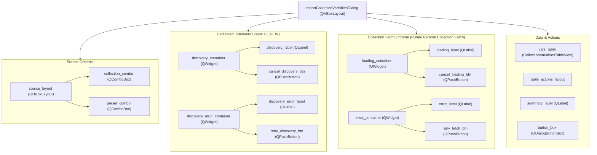
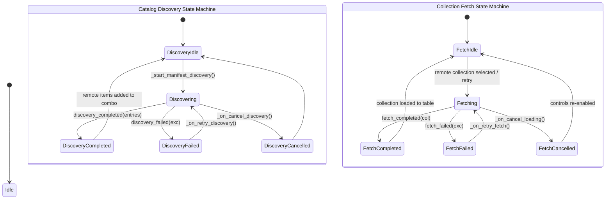

# PYPOST-1450: Dedicated Discovery Status UI Separate from Fetch Loading Chrome

## Research

### Existing UI & Layout Analysis
In [`pypost/ui/dialogs/import_collection_variables_dialog.py`](file:///home/src/pypost/ui/dialogs/import_collection_variables_dialog.py):
1. **Layout Hierarchy**:
   - The dialog root layout is a vertical layout (`QVBoxLayout`).
   - Source selection controls (`collection_combo`, `preset_combo`) sit in `source_layout` (`QHBoxLayout`) at the top.
   - Immediately below `source_layout` are two shared status containers:
     - `self.loading_container` (`QWidget`, horizontal layout with `loading_label` and `cancel_loading_btn`).
     - `self.error_container` (`QWidget`, horizontal layout with `error_label` and `retry_fetch_btn`).
   - Below the status containers sits `self.vars_table` (`CollectionVariablesTableView`), followed by table action buttons (`select_all_btn`, `deselect_all_btn`, `bulk_keep_current_btn`, `bulk_overwrite_btn`), `summary_label`, and `button_box`.

2. **State & Control Collisions in Current Code**:
   - **Cross-pollinated loading chrome**: `_start_manifest_discovery()` sets `self.loading_container.setVisible(True)` and modifies `self.loading_label.setText("Discovering library collections...")`. This repurposes the fetch loading indicator.
   - **Premature hiding**: In `_on_collection_changed()`, when a user selects a workspace collection, `self.loading_container.setVisible(False)` is called unconditionally. If manifest discovery is still running in the background, its status indicator is prematurely hidden while the worker continues to run.
   - **Cross-pollinated completion handling**: In `_on_discovery_completed()`, line 312 checks `if self._active_fetch_worker is None: self.loading_container.setVisible(False)`. If a fetch is active, the state transitions become entangled.
   - **Cross-pollinated error banner**: In `_on_discovery_failed()`, lines 352-355 show `self.error_container` and set `self.error_label.setText(f"Failed to discover library collections: {exc}")`. This overwrites or prevents fetch error messaging and gives the impression that loading the selected collection failed, even if the user is working with a local workspace collection.
   - **Ambiguous Cancel**: `_on_cancel_loading()` checks `if self._active_discovery_worker is not None` first. If discovery is active, clicking "Cancel" cancels discovery and returns early, failing to cancel any in-flight remote collection fetch.
   - **Ambiguous Retry**: `_on_retry_fetch()` inspects `self.collection_combo.currentData()`. If a library entry is selected, it retries fetch; otherwise, if `self.library_service` is present, it retries discovery. There is no way to retry discovery if a remote fetch failed, or to retry fetch independently.

3. **Widget Identity Standards**:
   - [`pypost/ui/widget_ids.py`](file:///home/src/pypost/ui/widget_ids.py) provides stable IDs using the `set_widget_id()` helper.
   - Currently, neither `loading_container` nor `error_container` (nor discovery UI) have registered widget IDs in `widget_ids.py`.
   - Introducing dedicated widget IDs for both discovery UI and fetch loading chrome adheres to project conventions and simplifies test automation.

## Implementation Plan

1. **Define Widget IDs in [`pypost/ui/widget_ids.py`](file:///home/src/pypost/ui/widget_ids.py)**:
   - Dedicated Discovery UI:
     - `IMPORT_COLLECTION_DISCOVERY_CONTAINER = "pypost_import_collection_discovery_container"`
     - `IMPORT_COLLECTION_DISCOVERY_LABEL = "pypost_import_collection_discovery_label"`
     - `IMPORT_COLLECTION_CANCEL_DISCOVERY_BUTTON = "pypost_import_collection_cancel_discovery_button"`
     - `IMPORT_COLLECTION_DISCOVERY_ERROR_CONTAINER = "pypost_import_collection_discovery_error_container"`
     - `IMPORT_COLLECTION_DISCOVERY_ERROR_LABEL = "pypost_import_collection_discovery_error_label"`
     - `IMPORT_COLLECTION_RETRY_DISCOVERY_BUTTON = "pypost_import_collection_retry_discovery_button"`
   - Dedicated Collection Fetch Chrome:
     - `IMPORT_COLLECTION_LOADING_CONTAINER = "pypost_import_collection_loading_container"`
     - `IMPORT_COLLECTION_LOADING_LABEL = "pypost_import_collection_loading_label"`
     - `IMPORT_COLLECTION_CANCEL_LOADING_BUTTON = "pypost_import_collection_cancel_loading_button"`
     - `IMPORT_COLLECTION_ERROR_CONTAINER = "pypost_import_collection_error_container"`
     - `IMPORT_COLLECTION_ERROR_LABEL = "pypost_import_collection_error_label"`
     - `IMPORT_COLLECTION_RETRY_FETCH_BUTTON = "pypost_import_collection_retry_fetch_button"`

2. **Construct Dedicated Discovery UI Components in [`ImportCollectionVariablesDialog.__init__`](file:///home/src/pypost/ui/dialogs/import_collection_variables_dialog.py)**:
   - Positioned between `source_layout` and the collection fetch loading containers:
     - `self.discovery_container = QWidget()`
       - Horizontal layout: `self.discovery_label = QLabel("Discovering library collections...")`, `self.cancel_discovery_btn = QPushButton("Cancel")`, stretch.
       - Connected to dedicated slot: `self._on_cancel_discovery`.
       - Initial visibility: `False`.
     - `self.discovery_error_container = QWidget()`
       - Horizontal layout: `self.discovery_error_label = QLabel()`, `self.retry_discovery_btn = QPushButton("Retry")`, stretch.
       - Red error styling applied to `discovery_error_label`.
       - Connected to dedicated slot: `self._on_retry_discovery`.
       - Initial visibility: `False`.
   - Tag all discovery and fetch widgets with their respective widget IDs via `set_widget_id()`.

3. **Separate State Machine Lifecycles & Signal Routing**:
   - **Catalog Discovery**:
     - `_start_manifest_discovery()`:
       - Displays `self.discovery_container` (sets label to `"Discovering library collections..."`).
       - Hides `self.discovery_error_container`.
       - Does NOT touch `self.loading_container` or `self.error_container`.
     - `_on_discovery_completed(entries, gen)`:
       - Hides `self.discovery_container`.
       - Appends remote entries to `self.collection_combo`.
       - Does NOT touch `self.loading_container`.
     - `_on_discovery_failed(exc, gen)`:
       - Hides `self.discovery_container`.
       - Displays `self.discovery_error_container` with `exc` in `self.discovery_error_label`.
       - Does NOT touch `self.loading_container` or `self.error_container`.
     - `_on_cancel_discovery()`:
       - Dedicated slot for `cancel_discovery_btn`.
       - Increments `_discovery_generation`, cancels `_active_discovery_worker`.
       - Hides `self.discovery_container` and `self.discovery_error_container`.
       - Does NOT cancel or modify `_active_fetch_worker` or fetch UI.
     - `_on_retry_discovery()`:
       - Dedicated slot for `retry_discovery_btn`.
       - Hides `self.discovery_error_container`.
       - Calls `_start_manifest_discovery()`.
       - Does NOT re-trigger collection fetch.
   - **Collection Fetch**:
     - `_start_fetch_remote_collection(conn_id, path)`:
       - Operates exclusively on `self.loading_container` and `self.error_container`.
       - Does NOT touch discovery containers.
     - `_on_cancel_loading()`:
       - Operates exclusively on `self._active_fetch_worker`, `self.loading_container`, and `self.error_container`.
       - No longer checks or cancels `_active_discovery_worker`.
     - `_on_retry_fetch()`:
       - Retries only the selected remote collection.
       - No longer falls back to `_start_manifest_discovery()`.
   - **Selection & Dialog Lifecycle**:
     - Selecting a workspace collection in `_on_collection_changed()` resets only fetch chrome (`loading_container`, `error_container`), leaving discovery running or displaying its dedicated status strip.
     - `reject()`, `accept()`, `closeEvent()` cleanly cancel both workers via dedicated helpers.

**Mandatory — Failing Repro (next Step 3):**
Create an automated red test suite in `tests/test_discovery_status_ui_repro.py`:
- **File location**: `tests/test_discovery_status_ui_repro.py`
- **Module timeout**: `pytestmark = [pytest.mark.timeout(30)]`
- **Isolation without external network**: Uses mocked `library_service` (via `unittest.mock.MagicMock` and threading synchronization events or controlled sleeps).
- **Assertions tested**:
  1. `test_discovery_ui_elements_exist_and_have_widget_ids`:
     - Verifies `dialog.discovery_container`, `dialog.discovery_label`, `dialog.cancel_discovery_btn`, `dialog.discovery_error_container`, `dialog.discovery_error_label`, and `dialog.retry_discovery_btn` are created and have valid object names per `widget_ids.py`.
     - Verifies `cancel_discovery_btn` is wired to `_on_cancel_discovery` and `retry_discovery_btn` is wired to `_on_retry_discovery`.
  2. `test_discovery_status_visible_without_polluting_fetch_loading`:
     - Verifies that while discovery is in progress, `discovery_container.isVisible()` is `True`, `discovery_label.text()` is `"Discovering library collections..."`, and `loading_container.isVisible()` is `False`.
     - Verifies that workspace collections remain selected and interactive (table populated, controls enabled) while discovery is in-flight.
  3. `test_discovery_cancellation_isolated_from_fetch_chrome`:
     - Triggers `dialog.cancel_discovery_btn.click()`.
     - Verifies discovery worker is cancelled and `discovery_container.isVisible()` becomes `False`.
     - Verifies collection fetch loading chrome remains hidden and workspace table data is intact.
  4. `test_discovery_error_isolated_in_discovery_error_container`:
     - Configures `mock_service.list_connections` to raise an error.
     - Awaits discovery failure.
     - Verifies `discovery_error_container.isVisible()` is `True`, `discovery_error_label.text()` mentions the failure, and `retry_discovery_btn.isEnabled()` is `True`.
     - Verifies `fetch_error` (`dialog.error_container.isVisible()`) is `False` and `loading_container.isVisible()` is `False`.
  5. `test_discovery_retry_triggers_rediscovery_not_fetch`:
     - Clicking `dialog.retry_discovery_btn.click()` restarts discovery without invoking `_start_fetch_remote_collection` or clearing workspace table data.
  6. `test_concurrent_discovery_and_fetch_cancellation_independence`:
     - Simulates both active discovery worker and active fetch worker.
     - Cancelling discovery (`cancel_discovery_btn.click()`) cancels discovery without aborting the fetch worker.
     - Cancelling fetch (`cancel_loading_btn.click()`) cancels fetch without aborting discovery.
- **Sequencing**:
  1. Step 3: Implement `tests/test_discovery_status_ui_repro.py`. Run `make test` to verify it fails red against current code.
  2. Step 4: Implement dedicated discovery UI and separated handlers in `import_collection_variables_dialog.py` and IDs in `widget_ids.py` until tests pass green.

## Architecture

### Component Hierarchy & Layout

### State Machine Separation

### Module Responsibilities

| Component / Method | Scope | Responsibility |
| --- | --- | --- |
| `discovery_container` | Discovery UI | Dedicated container for in-progress discovery feedback. |
| `discovery_label` | Discovery UI | Displays "Discovering library collections..." during catalog scan. |
| `cancel_discovery_btn` | Discovery UI | Cancels in-flight catalog discovery worker. |
| `discovery_error_container`| Discovery UI | Dedicated error banner for catalog discovery failures. |
| `discovery_error_label` | Discovery UI | Displays discovery error details in styled red text. |
| `retry_discovery_btn` | Discovery UI | Retries catalog discovery scan without affecting current collection or fetch state. |
| `_on_cancel_discovery()` | Signal Handler | Dedicated slot for `cancel_discovery_btn.clicked`. Aborts `_active_discovery_worker`. |
| `_on_retry_discovery()` | Signal Handler | Dedicated slot for `retry_discovery_btn.clicked`. Restarts `_start_manifest_discovery()`. |
| `loading_container` | Fetch UI | Pure remote collection fetch loading container (never used for discovery). |
| `error_container` | Fetch UI | Pure remote collection fetch error container (never used for discovery). |
| `_on_cancel_loading()` | Signal Handler | Dedicated slot for `cancel_loading_btn.clicked`. Aborts `_active_fetch_worker`. |
| `_on_retry_fetch()` | Signal Handler | Dedicated slot for `retry_fetch_btn.clicked`. Retries `_start_fetch_remote_collection()`. |

### Architectural Patterns

- **Separation of Concerns (SoC)**: Background discovery of library manifests and user-initiated fetching of specific collection contents are decoupled at the UI, controller, and state levels.
- **Symmetrical State Enclosures**: Both asynchronous operations have distinct, non-overlapping loading and error containers, matching signal handlers, and distinct cancel/retry tokens.
- **Non-blocking UI & Worker Lifecycle**: Long-running I/O executes exclusively on `QThread` workers with generation IDs. UI stays responsive to local workspace collections at all times.

## Q&A

- **Q: Why separate discovery error from fetch error into two containers instead of one status strip?**
  **A:** Symmetrical containers (`discovery_container` + `discovery_error_container` alongside `loading_container` + `error_container`) ensure that both operations can present their status simultaneously without overwriting each other. If discovery fails while a user is fetching a remote collection, both error and loading states can coexist cleanly without race conditions.
- **Q: How does this affect existing tests in `tests/test_async_manifest_discovery_repro.py` and `tests/test_remote_collection_fault_injection_repro.py`?**
  **A:** Existing tests inspect `collection_combo` contents or `error_container` on remote collection fetch faults. By keeping `loading_container` and `error_container` dedicated to fetch operations, existing collection fetch fault tests will continue to pass without modification.
- **Q: What widget IDs will be added?**
  **A:** Six IDs for discovery (`IMPORT_COLLECTION_DISCOVERY_CONTAINER`, `IMPORT_COLLECTION_DISCOVERY_LABEL`, `IMPORT_COLLECTION_CANCEL_DISCOVERY_BUTTON`, `IMPORT_COLLECTION_DISCOVERY_ERROR_CONTAINER`, `IMPORT_COLLECTION_DISCOVERY_ERROR_LABEL`, `IMPORT_COLLECTION_RETRY_DISCOVERY_BUTTON`) and six corresponding IDs for fetch chrome to ensure comprehensive automation coverage.
