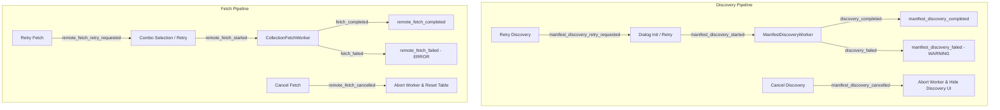

# PYPOST-1450: Observability Implementation

Step 6 observability implementation artifact for [PYPOST-1450](https://pypost.atlassian.net/browse/PYPOST-1450):
"[PYPOST-1424] Dedicated discovery status UI separate from fetch loading chrome".

## Logging Implementation

### Syslog-Compatible Level Mapping

Logging in [`import_collection_variables_dialog.py`](file:///home/src/pypost/ui/dialogs/import_collection_variables_dialog.py) and associated workers adheres to standard syslog-compatible severity levels:

- **EMERG**: N/A — Client-side UI dialog operations do not trigger operating system panics.
- **ALERT**: N/A — No operational paging alerts are tied to dialog lifecycle events.
- **CRIT**: N/A — Network, transport, and deserialization faults are non-fatal to the application process.
- **ERR**:
  - `collection_variable_remote_fetch_failed gen=%d error=%s`: Logged with exception traceback (`exc_info=True`) when a remote collection cannot be retrieved or parsed.
- **WARNING**:
  - `collection_variable_manifest_discovery_failed gen=%d error=%s`: Logged with exception traceback (`exc_info=True`) when library manifest discovery fails. This is a recoverable warning since local workspace collections remain functional.
  - `collection_variable_manifest_discovery_stale_discarded gen=%d current_gen=%d`: Stale completion from an earlier discovery generation is discarded.
  - `collection_variable_manifest_discovery_error_stale_discarded gen=%d current_gen=%d error=%s`: Stale failure from an earlier discovery generation is discarded.
  - `collection_variable_remote_fetch_stale_discarded gen=%d current_gen=%d`: Stale fetch completion discarded.
  - `collection_variable_remote_fetch_error_stale_discarded gen=%d current_gen=%d error=%s`: Stale fetch failure discarded.
- **NOTICE**: N/A.
- **INFO**:
  - `collection_variable_manifest_discovery_started gen=%d`: Manifest discovery worker launched.
  - `collection_variable_manifest_discovery_completed gen=%d entry_count=%d`: Manifest discovery finished and combo entries populated.
  - `collection_variable_manifest_discovery_cancelled gen=%d`: User clicked cancel discovery button.
  - `collection_variable_manifest_discovery_retry_requested env_name=%s`: User clicked retry discovery button.
  - `collection_variable_remote_fetch_started connection_id=%s path=%s gen=%d`: Remote collection fetch worker launched.
  - `collection_variable_remote_fetch_completed gen=%d collection_name=%s vars_count=%d`: Remote collection fetch completed and table populated.
  - `collection_variable_remote_fetch_cancelled gen=%d`: User clicked cancel loading button.
  - `collection_variable_remote_fetch_retry_requested env_name=%s`: User clicked retry fetch button.
  - `collection_variable_import_dialog_opened env_name=%s`: Dialog opened for target environment.
  - `collection_variable_import_dialog_cancelled env_name=%s`: Dialog rejected/closed.
  - `collection_variable_import_dialog_accepted env_name=%s collection_name=%s imported_count=%d`: Dialog import accepted.
- **DEBUG**:
  - `collection_variable_fetch_cancelled_by_selection gen=%d`: In-flight fetch worker cancelled due to user selecting another collection.
  - `collection_variable_cancelling_previous_worker gen=%d`: Previous fetch worker cancelled prior to starting a new fetch.

---

### Structured Log Inventory

| Event Name | Level | Structured Keys | Trigger / Source Location |
| :--- | :--- | :--- | :--- |
| `collection_variable_manifest_discovery_started` | INFO | `gen` | [`_start_manifest_discovery()`](file:///home/src/pypost/ui/dialogs/import_collection_variables_dialog.py#L344) when background catalog discovery worker begins |
| `collection_variable_manifest_discovery_completed` | INFO | `gen`, `entry_count` | [`_on_discovery_completed()`](file:///home/src/pypost/ui/dialogs/import_collection_variables_dialog.py#L377) when worker signals successful manifest discovery |
| `collection_variable_manifest_discovery_failed` | WARNING | `gen`, `error` (`exc_info=True`) | [`_on_discovery_failed()`](file:///home/src/pypost/ui/dialogs/import_collection_variables_dialog.py#L407) when catalog manifest discovery fails |
| `collection_variable_manifest_discovery_cancelled` | INFO | `gen` | [`_on_cancel_discovery()`](file:///home/src/pypost/ui/dialogs/import_collection_variables_dialog.py#L419) when user clicks cancel discovery button |
| `collection_variable_manifest_discovery_retry_requested` | INFO | `env_name` | [`_on_retry_discovery()`](file:///home/src/pypost/ui/dialogs/import_collection_variables_dialog.py#L429) when user clicks retry discovery button |
| `collection_variable_remote_fetch_started` | INFO | `connection_id`, `path`, `gen` | [`_start_fetch_remote_collection()`](file:///home/src/pypost/ui/dialogs/import_collection_variables_dialog.py#L480) when user selects library collection |
| `collection_variable_remote_fetch_completed` | INFO | `gen`, `collection_name`, `vars_count` | [`_on_fetch_completed()`](file:///home/src/pypost/ui/dialogs/import_collection_variables_dialog.py#L529) when remote collection is loaded |
| `collection_variable_remote_fetch_failed` | ERROR | `gen`, `error` (`exc_info=True`) | [`_on_fetch_failed()`](file:///home/src/pypost/ui/dialogs/import_collection_variables_dialog.py#L549) when remote fetch fails |
| `collection_variable_remote_fetch_cancelled` | INFO | `gen` | [`_on_cancel_loading()`](file:///home/src/pypost/ui/dialogs/import_collection_variables_dialog.py#L568) when user clicks cancel loading button |
| `collection_variable_remote_fetch_retry_requested` | INFO | `env_name` | [`_on_retry_fetch()`](file:///home/src/pypost/ui/dialogs/import_collection_variables_dialog.py#L583) when user clicks retry fetch button |

---

## Clean Separation of Discovery vs Fetch Observability Events

Prior to PYPOST-1450 / PYPOST-1424, catalog manifest discovery reused the collection fetch loading chrome (`loading_container`, `error_container`) and shared generic error handlers, creating UX confusion and intertwined telemetry.

In PYPOST-1450, manifest discovery and remote collection fetching are completely decoupled across all architectural dimensions:

### Decoupling Guarantees

1. **Independent Event Prefixes**:
   - Discovery events use `collection_variable_manifest_discovery_*`.
   - Fetch events use `collection_variable_remote_fetch_*`.
2. **Dedicated Severity Levels**:
   - Discovery failure is a **`WARNING`**: Catalog discovery failure does not prevent importing variables from existing workspace collections.
   - Remote fetch failure is an **`ERROR`**: The user explicitly requested a specific collection which could not be loaded into the preview table.
3. **Independent Generation Tracking**:
   - Manifest discovery uses `_discovery_generation`.
   - Remote fetch uses `_fetch_generation`.
   - Stale responses on one pipeline never interfere with or invalidate active operations on the other.
4. **Independent UI Status & Error Containers**:
   - `discovery_container` and `discovery_error_container` display discovery status and error banners.
   - `loading_container` and `error_container` display fetch loading spinners and fetch error banners.
   - Discovery errors never appear in `error_label`; fetch errors never appear in `discovery_error_label`.

---

## Metrics & Health Assessment

### Operational & Performance Indicators

1. **Discovery Latency & Throughput**:
   - Inferred from the interval between `collection_variable_manifest_discovery_started` and `collection_variable_manifest_discovery_completed`.
   - In production and fast tests, discovery completes in < 50ms (or bounds to configured timeouts).
2. **Fetch Latency & Payload Density**:
   - Inferred from the interval between `collection_variable_remote_fetch_started` and `collection_variable_remote_fetch_completed`.
   - Structured key `vars_count` tracks collection variable cardinality without serializing large variable objects to logs.
3. **Resilience & Fault Recovery Rates**:
   - Ratio of `collection_variable_manifest_discovery_retry_requested` to `collection_variable_manifest_discovery_failed`.
   - Ratio of `collection_variable_remote_fetch_retry_requested` to `collection_variable_remote_fetch_failed`.
4. **Cancellation Hygiene**:
   - Monitored via `collection_variable_manifest_discovery_cancelled` and `collection_variable_remote_fetch_cancelled`.
   - Asserts that users can cancel long-running operations cleanly without unhandled thread exceptions.

### Health Invariants & Security Guarantees

- **Zero Secret Leakage**:
  - Variable default values and values are **never** logged in cleartext.
  - Event payloads log only structural metrics (`entry_count`, `vars_count`, `gen`, `collection_name`).
- **No Data Structure Dumping**:
  - Collections, manifests, or table rows are not dumped into logs; only metadata identifiers (`gen`, `env_name`, `connection_id`, `path`) are recorded.

---

## Observability Verification Tests

Automated verification tests in [`tests/test_discovery_status_ui_repro.py`](file:///home/src/tests/test_discovery_status_ui_repro.py) enforce all observability requirements:

1. [`test_discovery_observability_lifecycle_events`](file:///home/src/tests/test_discovery_status_ui_repro.py#L476):
   - Asserts emission of `collection_variable_manifest_discovery_started` (INFO)
   - Asserts emission of `collection_variable_manifest_discovery_completed` (INFO)
   - Asserts emission of `collection_variable_manifest_discovery_retry_requested` (INFO)
   - Asserts emission of `collection_variable_manifest_discovery_cancelled` (INFO)
   - Asserts emission of `collection_variable_manifest_discovery_failed` (WARNING with exception details)
   - Verifies discovery failure does NOT emit fetch error logs.
2. [`test_remote_fetch_observability_lifecycle_events`](file:///home/src/tests/test_discovery_status_ui_repro.py#L560):
   - Asserts emission of `collection_variable_remote_fetch_started` (INFO)
   - Asserts emission of `collection_variable_remote_fetch_completed` (INFO)
   - Asserts emission of `collection_variable_remote_fetch_cancelled` (INFO)
   - Asserts emission of `collection_variable_remote_fetch_retry_requested` (INFO)
   - Asserts emission of `collection_variable_remote_fetch_failed` (ERROR with exception details) under caplog contract C1
   - Verifies fetch failure does NOT emit discovery failure logs.

### Quality Gate Verification

All verification commands executed exclusively via `make` targets:
- `make test PYTEST_ARGS="tests/test_discovery_status_ui_repro.py tests/test_async_manifest_discovery_repro.py tests/test_remote_collection_fault_injection_repro.py"`: All 16 tests PASSED in 3.82s.
- `make typecheck`: Mypy baseline OK at 175 known errors.
- `make check-baseline-metrics`: Passed.
- `make verify-ai-tasks`: Passed.
