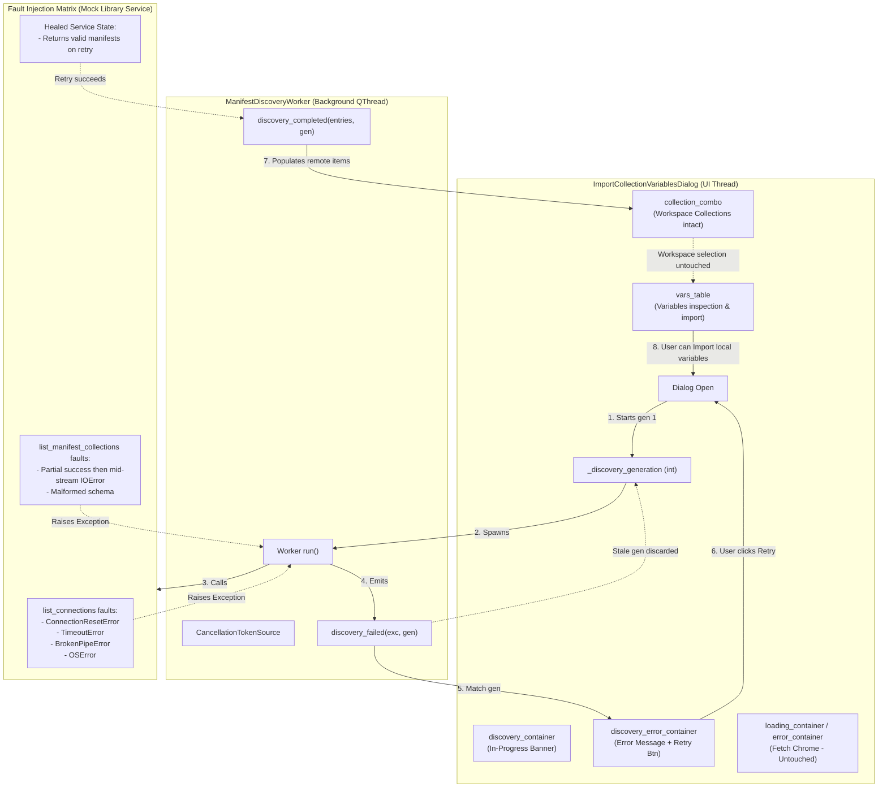
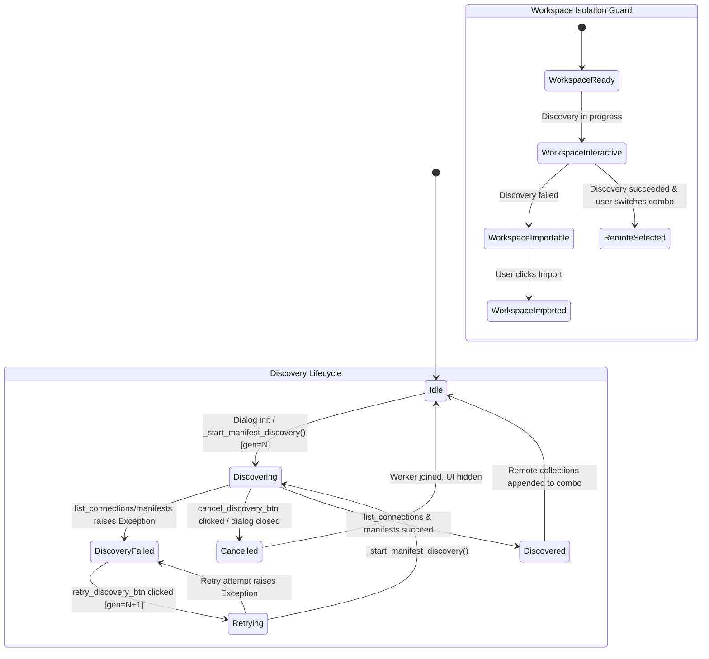

# PYPOST-1451: Discovery Failure and Retry Automated Coverage

## Research

### Background & Context

In [`ImportCollectionVariablesDialog`](file:///home/src/pypost/ui/dialogs/import_collection_variables_dialog.py), users can import variables from both local workspace collections and external library connections. To prevent the UI thread from freezing when connecting to external catalogs, [`ManifestDiscoveryWorker`](file:///home/src/pypost/ui/workers/manifest_discovery_worker.py) enumerates library connections and catalog manifests asynchronously in the background.

In PYPOST-1450, dedicated discovery status feedback (`discovery_container`) and error banner (`discovery_error_container`) were introduced to separate catalog discovery from the collection contents fetch chrome (`loading_container`, `error_container`). However, comprehensive automated test coverage for discovery failure modes, retry recovery, rapid generation discards, and worker thread lifecycle management was not fully established.

### Analysis of Target Implementation

#### 1. ManifestDiscoveryWorker Lifecycle & Error Handling

In [`pypost/ui/workers/manifest_discovery_worker.py`](file:///home/src/pypost/ui/workers/manifest_discovery_worker.py):
- **Inheritance & Signals**:
  - Inherits from `PySide6.QtCore.QThread`.
  - Defines `discovery_completed = Signal(object, int)` where the payload is `entries: list[tuple[str, tuple[str, str, str]]]` and `generation_id: int`.
  - Defines `discovery_failed = Signal(Exception, int)` with the caught `exc` and `generation_id: int`.
- **Cooperative Cancellation**:
  - Owns a `CancellationTokenSource` (`self._cts = CancellationTokenSource()`) and boolean `self._cancelled = False`.
  - `cancel()` invokes `self._cancelled = True`, `self.requestInterruption()`, and `self._cts.cancel(reason="manifest discovery cancelled")`.
- **Execution Flow in `run()`**:
  1. Calls `connections = call_with_cancellation_token(self.library_service.list_connections, cancellation_token=self._cts.token)`.
  2. Iterates through each connection `conn` in `connections`:
     - Checks `if self._cancelled or self.isInterruptionRequested(): break`.
     - Checks `self._cts.token.throw_if_cancellation_requested()`.
     - Calls `manifest_cols = call_with_cancellation_token(self.library_service.list_manifest_collections, conn.stable_id, cancellation_token=self._cts.token)`.
     - Iterates through manifests and builds entries `(label, ("library", conn.stable_id, mcol["path"]))`.
  3. If cancelled or interrupted at any point, logs debug and returns cleanly without emitting completion or failure signals.
  4. If traversal finishes successfully, emits `discovery_completed.emit(entries, self.generation_id)`.
  5. Catches `OperationCancelledError`: logs debug abort, suppresses signal emission.
  6. Catches `Exception`: if not cancelled and not interruption requested, emits `discovery_failed.emit(exc, self.generation_id)`. If cancelled, logs debug and suppresses emission.
  7. `finally` block guarantees `self._cts.dispose()`.

#### 2. ImportCollectionVariablesDialog Discovery State Management

In [`pypost/ui/dialogs/import_collection_variables_dialog.py`](file:///home/src/pypost/ui/dialogs/import_collection_variables_dialog.py):
- **State Fields**:
  - `self._discovery_generation: int = 0`: monotonically increasing integer tracking active discovery cycle.
  - `self._active_discovery_worker: ManifestDiscoveryWorker | None = None`: reference to active discovery thread.
- **UI Elements for Discovery**:
  - `self.discovery_container` (`QWidget`, ID `IMPORT_COLLECTION_DISCOVERY_CONTAINER`):
    - `self.discovery_label` (`QLabel`, ID `IMPORT_COLLECTION_DISCOVERY_LABEL`).
    - `self.cancel_discovery_btn` (`QPushButton`, ID `IMPORT_COLLECTION_CANCEL_DISCOVERY_BUTTON`).
  - `self.discovery_error_container` (`QWidget`, ID `IMPORT_COLLECTION_DISCOVERY_ERROR_CONTAINER`):
    - `self.discovery_error_label` (`QLabel`, ID `IMPORT_COLLECTION_DISCOVERY_ERROR_LABEL`).
    - `self.retry_discovery_btn` (`QPushButton`, ID `IMPORT_COLLECTION_RETRY_DISCOVERY_BUTTON`).
- **Initiating Discovery (`_start_manifest_discovery`)**:
  - Increments `_discovery_generation += 1`.
  - Aborts any prior discovery worker via `_cancel_discovery_worker()`.
  - Hides `discovery_error_container`, displays `discovery_container`.
  - Instantiates `ManifestDiscoveryWorker`, connects signals `discovery_completed` and `discovery_failed`, and calls `worker.start()`.
- **Handling Failure (`_on_discovery_failed`)**:
  - Stale guard: `if gen != self._discovery_generation: return` (logs warning and discards).
  - Clears `self._active_discovery_worker = None`.
  - Hides `self.discovery_container`.
  - Displays `self.discovery_error_container`.
  - Sets `self.discovery_error_label.setText(f"Failed to discover library collections: {exc}")`.
  - Enables `self.retry_discovery_btn.setEnabled(True)`.
- **Handling Retry (`_on_retry_discovery`)**:
  - Hides `discovery_error_container`.
  - Re-invokes `_start_manifest_discovery()` (which advances generation, clears prior worker, and starts fresh worker).
- **Handling Cancellation (`_on_cancel_discovery`)**:
  - Advances `_discovery_generation += 1`.
  - Cancels and joins `_active_discovery_worker`.
  - Hides both `discovery_container` and `discovery_error_container`.
- **Dialog Teardown (`closeEvent`, `reject`, `accept`)**:
  - All teardown hooks call `self._discovery_generation += 1` and `self._cancel_discovery_worker()` (which executes `worker.cancel()` and `worker.wait(1000)`).

### Coverage Gaps Identified

1. **Exhaustive Fault Types in `list_connections`**: Current tests only cover happy paths and a generic `RuntimeError`. Tests are needed for specific I/O exceptions: `ConnectionResetError`, `TimeoutError`, `BrokenPipeError`, and `OSError`.
2. **Catalog Traversal Mid-Stream Faults**: No tests verify behavior when `list_connections` succeeds (e.g. 2 connections), but `list_manifest_collections` fails on connection 2. Tests must assert that partial results are discarded, error banner is shown with retry button, and no unhandled exceptions leak.
3. **End-to-End Retry Recovery**: No test validates the complete fail-then-recover lifecycle: failing on dialog launch, clicking `retry_discovery_btn`, subsequent successful worker execution, remote collections populating into `collection_combo`, and verifying workspace collection selection is preserved.
4. **Rapid Retry Generation Race Condition**: No test simulates a slow or delayed worker 1 emitting a failure after the user has already clicked Retry (launching worker 2). Tests must verify that stale failure signals from worker 1 are rejected and do not overwrite or disrupt worker 2.
5. **Cooperative Cancellation During Fault/Retry**: No test verifies that clicking "Cancel" while discovery is failing or retrying cleanly aborts the worker via `CancellationToken` without emitting an error banner.
6. **Decoupling & Workspace Collection Isolation**: No test verifies that while discovery is in a failed state, the user can continue to interact with local workspace collections, view candidate variables in `vars_table`, change conflict strategies, and successfully execute an import (`accept()`).
7. **Thread Join & GC on Close During Failure**: No test asserts that closing or rejecting the dialog while discovery is in a failure or retrying state joins the worker thread cleanly without thread leaks or Qt warnings.

---

## Implementation Plan

### High-Level Architecture of Test Suite

A dedicated automated test module `tests/test_async_manifest_discovery_failure_repro.py` will be created. The module follows repository standards:
- **Framework**: `pytest` with `pytest-mock` and `PySide6`.
- **Timeout Marking**: Module-level `pytestmark = [pytest.mark.timeout(30)]` per `do-testing/SKILL.md`.
- **Deterministic Waits**: Uses a bounded wait helper `_wait_until(predicate, qapp, timeout_s=5.0)` polling Qt events every 20ms without arbitrary sleep calls.
- **Thread Safety & Teardown**: Guarantees that any spawned `ManifestDiscoveryWorker` or `CollectionFetchWorker` is cancelled and joined (`worker.wait(1000)`) in `finally` blocks, and dialogs are closed.
- **Logging Guardrails**: Verifies warning logs matching structured events (`collection_variable_manifest_discovery_worker_failed`, `collection_variable_manifest_discovery_failed`, `collection_variable_manifest_discovery_error_stale_discarded`).

### Mandatory — Failing Repro (Step 3 Test Plan)

**File location**: `tests/test_async_manifest_discovery_failure_repro.py`

#### Planned Test Cases:

1. `test_discovery_failure_list_connections_network_and_os_errors`:
   - **Faults Injected**: Parameterized or sequential execution of `ConnectionResetError("Connection reset by peer")`, `TimeoutError("Connection timed out")`, `BrokenPipeError("Broken pipe")`, and `OSError("Network is unreachable")` on `mock_service.list_connections`.
   - **Desired Behavior**: Worker catches exception without crash, emits `discovery_failed(exc, gen)`. Dialog displays `discovery_error_container`, displays error message in `discovery_error_label`, enables `retry_discovery_btn`. `discovery_container`, `loading_container`, and `error_container` are all hidden.

2. `test_discovery_failure_mid_stream_catalog_traversal`:
   - **Faults Injected**: `mock_service.list_connections` returns two connection mocks (`conn1`, `conn2`). `mock_service.list_manifest_collections(conn1.stable_id)` succeeds and returns manifests. `mock_service.list_manifest_collections(conn2.stable_id)` raises `ConnectionResetError("Mid-stream catalog drop")`.
   - **Desired Behavior**: Worker aborts traversal, does NOT emit `discovery_completed`, emits `discovery_failed`. Dialog shows `discovery_error_container`. Combo box does NOT contain partial collections from `conn1`.

3. `test_discovery_fail_then_recover_end_to_end_retry`:
   - **Flow**:
     1. `mock_service.list_connections` initially raises `ConnectionRefusedError("Server offline")`.
     2. Dialog opens, discovery fails, `discovery_error_container` is visible.
     3. Heal `mock_service`: `mock_service.list_connections.side_effect = None` returning `[conn]`, `list_manifest_collections` returns `[{"name": "RemoteCol", "path": "cols/remote.json"}]`.
     4. User clicks `dialog.retry_discovery_btn.click()`.
     5. Dialog increments generation, hides `discovery_error_container`, shows `discovery_container`.
     6. Second worker completes successfully.
     7. `discovery_container` is hidden, remote collection `"RemoteCol (Remote Conn)"` is populated into `collection_combo`.
     8. Workspace collection remains at index 0 and selected.

4. `test_discovery_rapid_retry_discards_stale_failure`:
   - **Flow**:
     1. Mock `list_connections` uses a threading event to simulate a slow initial discovery worker (generation 1).
     2. Dialog opens, worker 1 begins execution and pauses.
     3. User clicks `retry_discovery_btn` before worker 1 finishes, advancing generation to 2.
     4. Worker 1 is unblocked and raises `RuntimeError("Late error from gen 1")`.
     5. Dialog `_on_discovery_failed` receives error with `gen=1 != current_gen(2)`.
     6. Verifies stale failure is discarded (logged as `collection_variable_manifest_discovery_error_stale_discarded`), error banner is NOT displayed, and worker 2 continues to completion.

5. `test_discovery_cancellation_during_fault_state`:
   - **Flow**:
     1. Worker 1 is hung in a slow network call.
     2. User clicks `dialog.cancel_discovery_btn.click()`.
     3. Verifies `_cts.is_cancellation_requested` is True, worker interruption is requested.
     4. Worker finishes via cancellation abort without emitting `discovery_failed`.
     5. `discovery_container` and `discovery_error_container` are both hidden.

6. `test_workspace_collections_fully_functional_during_discovery_failure`:
   - **Flow**:
     1. Dialog initialized with a workspace collection containing 2 variables (`host`, `token`) and a target environment containing conflicting variables.
     2. `mock_service.list_connections` raises `ConnectionResetError`.
     3. Wait for discovery failure to complete and show error banner.
     4. Assert `collection_combo` shows the workspace collection and it is selected.
     5. Assert `vars_table` displays the 2 variables with correct conflict strategies.
     6. Set collision strategies, click `dialog.import_button.click()` (`dialog.accept()`).
     7. Verify `dialog.summary` is populated, variables are imported to `target_environment`, and dialog closes cleanly despite remote discovery failure.

7. `test_dialog_close_during_discovery_failure_clean_thread_join`:
   - **Flow**:
     1. Simulate discovery failure or in-flight discovery during dialog teardown.
     2. Call `dialog.close()` / `dialog.reject()`.
     3. Assert `_active_discovery_worker` has its `cancel()` invoked and is joined (`wait()`).
     4. Assert worker thread is stopped (`isFinished() == True` or `isRunning() == False`).
     5. Assert no unhandled Qt exceptions or thread memory leaks.

---

## Architecture

### System & Test Architecture Diagram

### Discovery Lifecycle & Retry State Machine

### Module Responsibilities & Test Assertions

| Component / Action | In-Scope Verification | Expected Assertion |
| --- | --- | --- |
| `ManifestDiscoveryWorker.run()` | Fault handling on `list_connections` | Catches network/OS errors, suppresses crash, emits `discovery_failed(exc, gen)`. |
| `ManifestDiscoveryWorker.run()` | Fault handling on `list_manifest_collections` | Traversal terminates on mid-stream fault, partial results discarded, emits `discovery_failed`. |
| `ManifestDiscoveryWorker.cancel()` | Cooperative cancellation | Sets CTS token, interruption requested, thread exits without emitting failure. |
| `ImportCollectionVariablesDialog._on_discovery_failed` | UI error presentation | `discovery_error_container.isVisible() == True`, label contains error text, `retry_discovery_btn.isEnabled() == True`. |
| `ImportCollectionVariablesDialog._on_discovery_failed` | Decoupling isolation | `loading_container.isVisible() == False`, `error_container.isVisible() == False`. |
| `ImportCollectionVariablesDialog._on_discovery_failed` | Stale generation discard | If `gen != self._discovery_generation`, signal is ignored, error banner not displayed. |
| `ImportCollectionVariablesDialog._on_retry_discovery` | End-to-end retry recovery | Increments generation, clears error container, runs new worker, populates combo on success. |
| `ImportCollectionVariablesDialog` Table / Import | Workspace usability during failure | Workspace collection selected, `vars_table` populated, import executes successfully. |
| `ImportCollectionVariablesDialog.closeEvent` | Teardown integrity | Worker cancelled, thread joined within 1.0s, no thread leaks or dangling references. |

### Architectural Patterns

- **Asynchronous Fault Boundary**: Network and catalog traversal exceptions are trapped inside the worker thread boundary, converted into structured Qt signals, and routed to the UI thread event loop.
- **Generation-Keyed State Validation**: Stale worker responses (from cancelled or superseded retry attempts) are filtered using monotonic integer tokens, preventing UI race conditions.
- **Fail-Safe UI Decoupling**: Remote discovery failures are contained within the dedicated discovery status strip, preventing collateral disruption of local workspace operations or collection variable fetching.
- **Deterministic Test Synchronization**: Test cases leverage event-driven state predicates via `_wait_until` without fragile thread sleeps, adhering to `do-testing` requirements.

---

## Q&A

- **Q: Why create a dedicated test file `tests/test_async_manifest_discovery_failure_repro.py` instead of adding to `test_discovery_status_ui_repro.py`?**
  **A:** `test_discovery_status_ui_repro.py` focuses specifically on UI container presence and layout separation between discovery and fetch chrome (PYPOST-1450). A dedicated `test_async_manifest_discovery_failure_repro.py` focuses on exhaustive fault injection, retry lifecycle recovery, mid-stream traversal errors, rapid generation discards, and local workspace usability, keeping test files cohesive and maintainable.

- **Q: How does the test suite simulate transient network drops and subsequent recovery?**
  **A:** By using `mock_service.list_connections.side_effect` with stateful call counters or functions: raising `ConnectionResetError` or `TimeoutError` on the first call, and returning valid mock connections and collections on subsequent calls triggered by `retry_discovery_btn.click()`.

- **Q: How is thread safety and clean teardown guaranteed during test execution?**
  **A:** Every test wraps dialog usage in `try ... finally` blocks that explicitly check `_active_discovery_worker` and `_active_fetch_worker`, invoke `cancel()`, wait for thread termination (`worker.wait(1000)`), and call `dialog.close()`. All waits use bounded deadlines.

- **Q: How do we verify that workspace collections are unaffected by remote catalog failure?**
  **A:** Tests assert that index 0 of `collection_combo` remains pointing to the workspace collection, `vars_table` displays the workspace variables, and triggering `dialog.accept()` successfully imports the local variables into `target_environment` with valid `dialog.summary` while `discovery_error_container` is visible.
