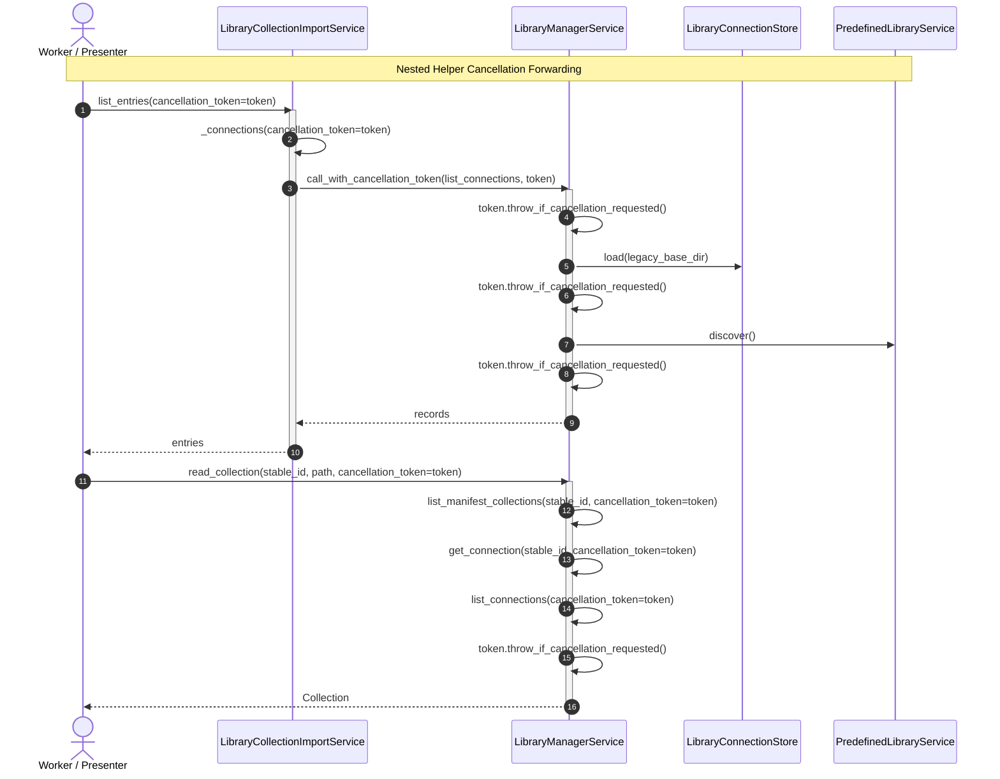
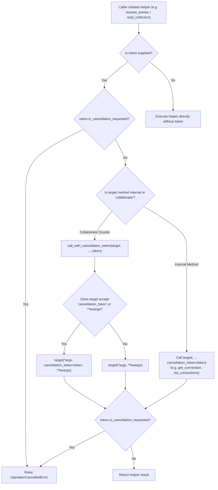

# PYPOST-1452: Forward cancellation through nested get_connection/list_connections

## Research

### Background & Problem Analysis

In PYPOST-1425, transport-level cancellation and cooperative abort signals were added to `CollectionFetchWorker` and `ManifestDiscoveryWorker` using `CancellationTokenSource` and `CancellationToken`. While this allowed remote collection fetching and high-level catalog listing to abort early when cancelled, technical debt item #1 in [`ai-tasks/PYPOST-1425/60-tech-debt.md`](file:///home/src/ai-tasks/PYPOST-1425/60-tech-debt.md) highlighted an operational vulnerability:

> `get_connection()` still calls `list_connections()` without forwarding an outer cancellation token, so nested listing during `list_manifest_collections` / `read_collection` may do a short uncancellable store load before the next check.

When users dismiss import dialogs, switch collection selections rapidly, or abort background operations, uncancellable nested operations cause:
1. **Unresponsive UI teardown**: Workers waiting on nested helper routines stall during dialog destruction or worker thread join.
2. **Orphaned I/O work**: CPU cycles and disk/filesystem access continue scanning manifests, legacy clones, and predefined libraries even after the user has explicitly aborted the operation.
3. **Inconsistent cancellation contracts**: Higher-level operations accept a `cancellation_token`, but the signal is dropped before reaching lower-level connection resolution and disk loading.

### Codebase Auditing & Call Graph Analysis

#### 1. `LibraryManagerService` ([`pypost/core/library_manager_service.py`](file:///home/src/pypost/core/library_manager_service.py))

- **`list_connections(self, cancellation_token: CancellationToken | None = None) -> list[LibraryConnectionRecord]`**:
  - Already accepts `cancellation_token`.
  - Performs cooperative checks before loading `connection_store.load()` and before `predefined_library.discover()`.
- **`get_connection(self, stable_id: str) -> Optional[LibraryConnectionRecord]`** (lines 84-89):
  - **GAP**: Does not accept `cancellation_token`.
  - Directly executes `self.list_connections()` without forwarding any token.
  - As a result, any store reload or predefined library discovery triggered by `get_connection` runs uncancellably.
- **`read_manifest(self, stable_id: str)`** (lines 95-100):
  - **GAP**: Does not accept `cancellation_token`.
  - Directly executes `self.get_connection(stable_id)` without a token.
- **`list_manifest_collections(self, stable_id: str, cancellation_token: CancellationToken | None = None)`** (lines 102-150):
  - Accepts `cancellation_token` and checks `cancellation_token.throw_if_cancellation_requested()`.
  - **GAP**: At line 110, calls `record = self.get_connection(stable_id)` without passing `cancellation_token`.
- **`read_collection(self, stable_id: str, relative_path: str, cancellation_token: CancellationToken | None = None)`** (lines 152-173):
  - Accepts `cancellation_token` and forwards it to `list_manifest_collections`.
  - **GAP**: At line 170, executes `record = self.get_connection(stable_id)` without passing `cancellation_token`.

#### 2. `LibraryCollectionImportService` ([`pypost/core/library_collection_import.py`](file:///home/src/pypost/core/library_collection_import.py))

- **`list_entries(self, connection: LibraryConnectionRecord | None = None, *, cancellation_token: CancellationToken | None = None)`** (lines 180-281):
  - Accepts `cancellation_token` and checks it in loops.
  - **GAP**: When `connection is None`, executes `connections = self._connections()`, which completely drops `cancellation_token`.
- **`_connections(self) -> list[LibraryConnectionRecord]`** (lines 483-488):
  - **GAP**: Does not accept `cancellation_token`.
  - Directly calls `records = list_connections()` without passing `cancellation_token` and without duck-typing fallback.
- **`resolve_entries(self, entries: Iterable[LibraryCollectionImportEntry], *, cancellation_token: CancellationToken | None = None)`** (lines 283-320):
  - Accepts `cancellation_token` and checks it at the start of each entry iteration.
  - **GAP**: At line 297, calls `record = self._find_connection(entry.library_id)` without passing `cancellation_token`.
- **`_find_connection(self, stable_id: str) -> LibraryConnectionRecord | None`** (lines 490-499):
  - **GAP**: Does not accept `cancellation_token`.
  - Calls `self._connections()` without token.
  - If not found in `_connections()`, calls `get_connection(stable_id)` without token and without safe duck-typing fallback.

#### 3. Presenters & UI Callers ([`pypost/ui/presenters/library_presenter.py`](file:///home/src/pypost/ui/presenters/library_presenter.py))

- **`get_connection_record(self, library_id: Optional[str] = None)`**:
  - Delegates to `self.manager_service.get_connection(connection_id)`.
  - Should accept an optional `cancellation_token` and forward it via `call_with_cancellation_token`.

### Compatibility & Duck-Typing Requirements

Existing test suites and collaborators frequently employ test doubles, mocks, or legacy services:
- Example: `_FakeLibraryManager` in [`tests/test_library_import_cancel_checkpoints_repro.py`](file:///home/src/tests/test_library_import_cancel_checkpoints_repro.py) defines:
  ```python
  def list_connections(self) -> list[LibraryConnectionRecord]: ...
  def get_connection(self, library_id: str) -> LibraryConnectionRecord | None: ...
  ```
  Neither method accepts `cancellation_token`.
- Direct parameter invocation (e.g. `self.library_manager.get_connection(stable_id, cancellation_token=...)`) would raise `TypeError: get_connection() got an unexpected keyword argument 'cancellation_token'`.
- Therefore, helper methods invoking collaborator methods on `self.library_manager` MUST use [`call_with_cancellation_token`](file:///home/src/pypost/core/cancellation.py#L255-L290). This utility inspects the callable's signature (and handles `MagicMock` kwargs forwarding) so that `cancellation_token` is passed when supported, and omitted when not supported.

---

## Implementation Plan

### High-Level Changes

1. **Update `LibraryManagerService` (`pypost/core/library_manager_service.py`)**:
   - Update `get_connection(self, stable_id: str, cancellation_token: CancellationToken | None = None) -> Optional[LibraryConnectionRecord]`:
     - Cooperative pre-check: `if cancellation_token is not None: cancellation_token.throw_if_cancellation_requested()`.
     - Forward `cancellation_token` to `self.list_connections(cancellation_token=cancellation_token)`.
     - Cooperative post-check: `if cancellation_token is not None: cancellation_token.throw_if_cancellation_requested()`.
   - Update `read_manifest(self, stable_id: str, cancellation_token: CancellationToken | None = None)`:
     - Cooperative pre-check: `if cancellation_token is not None: cancellation_token.throw_if_cancellation_requested()`.
     - Forward `cancellation_token` to `self.get_connection(stable_id, cancellation_token=cancellation_token)`.
   - Update `list_manifest_collections`:
     - Forward `cancellation_token` to `self.get_connection(stable_id, cancellation_token=cancellation_token)`.
   - Update `read_collection`:
     - Forward `cancellation_token` to `self.get_connection(stable_id, cancellation_token=cancellation_token)` at line 170.

2. **Update `LibraryCollectionImportService` (`pypost/core/library_collection_import.py`)**:
   - Import `call_with_cancellation_token` from `pypost.core.cancellation`.
   - Update `_connections(self, cancellation_token: CancellationToken | None = None) -> list[LibraryConnectionRecord]`:
     - Accept optional `cancellation_token`.
     - Check `cancellation_token.throw_if_cancellation_requested()`.
     - Invoke `list_connections` via `call_with_cancellation_token(list_connections, cancellation_token=cancellation_token)`.
     - Check `cancellation_token.throw_if_cancellation_requested()`.
   - Update `_find_connection(self, stable_id: str, cancellation_token: CancellationToken | None = None) -> LibraryConnectionRecord | None`:
     - Accept optional `cancellation_token`.
     - Check `cancellation_token.throw_if_cancellation_requested()`.
     - Forward `cancellation_token` to `self._connections(cancellation_token=cancellation_token)`.
     - If not found in `_connections()`, invoke `get_connection` via `call_with_cancellation_token(get_connection, stable_id, cancellation_token=cancellation_token)`.
   - Update `list_entries`:
     - In the fallback branch (`connections = self._connections(...)`), pass `cancellation_token=cancellation_token`.
   - Update `resolve_entries`:
     - In the entry loop, pass `cancellation_token=cancellation_token` into `self._find_connection(entry.library_id, cancellation_token=cancellation_token)`.

3. **Defensive update in `LibraryPresenter` (`pypost/ui/presenters/library_presenter.py`)**:
   - Update `get_connection_record(self, library_id: Optional[str] = None, cancellation_token: CancellationToken | None = None)`:
     - Forward `cancellation_token` to `self.manager_service.get_connection` via `call_with_cancellation_token`.

### Mandatory — Failing Repro (Step 3 Test Plan)

**Target Test File**: `tests/test_forward_cancellation_nested_helpers_repro.py`

Per Top-Down Step 3 rules, an automated red repro test suite will be created *before* applying any changes to production code. The tests assert the desired token forwarding and cooperative abort behavior across all nested helper paths.

#### Repro Test Cases:

1. `test_library_manager_get_connection_forwards_token_to_list_connections`:
   - **Setup**: Create a `LibraryManagerService` instance and spy/mock `list_connections`.
   - **Execution**: Invoke `manager.get_connection("lib-1", cancellation_token=token)`.
   - **Assertions**: Assert `list_connections` was invoked with `cancellation_token=token`.
   - **Why it fails on unpatched code**: `get_connection` signature does not accept `cancellation_token` (raises `TypeError`), and its internal implementation calls `self.list_connections()` with 0 arguments.

2. `test_library_manager_list_manifest_collections_forwards_token_to_get_connection`:
   - **Setup**: Spy/mock `get_connection` on `LibraryManagerService`.
   - **Execution**: Call `manager.list_manifest_collections("lib-1", cancellation_token=token)`.
   - **Assertions**: Assert `get_connection` was called with `cancellation_token=token`.
   - **Why it fails on unpatched code**: `list_manifest_collections` calls `self.get_connection(stable_id)` with only 1 argument, dropping the token.

3. `test_library_manager_read_manifest_forwards_token_to_get_connection`:
   - **Setup**: Spy/mock `get_connection` on `LibraryManagerService`.
   - **Execution**: Call `manager.read_manifest("lib-1", cancellation_token=token)`.
   - **Assertions**: Assert `get_connection` was called with `cancellation_token=token`.
   - **Why it fails on unpatched code**: `read_manifest` only takes `(self, stable_id: str)` and raises `TypeError` when given `cancellation_token`.

4. `test_library_manager_read_collection_forwards_token_to_second_get_connection`:
   - **Setup**: Setup mock manifest and spy `get_connection` on `LibraryManagerService`.
   - **Execution**: Call `manager.read_collection("lib-1", "path/to/col.json", cancellation_token=token)`.
   - **Assertions**: Verify that the second `get_connection` call (after `list_manifest_collections`) also receives `cancellation_token=token`.
   - **Why it fails on unpatched code**: Line 170 of `read_collection` invokes `self.get_connection(stable_id)` with 0 additional arguments.

5. `test_library_collection_import_list_entries_forwards_token_to_connections`:
   - **Setup**: Mock `library_manager.list_connections` to record kwargs.
   - **Execution**: Call `import_service.list_entries(cancellation_token=token)`.
   - **Assertions**: Assert `list_connections` was called with keyword `cancellation_token=token`.
   - **Why it fails on unpatched code**: `list_entries` calls `self._connections()`, which calls `list_connections()` with no token.

6. `test_library_collection_import_resolve_entries_forwards_token_to_nested_helpers`:
   - **Setup**: Create import service with mock `library_manager.get_connection` and `list_connections`.
   - **Execution**: Call `import_service.resolve_entries([entry], cancellation_token=token)`.
   - **Assertions**: Assert `self._find_connection` forwards `cancellation_token=token` to both `list_connections` and `get_connection`.
   - **Why it fails on unpatched code**: `resolve_entries` calls `self._find_connection(entry.library_id)` without token, and `_find_connection` calls `_connections()` and `get_connection` without token.

7. `test_nested_helpers_legacy_double_compatibility_fallback`:
   - **Setup**: Provide a legacy `_LegacyManagerDouble` whose `list_connections()` and `get_connection(id)` do NOT accept `cancellation_token`.
   - **Execution**: Call `import_service.list_entries(cancellation_token=token)` and `import_service.resolve_entries([entry], cancellation_token=token)`.
   - **Assertions**: Verify calls complete without `TypeError` due to `call_with_cancellation_token` duck-typing fallback.
   - **Why it verifies contract**: Ensures no regressions for existing tests and mocks that lack `cancellation_token`.

8. `test_pre_cancelled_token_aborts_nested_helpers_immediately`:
   - **Setup**: Create an already-cancelled `CancellationTokenSource` (`cts.cancel()`).
   - **Execution**: Call `manager.get_connection("lib-1", cancellation_token=cts.token)`, `manager.read_manifest("lib-1", cancellation_token=cts.token)`, `import_service._connections(cancellation_token=cts.token)`, `import_service._find_connection("lib-1", cancellation_token=cts.token)`.
   - **Assertions**: Each call must raise `OperationCancelledError` immediately at entry before performing store reads or filesystem scans.
   - **Why it fails on unpatched code**: Current unpatched methods don't check or accept `cancellation_token` and perform unnecessary disk I/O.

---

## Architecture

### Component Interaction Scheme

The following sequence diagram illustrates how an outer cancellation token propagates through nested helper layers down to the underlying store operations during catalog listing and collection reading:



### Call Graph & Fallback Decision Flowchart

The following flowchart shows the cooperative checkpoints and duck-typed fallback logic applied when invoking nested connection methods:



### Module Responsibilities

| Module | Location | Responsibility & Changes |
| --- | --- | --- |
| `LibraryManagerService` | [`pypost/core/library_manager_service.py`](file:///home/src/pypost/core/library_manager_service.py) | - Add optional `cancellation_token` to `get_connection` and `read_manifest`.<br/>- Forward `cancellation_token` to `list_connections` from `get_connection`.<br/>- Forward `cancellation_token` to `get_connection` in `list_manifest_collections` and `read_collection`.<br/>- Enforce cooperative entry/exit checkpoints. |
| `LibraryCollectionImportService` | [`pypost/core/library_collection_import.py`](file:///home/src/pypost/core/library_collection_import.py) | - Add optional `cancellation_token` to `_connections` and `_find_connection`.<br/>- Forward `cancellation_token` from `list_entries` to `_connections`.<br/>- Forward `cancellation_token` from `resolve_entries` to `_find_connection`.<br/>- Use `call_with_cancellation_token` for all collaborator invocations (`list_connections`, `get_connection`). |
| `LibraryPresenter` | [`pypost/ui/presenters/library_presenter.py`](file:///home/src/pypost/ui/presenters/library_presenter.py) | - Accept optional `cancellation_token` in `get_connection_record`.<br/>- Forward `cancellation_token` via `call_with_cancellation_token` to `manager_service.get_connection`. |
| `cancellation` | [`pypost/core/cancellation.py`](file:///home/src/pypost/core/cancellation.py) | Authoritative source of `CancellationToken`, `CancellationTokenSource`, `OperationCancelledError`, and `call_with_cancellation_token`. Unchanged (already fully equipped). |

### Method Signature Updates and Backward Compatibility Contract

#### 1. `LibraryManagerService.get_connection`

```python
def get_connection(
    self,
    stable_id: str,
    cancellation_token: CancellationToken | None = None,
) -> Optional[LibraryConnectionRecord]:
    """Return the authoritative current record for one connection.

    Cooperatively checks ``cancellation_token`` before and after refreshing
    connections via ``list_connections()``.
    """
```

- **Backward Compatibility**: `cancellation_token` defaults to `None`. All existing callers passing only `(stable_id)` execute without alteration.

#### 2. `LibraryManagerService.read_manifest`

```python
def read_manifest(
    self,
    stable_id: str,
    cancellation_token: CancellationToken | None = None,
):
    """Read the current manifest for a registered connection."""
```

- **Backward Compatibility**: `cancellation_token` defaults to `None`. Callers without token continue to function as before.

#### 3. `LibraryCollectionImportService._connections`

```python
def _connections(
    self,
    cancellation_token: CancellationToken | None = None,
) -> list[LibraryConnectionRecord]:
```

- **Duck-Typing Contract**: Invokes `call_with_cancellation_token(list_connections, cancellation_token=cancellation_token)`. If `library_manager` is a legacy mock or double that does not accept `cancellation_token`, the keyword is silently dropped.

#### 4. `LibraryCollectionImportService._find_connection`

```python
def _find_connection(
    self,
    stable_id: str,
    cancellation_token: CancellationToken | None = None,
) -> LibraryConnectionRecord | None:
```

- **Duck-Typing Contract**: Forwards `cancellation_token` to `self._connections(cancellation_token=cancellation_token)` and invokes `call_with_cancellation_token(get_connection, stable_id, cancellation_token=cancellation_token)`.

---

## Verification Strategy & Quality Gates

1. **Step 3 Red Repro Execution**:
   - Create `tests/test_forward_cancellation_nested_helpers_repro.py`.
   - Run tests against unpatched codebase using `make test`.
   - Confirm all test cases fail with predictable errors (`TypeError: get_connection() got an unexpected keyword argument`, token omission assertions, lack of cooperative pre-abort).
2. **Step 4 Green Implementation**:
   - Apply production modifications in `pypost/core/library_manager_service.py` and `pypost/core/library_collection_import.py`.
   - Verify all tests in `tests/test_forward_cancellation_nested_helpers_repro.py` transition from red to green.
3. **Step 5 Quality Gate Verification**:
   - `make check`: executes `lint`, `test`, and `verify-ai-tasks`.
   - `make typecheck`: validates mypy type checking against baseline.
   - `make check-baseline-metrics`: checks code complexity and lint metrics.
   - `make verify-ai-tasks`: verifies AI task artifacts integrity.

---

## Q&A

- **Q: Why does `get_connection()` need to forward `cancellation_token` when it only retrieves a single record?**
  **A:** Under the hood, `LibraryManagerService.get_connection()` calls `self.list_connections()`. `list_connections()` accesses disk via `connection_store.load()` and executes discovery across predefined library directories. On slow, congested, or network-mounted filesystems, this can block noticeably. Forwarding the token allows immediate abort before and between these I/O operations.

- **Q: Why is duck-typing via `call_with_cancellation_token` necessary instead of simply calling collaborator methods with the keyword?**
  **A:** Many existing unit tests and external integrations define lightweight doubles or mocks for `LibraryManagerService` (such as `_FakeLibraryManager` in `test_library_import_cancel_checkpoints_repro.py` and `_DummyRecord` mocks in `test_library_manifest_observability.py`). Forcing keyword arguments would break existing test suites with `TypeError`. `call_with_cancellation_token` inspects the callee's parameters and gracefully omits the keyword when unsupported.

- **Q: Does this introduce any breaking changes to public APIs?**
  **A:** No. All signature changes append `cancellation_token: CancellationToken | None = None` as an optional parameter. All return types, exceptions on non-cancelled paths, and default non-cancelling execution remain identical.

- **Q: How does this interact with `OperationCancelledError`?**
  **A:** Whenever a cancellation token is in a requested state, calling `throw_if_cancellation_requested()` raises `OperationCancelledError`. Callers (such as `ManifestDiscoveryWorker` and `CollectionFetchWorker`) catch this exception and perform clean, quiet worker shutdown without triggering false error alerts in the UI.
