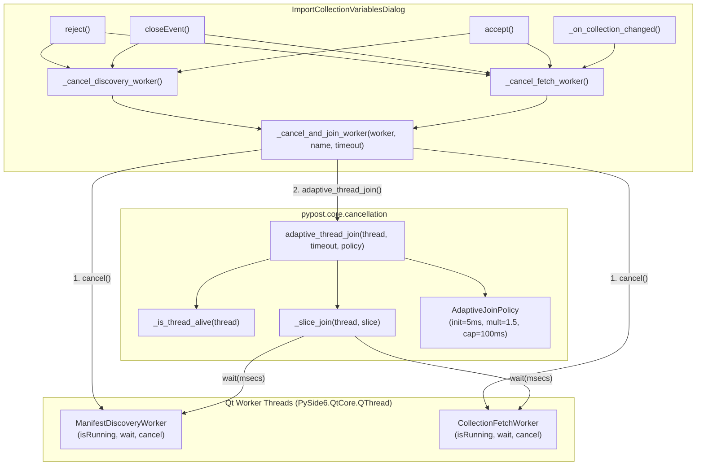
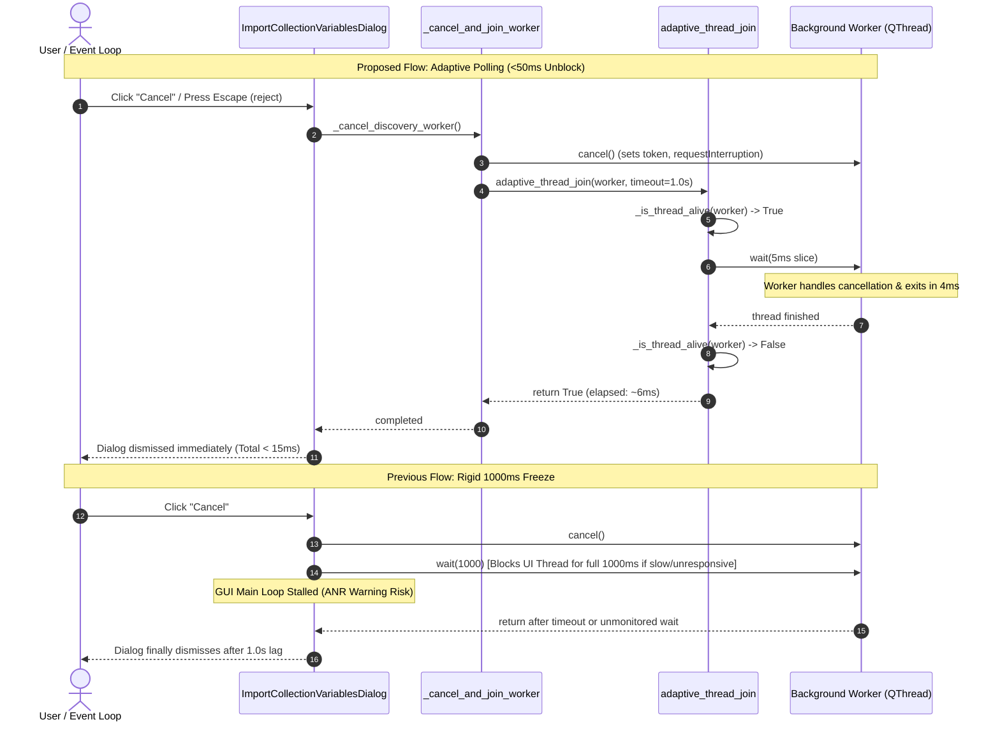

# PYPOST-1453: High-Level Architecture Design — Adaptive Join on Dialog Worker Teardown

## Research

### 1. Existing Thread Termination and Teardown in `ImportCollectionVariablesDialog`
In [`pypost/ui/dialogs/import_collection_variables_dialog.py`](file:///home/src/pypost/ui/dialogs/import_collection_variables_dialog.py),
the import dialog manages two asynchronous Qt background workers:
- `_active_discovery_worker: ManifestDiscoveryWorker | None`: Discovers remote library
  connections and catalog manifests off the UI thread.
- `_active_fetch_worker: CollectionFetchWorker | None`: Retrieves remote collection
  variables and presets from remote endpoints.

Currently, dialog worker teardown is fragmented and relies on rigid `wait(1000)` calls:
```python
# pypost/ui/dialogs/import_collection_variables_dialog.py:333
def _cancel_discovery_worker(self) -> None:
    if self._active_discovery_worker is not None:
        self._active_discovery_worker.cancel()
        self._active_discovery_worker.wait(1000)
        self._active_discovery_worker = None

# pypost/ui/dialogs/import_collection_variables_dialog.py:713
def reject(self) -> None:
    self._discovery_generation += 1
    self._cancel_discovery_worker()
    if self._active_fetch_worker is not None:
        self._active_fetch_worker.cancel()
        self._active_fetch_worker.wait(1000)
        self._active_fetch_worker = None
    ...
    super().reject()

# pypost/ui/dialogs/import_collection_variables_dialog.py:726
def closeEvent(self, event: Any) -> None:
    self._discovery_generation += 1
    self._cancel_discovery_worker()
    if self._active_fetch_worker is not None:
        self._active_fetch_worker.cancel()
        self._active_fetch_worker.wait(1000)
        self._active_fetch_worker = None
    super().closeEvent(event)

# pypost/ui/dialogs/import_collection_variables_dialog.py:735
def accept(self) -> None:
    self._discovery_generation += 1
    self._cancel_discovery_worker()
    if self._active_fetch_worker is not None:
        self._active_fetch_worker.cancel()
        self._active_fetch_worker.wait(1000)
        self._active_fetch_worker = None
    ...
```

Furthermore, during interactive selection changes (`_on_collection_changed`,
`_start_fetch_remote_collection`, `_on_cancel_loading`):
```python
if self._active_fetch_worker is not None:
    self._active_fetch_worker.cancel()
    self._active_fetch_worker = None
```
In these interactive methods, the previous worker is cancelled and its reference dropped
without joining, creating orphaned worker threads running concurrently with superseded
operations.

### 2. Limitations of Rigid 1000ms Synchronous Joins
1. **Perceptible UI Stutter and ANR Danger**: In desktop applications, dialog dismissal
   (pressing Escape, clicking Cancel, or window close) must feel instantaneous. Calling
   `worker.wait(1000)` on the Qt main GUI thread blocks event loop processing. If a worker
   is slow to release an I/O resource or is unresponsive, the window freezes for a full
   1000ms. If both discovery and fetch workers are active, sequential waits freeze the
   application for up to 2000ms, risking OS "Application Not Responding" warnings.
2. **Duplicated Teardown Boilerplate**: Hand-rolled cancellation, waiting, logging, and
   reference clearing are copy-pasted across `reject()`, `closeEvent()`, `accept()`, and
   `_cancel_discovery_worker()`.
3. **No Operational Observability**: A raw `wait(1000)` provides zero diagnostic
   information regarding elapsed drain duration, thread state, or deadline expiration
   warnings.
4. **Thread Interface Divergence**: In PYPOST-1437, `adaptive_thread_join()` was introduced
   in [`pypost/core/cancellation.py`](file:///home/src/pypost/core/cancellation.py) for standard
   Python `threading.Thread` instances. However, Qt workers inherit from
   `PySide6.QtCore.QThread`, which exposes `isRunning()` and `wait(msecs)` rather than
   `is_alive()` and `join(timeout)`. Attempting to pass a `QThread` to `adaptive_thread_join`
   currently raises `AttributeError: 'CollectionFetchWorker' object has no attribute 'is_alive'`.

### 3. PySide6 `QThread` vs Python `threading.Thread` Duck-Typing Contracts
To unify thread join logic across the codebase without coupling core utilities to PySide6
(preserving headless execution per `pypost/core/qt/__init__.py`), `adaptive_thread_join`
must support duck-typing:

| Operation | Python `threading.Thread` | PySide6 `QtCore.QThread` | Duck-Typing Double / Mock |
| --------- | ------------------------- | ------------------------ | ------------------------- |
| **Liveness Check** | `thread.is_alive() -> bool` | `thread.isRunning() -> bool` (or `not thread.isFinished()`) | `is_alive()`, `isRunning()`, or `is_running()` |
| **Join / Wait** | `thread.join(timeout=float_sec)` | `thread.wait(msecs=int_ms) -> bool` | `join(timeout=...)` or `wait(msecs=...)` |
| **Identity / Name** | `thread.name: str` | `thread.objectName() -> str` | `name` attribute or `type(obj).__name__` |

### 4. Adaptive Backoff Join Dynamics
Rather than sleeping for a static 1000ms duration, adaptive polling checks thread completion
with progressive backoff:
- **Initial Slice**: `initial_poll = 0.005s` (5ms). Cooperative cancellations typically
  complete within 1–10ms; the first or second check detects termination immediately (<10ms).
- **Geometric Multiplier**: `multiplier = 1.5x`. Successive slices scale smoothly
  (5ms -> 7.5ms -> 11.2ms -> 16.8ms -> 25.3ms -> 38ms -> 57ms -> 85ms -> 100ms).
- **Cap**: `max_poll = 0.100s` (100ms). Prevents polling slices from blocking the main
  thread for extended windows.
- **Configurable Deadline**: `timeout: float = 1.0s` (default 1.0s for dialog teardown;
  bounds worst-case wait).
- **Observability**: Structured debug logs record slice intervals; informational logs record
  thread drain if duration exceeds `progress_log_interval` (0.5s); structured warning logs
  are emitted if the thread exceeds the maximum deadline.

---

## Implementation Plan

### High-Level Implementation Steps
1. **Extend [`pypost/core/cancellation.py`](file:///home/src/pypost/core/cancellation.py) with Polymorphic Duck-Typing**:
   - Update `adaptive_thread_join` signature to accept `thread: Any | None`.
   - Implement `_is_thread_alive(thread: Any) -> bool`:
     - Checks `thread.is_alive()` if callable.
     - Else checks `thread.isRunning()` if callable.
     - Else checks `thread.is_running()` if callable.
     - Else checks `not thread.isFinished()` if callable.
     - Returns `False` if none match or if `thread` is `None`.
   - Implement `_slice_join(thread: Any, slice_timeout: float) -> None`:
     - If `hasattr(thread, "join")` and callable: `thread.join(timeout=slice_timeout)` (seconds).
     - Else if `hasattr(thread, "wait")` and callable: convert `slice_timeout` to milliseconds
       (`max(1, int(round(slice_timeout * 1000)))`) and call `thread.wait(msecs)`. If `wait`
       raises `TypeError` (e.g. mock expects float seconds), fallback to `thread.wait(slice_timeout)`.
   - Implement `_resolve_thread_name(thread: Any, thread_name: str | None = None) -> str`:
     - Uses explicit `thread_name`, or `thread.name`, or `thread.objectName()`, or `type(thread).__name__`.
   - Preserve 100% backward compatibility for all existing callers of `adaptive_thread_join`.
2. **Centralize Worker Teardown in [`pypost/ui/dialogs/import_collection_variables_dialog.py`](file:///home/src/pypost/ui/dialogs/import_collection_variables_dialog.py)**:
   - Introduce `_cancel_and_join_worker(self, worker: Any | None, worker_name: str, timeout: float = 1.0) -> bool`:
     - If `worker is None`: return `True` immediately.
     - Invoke `worker.cancel()` safely within `try...except Exception`.
     - Delegate to `adaptive_thread_join(worker, timeout=timeout, thread_name=worker_name)`.
   - Refactor `_cancel_discovery_worker(self, timeout: float = 1.0) -> None`:
     - Extract `worker = self._active_discovery_worker`, clear reference to `None`,
       call `_cancel_and_join_worker(worker, "ManifestDiscoveryWorker", timeout)`.
   - Implement `_cancel_fetch_worker(self, timeout: float = 1.0) -> None`:
     - Extract `worker = self._active_fetch_worker`, clear reference to `None`,
       call `_cancel_and_join_worker(worker, "CollectionFetchWorker", timeout)`.
   - Replace all duplicate `wait(1000)` and raw cancellations across:
     - `reject()`: calls `self._cancel_discovery_worker()` and `self._cancel_fetch_worker()`.
     - `closeEvent()`: calls `self._cancel_discovery_worker()` and `self._cancel_fetch_worker()`.
     - `accept()`: calls `self._cancel_discovery_worker()` and `self._cancel_fetch_worker()`.
     - `_on_collection_changed()`: calls `self._cancel_fetch_worker()`.
     - `_start_fetch_remote_collection()`: calls `self._cancel_fetch_worker()`.
     - `_on_cancel_loading()`: calls `self._cancel_fetch_worker()`.
     - `_start_manifest_discovery()`: calls `self._cancel_discovery_worker()`.

---

### Step 3 Failing Repro Test Plan

**File**: [`tests/test_import_dialog_adaptive_worker_join_repro.py`](file:///home/src/tests/test_import_dialog_adaptive_worker_join_repro.py)  
**Timeout**: Module-level `pytestmark = pytest.mark.timeout(30)` per `do-testing` rules.  
**Execution Sequence**: Authored in Step 3 before modifying production code. Runs red on
unpatched code; turns green upon Step 4 implementation.

#### Test Cases and Assertions

1. `test_adaptive_thread_join_polymorphic_qthread_support`:
   - **Setup**: Create a duck-typed worker double exposing `isRunning()` and `wait(msecs)`
     (simulating PySide6 `QThread` without `is_alive` or `join`). Worker runs a background
     task that stops after 10ms.
   - **Action**: Invoke `adaptive_thread_join(worker, timeout=1.0)`.
   - **Assertion**: Returns `True`; elapsed time < 0.150s.
   - **Failure on Unpatched Code**: Unpatched `adaptive_thread_join` strictly calls
     `thread.is_alive()`, raising `AttributeError: 'WorkerDouble' object has no attribute 'is_alive'`.

2. `test_dialog_reject_adaptive_teardown_fast_latency`:
   - **Setup**: Construct `ImportCollectionVariablesDialog` with mock `library_service`.
     Attach active mock discovery and fetch workers that simulate fast cooperative exit (10ms).
   - **Action**: Call `dialog.reject()`.
   - **Assertion**:
     - Teardown completes in elapsed time < 0.100s (sub-50ms nominal).
     - Both `dialog._active_discovery_worker` and `dialog._active_fetch_worker` are `None`.
     - Worker `cancel()` was called on both.
     - No rigid 1000ms blocking join was executed.
   - **Failure on Unpatched Code**: Unpatched dialog invokes `worker.wait(1000)` directly;
     mock call assertion verifies `wait(1000)` was called and `adaptive_thread_join` was not invoked.

3. `test_dialog_close_event_and_accept_centralized_teardown`:
   - **Setup**: Construct dialog with active mock workers.
   - **Action**: Trigger `dialog.closeEvent(event)` and `dialog.accept()`.
   - **Assertion**: Both methods delegate to centralized teardown (`_cancel_discovery_worker`
     and `_cancel_fetch_worker`), clear worker references to `None`, and use adaptive join.
   - **Failure on Unpatched Code**: Fails on unpatched dialog because `closeEvent` and `accept`
     contain duplicated inline `wait(1000)` calls without centralized helper or adaptive join.

4. `test_interactive_collection_switch_cleans_up_previous_fetch_worker`:
   - **Setup**: Simulate active fetch worker in dialog during collection combo change or
     new remote fetch start.
   - **Action**: Trigger `_on_collection_changed()` or `_start_fetch_remote_collection()`.
   - **Assertion**: Prior fetch worker is cancelled and adaptively joined rather than
     abandoned as an un-joined thread.
   - **Failure on Unpatched Code**: Unpatched dialog drops worker reference
     (`self._active_fetch_worker = None`) without waiting/joining.

5. `test_unresponsive_worker_enforces_bounded_deadline_and_logs_warning`:
   - **Setup**: Create an uncooperative worker that fails to terminate when cancelled.
   - **Action**: Trigger dialog teardown with a short test timeout (e.g., `timeout=0.1`).
   - **Assertion**:
     - Teardown does not hang; completes within bounded timeout (~0.1s + slice margin).
     - Does not raise unhandled exceptions.
     - Logs `WARNING` message via `caplog` containing worker name and `exceeded join deadline`.
   - **Failure on Unpatched Code**: Unpatched dialog ignores custom timeout, blocks for
     hardcoded 1000ms, and emits no diagnostic deadline warning log.

6. `test_none_or_already_stopped_worker_returns_instantly`:
   - **Setup**: Construct dialog where `_active_discovery_worker` is `None` and
     `_active_fetch_worker` is already stopped (`isRunning() == False`).
   - **Action**: Call teardown.
   - **Assertion**: Returns in < 0.005s (0ms delay), performing 0 sleep slices.
   - **Failure on Unpatched Code**: Unpatched code has no centralized liveness guard.

---

## Architecture

### System Component Architecture



### Sequence Comparison: Current Rigid Wait vs Proposed Adaptive Join



### Module Responsibilities and Interface Contracts

| Module / Component | Responsibility | Public Interface / Changes |
| ------------------ | -------------- | -------------------------- |
| [`pypost/core/cancellation.py`](file:///home/src/pypost/core/cancellation.py) | Cooperative cancellation primitives and polymorphic adaptive thread joining. | `adaptive_thread_join(thread: Any \| None, timeout: float \| None = None, ...)`<br>`_is_thread_alive(thread: Any) -> bool`<br>`_slice_join(thread: Any, slice_timeout: float) -> None`<br>`_resolve_thread_name(thread: Any, ...) -> str` |
| [`pypost/ui/dialogs/import_collection_variables_dialog.py`](file:///home/src/pypost/ui/dialogs/import_collection_variables_dialog.py) | Modal dialog for previewing and importing collection variables. | `_cancel_and_join_worker(worker: Any \| None, name: str, timeout: float = 1.0) -> bool`<br>`_cancel_discovery_worker(timeout: float = 1.0) -> None`<br>`_cancel_fetch_worker(timeout: float = 1.0) -> None`<br>Refactored `reject()`, `closeEvent()`, `accept()`, `_on_collection_changed()`, `_start_fetch_remote_collection()`, `_on_cancel_loading()`. |
| [`pypost/ui/workers/manifest_discovery_worker.py`](file:///home/src/pypost/ui/workers/manifest_discovery_worker.py) | Background discovery worker (`QThread`). | Unchanged interface; cooperative cancellation token already integrated in PYPOST-1425. |
| [`pypost/ui/workers/collection_fetch_worker.py`](file:///home/src/pypost/ui/workers/collection_fetch_worker.py) | Background fetch worker (`QThread`). | Unchanged interface; cooperative cancellation token already integrated in PYPOST-1425. |

---

## Verification Strategy & Quality Gates

1. **Repro Failure Verification (Step 3)**:
   - Run repro suite: `.venv/bin/pytest tests/test_import_dialog_adaptive_worker_join_repro.py`
   - Confirm tests assert missing polymorphic support and rigid `wait(1000)` calls fail
     before Step 4 changes.
2. **Quality Gates Verification (Step 4 & 5)**:
   - Unit and integration tests: `make test`
   - Static analysis and linting: `make lint` (ensure line lengths <= 100 characters)
   - Baseline type checking: `make typecheck`
   - Task artifacts validation: `make verify-ai-tasks`
3. **Observability Verification (Step 6)**:
   - Caplog assertions verifying:
     - `DEBUG` log: adaptive thread join succeeded with elapsed time.
     - `INFO` log: thread drain progress when duration > 0.5s.
     - `WARNING` log: worker thread exceeded join deadline if unresponsive.

---

## Q&A

**Q: Why not import PySide6.QtCore.QThread in `pypost/core/cancellation.py` for type hints?**  
A: `pypost/core/` is designed to run in headless environments (CLI, background workers, tests
without display). Per `pypost/core/qt/__init__.py`, core utilities must avoid hard PySide6 imports.
Duck-typing inspection (`is_alive` vs `isRunning`, `join` vs `wait`) cleanly decouples the join
helper from Qt while providing complete support for both Qt and standard Python threads.

**Q: What is the unit of timeout in `QThread.wait` vs `Thread.join`?**  
A: Python's `threading.Thread.join(timeout)` accepts seconds as a float. PySide6's `QThread.wait(msecs)`
accepts milliseconds as an integer. `_slice_join` explicitly converts the floating-point second slice
into milliseconds (`max(1, int(round(slice_timeout * 1000)))`) when delegating to `wait()`.

**Q: Why clear worker references (`self._active_discovery_worker = None`, `self._active_fetch_worker = None`) before or during join?**  
A: Setting the reference to `None` immediately ensures subsequent UI events or late signals cannot
reference a tearing-down worker or attempt duplicate joins. The local worker reference is retained
for the duration of the join call and then garbage collected.

**Q: What happens if a worker is blocked in an un-abortable C-extension or network syscall?**  
A: The adaptive join loops until the deadline (default 1.0s). At deadline expiration, it emits a
structured `logger.warning` with the worker name and elapsed duration, returns `False`, and allows
the dialog to finish closing. The UI never deadlocks or hangs indefinitely.
