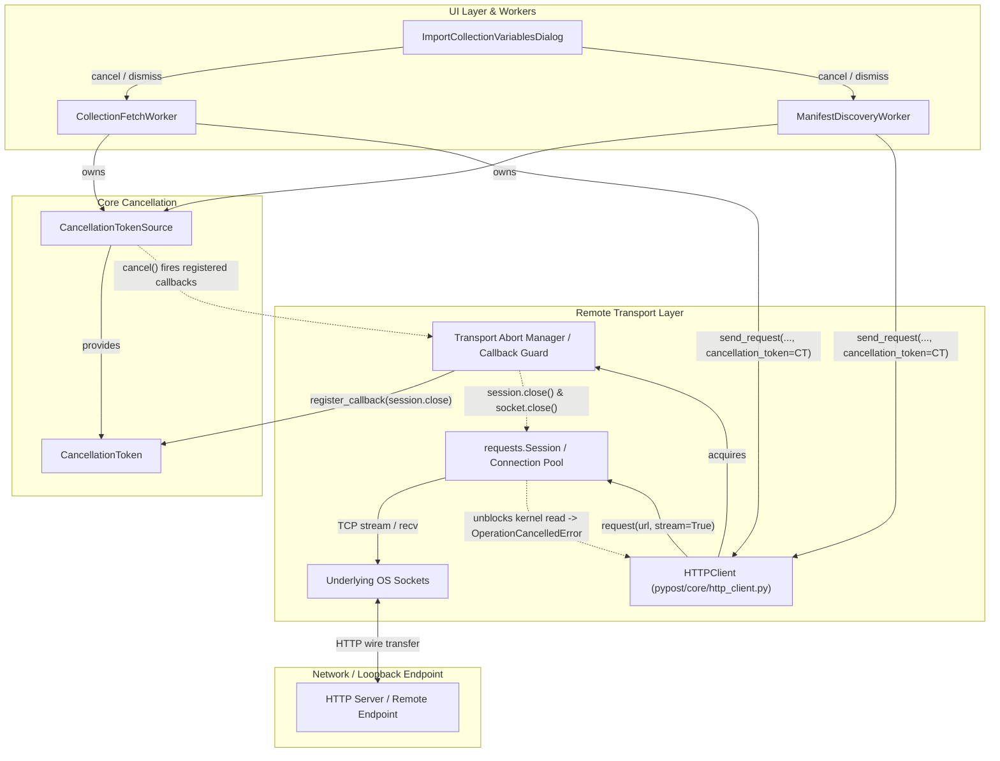

# PYPOST-1454: Real Remote HTTP Transport Abort and Session Teardown Registration

## Research

### Current State of Transports and Cancellation in PyPost

1. **PYPOST-1425 Foundations**:
   - `CancellationTokenSource` and `CancellationToken` in `pypost/core/cancellation.py` provide thread-safe cooperative cancellation signaling.
   - `CancellationToken.register_callback(callback: Callable[[], None]) -> Callable[[], None]` allows registering callbacks invoked synchronously when cancellation is requested (or immediately if already requested) and returns an unregister function.
   - `CollectionFetchWorker` and `ManifestDiscoveryWorker` in `pypost/ui/workers/` instantiate `CancellationTokenSource`, call `_cts.cancel()` on `cancel()`, pass `cancellation_token` to underlying services via `call_with_cancellation_token`, and quietly catch `OperationCancelledError`.

2. **The Missing Link — Real HTTP Transport Abort**:
   - As documented in `ai-tasks/PYPOST-1425/60-tech-debt.md` (Debt item 3) and `ai-tasks/PYPOST-1426/60-tech-debt.md`, current library services (`LibraryManagerService`) perform only discrete cooperative checkpoints between operations via `cancellation_token.throw_if_cancellation_requested()`.
   - Existing unit tests (`test_collection_fetch_transport_abort_repro.py` and `test_remote_collection_fault_injection_repro.py`) simulated transport abort using mock functions that called `cancellation_token.register_callback(aborted.set)`.
   - In production HTTP client operations (`HTTPClient` in `pypost/core/http_client.py`), requests are executed via `requests.Session().request(...)`. `HTTPClient` currently accepts only an optional `stop_flag: Callable[[], bool] | None` which is evaluated exclusively inside `read_streamed_body` *after* the initial HTTP response headers have arrived. If the remote server hangs during connection establishment, TLS handshake, or response header transmission, `stop_flag` is never checked and the worker thread blocks inside `session.request` until `DEFAULT_REQUEST_TIMEOUT` (30 seconds) elapses.
   - `HTTPClient` has no integration with `CancellationToken` or cancellation callbacks.

3. **Behavior of `requests.Session` and Active Sockets Under Concurrent Closure**:
   - In Python's `requests` (backed by `urllib3`), `requests.Session` manages an internal `HTTPAdapter` and `urllib3.PoolManager`.
   - Calling `session.close()` closes all active adapter connection pools and closes underlying socket handles.
   - When `session.close()` or low-level socket shutdown (`sock.shutdown(socket.SHUT_RDWR)` / `sock.close()`) is invoked from another thread while a worker is blocked in `session.request` or `response.raw.read()`, the blocking socket read/poll unblocks immediately in the OS kernel with an error (`requests.exceptions.RequestException`, `urllib3.exceptions.ClosedPoolError`, `urllib3.exceptions.HTTPError`, or `OSError: [Errno 9] Bad file descriptor`).
   - If `cancellation_token.is_cancellation_requested` is checked when these transport exceptions occur, the transport layer can cleanly translate them into `OperationCancelledError`. This prevents misrepresenting user cancellation as an unexpected network crash or presenting false error banners.
   - Once a `requests.Session` has been aborted/closed, pooling state on that instance is invalidated. To allow subsequent requests to succeed cleanly without pool corruption, the transport must discard or recreate the aborted session or instantiate request-scoped / connection-scoped sessions.

4. **Callback Lifecycle and Memory Safety**:
   - To prevent memory leaks or dangling closures when requests finish normally, every registration of `token.register_callback(abort_handler)` must have a guaranteed unregister call in a `finally` block.
   - Registration must handle the case where `token.is_cancellation_requested` is already `True` at request initiation time: `token.register_callback` fires immediately, closing the session/socket before I/O starts, and `token.throw_if_cancellation_requested()` raises `OperationCancelledError` with zero network overhead.

---

## Implementation Plan

### High-Level Execution Phases

1. **Step 2 (Current)**:
   - High-level architecture design and documentation in `ai-tasks/PYPOST-1454/20-architecture.md`.
   - Update roadmap status.

2. **Step 3: Automated Failing Repro Test**:
   - Implement `tests/test_remote_http_transport_abort_repro.py`.
   - The test will set up a real local loopback HTTP server (via `http.server.HTTPServer` or `ThreadingHTTPServer` on `127.0.0.1` on an ephemeral port).
   - The test server accepts an incoming HTTP request, sends headers or stalls indefinitely (e.g. sleeps 10.0 seconds).
   - The test initiates an HTTP request through the real HTTP transport / `HTTPClient` with a `CancellationToken`.
   - While the request is blocked on the network read, `cancel()` is triggered.
   - **Assertion (Red before fix)**: The client must abort immediately (elapsed time < 0.5s, well below the 10s server sleep), the underlying socket/session must be severed, and `OperationCancelledError` must be raised. Prior to Step 4, `HTTPClient` does not register abort callbacks with `CancellationToken`, so it blocks until timeout or fails to unblock promptly, asserting red.
   - Test must run cleanly without external network access, adhering to `@pytest.mark.timeout(30)` and `do-testing` rules.

3. **Step 4: Development**:
   - Implement transport abort registration in `pypost/core/http_client.py` and remote transport abstractions:
     - Add `cancellation_token: CancellationToken | None = None` to `HTTPClient.send_request`.
     - Introduce a reusable transport abort registration context manager (or helper method) `_register_transport_abort(session, cancellation_token, extra_abort=None)`.
     - Register `session.close()` (and active response socket close) with `cancellation_token.register_callback(...)`.
     - In `finally`, invoke the unregister callback to guarantee zero callback leaks.
     - When catching transport/socket exceptions (`requests.RequestException`, `urllib3.exceptions.HTTPError`, `OSError`), check `cancellation_token.is_cancellation_requested`; if True, raise `OperationCancelledError`.
     - When aborted, ensure session state is cleaned up and subsequent requests initialize a fresh or healthy session.
   - Connect remote library / collection retrieval paths to pass `cancellation_token` to HTTP client transports.
   - Verify green status across test suite with `make test`.

4. **Steps 5–8**:
   - Step 5: Code cleanup (`make lint`, `make typecheck`).
   - Step 6: Observability (structured logging for transport aborts and socket closures).
   - Step 7: Technical debt analysis.
   - Step 8: Dev docs updates (`doc/dev/workspace_environment_variable_import.md` and related docs).

---

## Architecture

### System Module Diagram



### Module Responsibilities and Lifecycle

| Module | Responsibility | Cancellation Lifecycle Handling |
| --- | --- | --- |
| `CancellationTokenSource` & `CancellationToken` (`pypost/core/cancellation.py`) | Thread-safe cooperative signal dispatch and callback registry. | Invokes all registered transport abort callbacks upon `cancel()`. Idempotent; catches callback errors safely. |
| `HTTPClient` (`pypost/core/http_client.py`) | Outbound HTTP request execution and response streaming. | Accepts optional `cancellation_token`. Registers session abort callback before network dispatch. Translates abort-induced socket/session errors into `OperationCancelledError`. Disposes/recreates closed session on demand. |
| `TransportAbortGuard` (helper context manager in `pypost/core/http_client.py` or `remote_transport.py`) | Scoped callback registration and socket shutdown coordinator. | `__enter__`: registers callback on token to close `session` and any active sockets. `__exit__`: unregisters callback to avoid memory leaks. Handles thread-safe atomic state transitions. |
| `CollectionFetchWorker` (`pypost/ui/workers/collection_fetch_worker.py`) | Background QThread retrieving remote collection payloads. | Passes `_cts.token` to underlying fetch/HTTP call. On `cancel()`, triggers `_cts.cancel()` which immediately severs the active HTTP session. Catches `OperationCancelledError` quietly without emitting `fetch_failed`. |
| `ManifestDiscoveryWorker` (`pypost/ui/workers/manifest_discovery_worker.py`) | Background QThread discovering remote library manifests. | Passes `_cts.token` to catalog listing/fetch calls. On `cancel()`, triggers `_cts.cancel()`. Catches `OperationCancelledError` quietly without emitting `discovery_failed`. |

### Module Interaction Scheme

#### Happy Path (Success)
1. Worker calls `http_client.send_request(request_data, cancellation_token=token)`.
2. `HTTPClient` registers `session.close` callback on `token`. Callback handle returned.
3. Network request and response streaming complete successfully.
4. `finally` block unregisters callback from `token`.
5. Response returned to worker; worker emits completed signal.

#### Cancellation In-Flight (Mid-Stream or Mid-Connect)
1. Worker starts `http_client.send_request(request_data, cancellation_token=token)`.
2. `HTTPClient` registers `session.close` callback on `token`.
3. Worker thread enters `session.request` or `read_streamed_body(response)`.
4. User clicks Cancel in GUI or closes dialog.
5. GUI thread calls `worker.cancel()`, which calls `token_source.cancel()`.
6. `token_source` synchronously executes the registered callback (`session.close()`).
7. The operating system unblocks the worker thread with a socket exception (`ConnectionReset`, `Bad file descriptor`, or `ClosedPoolError`).
8. `HTTPClient` catches the exception, checks `token.is_cancellation_requested`, and raises `OperationCancelledError`.
9. `finally` block unregisters callback and marks the session for re-initialization.
10. Worker catches `OperationCancelledError`, logs debug message, and exits cleanly in < 0.5s without emitting error signals.

#### Token Already Cancelled Before Request
1. User cancels before worker begins HTTP dispatch.
2. `HTTPClient` checks `token.throw_if_cancellation_requested()`.
3. `OperationCancelledError` is raised immediately without opening sockets or initiating connections.

### Selected Architectural Patterns and Justification

1. **Callback-Driven Active Transport Abort (Observer / Cancellation Token Pattern)**:
   - *Justification*: Passive polling (e.g. checking `stop_flag` or checking token periodically) cannot interrupt a thread blocked in a synchronous OS socket read or connect syscall. An active callback registered with the cancellation token allows the cancelling thread to immediately sever the transport handle, forcing kernel-level read termination.
2. **Resource Acquisition Is Initialization (RAII) / Scoped Registration Guard**:
   - *Justification*: Transport abort callbacks must be registered *only* for the duration of the in-flight network call. Using a context manager (`TransportAbortGuard`) guarantees that callback handles are unregistered upon normal completion, error, or cancellation, preventing callback accumulation and memory leaks.
3. **Exception Translation / Separation of Concerns**:
   - *Justification*: Low-level socket aborts typically manifest as generic socket or connection errors (`OSError: [Errno 9]`, `requests.exceptions.ConnectionError`). The transport layer inspects the cancellation token to translate these expected abort errors into `OperationCancelledError`, preventing spurious "connection broken" error banners from surfacing to users.
4. **Session Rejuvenation / Resilience**:
   - *Justification*: Closing a `requests.Session` closes its connection pools. Subsequent requests executed by the same client must not fail due to a closed pool. The transport layer lazily recreates or resets the underlying session if the previous session was severed by cancellation.

### Interfaces and APIs

```python
class HTTPClient:
    def send_request(
        self,
        request_data: RequestData,
        variables: Dict[str, str] | None = None,
        stream_callback: Callable[[str], None] | None = None,
        stop_flag: Callable[[], bool] | None = None,
        headers_callback: Callable[[int, Dict], None] | None = None,
        cancellation_token: CancellationToken | None = None,
    ) -> HTTPRequestResult:
        """Execute request with optional cooperative cancellation and transport abort.

        When cancellation_token is provided, registers an abort callback that closes
        the active HTTP session and response sockets immediately if cancellation
        is signaled, unblocking any active network reads.
        """
        ...
```

---

## Q&A

- **Q: Why is `session.close()` sufficient for aborting an in-flight HTTP request?**
  **A:** `requests.Session` manages `urllib3.PoolManager`. When `session.close()` is called, `PoolManager.clear()` is invoked, which closes all active pooled connections and disconnects open TCP sockets. Any thread currently blocked in `recv()` on one of those sockets immediately unblocks with an `EBADF` or connection error.

- **Q: How does the transport distinguish between intentional user cancellation and a genuine remote server drop?**
  **A:** When a connection or socket error occurs, the transport checks `cancellation_token.is_cancellation_requested`. If `True`, the abort was intentionally triggered by cancellation, and the error is translated to `OperationCancelledError`. If `False`, it was an unexpected network failure and the original `ExecutionError(category=ErrorCategory.NETWORK)` is raised.

- **Q: How do we prevent callback leaks when many requests are made over the application lifetime?**
  **A:** The registration context manager unregisters the callback in a `finally` block as soon as the network request completes, errors out, or aborts. `CancellationTokenSource.dispose()` also releases all references when workers shut down.

- **Q: Does subsequent request execution still work if a previous request was aborted?**
  **A:** Yes. If `session.close()` was executed during an abort, `HTTPClient` resets its internal `session` reference (or instantiates a fresh `requests.Session()`) so subsequent requests have a clean, valid connection pool.

- **Q: Can this be tested hermetically without real internet access?**
  **A:** Yes. Using Python's built-in `http.server.HTTPServer` on `127.0.0.1` with a handler that delays or blocks response transmission, tests can initiate a real HTTP TCP connection, trigger cancellation, and measure exact abort latency (< 0.5s) without external dependencies.
