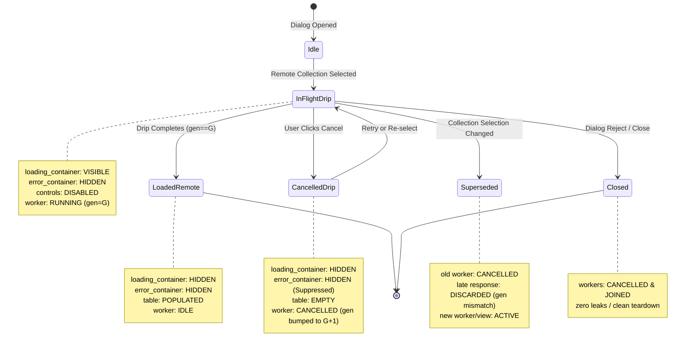
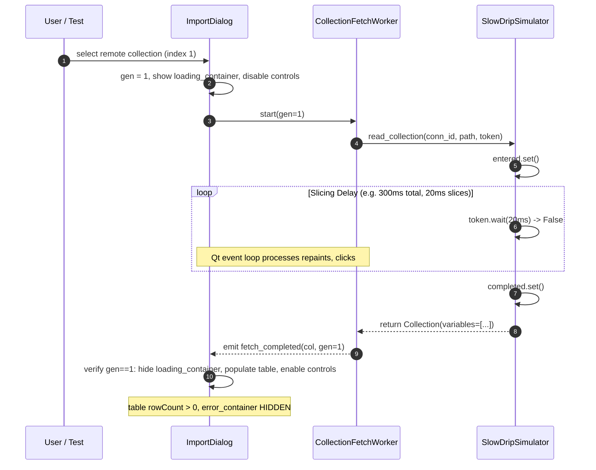

# PYPOST-1457: Slow-Drip / Delayed-Success Remote Read Characterization

## Research

### Context and Problem Analysis

In PyPost, `ImportCollectionVariablesDialog`
(`pypost/ui/dialogs/import_collection_variables_dialog.py`) enables users to inspect and import
variables from remote collections into environments. Background reading is offloaded to
`CollectionFetchWorker` (`QThread`), communicating back to the dialog via Qt signals
(`fetch_completed(object, int)` and `fetch_failed(Exception, int)`).

Prior hardening tasks established robust handling for hard network errors and cancellation:
- **PYPOST-1424**: Introduced non-modal loading chrome, retry controls, and basic timeout handling.
- **PYPOST-1425**: Implemented cooperative transport abort via `CancellationToken` and
  `call_with_cancellation_token`.
- **PYPOST-1426**: Added fault-injection coverage for hard failures: TCP resets, mid-stream broken
  pipes, truncated JSON manifests, and malformed schemas
  (`tests/helpers/remote_collection_faults.py`,
  `tests/test_remote_collection_fault_injection_repro.py`).

However, technical debt item 3 in PYPOST-1426 identified a critical missing scenario: **slow-drip /
delayed-success remote reads**. On high-latency or throttled connections, data dribbles in slowly
over hundreds of milliseconds or seconds before completing cleanly without network errors.

This introduces distinct concurrency hazards and UX invariants:
1. **In-Flight Loading Persistence**: The loading indicator (`loading_container`) and label must
   remain active for the full drip duration. Actions (Import button, preset combo) must stay
   disabled.
2. **Spurious Error Suppression**: Because no failure occurred, the error banner (`error_container`)
   must remain strictly suppressed during the drip and upon successful completion.
3. **UI Thread Responsiveness**: Qt event loop processing must remain smooth (< 50ms latency per
   iteration) while worker threads wait or slice delays in the background.
4. **Clean Eventual Population**: When data transfer finishes, the loading chrome must hide, and the
   variables table and preview summaries must populate accurately without corruption or truncation.
5. **Prompt Mid-Drip Cancellation**: Clicking "Cancel" on the loading container must cooperatively
   signal abort, terminate the worker without hanging, clear loading chrome, and leave the table
   empty without surfacing false failure banners.
6. **Selection Supersession**: If the user switches collections mid-drip, the active worker's
   generation is bumped. When the slow stream finishes late, its results must be quietly discarded
   (`gen != _fetch_generation`) without overwriting the user's new view.
7. **Dialog Dismissal Teardown**: Closing or rejecting the dialog while a slow drip is underway
   must cancel and join workers cleanly within the dialog teardown budget without orphan threads.

### Existing Patterns in Codebase

- **Worker Threading**: `CollectionFetchWorker` inherits `QThread`, manages
  `CancellationTokenSource`, and invokes `library_service.read_collection` through
  `call_with_cancellation_token`.
- **Cancellation**: `CancellationToken` provides `.is_cancellation_requested`,
  `.throw_if_cancellation_requested()`, `.wait(timeout)`, and `.register_callback(fn)`.
- **Adaptive Join**: `adaptive_thread_join` (`pypost/core/cancellation.py`) polls thread state with
  exponential backoff (5ms to 100ms) to ensure responsive joins without busy-waiting.
- **Test Double Infrastructure**: `tests/helpers/remote_collection_faults.py` provides
  `build_library_service` and side effects for simulating network anomalies without live sockets.

### Architectural Gap

Currently, `tests/helpers/remote_collection_faults.py` lacks a dedicated, reusable simulator for
delayed-success slow drips with cooperative cancellation polling and synchronization events.
There are no automated characterization tests verifying the full state lifecycle, mid-drip
cancellation promptness, selection supersession, or dialog teardown during slow-drip reads.

## Implementation Plan

1. **Test Double Enhancement (`tests/helpers/remote_collection_faults.py`)**:
   - Design and implement `SlowDripSimulator` and `slow_drip_collection_side_effect`.
   - Support configurable total delay, slice interval, cancellation token polling, synchronization
     events (`entered`, `completed`, `cancelled`), and mock collection payloads.
   - Guarantee bounded execution and sub-50ms cooperative abort latency.

2. **Failing Repro Suite (`tests/test_remote_collection_slow_drip_repro.py`)**:
   - Create Step 3 automated characterization test suite asserting all DOD contracts.
   - Exercise loading chrome persistence, error suppression, eventual population, mid-drip
     cancellation, supersession on collection change, dialog close teardown, zero-variable
     collections, and UI event loop responsiveness.

3. **Production Hardening (if necessary)**:
   - If characterization reveals any race conditions (e.g. edge-case state inconsistency on cancel
     at exact completion or teardown timeout), apply minimal surgical hardening in
     `ImportCollectionVariablesDialog` or `CollectionFetchWorker`.

4. **Code Quality and Cleanup (Step 5)**:
   - Enforce 100-character line limit, flake8 compliance, mypy typing cleanliness, and baseline
     metrics gates via `make lint`, `make typecheck`, and `make check-baseline-metrics`.

5. **Observability and Documentation (Steps 6 & 8)**:
   - Validate structured logging for slow-drip completion, cancellation, and stale discard.
   - Document slow-drip contracts in `doc/dev/workspace_environment_variable_import.md`.

### Mandatory — Failing Repro (next Step 3)

The failing repro test suite will be created at:
`tests/test_remote_collection_slow_drip_repro.py`

**Scope and Target Behaviors:**
- Asserts that while a remote collection read is slowly dripping, `loading_container` remains
  visible, `error_container` is hidden, and action controls are disabled.
- Asserts that upon delayed completion, `loading_container` hides, `error_container` remains
  hidden, and the variables table and presets populate accurately.
- Asserts that clicking "Cancel" mid-drip aborts the worker promptly (< 0.5s), suppresses error
  banners, leaves table empty, and increments fetch generation.
- Asserts that switching collections mid-drip supersedes the active fetch, cleanly discarding
  late arrivals without corrupting the active selection view.
- Asserts that closing or rejecting the dialog mid-drip cleanly terminates background threads
  without leaking zombies or raising unhandled exceptions.
- Asserts that the Qt event loop processes events smoothly with bounded latency during slow drips.

**Initial Red Repro Failure Point:**
The suite will be created before the helper and characterization tests are finalized in Step 4.
The test file initially asserts the new contracts against `SlowDripSimulator`. If run prior to
helper implementation or before edge case validation, missing symbols or race assertions will
render the suite red.

## Architecture

### System Overview and Interactions

The slow-drip characterization architecture models the interaction between the Qt UI layer, the
background fetch worker thread, and a simulated high-latency remote library service.

```mermaid
flowchart TD
    subgraph TestSuite["Test Architecture"]
        ReproTest["test_remote_collection_slow_drip_repro.py"]
        DripSim["SlowDripSimulator / slow_drip_side_effect"]
    end

    subgraph UILayer["PyPost UI Layer"]
        Dialog["ImportCollectionVariablesDialog"]
        Combo["collection_combo"]
        LoadingChrome["loading_container"]
        ErrorChrome["error_container"]
        VarsTable["vars_table / model"]
    end

    subgraph ConcurrencyLayer["Threading & Worker Layer"]
        Worker["CollectionFetchWorker (QThread)"]
        CTS["CancellationTokenSource / Token"]
    end

    ReproTest -->|instantiates| Dialog
    ReproTest -->|configures| DripSim
    Dialog -->|spawns on remote selection| Worker
    Worker -->|monitors| CTS
    Worker -->|calls read_collection| DripSim
    DripSim -->|polls cooperative cancellation| CTS
    Worker -->>|fetch_completed signal| Dialog
    Dialog -->|updates view| VarsTable
    Dialog -->|hides/shows| LoadingChrome
    Dialog -->|suppresses| ErrorChrome
    Combo -->|selection switch bumps gen| Dialog
    Dialog -->|cancel()| Worker
```

### Module Responsibilities

| Module / Component | Responsibility |
| --- | --- |
| `tests/helpers/remote_collection_faults.py` | Hosts `SlowDripSimulator` and `slow_drip_collection_side_effect`, providing slicing delay logic with cooperative token polling and synchronization events. |
| `tests/test_remote_collection_slow_drip_repro.py` | Step 3 automated characterization suite validating all slow-drip lifecycle states, cancellation, supersession, and UI responsiveness. |
| `pypost/ui/dialogs/import_collection_variables_dialog.py` | UI controller managing dialog lifecycle, loading/error chrome visibility, generation sequencing, and worker thread cancellation. |
| `pypost/ui/workers/collection_fetch_worker.py` | Dedicated `QThread` executing remote collection reads in background, holding `CancellationTokenSource`, and emitting Qt completion/failure signals. |
| `pypost/core/cancellation.py` | Cooperative cancellation primitives (`CancellationToken`, `CancellationTokenSource`, `adaptive_thread_join`, `call_with_cancellation_token`). |

### Design of `SlowDripSimulator`

`SlowDripSimulator` encapsulates a controllable, cooperative delayed-success read:

```python
class SlowDripSimulator:
    """Simulates a high-latency remote read that drips data before succeeding."""

    def __init__(
        self,
        collection: Collection | None = None,
        total_delay_s: float = 0.3,
        slice_interval_s: float = 0.02,
        max_duration_s: float = 5.0,
    ) -> None:
        self.collection = collection or recovered_collection()
        self.total_delay_s = total_delay_s
        self.slice_interval_s = slice_interval_s
        self.max_duration_s = max_duration_s
        self.entered = threading.Event()
        self.completed = threading.Event()
        self.cancelled = threading.Event()
        self.slices_elapsed = 0

    def __call__(
        self,
        connection_id: str,
        collection_path: str,
        cancellation_token: CancellationToken | None = None,
        **kwargs: Any,
    ) -> Collection:
        self.entered.set()
        start = time.monotonic()
        while (time.monotonic() - start) < self.total_delay_s:
            if time.monotonic() - start > self.max_duration_s:
                break
            if cancellation_token is not None:
                if cancellation_token.is_cancellation_requested:
                    self.cancelled.set()
                    raise OperationCancelledError("Slow drip cancelled via token")
                if cancellation_token.wait(timeout=self.slice_interval_s):
                    self.cancelled.set()
                    raise OperationCancelledError("Slow drip aborted during slice")
            else:
                time.sleep(self.slice_interval_s)
            self.slices_elapsed += 1

        if cancellation_token is not None and cancellation_token.is_cancellation_requested:
            self.cancelled.set()
            raise OperationCancelledError("Slow drip cancelled at completion boundary")

        self.completed.set()
        return self.collection
```

**Key Architectural Properties:**
1. **Cooperative Slice Polling**: Slices are small (20ms) so cancellation aborts almost immediately
   (< 30ms) without waiting for the full delay.
2. **Token Wait Integration**: Uses `cancellation_token.wait(timeout=slice_interval_s)` which wakes
   up instantly if cancelled during a sleep slice.
3. **Synchronization Events**: `entered`, `completed`, and `cancelled` allow test cases to
   synchronize deterministically without arbitrary sleeps.
4. **Boundary Checks**: Checks cancellation both during slices and at the completion boundary.

### Characterization Matrix and State Transitions

| Starting State | Trigger / Event | Target State | Loading Chrome | Error Banner | Table Content | Worker Status |
| --- | --- | --- | --- | --- | --- | --- |
| `IDLE` (Workspace) | Select Remote Collection | `IN_FLIGHT_DRIP` | Visible ("Loading...") | Hidden | Empty (0 rows) | Worker running (Gen G) |
| `IN_FLIGHT_DRIP` | Drip Completes Cleanly | `LOADED_REMOTE` | Hidden | Hidden | Populated with vars | Worker terminated (None) |
| `IN_FLIGHT_DRIP` | Cancel Button Clicked | `CANCELLED_DRIP` | Hidden | Hidden (Suppressed) | Empty (0 rows) | Worker cancelled & joined |
| `IN_FLIGHT_DRIP` | Switch to Other Col | `SUPERSEDED` | Updated for new target | Hidden | Updated for new target | Old worker discarded; new started |
| `IN_FLIGHT_DRIP` | Dialog Reject / Close | `CLOSED` | Hidden / N/A | Hidden / N/A | N/A | Worker cancelled & joined |
| `IN_FLIGHT_DRIP` | Drip Completes (Empty) | `LOADED_EMPTY` | Hidden | Hidden | Empty ("No variables") | Worker terminated (None) |

### State Transition Diagram



### Sequence Diagram: Delayed-Success Lifecycle



### Sequence Diagram: Mid-Drip Cancellation and Supersession Race

```mermaid
sequenceDiagram
    autonumber
    participant U as User / Test
    participant D as ImportDialog
    participant W1 as Worker 1 (gen=1)
    participant S1 as SlowDrip 1
    participant W2 as Worker 2 (gen=2)

    U->>D: select collection A (remote)
    D->>W1: start(gen=1)
    W1->>S1: read_collection(..., token_1)
    S1->>S1: entered.set(), begins slow drip

    alt Mid-Drip User Cancellation
        U->>D: click cancel_loading_btn
        D->>D: gen bumped to 2
        D->>W1: cancel() -> token_1.cancel()
        S1-->>W1: raises OperationCancelledError
        D->>W1: adaptive_thread_join()
        Note over D: loading_container hidden, error suppressed, table empty
    else User Switches to Collection B Mid-Drip
        U->>D: select collection B (gen bumped to 2)
        D->>W1: cancel()
        D->>W2: start(gen=2)
        Note over S1,W1: S1 finishes late in background
        W1-->>D: emit fetch_completed(col_A, gen=1)
        D->>D: gen mismatch (1 != 2) -> STALE DISCARD
        Note over D: col_A discarded; view awaits W2 or displays B
    end
```

### Determinism, Timeout Budgeting, and UI Responsiveness Guarantees

1. **No External Network Dependencies**: All tests run in-process using mock services and
   `SlowDripSimulator`.
2. **Explicit Pytest Timeout**: All test modules and functions are marked with
   `@pytest.mark.timeout(30)` to prevent deadlocks in CI.
3. **Bounded Slices**: Drip intervals default to ~200ms-300ms total with 20ms polling slices,
   keeping test suite execution fast (< 5s for the entire file).
4. **Adaptive Backoff Joins**: Dialog and test teardown use `adaptive_thread_join` with bounded
   timeouts (1.0s) ensuring zero test hangs.
5. **Event Loop Non-Starvation**: UI responsiveness test monitors maximum dispatch latency during
   slicing to verify that worker thread operations never starve the Qt main thread.

## Verification Strategy and Quality Gates

### Test Execution Commands (Make-Only)

In accordance with repository guidelines, all testing and validation must be executed via `make`:

```bash
# Verify AI tasks integrity
make verify-ai-tasks

# Run the slow drip characterization test suite
make test PYTEST_ARGS="tests/test_remote_collection_slow_drip_repro.py"

# Run existing fault injection suite to verify zero regressions
make test PYTEST_ARGS="tests/test_remote_collection_fault_injection_repro.py"

# Code formatting and linting
make lint

# Type checking against baseline gate
make typecheck

# Full combined quality gate
make check
```

## Q&A

- **Q: Why is `SlowDripSimulator` designed as a slicing loop rather than a single `time.sleep`?**
  - **A**: A single `time.sleep` blocks the thread and prevents responsive reaction to
    cooperative cancellation tokens. Slicing with `cancellation_token.wait(timeout)` allows
    cancellation to abort within milliseconds while accurately simulating streaming latency.
- **Q: Does delayed-success remote read require modifying `CollectionFetchWorker`?**
  - **A**: `CollectionFetchWorker` already uses `call_with_cancellation_token` and quiet handling
    for `OperationCancelledError`. If characterization confirms complete contract adherence,
    production code remains untouched, maintaining strict backward compatibility.
- **Q: How is UI thread responsiveness tested without real human interactions?**
  - **A**: A dedicated test measures the latency of processing queued Qt events while a background
    slow-drip worker is actively running, asserting that event loop dispatch latency remains < 50ms.
- **Q: How is late response discard verified during supersession?**
  - **A**: A test simulates switching collections mid-drip, lets the initial worker complete late,
    and asserts that the dialog's `_fetch_generation` check discards the stale completion and leaves
    the newly selected collection data intact.
