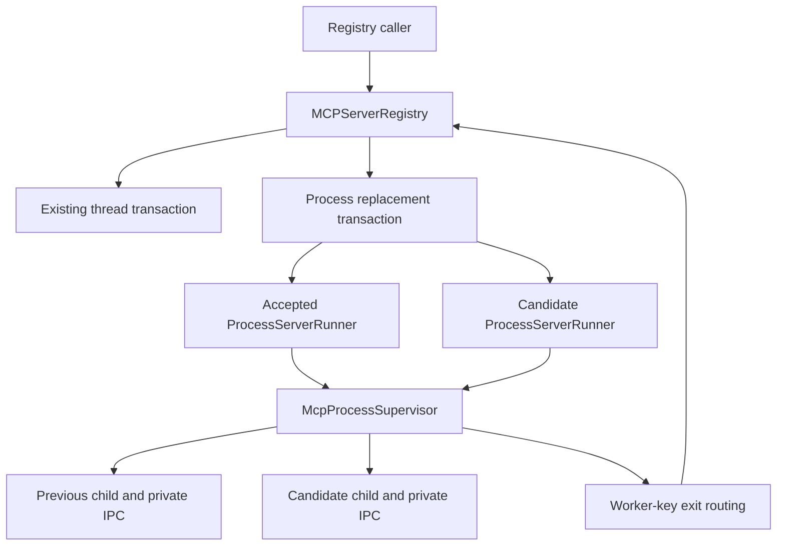

# PYPOST-1463: Supervised Process Reconfiguration

## Research

### Repository findings

- `MCPServerRegistry.reconfigure` validates a replacement, then indexes `_managers[id]`.
  Process startup populates `_runners` instead, so running process edits raise `KeyError`.
- `ProcessServerRunner.start` waits for the supervisor's bounded STARTED acknowledgement.
  Its stop path already delegates cooperative stop and escalation to the supervisor.
- `McpProcessSupervisor` indexes children by worker identity and owns their IPC readers.
  An additional candidate cannot reuse a live child's worker identity.
- Existing registry reconfiguration signals are consumed by callers; public configuration
  identity and `reconfiguration_finished(id, committed)` must remain stable.
- Parent task PYPOST-1439 explicitly deferred candidate-then-commit process reconfiguration.
  Existing thread reconfiguration tests in `tests/test_mcp_server_registry.py` remain regression
  coverage; process isolation helpers provide real local-worker integration fixtures.

### External guidance

The [Python multiprocessing documentation](https://docs.python.org/3/library/multiprocessing.html)
describes timeout-based joins and warns that forced termination can damage IPC resources.
Consequently each child keeps its own connection and is reclaimed through its supervisor;
replacement workers receive fresh connections. No Qt object crosses the process boundary.

This design retains the existing explicit `spawn` context and adds no dependency or wire protocol.

## Implementation Plan

1. Write the Step 3 red acceptance tests described below, then obtain independent review.
2. Branch to a process-specific reconfiguration transaction after existing validation and runtime
   resolution, before indexing thread managers. Leave the thread transaction unchanged.
3. Give each replacement a unique internal worker key on the existing shared supervisor.
   Keep the public configuration ID unchanged. Route exit notifications by the accepted runner's
   worker key rather than assuming that every supervisor key is a public configuration ID.
4. Retain the previous accepted start snapshot and runner until the replacement is acknowledged
   and the former worker is reclaimed. Restore the snapshot on failed same-endpoint replacement.
5. Cover cancellation/stop ordering, failed restoration, resource reclamation, secret-safe
   diagnostics, and existing thread behavior. Run the relevant suites through `make test`.

### Failing Repro: Step 3

Add `tests/test_mcp_process_reconfigure_repro.py` with explicit timeout marks and bounded waits.
Use real local process workers for success/rollback/port ownership, plus fault injection at the
runner start boundary for deterministic startup failures. No live remote dependency is required.

| Case | Desired assertion | Failure on current code |
| --- | --- | --- |
| Same endpoint | Accepted settings change; isolated worker serves new runtime | Thread-manager KeyError |
| Changed endpoint | New endpoint serves; old endpoint released after commit | Thread-manager KeyError |
| Candidate fails | Previous settings remain accepted; old endpoint still serves | No process transaction |
| Same endpoint fails | Old runtime is restarted and usable; completion is false | No process rollback |
| Restoration fails | Prior configuration retained; truthful failed state and bounded return | No recovery outcome |
| Neighbor continuity | Peer tools and worker stay independent across each outcome | No process transaction |
| Stop ordering | Stop concurrent with change leaves no late running endpoint | No process lifecycle ordering |
| Candidate cleanup | Failed child is reclaimed and candidate endpoint can be rebound | No candidate cleanup |

Assert outcomes through `configuration`, `status`, `is_running`, completion signals, local MCP
calls, and port rebinding. Avoid asserting private helper names as the behavioral contract.
Fault-injection tests may inspect supervisor ownership to prove that a failed candidate is gone.
Retain thread reconfiguration tests as regressions. Sequence is research, red tests, review,
production fix, then green checks; Step 3 must not change production code.

## Architecture

### Components and interfaces

- **Registry** owns public configuration, status, completion signals, and the accepted runner.
  `reconfigure(instance_id, configuration) -> None` retains its public signature. Validation
  failures raise before any child is disturbed. A process attempt emits exactly one completion
  result after validation, following existing thread semantics.
- **Process transaction** stays internal to the registry or a focused core helper. It owns the
  accepted configuration, previous runtime snapshot, previous runner, candidate runner, and
  outcome. It coordinates lifecycle only; it never constructs an MCP thread manager.
- **Process runner** keeps the supervisor worker key distinct from configuration identity.
  Expose a read-only worker identity for callback routing and a copied accepted start snapshot
  for recovery. Existing `start`, `stop`, `is_running`, and `update_variables` remain the lifecycle
  surface. Snapshot values include tools, variables, and hidden/overridable key sets.
- **Supervisor** remains the only process/IPC owner. Spawn waits for STARTED or bounded failure;
  stop returns whether the child was reclaimed. Failed startup always triggers candidate cleanup.
  A failed stop must retain ownership for later cleanup rather than silently forget a live child.
- **Worker** is unchanged: START and STOP use the existing messages and isolated runtime.

### Transaction and concurrency rules

1. Preserve existing identity, port, and reference validation before disrupting the accepted
   worker. Resolve replacement inputs independently of the prior snapshot.
2. Serialize process replacement with lifecycle stop/commit using `_reconfiguration_lock`.
   A simple bounded synchronous transaction under this lock is acceptable for this task because
   process startup is already synchronous. Do not wait for supervisor monitor callbacks to
   acquire that same lock while joining a worker. Peer child processes continue serving.
3. For a changed endpoint, keep the previous child serving while the candidate starts under its
   unique worker key. For the same endpoint, require successful prior stop before candidate start.
4. Require acknowledged startup and candidate liveness before accepting the replacement. Reclaim
   the old child before final success. Publish the replacement configuration and runner together;
   then publish running status and completion true.
5. On candidate failure, stop and reclaim it. If the previous runner is still alive, retain it.
   Otherwise start a new process runner from the previous accepted snapshot. Restore configuration
   and accepted runner, publish running when recovered, and emit completion false.
6. If cleanup or restoration fails, retain every live worker's ownership, keep the previous
   configuration accepted, publish failed status, and emit completion false. Never claim running
   merely because a spawn call returned. Cleanup must remain reachable by stop/stop_all.
7. Stop arriving during a serialized replacement runs after the transaction and stops its final
   accepted runner plus any retained cleanup ownership. Thus no late completion resurrects a
   stopped row. Clear/stop_all must also include retained candidate ownership.
8. Exit callbacks resolve worker keys against current accepted runners. Candidate or retired
   generations cannot mark a different accepted generation failed. A genuine accepted-child exit
   still produces the existing failed status. No supervisor-table lock is held while invoking
   registry callbacks.

### Failure and observability boundaries

Use lifecycle phase, public instance ID, endpoint port, and stable failure category for diagnostics.
Do not publish runtime values, headers, tool payloads, or unsanitized exception text that may
contain secrets. Preserve useful outcome categories such as candidate startup, old-worker cleanup,
and restoration failure. Existing registry metrics/status publication remains authoritative.

Startup uses the existing finite supervisor startup timeout; every stop uses existing finite
escalation budgets. Recovery is one bounded attempt rather than an automatic restart loop.

## Q&A

**Why keep internal worker identity separate?** A changed-endpoint candidate coexists with the
old child. Unique keys prevent process-table collisions and stale exit notifications while the
operator continues to see one stable server identity.

**Why preserve the previous runtime snapshot?** Re-resolving mutable collections or environments
after a failed edit could restore different credentials/tools. Recovery must use the last accepted
runtime, including accepted variable updates.

**Does this implement proxy parity or automatic recovery?** No. Those remain separate sprint
issues. This transaction restores service only after a rejected explicit configuration change.
