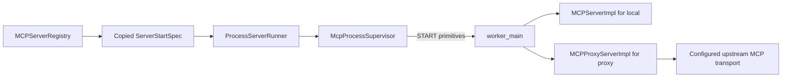

# PYPOST-1464: Process Proxy Startup Parity

## Research

`ThreadServerRunner` and the registry's thread startup already select proxy behavior using
`McpServerConfiguration.server_type`. `ProcessServerRunner.start` drops that selection and
the upstream settings; the supervisor sends only local-server inputs, and `worker_main`
always creates `MCPServerImpl`. This explains the execution-mode gap.

`MCPProxyServerImpl` already forwards tools, prompts, and resources using Streamable HTTP or
legacy SSE. It accepts upstream URL, transport, header templates, timeout, and variable/key
suppliers. Reusing it preserves existing header resolution and connection timeout semantics.
No proxy protocol or transport implementation needs to be duplicated.

The [Python multiprocessing documentation](https://docs.python.org/3/library/multiprocessing.html)
requires transferable connection data to be picklable and documents the explicit spawn model.
Send only primitive configuration data; construct proxy clients and application objects in
the child. Keep the existing private parent-child pipe and spawn context.

## Implementation Plan

1. Add and independently review the red tests below before production changes.
2. Carry `server_type`, `upstream_url`, `upstream_transport`, copied `headers`, and `timeout`
   from `ServerStartSpec.configuration` through `spawn_worker` into START.
3. Select `MCPProxyServerImpl` in the child for proxy START; retain the current local branch
   and register local tools only there. Pass the existing snapshot suppliers to both branches.
4. Make the repro green, then run existing proxy, process-isolation, and reconfiguration
   regressions through `make test`. Check lint through the repository Makefile.

### Failing Repro: Step 3

Add a focused `tests/test_mcp_process_proxy_repro.py` with explicit timeout marks and bounded
startup/teardown. Use a loopback upstream MCP server; no external service is needed.

- Parameterize existing upstream transport choices and prove a proxy started through the
  actual process runner discovers and invokes a uniquely named upstream tool. Assert that
  configured header templates resolve from that proxy's variables at the upstream boundary.
  Current code starts a local server and cannot return that upstream tool.
- Verify the START settings boundary with a capturing supervisor/pipe test: the configured
  upstream address, transport, copied header mapping, and nondefault timeout reach the child.
  This supplements the behavioral test by checking a timeout value without a slow timer test.
- Exercise a changed proxy configuration through the existing registry lifecycle and verify
  forwarding changes to the new upstream while an unrelated local worker remains usable.
  Stop owned workers in `finally` and verify endpoint release. The accepted startup snapshot
  must retain all proxy settings for the existing reconfiguration recovery path.

Keep tests focused on this missing settings/implementation selection; existing proxy tests
cover operation-specific forwarding and timeout/error semantics. Existing process
reconfiguration tests retain rollback, same-endpoint, and cleanup-failure coverage.

## Architecture

### Responsibilities and Interfaces

- **Registry and start specification** remain the source of validated configuration and
  resolved variable snapshots. The copied `ServerStartSpec` introduced by PYPOST-1463 already
  contains complete configuration, so recovery requires no separate proxy snapshot format.
- **Process runner** forwards the five proxy selection/settings fields from that configuration
  alongside existing tool and variable inputs. No runtime proxy client crosses the boundary.
- **Supervisor** extends `spawn_worker` with optional typed proxy fields using current local
  defaults (`local`, no upstream, Streamable HTTP, empty headers, 30-second timeout). It copies
  the headers into START. Existing local callers remain source compatible.
- **Worker** selects the existing implementation from START and supplies name, upstream settings,
  and its `_SnapshotStore` suppliers to the proxy. Omitted selection retains local behavior.
  Both implementations expose `create_app`, so the serving helper accepts their union and
  retains the existing STARTED, STOP, and process reclamation behavior.
- **Proxy implementation** continues to own forwarding, dynamic header resolution, and transport
  timeout behavior. UPDATE_VARIABLES keeps updating the shared store, so future proxy requests
  read the latest accepted variables without exposing another worker's state.

### Lifecycle and Security

Candidate startup and recovery use the same runner path as initial startup. Public identity,
private candidate identity, serialized reconfiguration, and cleanup ownership from PYPOST-1463
remain unchanged. The child constructs a fresh proxy per worker; upstream clients stay inside
the proxy's existing per-operation connection contexts.

Do not log START payloads, upstream URLs, header values, or variable snapshots. Existing runner
failure categories and proxy sanitized diagnostics remain authoritative. Forward templates as
configuration and resolve them inside the owning worker using its own variable snapshot.
Startup success means the local proxy listener is ready; upstream reachability remains an
operation outcome, consistent with existing thread proxy behavior.

## Q&A

**Does this change the IPC version?** No. These are additive START fields with local defaults;
version negotiation remains the separate PYPOST-1467 scope.

**Does timeout become a new lifecycle deadline?** No. It retains the existing upstream request
meaning in `MCPProxyServerImpl`; supervisor startup/stop budgets remain separate.

**Are new transports or retry policies introduced?** No. Reuse the existing proxy implementation
and its supported transport choices, preserving thread execution and local process behavior.
